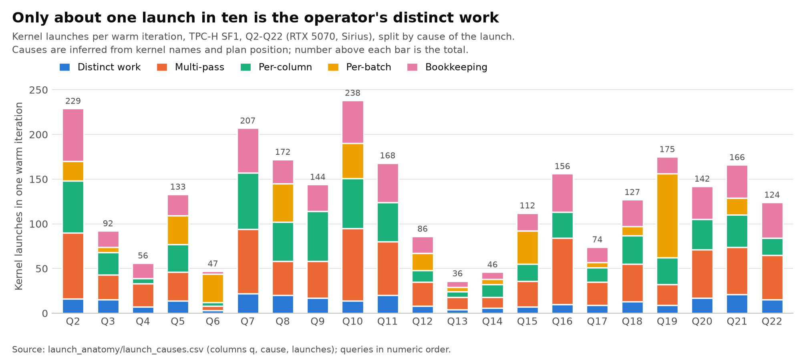
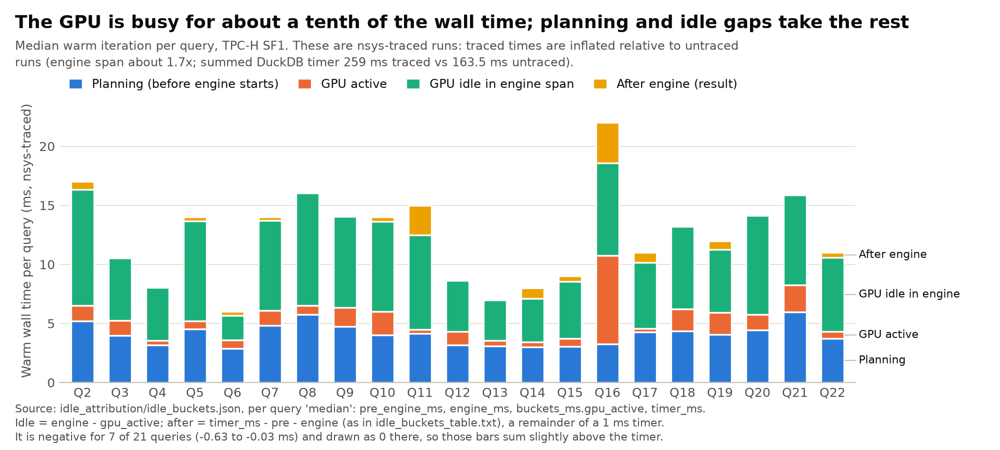
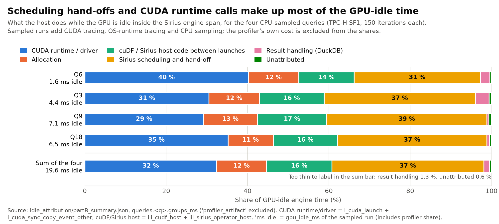
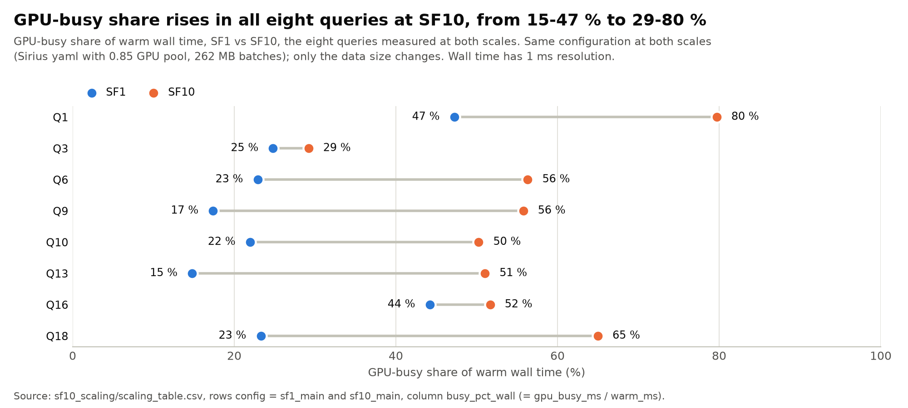
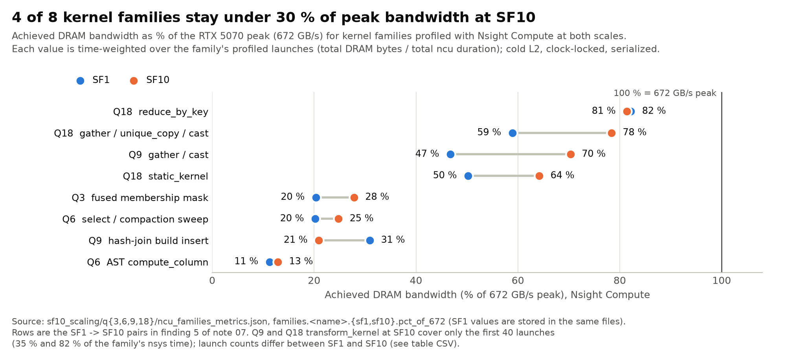
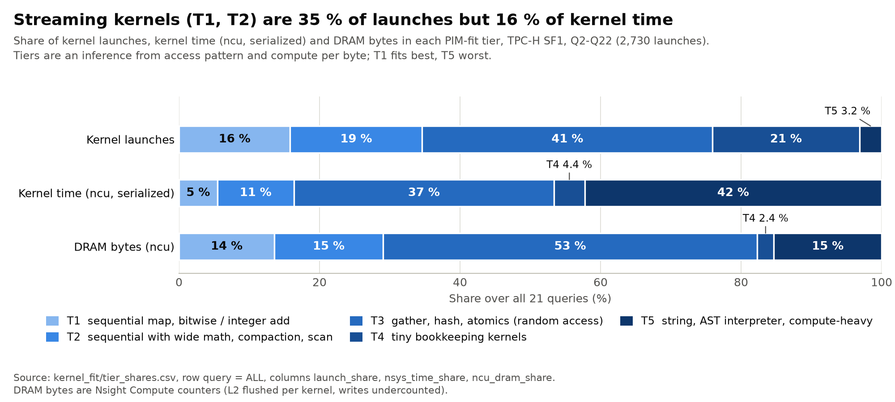
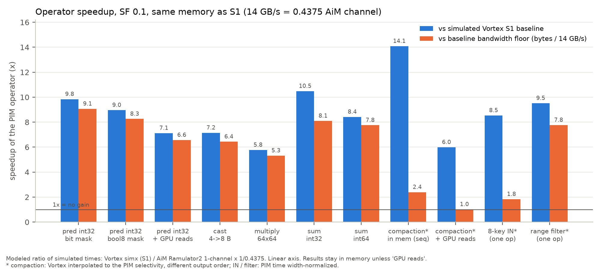
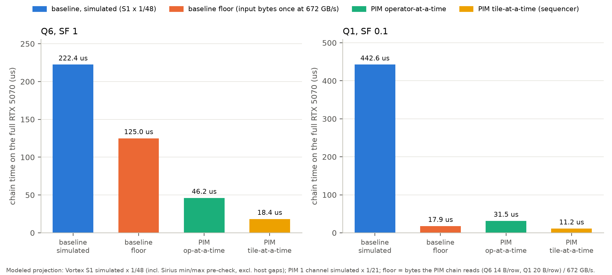
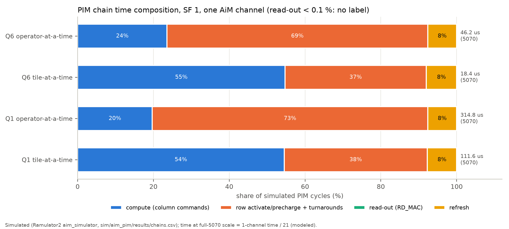
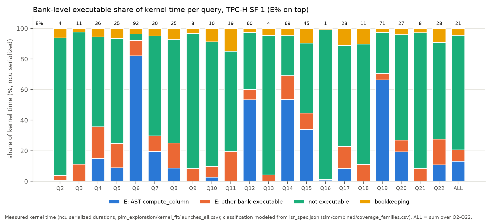

# Where can PIM speed up GPU SQL operators? — findings report

**Date:** 2026-11-13 · **Workload:** TPC-H on Sirius (DuckDB + libcudf), RTX 5070 (12 GB GDDR7, 672 GB/s, 48 SMs)
**Method:** real-GPU profiling (existing nsys/ncu data, Q2–Q22 at SF1; 8 queries re-timed at SF10) → Vortex GPU
simulator as a scaled-down RTX 5070 baseline → SK hynix AiM simulator with a database processing unit → speedups.
**Status:** reviewed once by an independent reviewer (about 200 numbers checked against the data files); its
corrections are applied here and its full findings are in [`notes/12_independent_review.md`](notes/12_independent_review.md).

**Labels:** *measured* = real GPU; *simulated* = Vortex simx or the AiM Ramulator2 model; *modeled* = an assumption
stated next to the number; *inferred* = a reading of evidence, not a measurement. PIM does not exist on the real
machine, so every PIM number is a projection.

**Terms used below**

- **Bank unit** — the processing unit next to each DRAM bank in AiM-style memory, extended here with database circuits.
- **Row tile** — the data layout the bank unit needs: each DRAM row of a bank holds the same T records of every column
  the chain uses, plus scratch space for intermediates.
- **Operator-at-a-time** — the memory runs one general operator over the whole table, then the next (the way Sirius
  launches kernels). **Tile-at-a-time** — the whole chain of general operators runs on one open DRAM row before moving
  to the next row.
- **GPU floor** — the time a GPU needs to move an operator's input (and output) bytes once at its full memory
  bandwidth: the best any memory-bound GPU kernel or plan could do.
- **AST kernel** — cuDF's expression-interpreter kernel (`compute_column`), which evaluates predicates and arithmetic.

Detailed findings behind each section are in [`notes/`](notes/); each number there names the script and file that
produces it.

---

## 1. Bottom line

1. **What PIM gains is the input rate the bank unit sustains relative to the memory's external pins — and only for
   streaming operators.** Against the GPU floor on the same bytes, the bank unit is **5–9× faster on predicate, cast,
   multiply and sum**, **6.8× on the Q6 chain** (it reaches 43 % of the 16× internal bandwidth advantage) and **1.6×
   on the Q1 chain** (compute-bound inside the bank). PIM is simulated on one channel and scaled to the same memory as
   the GPU (*modeled*). The larger ratios against the simulated Vortex baseline (12× for Q6, 40× for Q1) also contain
   a change of query plan and baseline inefficiency and should not be quoted as the PIM effect.
2. **Your "chain operators without going back to the GPU" idea is the most important design point, for a reason
   other than data movement.** Operator-at-a-time PIM spends 69–73 % of its time re-opening DRAM rows; tile-at-a-time
   is **2.5–2.8× faster**. Operator-at-a-time PIM is only 2.7× over the GPU floor on Q6 and *slower* than the floor on
   Q1 (0.57×; 0.79× at cuDF's column widths). Tile order needs either an in-memory sequencer or a host that can
   stream the commands without waiting for each one (§6.3).
3. **Keeping operators general costs little.** Q6 as four general operations (three compares and a masked
   multiply-accumulate) is 6–9 % slower than a fused Q6 command.
4. **The bank unit cannot run most of what TPC-H spends GPU time on.** Sort, hash build/probe, gather and string
   kernels need data in other banks. Across Q2–Q22 at SF1 it can execute about **21 % of the real-clock kernel
   time**; an infinitely fast unit would improve summed SF1 wall time by **at most about 1.04×** (kernel time only).
   Q6 and Q1 are the favourable cases (wall up to 2.2× and 3.1× at SF10 with an infinitely fast unit, upper bounds).
5. **Every PIM gain assumes tables already sit in the row-tile layout.** Converting Q6's columns from the GPU's
   layout is estimated at 250 µs — twice the GPU's whole floor time for Q6, and 14× the PIM chain.
6. **The observations that motivated this are true at SF1 but are mostly not PIM arguments.** Untraced, the GPU is
   idle about 82 % of SF1 wall time, but that is planning, Sirius scheduling and CUDA runtime overhead — largely
   software. For the 8 queries rerun at SF10 the busy share rises from 15–47 % to 50–80 % (Q3 stays at 25 → 29 %).
   The launch count is driven by batch size, per-column kernels and multi-pass algorithms, most of it removable in
   software.
7. **Group-by → sort is not where the data is.** In TPC-H between 2 and 37,922 groups reach the sort (2.2 MB in total
   over 13 queries), and sort is not bank-executable. By bytes, the chains that matter are dynamic-filter probe →
   compaction → gather (189 MB), the group-by's internal steps (160 MB), predicate → compaction → gather (73 MB) and
   expression → aggregate (40 MB).

---

## 2. Your starting hypotheses, tested

| # | Hypothesis | Verdict | Key evidence |
|---|---|---|---|
| 1 | Very many launches; the same kernel re-run on subsets of the data | **Partly.** Many launches, yes (36–238 per query at SF1). Re-running on data subsets is the smallest *repeat* cause at SF1 (14 %) but dominates at SF10 (Q1: about 90 % of 873 launches, *inferred*) | only 9.8 % of launches are an operator's essential kernel; Q1 launches about 67 kernels per batch at every scale; batch size is a Sirius setting |
| 2 | The GPU is idle most of the query time | **True at SF1, mostly a small-data effect.** GPU busy 17.6 % of untraced wall at SF1 (Q2–Q22); 50–80 % at SF10 in 7 of the 8 queries measured | idle time = planning + scheduling/hand-off, CUDA runtime, allocation, host code |
| 3 | Q1's group-by is not fully memory-bound, so PIM cannot be claimed from it | **Confirmed.** 11–22 % of peak bandwidth at SF10; 67 % at best after unrolling (SF1) | at SF10 the kernels near peak bandwidth (64–81 %) are gathers, unique-copy and reduce-by-key, which the bank unit cannot run; the scan/expression kernel it can run stays at 13 % |
| 4 | In-memory execution avoids the memory → SM → memory trip and the per-step launch | **True for streaming operators (5–9× vs the GPU floor); not available for gather/hash/sort at bank level.** | operator and chain results in §6 |
| 5 | Operators that follow each other should be chained in memory (group-by → sort) | **The mechanism is right, the example is not.** Chaining gives 2.5–2.8× inside PIM; group-by → sort carries almost no data and sort is not bank-executable | round-trip intermediates are a median 0.7 % of engine time at SF1 |

---

## 3. What the real GPU shows

### 3.1 Why one operator becomes many launches

Of 2,730 launches in the 21 warm iterations (*measured*; cause assigned from the cuDF/Sirius source, *inferred*):
distinct work 9.8 %, multi-pass steps 31.5 %, per-column repeats 23.3 %, bookkeeping on tiny inputs 21.9 %, per-batch
repeats 13.6 %. 78 % of launches run under 5 µs and 37 % are a single thread block.

- The host reads a value back from the GPU about 0.4 times per launch (1,207 read-backs): compaction output sizes,
  string sizes, join sizes, group counts. 407 of them are one-byte flags that are not data-dependent.
- The batch count follows from Sirius's memory-limit setting (batch = GPU capacity ÷ 40); a model of that rule
  reproduces every scan repeat in the traces. Q1 at SF10 launches 3,865 kernels with the SF1 profiling configuration
  and 873 with the larger pool used for SF10 (both *measured*); with no usage limit the batch model predicts 6 batches
  instead of 12.
- **Removable without PIM:** batching configuration, multi-column gather, over-allocating instead of reading sizes
  back, skipping redundant pre-checks. **Only in-memory execution removes** the memory → SM → memory trip of each pass.

### 3.2 What happens while the GPU is idle

Summed over the 21 queries in the nsys-traced runs (tracing inflates host time: 259 ms traced vs 163.5 ms untraced):
planning 33 %, GPU active 11 %, GPU idle inside the engine 52 %, after the engine 4 %. On the untraced wall the GPU
is busy 17.6 %. CPU sampling of Q6, Q3, Q9 and Q18 splits the idle engine time:

- Sirius scheduling and thread hand-off 37 % (for 29 % of the idle time no application thread is on a CPU at all),
  CUDA runtime/driver 32 %, cuDF and Sirius host code between launches 16 %, allocation 12 %.
- Untraced engine time ≈ 483 µs + 18.3 µs per launch + 1.28 × kernel time (R² = 0.97).
- An in-memory operator chain could remove at most 45–60 % of the idle engine time (*inferred*); planning (2.8–5.1 ms
  in the four sampled queries, comparable to the whole engine span at SF1), scheduling between pipelines and result
  handling remain. Much of the removable part is software structure that a GPU-only change could also remove.

### 3.3 What changes at 10× the data

- GPU-busy share of untraced wall time (*measured*, same configuration at both scales): Q1 47 → 80 %, Q6 23 → 56 %,
  Q9 17 → 56 %, Q18 23 → 65 %; Q3 stays at 25 → 29 %.
- Launches grow with data ÷ batch size, not with data alone (Q6: about 15 per batch). Extra launches are cheap in
  wall time (Q1: 2.8 µs each) because they overlap GPU work across the four pipeline threads.
- Some kernels slow down faster than the data grows because tables stop fitting in the 48 MB L2: the Q9 hash-join
  build takes 65× longer for 10× the data.

- **Near peak bandwidth at SF10** (*measured*, Nsight Compute; two families cover only their first 40 launches):
  gather/cast/unique-copy kernels 64–78 % and reduce-by-key 81 % of 672 GB/s — none of them bank-executable.
  **Latency-bound:** the AST kernel 13 %, hash-join build 21 %, membership mask 28 %, compaction 25 %, Q1's
  aggregation kernel 11–22 %. So on the real GPU the scan kernels PIM could replace are latency-bound even at SF10,
  and part of that gap is closable by a better GPU kernel.

### 3.4 Which kernels fit in-memory logic

Tiers are an inference from access pattern and compute per byte: T1 sequential with compare/add; T2 sequential with
multiply or data-dependent output; T3 random access or atomics; T4 tiny launches; T5 heavy compute or string control
flow. Kernel-time shares in this chart use Nsight Compute's serialized durations. At SF1 the clean streaming tiers
T1 + T2 are 35 % of launches but 16 % of kernel time; one sort kernel family alone is 28 % of serialized kernel time
(31 % of real-clock time) while moving 0.2 % of the bytes. The median kernel uses 1.3 % of peak bandwidth at SF1.
The AST kernel is in T5 here because, as a GPU kernel, it is an interpreter with heavy compute per byte; §6.3 counts
it as bank-executable because the *work* it does (compares and arithmetic) maps onto the bank unit's commands.

### 3.5 Operator chains

Intermediates written by one kernel and read by the next total 632 MB over the 21 queries; moving them is a median
0.7 % of engine time (*modeled* at 672 GB/s), and about 81 % are small enough to stay in the L2 cache (*inferred*).
The gaps between chained steps cost more than the kernels (37.9 ms vs 27.8 ms, *measured*); 350 of 886 steps wait for
a size read-back (median 33.6 µs). The most frequent chains — mask → compaction → gather (all 21 queries),
probe → retrieve → gather, the group-by's internal steps — can all be expressed as general operator A followed by
general operator B.

---

## 4. What existing PIM hardware and the two papers say

- **Shipping bank-level PIM cannot run a SQL step.** Samsung HBM-PIM and SK hynix GDDR6-AiM execute 16-bit
  floating-point multiply/add only; there is no compare, so not even a filter bitmap. Database operations need new
  circuits — which is what §5 models.
- **Both papers you supplied find that only filtering wins clearly.** Membrane keeps aggregation, sort and join on the
  CPU. PIMDAL (UPMEM) loses to a GPU on sort (0.9×) and join (0.3×) because data must move between memory units
  through the host; on TPC-H at SF40 it reports beating an A6000 running cuDF by 2.2× on Q1 and 3.3× on Q6 — the same
  two queries that are the favourable cases here (its GPU pays PCIe transfers, ours does not).
- **Current PIM is paced by host commands**, one per step. Logic in the HBM base die is the only placement that could
  reach all banks (and so gather, partition or sort), but it has no bandwidth advantage over the GPU.

---

## 5. How the simulation was set up

**Baseline — Vortex as a scaled-down RTX 5070** (your rules: multi-kernel like Sirius, 32 threads per warp, bandwidth
and caches scaled, L3 off). One Vortex core stands for one SM, so the scale factor is cores ÷ 48.

| Configuration | Cores × warps × threads | Memory bandwidth | L1 / L2 / L3 | Streaming read achieved (*simulated*) |
|---|---|---|---|---|
| S1 (1/48 of the GPU) | 1 × 32 × 32 | 14 GB/s (4 narrow GDDR6 channels) | 128 KB / 1 MB / off | 13.8 GB/s = 98.6 % |
| S4 (1/12) | 4 × 32 × 32 | 56 GB/s | 128 KB per core / 4 MB / off | 52.6 GB/s = 93.9 % |

- Memory latency is 299.6 ns (real card: 299 ns). The 128 KB L1 is an inference for this GPU generation.
- Three simulator artifacts were fixed with patches before any result was taken: writes were free; every store first
  fetched its line; thread stacks collided in a few cache sets.
- The operators are separate OpenCL kernels chained by a host driver with resident buffers ("Sirius-structured":
  13 launches for Q6, 42 for Q1, derived from the real traces; bookkeeping launches on tiny inputs are omitted and
  priced separately). All 115 runs match their references exactly, Q6 and Q1 against DuckDB.
- Your rule 3 was tested: at the same memory, a second core speeds up the latency-bound kernels (narrow predicate
  1.44×, group-by 1.45×, compaction 1.34×) while more warps barely help; the chains below use the plain S1.

**PIM — AiM bank unit with database circuits.** New all-bank commands with their own timing: integer compare
→ 1-bit mask, element-wise add/multiply/widen with write-back to the row, masked multiply-accumulate, sum, group
aggregation with 8 accumulators, bank-local compaction with a per-bank count, mask read-out. Compare and add fit
AiM's 2-cycle slot; multiply uses four pipelined 32×32 multipliers per bank. Refresh — which the simulator never
issued — was fixed and costs 7–9 %. Your earlier Q6 result reproduces exactly (20,865 cycles at SF1). Every operator
has a bit-exact functional model checked against DuckDB.

**Same memory on both sides.** A GDDR6-AiM channel is 32 GB/s outside and 512 GB/s inside, so a GPU memory system of
bandwidth B is treated as B ÷ 32 channels: 21 channels for the full 5070, 0.44 channel for S1 (*modeled*, linear;
a direct simulation of a 1/21 share agrees within 0.4 %).

---

## 6. Simulation results

### 6.1 Single operators

S1 memory, SF 0.1. Baseline times are *simulated*; PIM times are simulated on one channel and scaled to S1's memory
(*modeled*).

| Operator | Vortex baseline (µs) | % of bandwidth | PIM (µs) | Speedup vs baseline | Speedup vs GPU floor |
|---|---:|---:|---:|---:|---:|
| Predicate (int32) → mask, result stays in memory | 232.8 | 93 | 23.7 | 9.8× | 9.1× |
| … mask read back by the GPU | 232.8 | 93 | 32.7 | 7.1× | 6.6× |
| Cast 4 → 8 bytes, written back | 571.9 | 91 | 80.0 | 7.2× | 6.4× |
| Multiply 64×64, written back | 1,116.9 | 93 | 193.4 | 5.8× | 5.3× |
| Sum (int64) | 372.6 | 94 | 44.2 | 8.4× | 7.8× |
| Compaction, result stays in memory (sequencer) | 407.0 (*modeled*, interpolated) | 40 | 28.9 | 14.1× | 2.4× |
| … packed rows read back by the GPU | 407.0 | 40 | 67.9 | 6.0× | 1.0× |

- For the memory-bound kernels the two speedups agree within 8–11 %; for compaction (latency-bound in the simulator
  and on the real GPU) only the floor comparison is meaningful. Host-paced compaction is 1.75× over the floor.
- **A result that must be read out to the GPU loses much of the gain**: reading one word per bank is limited by row
  activation to about 10 GB/s per channel, a third of the external bandwidth.
- Gather, hash build/probe, sort and strings have no bank-level implementation. Group-by was run on both sides but
  with different key and aggregate layouts, so no speedup is given.

### 6.2 Operator chains

Times projected to the full RTX 5070 — all *modeled* from simulations: the baseline is the S1 run × 1/48, PIM is the
one-channel run ÷ 21. Q6 is at SF 1 and Q1 at SF 0.1 (Q1 was not simulated at SF 1 on Vortex).

| | Q6, SF 1 (µs) | Q1, SF 0.1 (µs) |
|---|---:|---:|
| (a) Baseline: Sirius-structured multi-kernel chain | 222.4 (13 launches) | 442.6 (42 launches) |
| (b) GPU floor at the PIM run's column widths | 125.0 (14 B/row) | 17.9 (20 B/row) |
| (b2) GPU floor at cuDF's column widths | 125.0 | 25.0 (28 B/row, string flags) |
| (c) PIM operator-at-a-time | 46.2 | 31.5 |
| (d) PIM tile-at-a-time | 18.4 | 11.2 |
| Fused Q6 command (reference only, not general) | 17.3 | — |
| **Speedup (b)/(d) — the PIM-specific number** | **6.8×** | **1.6×** (2.2× with b2) |
| Speedup (b)/(c) | 2.7× | 0.57× (0.79× with b2) |
| Speedup (a)/(d) — includes plan change and baseline inefficiency | 12.1× | 39.6× |

- The PIM Q6 plan replaces compaction + gather by a masked aggregate. A GPU could do the same, which is why (b)/(d)
  is the fair comparison.
- Q1 is compute-bound inside the bank unit (51 GB/s of input per channel, 10 % of the internal peak): its
  intermediates must fit in the 2 KB row next to the inputs (T = 32 records), and five group aggregates share the
  adders. Simulated at SF 1, PIM Q1 takes 111.6 µs against a 178.7 µs floor — the same 1.6×.
- The Q1 baseline runs at 17.7× its 28 B/row floor mainly because its 42 kernels write and re-read full-width
  intermediates (387 B/row of memory traffic at 78 % of bandwidth) with caches emptied at every launch; launch cost
  and string gathers (26 %) add to it. The simulator's low issue rate (about 0.8 warp-instructions per cycle per core
  against 4 for a real SM) matters for the latency-bound group-by.
- With a realistic 2.5 µs launch cost instead of the simulator's, the baselines are 252 µs and 540 µs.
- S4 gives the same speedups as S1 once launch cost is amortised (ratio 1.004 for Q6 at SF 1).

(This chart shows both chains at SF 1.) Row activation and precharge fall from 69 % to 37 % of PIM time (Q6) and from
73 % to 38 % (Q1) going from operator-at-a-time to tile-at-a-time; refresh is about 8 %.

### 6.3 Host term, query level and coverage

- **End to end, Q6 at SF 1, full scale** (*modeled*). PIM with a sequencer takes 26–29 µs. Against the GPU floor plus
  one launch gap that is **5.0×** (4.6× if commands are synchronous). Against the simulated Sirius-structured
  baseline — 371 µs = 222 µs kernels + 141 µs host gaps + 7.5 µs omitted launches, or 319 µs if the size read-backs
  are removed in software, which needs no PIM — it is 14× and 12×. None of these include the layout conversion
  (250 µs if paid per query, which would make PIM 0.48× of the floor).
- **How commands are issued decides whether PIM works.** In tile order without a sequencer, the host issues 11,732
  commands per channel for Q6 at SF 1 and 199,470 for Q1. If they stream as posted writes (assumed 1 ns each,
  overlapped with execution) this is as fast as a sequencer; if each waits a 300 ns round trip, Q6 is 10× and Q1 27×
  slower, and only a sequencer works. With a sequencer Q1 still needs 197 host commands per query (192 are
  accumulator read-outs): under the synchronous model that drops it to 0.32× of the GPU floor at SF 0.1 and 1.04× at
  SF 1. Both per-command costs are assumptions, not measurements.
- **Query level on the real GPU** (Amdahl; *measured* inputs, *modeled* result). These are upper bounds: saved kernel
  time is assumed to be on the critical path, and the replaceable share includes kernels (compaction, gathers) that
  the masked-aggregate plan removes — a GPU plan could drop those too. Planning, host time and non-replaceable
  kernels stay.

| Run | Share of GPU-busy time the unit can replace | Wall speedup at s = (b)/(d) | Wall speedup using the projected PIM chain time | Wall speedup if the unit were infinitely fast |
|---|---:|---:|---:|---:|
| Q6, SF 1 | 91 % | 1.23× | 1.27× | 1.28× |
| Q6, SF 10 | 98 % | 1.85× | 2.10× | 2.17× |
| Q1, SF 1 | 77 % | 1.13× | 1.43× | 1.46× |
| Q1, SF 10 | 87 % | 1.34× | 2.85× | 3.14× |

- **Across Q2–Q22 at SF1** (chart on Nsight Compute's serialized durations: 20.5 % executable; on real-clock nsys
  durations: **21.4 % executable, 75.4 % not executable, 3.3 % bookkeeping** of 27.8 ms). Best cases: Q6 92 %,
  Q19 71 %; worst: Q16 1 %, Q2 4 %. The resulting bound on summed untraced SF1 wall time is 1.04× (kernel time only;
  host gaps not included).
- **What the bank unit cannot run** (75 % of SF1 kernel time): sort about 35–39 %, hash and membership about 17 %,
  strings about 11 %, gather about 6 %.
- **Two thirds of the executable time is the AST kernel** (68 %), which the real GPU runs latency-bound at 11–13 % of
  bandwidth — a better general GPU kernel would recover part of that without PIM. Excluding it, the wall bound is
  1.01×.
- The classification is optimistic in places: the AST kernel is counted as executable even where it runs on join
  outputs that are not in row-tile layout (Q19's alone is a fifth of the executable time); IN-lists are assumed to
  have ≤ 8 keys; compaction is counted although reading its output back erases the gain. Q1, the second-best case,
  is outside Q2–Q22.

---

## 7. What this means for the project

1. **The PIM case is a streaming-scan case at scale, not a launch-count case.** It applies to predicate, expression,
   reduction and small-group aggregation, and it needs data large enough that the GPU is busy.
2. **Run chains in tile order, and prefer a sequencer.** Per-row chaining of general operators is worth 2.5–2.8×
   inside PIM and removes the size read-backs between steps (one per batch between compaction and gather; two per
   batch in Q1's group-by). A sequencer needs a short micro-program (about 16 entries), a row counter, constants, and
   mask and accumulator registers per bank; without it the design depends on streaming ~10⁴–10⁵ commands per channel.
3. **Avoid reading intermediates out.** Masks and compacted rows should feed the next in-memory operator; anything
   the GPU must fetch per row erases the gain.
4. **To go beyond scans, the logic has to reach other banks.** Sort, hash, strings and gather are 75 % of SF1 kernel
   time. A base-die or controller-level unit could plausibly take gather and hash probe (about 23 % of kernel
   time); sort and strings would still stay on the GPU.
5. **Data layout is a first-order cost.** PIM pays off only if tables stay in row-tile layout across queries.

---

## 8. Limitations

- **Area, power and thermal limits are not modeled.** No synthesis tool was available; circuits are specified at
  datapath level with timing argued from published numbers. Membrane reports about 4× peak DRAM power in all-bank
  mode. Results are most sensitive to multiplier throughput (Q6 is 1.78× slower if a multiply slot takes 8 cycles
  instead of 2).
- **GDDR6-AiM stands in for the card's GDDR7.** The normalization assumes AiM's 16:1 internal-to-external ratio
  carries over; with GDDR7's faster pins it would likely be lower. Both sides are assumed to scale linearly.
- **Things that favour the GPU baseline in the comparison:** the floor assumes 100 % of peak bandwidth (the best
  measured kernel reaches 81 %, a measured stream 637 of 672 GB/s) while PIM pays refresh; the scaled Vortex memory
  has more banks per unit of bandwidth than the real card and a faster L2. **Things that favour PIM:** Q1's flags are
  1-byte codes on PIM and strings on the baseline; layout conversion, coexistence with normal GPU reads (AiM mode is
  exclusive per channel) and data loading are excluded.
- **The Vortex baseline is not Sirius.** Projected to full size it is about 3× faster than real Sirius on Q6 (general
  filter at 83 % of bandwidth vs the AST kernel at 11 %) and slower on Q1; kernels that are not memory-bound are
  pessimistic in the simulator. That is why speedups are given against the GPU floor.
- **The two simulations differ in details:** the Q6 column split (both total 14 B/row), Q1 widths (28 vs 20 B/row),
  the fused reference command reads 16 B/row, and the simulated data use DuckDB's default Q6 parameters while the
  real GPU ran another year/discount range of equal selectivity.
- **Host-gap and command-issue terms are models** built on real-GPU medians and assumed per-command costs; the
  "host gaps removed" estimates are the weakest numbers and are not shown in the tables.
- **Coverage is at SF1**, where sort and hash kernels weigh more than they would at scale; SF10 measurements cover 8
  queries. Operator attribution in the real traces is partly inferred (no NVTX ranges).
- Not verified from data: the PIM instruction sets of shipping parts and Membrane's power figure (from the
  literature survey, partly secondary sources); the simulator's launch cost and issue rate (builder's measurement,
  not re-run by the reviewer). The simulations have not been re-run from a clean checkout by a second party.

---

## 9. Suggested next steps

1. Model a base-die/controller-level unit for gather and hash probe and a two-level chain
   (bank filter → base-die gather).
2. Give the bank unit a separate scratch row or larger mask registers so Q1's intermediates do not shrink the tile,
   then re-run Q1.
3. Write the PIM circuits as RTL and synthesize them for area, power and critical path.
4. Run the baseline's general filter and a masked-aggregate plan on the real GPU to measure how much of the Q6 gap is
   cuDF's interpreter rather than memory.
5. Extend both simulations to SF 1–10 for Q1 and to one join query's scan side (dynamic-filter membership).
6. Re-trace the real GPU with NVTX ranges enabled so operator attribution becomes exact.

---

## 10. Where everything is

| What | Where |
|---|---|
| Detailed findings (12 notes, including the independent review) | [`notes/`](notes/) |
| Real-GPU analyses (scripts + data) | `launch_anatomy/`, `idle_attribution/`, `kernel_fit/`, `operator_chains/`, `sf10_scaling/`, `papers/`, `hardware/` |
| Simulation design and rules | [`../sim/DESIGN_BRIEF.md`](../sim/DESIGN_BRIEF.md) |
| Vortex baseline (configs, kernels, results) | `../sim/vortex_baseline/` — rerun: `sim/scripts/run_vortex_baseline.sh` (≈ 45 min, CPU only) |
| AiM database unit (spec, model, results) | `../sim/aim_pim/` (`isr_spec.json`) — rerun: `sim/scripts/run_aim.sh` (≈ 30 s) |
| Simulator patches | `../sim/patches/vortex/`, `../sim/patches/aim/` |
| Combined speedups, coverage, plots | `../sim/combined/` — rerun: `combine.py`, `coverage.py`, `coverage_realclock.py`, `plots.py` |
| Simulators | submodules `../sim/vortex` (vortexgpgpu/vortex @ 90a6262), `../sim/aim_simulator` (arkhadem/aim_simulator @ 0f28a07) |
