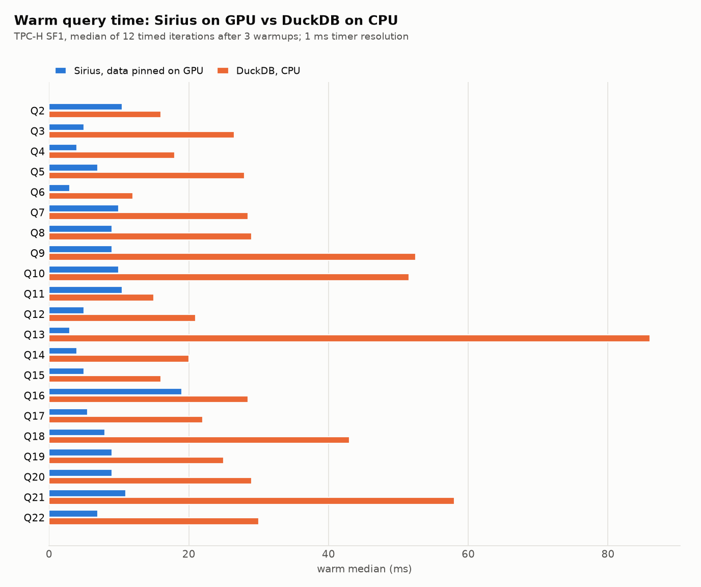
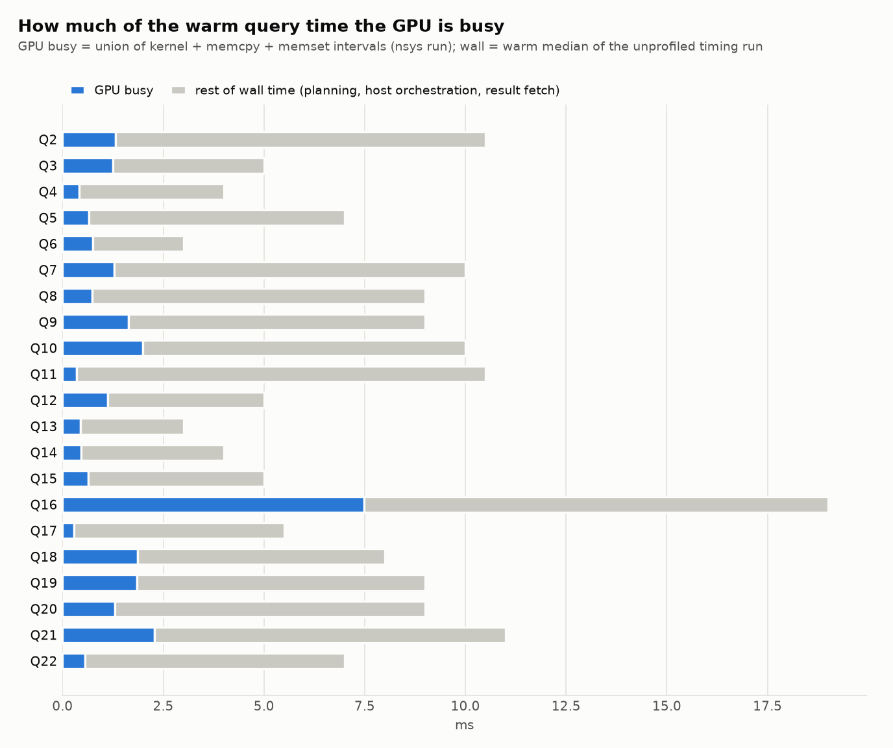
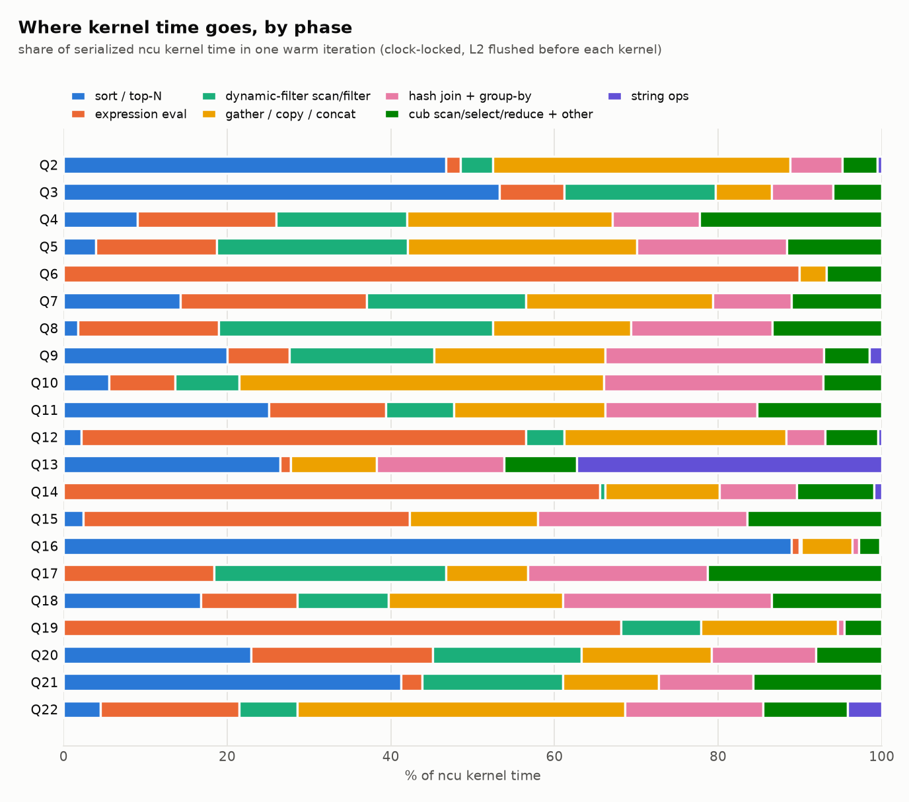

# TPC-H Q2–Q22 at SF1 on Sirius, data pinned on GPU — cross-query summary

**Generated by** `scripts/tpch_sf1/make_summary.py` from the data files in each `q<N>/` directory. Tables, counts and ranges are computed from those files (`summary/summary_data.json` holds the collected values); the few notes that quote a per-query report or its review say so.
**Machine**: RTX 5070 (12 GB, 672 GB/s peak DRAM bandwidth, 48 SMs). **Engine**: Sirius (`sirius-duckdb` release build) with stock libcudf, CPU fallback disabled. **Profilers**: Nsight Compute 2025.2.1 (`--set full` on every kernel of one warm iteration) and Nsight Systems 2025.5.2.
**Per-query detail**: each directory has `REPORT_tpch_q<N>_sf1.md` (links in §7), the ncu report, the nsys trace, and the evidence files named below.

How to read the numbers: *warm ms* is the median of 12 timed iterations after 3 warmups (1 ms timer resolution). *GPU busy* is the union of kernel, memcpy and memset intervals in the nsys run, at real clocks. *ncu* times are serialized, clock-locked and taken with the L2 cache flushed before each kernel, so they are longer than real-clock times and their DRAM figures are cold-cache values. GPU busy (nsys run) and wall time (timing run) come from different runs.

## 1. Headline

- All 21 queries ran on the GPU path with CPU fallback disabled, and all 21 results equal DuckDB's on the CPU (20 compared as `exact`, 1 compared as `multiset-with-tolerance`; maximum relative difference 0).
- PCIe verification: all 21 queries PASS; in every query, zero profiled kernels read host memory in place; every negative control failed the verification as intended (§2).
- Sirius is faster than DuckDB-CPU on every query: from 1.4× (Q11) to 28.7× (Q13), median 4.0× (§3).
- The GPU is busy for a small part of the warm wall time: 3.3% (Q11) to 39.4% (Q16), median 14.5% (§3).
- A warm iteration launches 36–238 kernels. Across all queries, 1,755 of 2,730 profiled launches (64%) run under 5 µs (ncu) and 2,397 (88%) launch less than one wave of CTAs (§4).
- The largest kernel family by real-clock time is the merge-sort block sort in 6 queries, the libcudf expression interpreter (`compute_column_kernel`) in 6, and the `static_kernel` family in 4 (§5).

## 2. PCIe verification

Per measured (warm) iteration of the nsys run; copies are classified by source and destination memory kind. *Scans* is the number of `GPU_SCAN` operators, each of which must get its own pinned-entry assignment in every iteration. *Host-memory kernels* counts profiled kernels with non-zero SM system-memory-aperture sectors in the ncu report. Sources: `pcie.json`, `pcie_verification.txt`, `ncu_sysmem_check.txt`, `selftest_negative_control.txt`.

| Query | Verdict | Tables | Scans | H2D copies | H2D bytes | Largest H2D | D2H bytes | Largest D2H | Result bytes (CSV) | Host-memory kernels | Negative control (table unpinned) |
|---|---|---:|---:|---:|---:|---:|---:|---:|---:|---:|---|
| Q2 | PASS | 5 | 5 | 115 | 6,858 | 960 | 18,516 | 17,889 | 16,496 | 0 of 229 | fails as intended (`partsupp`) |
| Q3 | PASS | 3 | 3 | 36 | 1,093 | 192 | 422 | 280 | 376 | 0 of 92 | fails as intended (`lineitem`) |
| Q4 | PASS | 2 | 2 | 29 | 2,231 | 276 | 16,616 | 16,384 | 105 | 0 of 56 | fails as intended (`lineitem`) |
| Q5 | PASS | 6 | 6 | 50 | 2,419 | 276 | 407 | 144 | 130 | 0 of 133 | fails as intended (`lineitem`) |
| Q6 | PASS | 1 | 1 | 83 | 2,909 | 612 | 263 | 24 | 22 | 0 of 47 | fails as intended (`lineitem`) |
| Q7 | PASS | 5 | 6 | 113 | 8,254 | 576 | 33,424 | 16,384 | 195 | 0 of 207 | fails as intended (`lineitem`) |
| Q8 | PASS | 7 | 8 | 61 | 2,872 | 276 | 326 | 48 | 68 | 0 of 172 | fails as intended (`lineitem`) |
| Q9 | PASS | 6 | 6 | 42 | 1,995 | 192 | 6,391 | 6,143 | 4,764 | 0 of 144 | fails as intended (`lineitem`) |
| Q10 | PASS | 4 | 4 | 119 | 5,981 | 768 | 70,011 | 16,384 | 3,538 | 0 of 238 | fails as intended (`lineitem`) |
| Q11 | PASS | 3 | 6 | 51 | 1,313 | 100 | 439,270 | 439,060 | 381,659 | 0 of 168 | fails as intended (`partsupp`) |
| Q12 | PASS | 2 | 2 | 82 | 6,322 | 516 | 296 | 88 | 76 | 0 of 86 | fails as intended (`lineitem`) |
| Q13 | PASS | 2 | 2 | 13 | 354 | 128 | 720 | 672 | 312 | 0 of 36 | fails as intended (`orders`) |
| Q14 | PASS | 2 | 2 | 55 | 1,918 | 276 | 167 | 48 | 32 | 0 of 46 | fails as intended (`lineitem`) |
| Q15 | PASS | 2 | 2 | 66 | 2,613 | 276 | 390 | 96 | 122 | 0 of 112 | fails as intended (`lineitem`) |
| Q16 | PASS | 3 | 3 | 84 | 6,656 | 852 | 927,035 | 893,932 | 650,813 | 0 of 156 | fails as intended (`partsupp`) |
| Q17 | PASS | 2 | 2 | 43 | 2,258 | 320 | 154 | 24 | 29 | 0 of 74 | fails as intended (`lineitem`) |
| Q18 | PASS | 3 | 4 | 51 | 1,998 | 384 | 19,926 | 16,384 | 3,558 | 0 of 127 | fails as intended (`lineitem`) |
| Q19 | PASS | 2 | 2 | 309 | 23,256 | 2,508 | 510 | 24 | 21 | 0 of 175 | fails as intended (`lineitem`) |
| Q20 | PASS | 5 | 5 | 68 | 3,862 | 276 | 9,581 | 9,280 | 8,319 | 0 of 142 | fails as intended (`lineitem`) |
| Q21 | PASS | 4 | 6 | 61 | 4,081 | 256 | 19,690 | 16,384 | 2,215 | 0 of 166 | fails as intended (`lineitem`) |
| Q22 | PASS | 2 | 3 | 102 | 4,868 | 756 | 570 | 214 | 155 | 0 of 124 | fails as intended (`orders`) |

- No table data cross PCIe in the measured iterations of any query. What does cross is small control traffic plus the result: the largest host-to-device total is Q19's 23,256 B in 309 copies (largest single copy 2,508 B), and the largest device-to-host totals are Q16 (927,035 B for a 18,368-row result) and Q11 (439,270 B, 21,953 rows).
- In the measured iterations there were 0 unified-memory page faults and 0 Parquet-decode kernels over all 21 queries. Every query used the default byte limits.
- Limits of this proof, stated in each report: nsys never produced a GPU-side unified-memory fault table, so only CPU-side faults and managed-memory API calls are actually checked; for dynamic filters whose publication logs no transport line, the claim rests on the host-to-device byte bound and the zero host-memory reads; tables with fewer than 8,192 rows (`nation`, `region`) are too small for a byte limit and rest on the log and host-memory checks; Q21's negative control ran with a different plan (5 scans instead of 6).

## 3. Timing

Sources: `timing.json` (warm and CPU medians, planning/engine split from 1 ms Sirius log stamps), `nsys_iteration_breakdown.json` (GPU busy). The planning and engine medians come from 1 ms stamps and do not always sum to the warm median.

| Query | Warm ms (min–max) | DuckDB CPU ms | Speed-up | Planning ms | Engine ms | GPU busy ms | GPU busy / wall | Result rows |
|---|---:|---:|---:|---:|---:|---:|---:|---:|
| Q2 | 10.5 (10–12) | 16 | 1.5× | 3 | 7 | 1.321 | 12.6% | 100 |
| Q3 | 5 (5–6) | 26.5 | 5.3× | 2 | 3 | 1.258 | 25.2% | 10 |
| Q4 | 4 (4–5) | 18 | 4.5× | 2 | 2 | 0.415 | 10.4% | 5 |
| Q5 | 7 (7–8) | 28 | 4.0× | 3 | 4 | 0.651 | 9.3% | 5 |
| Q6 | 3 (3–4) | 12 | 4.0× | 1 | 2 | 0.748 | 24.9% | 1 |
| Q7 | 10 (9–10) | 28.5 | 2.9× | 3 | 6 | 1.287 | 12.9% | 4 |
| Q8 | 9 (8–10) | 29 | 3.2× | 4 | 4 | 0.741 | 8.2% | 2 |
| Q9 | 9 (8–10) | 52.5 | 5.8× | 3 | 5 | 1.637 | 18.2% | 175 |
| Q10 | 10 (9–11) | 51.5 | 5.2× | 2 | 7 | 1.999 | 20.0% | 20 |
| Q11 | 10.5 (10–11) | 15 | 1.4× | 2 | 3.5 | 0.347 | 3.3% | 21,953 |
| Q12 | 5 (5–6) | 21 | 4.2× | 2 | 3 | 1.129 | 22.6% | 2 |
| Q13 | 3 (3–4) | 86 | 28.7× | 1 | 2 | 0.449 | 15.0% | 42 |
| Q14 | 4 (4–5) | 20 | 5.0× | 2 | 2 | 0.456 | 11.4% | 1 |
| Q15 | 5 (5–6) | 16 | 3.2× | 2 | 3 | 0.646 | 12.9% | 1 |
| Q16 | 19 (17–20) | 28.5 | 1.5× | 2 | 13 | 7.486 | 39.4% | 18,368 |
| Q17 | 5.5 (5–6) | 22 | 4.0× | 3 | 3 | 0.282 | 5.1% | 1 |
| Q18 | 8 (7–8) | 43 | 5.4× | 2.5 | 5 | 1.866 | 23.3% | 57 |
| Q19 | 9 (8–9) | 25 | 2.8× | 3 | 6 | 1.851 | 20.6% | 1 |
| Q20 | 9 (8–9) | 29 | 3.2× | 3 | 5 | 1.307 | 14.5% | 181 |
| Q21 | 11 (10–12) | 58 | 5.3× | 4 | 6 | 2.285 | 20.8% | 100 |
| Q22 | 7 (6–7) | 30 | 4.3× | 2 | 4 | 0.562 | 8.0% | 7 |

- Planning takes 1–4 ms per query (median 2 ms), which is 33% of the warm wall time at the median.
- GPU busy exceeds 2 ms only in Q16, Q21; it is under 1 ms in 10 of 21 queries.

## 4. Kernel profile

Sources: `ncu_plan.json` (launch count; all queries took the `--set full`-on-everything branch), `ncu_warm_metrics.json` (per-kernel durations, waves, DRAM%), `phase_breakdown.json` (ncu total), `nsys_iteration_breakdown.json`. *Floor* is the pinned bytes read once at 672 GB/s; it is a lower bound on memory time, not a prediction. *Best DRAM%* is the highest single-kernel DRAM throughput as a share of peak (cold L2).

| Query | Kernels / iteration | < 5 µs | < 1 wave | Single-CTA | ncu serialized µs | nsys kernel µs | Pinned MB | Pool high-water MB | Floor µs | GPU busy / floor | Wall / floor | Best DRAM% |
|---|---:|---:|---:|---:|---:|---:|---:|---:|---:|---:|---:|---:|
| Q2 | 229 | 149 | 226 | 134 | 2,044.8 | 1,244.7 | 19.0 | 51.1 | 28.2 | 46.8× | 372× | 70.7 |
| Q3 | 92 | 57 | 77 | 20 | 1,735.7 | 1,235.1 | 103.1 | 359.6 | 153.4 | 8.2× | 33× | 74.6 |
| Q4 | 56 | 32 | 45 | 23 | 543.6 | 395.9 | 75.6 | 220.7 | 112.5 | 3.7× | 36× | 65.4 |
| Q5 | 133 | 99 | 118 | 53 | 940.2 | 617.5 | 99.8 | 354.1 | 148.5 | 4.4× | 47× | 50.7 |
| Q6 | 47 | 38 | 41 | 17 | 974.9 | 722.0 | 84.0 | 348.1 | 125.0 | 6.0× | 24× | 46.0 |
| Q7 | 207 | 151 | 186 | 76 | 1,851.2 | 1,237.4 | 108.8 | 325.3 | 161.9 | 8.0× | 62× | 54.2 |
| Q8 | 172 | 134 | 155 | 60 | 1,099.7 | 704.5 | 129.5 | 457.3 | 192.7 | 3.8× | 47× | 66.3 |
| Q9 | 144 | 63 | 118 | 27 | 2,289.7 | 1,598.3 | 157.2 | 456.9 | 233.9 | 7.0× | 38× | 72.3 |
| Q10 | 238 | 116 | 196 | 104 | 3,116.5 | 1,912.0 | 140.4 | 447.8 | 208.9 | 9.6× | 48× | 55.5 |
| Q11 | 168 | 128 | 163 | 40 | 676.7 | 310.6 | 9.6 | 41.8 | 14.3 | 24.2× | 733× | 42.2 |
| Q12 | 86 | 41 | 71 | 26 | 1,543.3 | 1,119.2 | 134.3 | 463.5 | 199.9 | 5.6× | 25× | 74.2 |
| Q13 | 36 | 22 | 26 | 13 | 572.4 | 460.2 | 91.4 | 273.5 | 136.0 | 3.3× | 22× | 72.0 |
| Q14 | 46 | 31 | 37 | 14 | 610.3 | 411.3 | 89.7 | 347.5 | 133.5 | 3.4× | 30× | 48.3 |
| Q15 | 112 | 69 | 102 | 51 | 991.4 | 620.7 | 72.7 | 312.8 | 108.2 | 6.0× | 46× | 59.6 |
| Q16 | 156 | 83 | 131 | 45 | 9,744.2 | 7,399.6 | 13.8 | 38.8 | 20.5 | 364.3× | 925× | 66.6 |
| Q17 | 74 | 56 | 69 | 31 | 440.7 | 252.3 | 77.5 | 293.6 | 115.4 | 2.4× | 48× | 30.2 |
| Q18 | 127 | 81 | 100 | 74 | 2,106.9 | 1,723.2 | 72.9 | 283.3 | 108.5 | 17.2× | 74× | 93.7 |
| Q19 | 175 | 126 | 156 | 81 | 2,544.4 | 1,815.3 | 247.5 | 731.0 | 368.3 | 5.0× | 24× | 19.8 |
| Q20 | 142 | 93 | 131 | 45 | 1,772.4 | 1,230.9 | 87.1 | 255.7 | 129.6 | 10.1× | 69× | 40.0 |
| Q21 | 166 | 104 | 142 | 46 | 3,144.8 | 2,265.3 | 73.8 | 232.4 | 109.8 | 20.8× | 100× | 77.4 |
| Q22 | 124 | 82 | 107 | 42 | 876.9 | 492.2 | 10.1 | 40.3 | 15.0 | 37.6× | 468× | 72.4 |

- All 21 warm iterations stayed under the 1,000-launch threshold (policies: 21 × `full_all`), so every kernel has full ncu metrics.
- The pool high-water mark is a process-lifetime figure that includes the pin phase; the largest is 731.0 MB (Q19) against a 3 GB pool.

## 5. Where kernel time goes

Share of serialized ncu kernel time per phase group (the chart's data; `phase_breakdown.json`, grouped as in `make_summary.py`). Phases come from the kernel-name classifier `kclass.py`, which classifies on the full template name; known misfile: in Q21 it puts 249.6 µs of `insert_if_n` set builds under "other".

| Query | sort / top-N | expression eval | dynamic-filter scan/filter | gather / copy / concat | hash join + group-by | cub scan/select/reduce + other | string ops |
|---|---:|---:|---:|---:|---:|---:|---:|
| Q2 | 46.7% | 1.8% | 4.0% | 36.3% | 6.4% | 4.3% | 0.5% |
| Q3 | 53.3% | 7.9% | 18.5% | 6.8% | 7.5% | 6.0% | 0.0% |
| Q4 | 9.0% | 17.0% | 15.9% | 25.2% | 10.7% | 22.3% | 0.0% |
| Q5 | 3.9% | 14.8% | 23.3% | 28.0% | 18.3% | 11.6% | 0.0% |
| Q6 | 0.0% | 89.9% | 0.0% | 3.3% | 0.0% | 6.8% | 0.0% |
| Q7 | 14.2% | 22.8% | 19.4% | 22.9% | 9.6% | 11.0% | 0.0% |
| Q8 | 1.7% | 17.2% | 33.5% | 16.9% | 17.2% | 13.4% | 0.0% |
| Q9 | 20.0% | 7.6% | 17.7% | 20.9% | 26.8% | 5.6% | 1.5% |
| Q10 | 5.5% | 8.1% | 7.8% | 44.5% | 26.9% | 7.1% | 0.0% |
| Q11 | 25.1% | 14.3% | 8.3% | 18.5% | 18.6% | 15.3% | 0.0% |
| Q12 | 2.2% | 54.3% | 4.7% | 27.1% | 4.8% | 6.4% | 0.4% |
| Q13 | 26.5% | 1.2% | 0.0% | 10.5% | 15.6% | 8.8% | 37.3% |
| Q14 | 0.0% | 65.5% | 0.6% | 14.0% | 9.4% | 9.4% | 1.0% |
| Q15 | 2.4% | 39.8% | 0.0% | 15.7% | 25.6% | 16.5% | 0.0% |
| Q16 | 89.0% | 0.9% | 0.3% | 6.2% | 0.8% | 2.6% | 0.2% |
| Q17 | 0.0% | 18.4% | 28.3% | 10.0% | 22.0% | 21.3% | 0.0% |
| Q18 | 16.8% | 11.8% | 11.1% | 21.3% | 25.6% | 13.4% | 0.0% |
| Q19 | 0.0% | 68.1% | 9.8% | 16.7% | 0.8% | 4.6% | 0.0% |
| Q20 | 22.9% | 22.2% | 18.1% | 15.9% | 12.8% | 8.0% | 0.0% |
| Q21 | 41.2% | 2.6% | 17.2% | 11.6% | 11.6% | 15.7% | 0.0% |
| Q22 | 4.5% | 16.9% | 7.1% | 40.1% | 16.9% | 10.4% | 4.1% |

Largest kernel families by real-clock kernel time (nsys, mean per measured iteration; `nsys_iteration_breakdown.json`). A family is every launch of one kernel function, so generic families such as `static_kernel` and `transform_kernel` mix several operators.

| Query | #1 family | Share | #2 family | Share | #3 family | Share |
|---|---|---:|---|---:|---|---:|
| Q2 | merge-sort block sort | 58.1% | `DeviceScanKernel` | 14.2% | string character gather | 7.9% |
| Q3 | merge-sort block sort | 48.5% | dynamic-filter probe (fused) | 17.5% | `static_kernel` family | 9.0% |
| Q4 | `static_kernel` family | 21.8% | expression interpreter | 16.6% | `DeviceSelectSweepKernel` | 14.3% |
| Q5 | `static_kernel` family | 21.7% | `transform_kernel` family | 11.1% | expression interpreter | 10.7% |
| Q6 | expression interpreter | 86.9% | `DeviceSelectSweepKernel` | 5.0% | `transform_kernel` family | 3.4% |
| Q7 | expression interpreter | 22.1% | dynamic-filter probe (fused) | 20.7% | merge-sort block sort | 15.3% |
| Q8 | dynamic-filter probe (fused) | 38.0% | `transform_kernel` family | 12.1% | expression interpreter | 10.5% |
| Q9 | merge-sort block sort | 22.6% | dynamic-filter probe (fused) | 18.8% | `transform_kernel` family | 15.9% |
| Q10 | string character gather | 17.7% | `static_kernel` family | 17.3% | `transform_kernel` family | 9.6% |
| Q11 | radix sort (onesweep) | 21.7% | `transform_kernel` family | 20.7% | `static_kernel` family | 16.6% |
| Q12 | expression interpreter | 57.8% | string character gather | 10.6% | `transform_kernel` family | 7.2% |
| Q13 | `LIKE` matcher | 43.8% | merge-sort block sort | 25.7% | `transform_kernel` family | 9.7% |
| Q14 | expression interpreter | 61.8% | `DeviceSelectSweepKernel` | 8.2% | string character gather | 6.1% |
| Q15 | expression interpreter | 39.5% | `static_kernel` family | 13.2% | `mapping_indices_kernel` | 12.5% |
| Q16 | merge-sort block sort | 67.6% | `DeviceMergeSortMergeKernel` | 19.6% | `DeviceMergeSortPartitionKernel` | 4.1% |
| Q17 | `static_kernel` family | 39.1% | `DeviceSelectSweepKernel` | 15.5% | `transform_kernel` family | 10.5% |
| Q18 | `transform_kernel` family | 37.7% | merge-sort block sort | 16.0% | `static_kernel` family | 10.2% |
| Q19 | expression interpreter | 71.3% | dynamic-filter probe (fused) | 11.2% | `DeviceScanKernel` | 5.3% |
| Q20 | merge-sort block sort | 25.7% | expression interpreter | 21.9% | dynamic-filter probe (fused) | 19.1% |
| Q21 | merge-sort block sort | 44.9% | `insert_if_n` | 12.0% | dynamic-filter probe (fused) | 10.2% |
| Q22 | `static_kernel` family | 16.3% | string character gather | 12.7% | expression interpreter | 12.6% |

Queries grouped by their largest family:

- **merge-sort block sort** (6): Q2 (58.1%), Q3 (48.5%), Q9 (22.6%), Q16 (67.6%), Q20 (25.7%), Q21 (44.9%)
- **expression interpreter** (6): Q6 (86.9%), Q7 (22.1%), Q12 (57.8%), Q14 (61.8%), Q15 (39.5%), Q19 (71.3%)
- **`static_kernel` family** (4): Q4 (21.8%), Q5 (21.7%), Q17 (39.1%), Q22 (16.3%)
- **dynamic-filter probe (fused)** (1): Q8 (38.0%)
- **string character gather** (1): Q10 (17.7%)
- **radix sort (onesweep)** (1): Q11 (21.7%)
- **`LIKE` matcher** (1): Q13 (43.8%)
- **`transform_kernel` family** (1): Q18 (37.7%)

## 6. Cross-query observations

These restate what the per-query reports establish; mechanisms are from their instruction-level sections and carry the same measured/inferred labels there.

1. **Wall time is set by the host, not the GPU.** GPU busy is at most 39.4% of the warm wall time (Q16) and under 20% in 14 of 21 queries. The remainder is planning plus the engine window with the GPU idle; the reports attribute the idle part to per-operator stream synchronizations, pool allocations and small copies between kernels of a few µs (an inference from nsys call counts and CPU time).
2. **Most launches are tiny.** 64% of launches run under 5 µs and 88% under one wave (measured). For those kernels launch and latency, not bandwidth, set the time (inferred).
3. **Sorting is the largest kernel cost in 6 queries**, in each case on few CTAs. Longest block-sort launch per query, from the full ncu pass (`ncu_warm_metrics.json`):

   | Query | Family share (nsys) | Longest launch µs (ncu) | Grid (CTAs) | Active lanes of 32 | Barrier stall share | Long-scoreboard stall share |
   |---|---:|---:|---:|---:|---:|---:|
   | Q2 | 58.1% | 505.2 | 1 | 15.4 | 83.9% | 5.5% |
   | Q3 | 48.5% | 633.8 | 3 | 28.6 | 16.0% | 59.1% |
   | Q9 | 22.6% | 457.2 | 1 | 11.9 | 83.2% | 4.3% |
   | Q16 | 67.6% | 3,998.5 | 5 | 15.3 | 13.4% | 64.4% |
   | Q20 | 25.7% | 406.6 | 1 | 14.0 | 85.1% | 4.8% |
   | Q21 | 44.9% | 776.8 | 1 | 14.4 | 84.9% | 5.5% |

   These launches use 1–5 CTAs, so most of the 48 SMs are idle while they run. Where the launch is a single CTA, barrier waits dominate its stall samples; in the multi-CTA launches (Q3, Q16) long-scoreboard waits dominate. The reports trace the latter to dependent loads in cuDF's generic row comparator, including byte-wise string compares in Q16.
4. **The libcudf expression interpreter (`compute_column_kernel`) is the largest family in 6 queries** (Q6, Q7, Q12, Q14, Q15, Q19). Its longest launch in each of those queries fills the GPU (18.1–40.7 waves) with the load/store pipe 81.4–93.8% busy while DRAM throughput is 5.6–11.4% of peak (measured, cold L2). The reports read this as a kernel limited by instruction count and dependent descriptor loads, not by bandwidth, and attribute these launches to predicates evaluated over `lineitem` partitions (the launch-to-operator mapping is inferred from grid sizes).
5. **Dynamic-filter probes and string handling are the next tier.** `fused_membership_mask_kernel` is among the three largest families in 7 queries (Q3, Q7, Q8, Q9, Q19, Q20, Q21); the `static_kernel` family, which the reports show to be led by `membership_probe_functor` launches in several queries, is in the top three in 9. The byte-per-lane string character gather `gather_chars_fn_char_parallel` is in the top three in 5 (Q2, Q10, Q12, Q14, Q22).
6. **Bandwidth is rarely the limit for the kernels that matter.** The best single-kernel DRAM throughput in any query reaches 93.7% of peak (Q18), but the longest kernel of each query runs at 0.0–43.1% of peak (median 5.8%; measured, cold L2).
7. Project rule kept in every report: no query-specific kernel fusion is recommended; optimization directions are general-purpose library or engine changes.

## 7. Per-query reports

| Query | Report | Largest family (real-clock share) |
|---|---|---|
| Q2 | [REPORT_tpch_q2_sf1.md](q2/REPORT_tpch_q2_sf1.md) | merge-sort block sort (58.1%) |
| Q3 | [REPORT_tpch_q3_sf1.md](q3/REPORT_tpch_q3_sf1.md) | merge-sort block sort (48.5%) |
| Q4 | [REPORT_tpch_q4_sf1.md](q4/REPORT_tpch_q4_sf1.md) | `static_kernel` family (21.8%) |
| Q5 | [REPORT_tpch_q5_sf1.md](q5/REPORT_tpch_q5_sf1.md) | `static_kernel` family (21.7%) |
| Q6 | [REPORT_tpch_q6_sf1.md](q6/REPORT_tpch_q6_sf1.md) | expression interpreter (86.9%) |
| Q7 | [REPORT_tpch_q7_sf1.md](q7/REPORT_tpch_q7_sf1.md) | expression interpreter (22.1%) |
| Q8 | [REPORT_tpch_q8_sf1.md](q8/REPORT_tpch_q8_sf1.md) | dynamic-filter probe (fused) (38.0%) |
| Q9 | [REPORT_tpch_q9_sf1.md](q9/REPORT_tpch_q9_sf1.md) | merge-sort block sort (22.6%) |
| Q10 | [REPORT_tpch_q10_sf1.md](q10/REPORT_tpch_q10_sf1.md) | string character gather (17.7%) |
| Q11 | [REPORT_tpch_q11_sf1.md](q11/REPORT_tpch_q11_sf1.md) | radix sort (onesweep) (21.7%) |
| Q12 | [REPORT_tpch_q12_sf1.md](q12/REPORT_tpch_q12_sf1.md) | expression interpreter (57.8%) |
| Q13 | [REPORT_tpch_q13_sf1.md](q13/REPORT_tpch_q13_sf1.md) | `LIKE` matcher (43.8%) |
| Q14 | [REPORT_tpch_q14_sf1.md](q14/REPORT_tpch_q14_sf1.md) | expression interpreter (61.8%) |
| Q15 | [REPORT_tpch_q15_sf1.md](q15/REPORT_tpch_q15_sf1.md) | expression interpreter (39.5%) |
| Q16 | [REPORT_tpch_q16_sf1.md](q16/REPORT_tpch_q16_sf1.md) | merge-sort block sort (67.6%) |
| Q17 | [REPORT_tpch_q17_sf1.md](q17/REPORT_tpch_q17_sf1.md) | `static_kernel` family (39.1%) |
| Q18 | [REPORT_tpch_q18_sf1.md](q18/REPORT_tpch_q18_sf1.md) | `transform_kernel` family (37.7%) |
| Q19 | [REPORT_tpch_q19_sf1.md](q19/REPORT_tpch_q19_sf1.md) | expression interpreter (71.3%) |
| Q20 | [REPORT_tpch_q20_sf1.md](q20/REPORT_tpch_q20_sf1.md) | merge-sort block sort (25.7%) |
| Q21 | [REPORT_tpch_q21_sf1.md](q21/REPORT_tpch_q21_sf1.md) | merge-sort block sort (44.9%) |
| Q22 | [REPORT_tpch_q22_sf1.md](q22/REPORT_tpch_q22_sf1.md) | `static_kernel` family (16.3%) |

## 8. Scope and caveats

- Scale factor 1 only; Q1 was profiled separately (`q1/`, SF10). At SF1 kernel time scales with rows while per-launch and host costs do not, so these shares will shift at larger scale factors (not measured here).
- Sirius ran with a 25% GPU pool and a 1 GB pinned-host pool (`scripts/tpch_sf1/sirius.yaml`) to keep ncu's per-kernel replay fast; no query downgraded or spilled.
- Every report was reviewed against its data files by an independent agent and corrected; headline numbers and PCIe tables held, while corrections concentrated on instruction-level interpretation, derived arithmetic and inferred-versus-measured labels.
- Timer resolution is 1 ms for wall-time figures; speed-ups and wall-time shares inherit that granularity.
