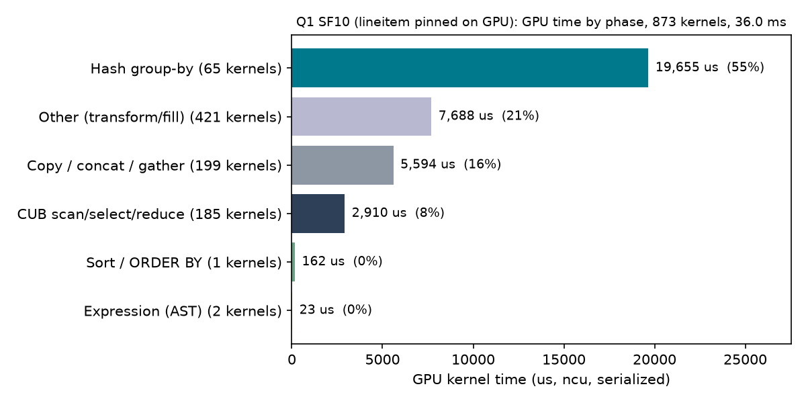
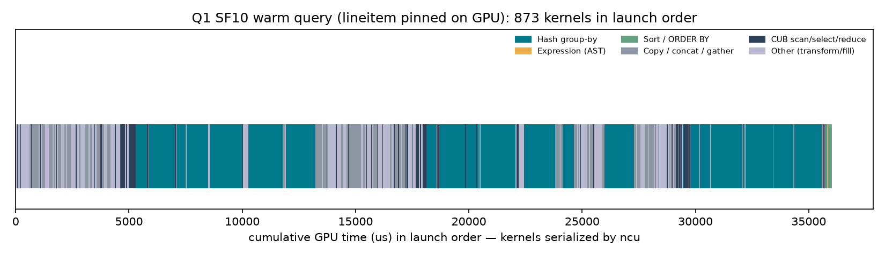
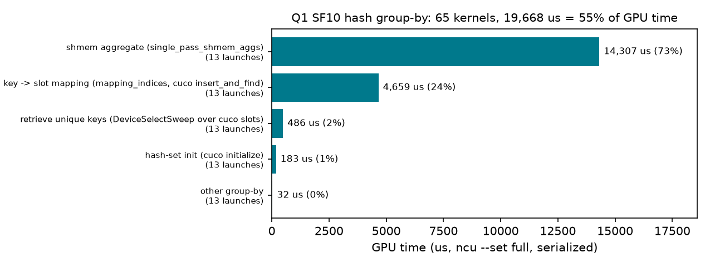
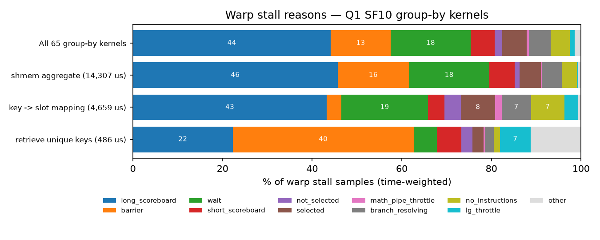
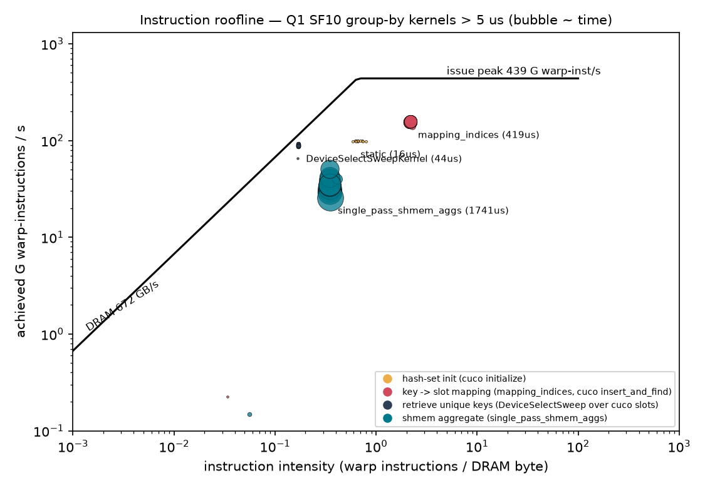

# TPC-H Q1 (SF10) on Sirius, `lineitem` pinned on GPU — Group-by Workload Analysis

**Date**: 2026-11-13
**GPU**: NVIDIA GeForce RTX 5070, 12 GB GDDR7 (192-bit, 672 GB/s), Blackwell sm_120, 48 SMs
**Workload**: TPC-H Query 1, scale factor 10 (59,986,052 `lineitem` rows). The 7 Q1 columns are pinned in GPU memory with `pin_table(tier='gpu')`; every timed and profiled query reads them from device memory, with zero file reads and zero host-to-device copies.
**Framework**: Sirius (`sirius-duckdb` release build), DuckDB v2.0, libcudf from the pixi env (unpatched), CUDA runtime 13.5
**Scope**: whole-query timing and a kernel list for all 873 kernels; `ncu --set full` + per-instruction SASS **only on the 65 hash group-by / aggregation kernels**.

---

## 1. Executive Summary

A warm SF10 Q1 with `lineitem` resident on the GPU takes **41 ms end-to-end** (median of 13 warm runs, range 40–45 ms). The query is now GPU-dominated: 873 kernels with **36.0 ms of serialized GPU time** (ncu, clock-locked at 2.28 GHz) against a ~30 ms engine window in the Sirius log.

**Hash group-by is 54.5% of GPU time (19.7 ms, 65 kernels = 5 distinct kernels × 13 runs: 11 full input batches, 1 partial batch, 1 final merge).** Two cuDF kernels account for 97% of that:

1. **`single_pass_shmem_aggs_kernel`: 14.3 ms (40% of the whole query).** It moves only 73–146 GB/s (11–22% of DRAM peak). Two separate effects compound:
   - **A straggler tail costs 65% of its time (9.3 ms).** In every batch the average SM is busy ~1.0M cycles (0.44 ms), but the busiest SM runs 2.2–3.4M cycles, and kernel time follows that SM. The 11 full batches do identical work (4.4e7 instructions, 126 MB, 2.49M bank conflicts each) yet range from **0.87 to 1.74 ms**. The straggler is measured, not root-caused (§8 B1).
   - **The balanced part is latency-bound too**: 0.44 ms per batch against a 0.19 ms DRAM floor. **31.4% of all stall samples fall on one instruction**, a generic `ATOM.E.ADD.64.STRONG.SYS` into shared memory that waits on a dependent `LD.E.64`. The same pattern was seen at SF1.
2. **`mapping_indices_kernel` (cuco `static_set` insert-and-find): 4.66 ms (13%).** It executes **~730 SASS instructions per row** to hash and probe two one-character string keys, at IPC 1.47 and 87% L2 hit rate. **31% of its stall samples sit on two instructions** waiting for a dependent chain: column descriptor → string offset → 1-byte `LD.E.U8` char load → MurmurHash3 mix.

Physical floor (read the 1.68 GB of resident columns once): **2.50 ms**. GPU kernels are **14x** above it and end-to-end time is **16x** above it. The group-by alone (19.7 ms) is **8x** the floor of the entire query.

---

## 2. Workload Description

- **Query**: filter `l_shipdate <= DATE '1995-08-19'` (keeps 31,569,869 of 59,986,052 rows, 52.6%), group by `(l_returnflag, l_linestatus)` (4 groups), 4 SUMs, 3 AVGs, COUNT, ORDER BY over 4 rows.
- **Data**: `tpchgen-rs` SF10 Parquet with the same generator settings as the SF1 set (`generate_tpch.py -s 10`; decimal128, date32, Parquet v2). `lineitem` is one 1.67 GB file with 56 row groups (`lineitem_parquet_metadata.txt`).
- **Pinning**: `CALL pin_table('…/tpch_parquet_sf10/lineitem/*.parquet', tier='gpu', name='lineitem', cols=[7 Q1 columns])`, generated by Sirius's `tpch_pin_columns.py`.
  - One-off cost: 177 ms. It decodes the Parquet and keeps cuDF tables in GPU memory.
  - Resident footprint: **1,679.6 MB** (`gpu_pool allocated=1679621120` between queries). Peak during a query is 3.57 GB of the 10.4 GB budget.
- **Verification that nothing crosses PCIe** (Sirius log, `traces/sirius_log_sf10_pinned/`):
  - All 14 queries log `assigned pinned entry 'lineitem'`.
  - All 14 report `fs_cache … last_cycle[reads=0 hits=0 h2d=0 miss=0]`. Only the pin itself read the file (`reads=168`).
  - No Parquet-decode kernel appears among the 873 warm-query kernels.
- **Execution shape**: the scan emits 12 batches (11 × ~2.8M filtered rows plus one partial batch of ~0.55M). Each batch runs the full filter → project → group-by chain, and a final 1-CTA pass of the same 5 group-by kernels merges the 12 partial results (4 groups each). That is why one query launches 873 kernels, against 186 at SF1.

---

## 3. Environment

| Component | Version / setting |
|---|---|
| GPU / driver | RTX 5070 (sm_120, 48 SMs, 12 GB, 48 MB L2) / 580.173.02 |
| Nsight Compute | 2025.2.1 via `sudo -n` (GPU counters are admin-only, `RmProfilingAdminOnly=1`) |
| ncu clocks | locked by ncu: SM ≈ 2.28–2.32 GHz (boost is 3.09 GHz) |
| CPU | Intel i9-13900K, 32 threads, 125 GB RAM |
| Sirius config | `scripts/sirius.yaml`: 85% GPU memory, 8 GB pinned host, 4 pipeline threads, `enable_duckdb_fallback=false` |

---

## 4. First-Principles Analysis (Physical Floor)

Details: `physical_floor.md`.

| Scenario | Bytes | Floor @ 672 GB/s |
|---|---:|---:|
| A. Read the resident (narrowed) columns once, aggregate in registers | 1,680 MB | **2.50 ms** |
| A'. Same at native widths (46 B/row) | 2,759 MB | 4.11 ms |
| B. Materialise the filtered copy, then read it again for the group-by | 4,584 MB | 6.82 ms |
| Group-by only: read the aggregate inputs as they reach `shmem_aggs` (DRAM bytes measured by ncu) | 1,542 MB | 2.29 ms |

Compute is negligible (~0.4 G integer ops, < 0.05 ms). Q1 is bandwidth-bound by construction.

---

## 5. Profiling Results

### End-to-end timing (`.timer on`, 1 cold + 13 warm, `q1_sirius_times.txt`)

| Configuration | First query | Warm median (range) |
|---|---:|---:|
| **Sirius, `lineitem` pinned on GPU** | 77 ms | **41 ms** (40–45) |
| DuckDB CPU baseline (i9-13900K, same file) | 101 ms | 91 ms (88–93) — `q1_duckdb_cpu_times.txt` |

Results match DuckDB exactly (e.g. `A|F sum_qty=377,518,399, count_order=14,804,077`).

**Wall-clock split per warm query** (median of 13, from millisecond log timestamps):
- **Planning: 4 ms** (`QueryBegin` → physical plan generated).
- **Engine: 30 ms** (plan → `QueryEnd`).
- **Result handling: 7 ms** (`QueryEnd` → next statement).

### Phase breakdown of GPU time (all 873 kernels, `q1_phase_breakdown.txt`)



| Operator (`q1_operator_breakdown.txt`) | Kernels | GPU time (µs) | % |
|---|---:|---:|---:|
| **Group-by: hash build + aggregate (cuDF)** | 65 | **19,655** | **54.5** |
| Filter gather: string keys | 164 | 5,491 | 15.2 |
| Projection: price arithmetic (binary ops) | 49 | 3,118 | 8.7 |
| Min/max reductions | 180 | 2,482 | 6.9 |
| Filter gather: fixed-width columns | 69 | 2,401 | 6.7 |
| Other (fill, scan, misc) | 263 | 1,508 | 4.2 |
| Filter: predicate + select indices | 49 | 1,094 | 3.0 |
| ORDER BY (1-CTA merge sort) | 1 | 162 | 0.4 |
| Other copies/concat, AST | 33 | 121 | 0.3 |
| **Total** | **873** | **36,032** | 100 |

These come from the ncu kernel-list pass (`gpu__time_duration` only), so non-group-by kernels have no counter data. 542 of the 873 kernels run < 5 µs (1.4 ms in total).



### Group-by breakdown (`ncu --set full`, 65 kernels)



| Group-by step | Launches | GPU time (µs) | % of group-by |
|---|---:|---:|---:|
| `single_pass_shmem_aggs_kernel` (aggregate into shared-memory partials) | 13 | **14,307** | 72.7 |
| `mapping_indices_kernel` (cuco `static_set` insert-and-find: key → group slot) | 13 | **4,659** | 23.7 |
| `DeviceSelectSweepKernel` over cuco slots (retrieve unique keys) | 13 | 486 | 2.5 |
| cuco `initialize_functor` (hash-set init) | 13 | 183 | 0.9 |
| other (`std::pair<device_uvector>` for-each) | 13 | 32 | 0.2 |
| **Total** | **65** | **19,669** | 100 |

The full-pass total (19,669 µs) matches the kernel-list pass (19,655 µs) within 0.1%, so the two profiles describe the same execution.

---

## 6. Kernel Analysis (group-by kernels, `ncu --set full`)

Sources: `ncu_q1_groupby_summary.txt`, `top_kernel_details.txt`, `ncu_q1_groupby_full.json`.

| Kernel | Dur/launch (µs) | Grid×Blk | Regs | Occ. ach/theo | Waves | DRAM GB/s (% peak) | L2 hit | IPC | Top stalls |
|---|---:|---|---:|---|---:|---|---:|---:|---|
| `single_pass_shmem_aggs` (11 full batches) | **867–1,741** | 240×128 | 72 | 32–39 / 58 | 0.71 | 73–146 (11–22%) | 2% | 0.88 | long_sb 46.5, wait 17.9, barrier 15.5 |
| `mapping_indices` (11 full batches) | 410–419 | 240×128 | 84 | 40.5 / 41.7 | 1.00 | 71 (11%) | 87% | 1.47 | long_sb 43.5, wait 19.8, selected 7.4 |
| `DeviceSelectSweep` (cuco slots) | 37 | 979×384 | 56 | 69 / 75 | 6.8 | 515 (78%) | 4% | 0.86 | barrier 40.3, long_sb 22.5 |
| cuco `initialize_functor` | 14 | — | 16 | 55 / 100 | — | — | 0% | 1.05 | drain 49.0, short_sb 26.3 |

### Warp stalls



Across all 65 group-by kernels (time-weighted): long scoreboard **44.2%**, wait 17.9%, barrier 13.3%, selected 5.4%, short scoreboard 5.3%, branch resolving 4.8%. These kernels mostly wait on dependent global/generic loads and on block barriers, not on bandwidth or ALU throughput.

### Roofline



Instruction roofline: ceilings are 439 G warp-inst/s (48 SMs × 4 SMSPs × 2.28 GHz) and the 672 GB/s DRAM slope.
- **`shmem_aggs`** sits at 0.35 inst/byte with 25–50 G warp-inst/s, about **5–9x below the memory roof** at that intensity. It is neither bandwidth- nor issue-bound, so latency and tail limit it.
- **`mapping_indices`** sits at 2.2 inst/byte with ~155 G warp-inst/s: right of the ridge and ~2.8x below the issue roof. It is effectively **instruction-bound on a very long per-row path**, because L2 serves its key bytes.
- **`DeviceSelectSweep`** is near the bandwidth slope (78% DRAM) and is not a problem.

---

## 6.5 Instruction-Level Analysis

### `single_pass_shmem_aggs_kernel` (launch id 12, 1,439 µs; `sass/single_pass_shmem_aggs_*`)

| Property | Value |
|---|---|
| Static vs executed code | 44,312 static SASS instructions, only 678 (1.5%) ever execute: a type-dispatched switch over aggregation kind × column type |
| Executed per batch | 4.34e7 warp instructions ≈ **490 per row** (~2.8M rows/batch) |
| Shared memory | 10,240 B/CTA; 2.49M shared bank conflicts per batch |

Hot path (once per row per aggregated column):

```
5c850  LD.E.64      R22, [R16.64]                      // load the value (generic) → DRAM latency, 2% L2 hit
5c860  S2UR SR_CgaCtaId / SR_SWINHI; ULEA; IMAD.WIDE    // rebuild a GENERIC pointer to this CTA's shared slot
5c8f0  ATOM.E.ADD.64.STRONG.SYS P0, RZ, [R20.64], R22  // generic, system-scope atomic that resolves to SHARED
5c900  @P0 BRA                                         // retry/loop
```

| Instruction | Stall | % of samples | Mechanism |
|---|---|---:|---|
| `ATOM.E.ADD.64.STRONG.SYS` @ `+0x5c8f0` | long_scoreboard | **31.4** | waits for `LD.E.64` (R22), then serialises on 4 shared slots per column |
| `UMOV UR6, 0x400` after `BAR.SYNC` @ `+0x668d0` | barrier | **20.0** | warps wait at the block barrier for the slowest warp before the partial flush |
| `IADD R52, R16, R13` @ `+0x06090` | long_scoreboard | 6.6 | waits on the row → group mapping index load (first link of the chain) |
| `ISETP.GT … R25, 0xe` + `@P BRA` | wait / branch | ~4 | runtime type switch, executed 620k times per batch |

| Class (`single_pass_shmem_aggs_inst_inventory.csv`) | % executed | % stall samples |
|---|---:|---:|
| Int arithmetic | 40.4 | 44.8 |
| Control flow | **26.6** | 14.3 |
| Move/special | 9.0 | 2.2 |
| Global load | 8.8 | 2.4 |
| Atomics (`ATOM.E`, resolving to shared) | 1.5 | **31.5** |
| Native shared atomics (`ATOMS`) | 0 | 0 |

The compiler emitted a **generic** `ATOM.E…SYS`, not a native shared `ATOMS`, so ncu's `smsp__inst_executed_op_shared_atom` is 0. This is the pattern of a `cuda::atomic_ref` with default system scope on a pointer the compiler cannot prove is in shared memory. Instruction mix and stall shares match the SF1 profile within ~1 point: the per-row behaviour does not depend on scale factor.

### `mapping_indices_kernel` (launch id 2, 417 µs; `sass/mapping_indices_*`)

| Property | Value |
|---|---|
| Static vs executed | 15,080 static, 848 executed (5.6%) |
| Executed per batch | 6.43e7 warp instructions ≈ **730 per row** to hash two 1-char strings and probe a 4-entry set |
| Local-memory (spill) instructions | 2.8% of executed (84 regs/thread) |

Hot path (row hasher, per string key column):

```
301b0  LDG.E.64 R46, [R18.64+0x30]     // column_device_view: offsets child pointer
301e0  LDG.E    R14, [R18.64+0x28]     // column offset / size
301f0  LD.E     R15, [R46.64]          // string offset[row]       (dependent on R46)
303b0  @!P2 SHF.R.S32.HI R55, …, R54   // 15.3% of samples — consumes the offset load
312a0  LD.E.U8  R15, [R14.64]          // 1-byte char load           (dependent on the offset)
312b0  LOP3.LUT R16, R16, R15, 0x3c    // 15.6% of samples — XOR the char into the hash
312c0  IMAD     R12, R16, -0x3361d2af  // MurmurHash3 c1 = 0xcc9e2d51
```

**31% of this kernel's stall samples fall on two instructions** that each wait for the previous load in a 3–4 deep dependent pointer chain. L2 serves the chain (87% hit), so each link costs L2 latency, not DRAM latency. The remaining time goes to the generic `device_row_comparator` / row-hasher machinery around it (type dispatch, null checks, per-column loops). That machinery brings the cost to ~730 instructions for a key that carries 2 bytes of information.

---

## 7. Root Cause Analysis

### Bottleneck 1 — `single_pass_shmem_aggs`: straggler tail on top of a latency-bound inner loop (14.3 ms, 40% of the query)

```
shmem_aggs: 14.3 ms for 1.54 GB of input → 108 GB/s average (16% of DRAM peak)
 → WHY? kernel time = busiest SM; sm__cycles_active.max is 2.2–3.4M cycles vs .avg ≈ 1.0M and .min ≈ 0.80M
        (shmem_aggs_sm_imbalance.txt). If every SM finished at the mean, the 13 launches would take 5.0 ms, not 14.3.
 → WHY does the tail vary 2x between batches with identical work (4.4e7 inst, 126 MB, 2.49M bank conflicts each)?
        NOT ROOT-CAUSED. The minimum SM time is a flat ~0.80M cycles in every launch while the maximum moves,
        so the work per SM appears unequal or nondeterministic. Duration tracks the barrier-stall share (9.5–21%).
        Hypotheses to test: (a) uneven CTA placement — 240 CTAs on 48 SMs with a register limit of 7 CTAs/SM,
        so some SMs host more CTAs than others; (b) a few CTAs receiving more rows or more same-group collisions.
        Test: record clock64() and %smid per CTA (or use ncu's per-SM breakdown) for one batch.
 → and the balanced part (~0.44 ms/batch vs 0.19 ms floor) is latency-bound:
        WHY? 46.5% long-scoreboard; 31.4% of samples on one generic ATOM.E.ADD.64.SYS waiting for its LD.E.64 operand
        WHY? per (row, column): dependent load → generic system-scope atomic into 4 contended shared slots, with
             a runtime type switch (26.6% control-flow instructions) between iterations, at 32–39% occupancy and 0.71 waves
 → ROOT (balanced part): row-at-a-time, column-by-column aggregation with runtime type dispatch and generic
        system-scope atomics; grid fixed at 240 CTAs (< 1 wave), so there is no second wave to absorb stragglers
```

- **Little's law** (balanced part): saturating 672 GB/s at ~600 ns needs ~400 KB in flight (8.4 KB per SM). With ~15 resident warps per SM each holding about one outstanding 8-byte load, the kernel sustains ~4 KB per SM, a ~45% ceiling, before atomics and dispatch reduce it further.
- **Impact**: tail ≈ 9.3 ms. The balanced part has ~2.7 ms of excess over the 2.29 ms floor.

### Bottleneck 2 — `mapping_indices`: ~730 instructions per row to hash two 1-character string keys (4.66 ms, 13%)

```
mapping_indices: 0.41 ms per 2.8M-row batch, IPC 1.47, 71 GB/s, 87% L2 hit
 → WHY? 6.43e7 warp instructions per batch ≈ 730 per row; ~2.8x below the issue roof
 → WHY? per row and per key column: load the column descriptor → load the string offset → load 1 char (LD.E.U8)
        → MurmurHash3 mix, then the same chain again in device_row_comparator for the equality check against the slot;
        31% of samples on the two instructions consuming those dependent loads (43.5% long scoreboard overall)
 → ROOT: low-cardinality keys are carried as cuDF STRING columns and pushed through the generic, type-dispatched
        row hasher/comparator, so a 2-byte key pays the full variable-length string path twice per row
```

- **Impact**: at the DRAM floor for its 29.6 MB per batch, the kernel would take ~0.04 ms instead of 0.41 ms. That is ~4.2 ms of excess across the 13 launches.

### Bottleneck 3 — small group-by helpers (0.7 ms, 2%)

`DeviceSelectSweep` over the cuco slots (486 µs, 78% DRAM, barrier-bound tiles) and the per-batch hash-set init (183 µs) run once per batch, 13 times per query. Each is efficient on its own; together they are a fixed per-batch cost.

---

## 8. Gap Analysis

| Metric | Value |
|---|---|
| Physical floor, whole query (A) | 2.50 ms |
| Physical floor, group-by input only | 2.29 ms |
| GPU kernel time, all 873 kernels (ncu, serialized, ~2.3 GHz) | 36.0 ms (14x floor) |
| Group-by kernel time | 19.7 ms (8.6x its floor) |
| End-to-end warm median | 41 ms (16x floor; hardware efficiency 6%) |

| Group-by factor | Evidence | Excess (ms) |
|---|---|---:|
| `shmem_aggs` SM straggler tail | §7 B1, `shmem_aggs_sm_imbalance.txt` | ~9.3 |
| `shmem_aggs` latency-bound inner loop (balanced part above floor) | §6.5, §7 B1 | ~2.7 |
| `mapping_indices` long string-hash path | §6.5, §7 B2 | ~4.2 |
| Select-sweep + init helpers | §7 B3 | ~0.7 |
| **Group-by excess over its 2.29 ms floor** | | **~16.9 of 17.4** |

Outside the group-by, the remaining 16.4 ms of GPU time (filter gathers, binary ops, min/max reductions, small kernels) was profiled for duration only. It is not analysed here.

---

## 9. Proposed Optimizations (group-by)

All of these are general-purpose cuDF/Sirius changes, not Q1-specific fusion.

| # | Optimization | Expected impact | Difficulty | Evidence |
|---|---|---|---|---|
| 1 | **Find and remove the `shmem_aggs` straggler**: instrument per-CTA `clock64()`/`%smid` for one batch; then size the grid for ≥ 2 waves (or a persistent, work-stealing row loop) so no SM owns a disproportionate share | up to −9 ms | Low to diagnose, Medium to fix | max/avg SM busy 2.2–3.3x; 0.71 waves |
| 2 | Native block-scope shared atomics (`ATOMS`) in `shmem_aggs`, plus warp-level pre-aggregation of equal group indices (`__match_any_sync` / `__reduce_add_sync`) before the atomic | −1.5 to −2.5 ms | Medium (cuDF) | 31.4% of samples on generic `ATOM.E…SYS`; 4 groups → heavy slot contention |
| 3 | Hoist the aggregation-kind × type dispatch out of the per-row loop (one specialised loop per column) | part of #2 | Medium | 26.6% control-flow instructions; 620k type-switch executions per batch |
| 4 | Dictionary-encode low-cardinality string columns at pin time and group on the integer codes; or add a fixed-width fast path to the row hasher/comparator for short strings | −3.5 to −4 ms (`mapping_indices`) | Medium | ~730 inst/row; 31% of samples on the dependent offset → char chain |
| 5 | Larger scan batches for GPU-resident tables (fewer than 12 per query, plus the merge pass) | −0.5 ms of per-batch helpers, plus fewer launches | Low (config) | 13× repeated init/select-sweep/merge kernels |

Before relying on #4's estimate, confirm how Sirius passes the pinned string columns to cuDF. If they reach the group-by as STRING rather than as dictionary codes, the full string hash path runs, as profiled here.

---

## 10. Benchmark Credibility

- **Suite**: TPC-H Query 1, standard query text (`sirius/test/tpch_performance/tpch_queries/orig/q1.sql`, DELTA = 104 days). Pin columns come from Sirius's own `tpch_pin_columns.py`.
- **Data**: SF10 generated by `tpchgen-rs` (`sirius/test_datasets/tpchgen-rs/scripts/generate_tpch.py -s 10`), the same generator and settings as the earlier SF1 set. Results match CPU DuckDB exactly.
- **Citation**:

```bibtex
@misc{tpch,
  author       = {{Transaction Processing Performance Council}},
  title        = {{TPC Benchmark H (Decision Support) Standard Specification}},
  howpublished = {\url{https://www.tpc.org/tpch/}}
}
```

- **Comparability**: this is a GPU-resident-data measurement. The one-off 177 ms pin is excluded from per-query numbers. Sirius's published results are on data-centre GPUs and are not directly compared.

---

## 11. Methodology Notes and Caveats

- **Profiling flow** (`scripts/ncu_profile_q1.sh` with `SF=10`, then `scripts/ncu_profile_q1_groupby.sh`):
  - Passes 1–2 are kernel lists for pin + 4 and pin + 5 iterations: 4,560 and 5,433 kernels. The 5th (warm) query is therefore launches 4,560–5,432, 873 kernels.
  - The group-by pass profiled the 65 matching kernels of that query with `--set full --import-source yes` (`--kernel-name-base demangled -k regex:'single_pass_shmem_aggs|mapping_indices|cuco::|open_addressing|groupby::' -s 260 -c 65`).
  - The pin's own kernels run before iteration 1, so they are excluded.
- **Why not `--set full` on everything**: at SF10 each kernel replay saves and restores GBs of device memory, about 7 s per kernel even for a 9-pass metric set. A full-set pass over all 873 kernels was started and stopped at 363/873. Its partial report, `profiles/q1_sf10_pinned_warm_full.ncu-rep`, is incomplete and not used. A lightweight all-kernel pass was also stopped (`q1_sf10_pinned_warm_light.ncu-rep`, 185/873, not used).
- **ncu durations are serialized and clock-locked** (~2.3 GHz vs 3.09 GHz boost). The 36.0 ms is therefore an upper bound on GPU busy time, which is why it exceeds the ~30 ms engine window.
- **Only the pinned configuration was profiled.** No unpinned run is part of these results.
- **CPU-side split** (planning, engine, result) uses 1 ms-resolution Sirius log timestamps, not a trace. nsys is unusable here: Nsight Systems 2025.1.3 cannot decode CUDA 13.5 traces.
- **Logged warning, every batch**: `HASH_GROUP_BY … column count mismatch: got 9, expected 8` (336 times). Results are correct.
- **Rows per batch** (~2.8M) is derived as 31.57M filtered rows ÷ 11.2 full-batch equivalents (the partial batch moves 25 MB into `shmem_aggs` vs 126 MB for a full one). Per-row instruction counts use it.
- **The 65 group-by kernels** are 5 distinct kernels × 13 runs: 11 full batches, 1 partial batch (ids 41/45/46/47/49) and 1 final merge (ids 60–64, all `grid=1`). Launch IDs interleave because 4 pipeline threads run batches concurrently.
- **No review cycle**: the skill's implementer/reviewer subagent cycle was not run. Every number traces to the files below.
- This folder previously held the SF1 analysis; it has been overwritten. Raw SF1 profiles remain in `../../../profiles/q1_sf1_*`.

## 12. Raw Data

| File | Contents |
|---|---|
| `q1_sirius_run.txt`, `q1_sirius_times.txt` | pinned timing run (pin + 14 iterations, results included) |
| `q1_duckdb_cpu_times.txt` | DuckDB CPU baseline (14 iterations) |
| `q1_warm_kernel_list.json`, `q1_warm_kernel_summary.txt` | all 873 warm-query kernels (duration, grid, block, regs) |
| `q1_phase_breakdown.txt`, `q1_operator_breakdown.txt` | GPU-time breakdowns over all kernels |
| `ncu_q1_groupby_full.json`, `ncu_q1_groupby_summary.txt`, `top_kernel_details.txt` | full metrics + stalls for the 65 group-by kernels |
| `shmem_aggs_sm_imbalance.txt` | per-SM busy-cycle spread for each `shmem_aggs` launch |
| `sass/single_pass_shmem_aggs_*`, `sass/mapping_indices_*` | per-instruction hotspots and instruction-class inventories |
| `physical_floor.md`, `lineitem_parquet_metadata.txt` | floor inputs |
| `q1_phase_breakdown.png`, `q1_groupby_breakdown.png`, `q1_kernel_sequence.png`, `q1_roofline.png`, `q1_stalls.png` | plots (`scripts/make_plots_targeted.py`) |
| `../../../profiles/q1_sf10_pinned_warm_groupby_full.ncu-rep` | ncu report for the group-by kernels (open with `ncu-ui`) |
| `../../../traces/sirius_log_sf10_pinned/` | Sirius log proving pinned-entry use and zero file reads |
