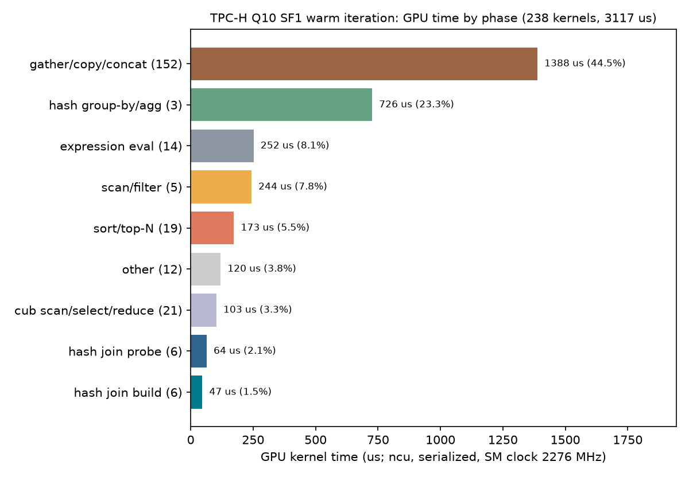
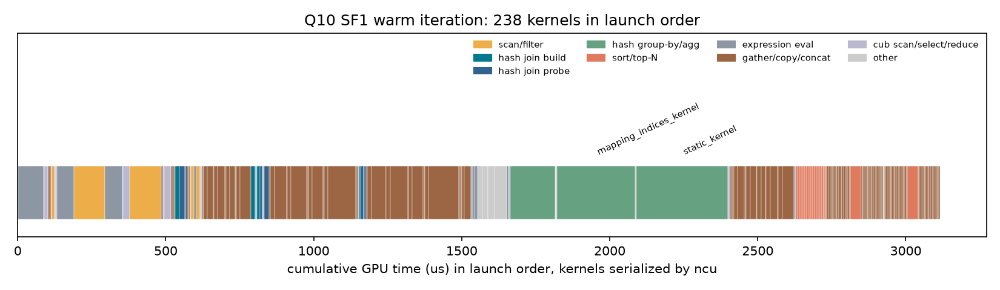
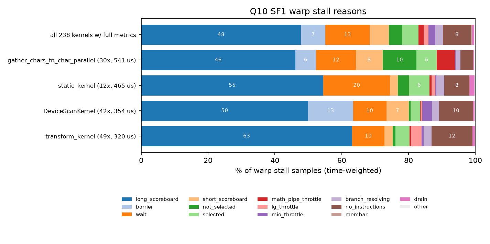
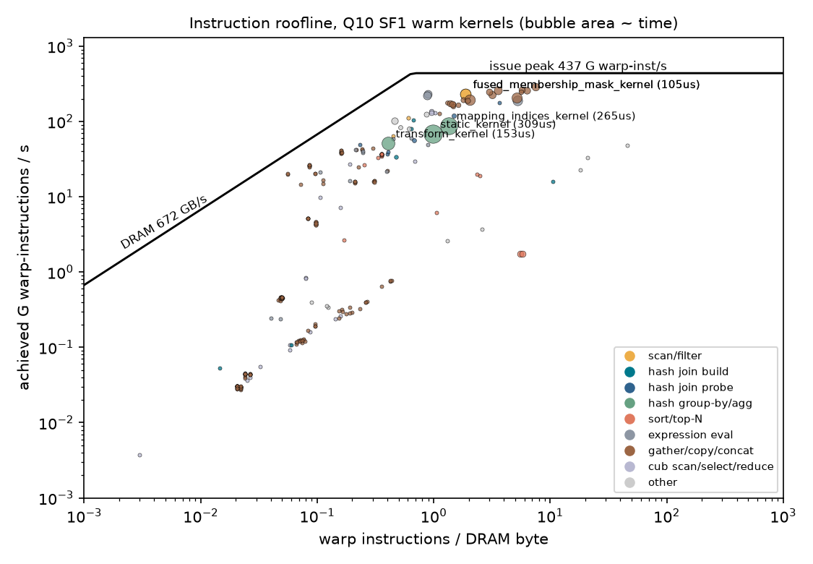

# TPC-H Q10 (SF1) on Sirius, all referenced columns pinned on GPU — Workload Analysis

**Date**: 2026-11-13
**GPU**: NVIDIA GeForce RTX 5070, 12 GB GDDR7 (192-bit, 672 GB/s), Blackwell sm_120, 48 SMs
**Workload**: TPC-H Query 10 (returned-item reporting: customer ⋈ orders ⋈ lineitem ⋈ nation; order-date window [1994-03-01, 1994-06-01), `l_returnflag = 'R'`; revenue = sum(l_extendedprice·(1−l_discount)) grouped by 7 columns incl. 5 strings; ORDER BY revenue DESC LIMIT 20), scale factor 1. All 16 referenced columns of the 4 tables are pinned in GPU memory with `pin_table(tier='gpu')` (140.36 MB); measured iterations read no file and copy no table data host→device (§3).
**Framework**: Sirius (`sirius-duckdb` release build), DuckDB v2.0, stock libcudf from the pixi env, CUDA runtime 13.5
**Pipeline**: `scripts/tpch_sf1/profile_query.sh 10` (7.0 min end-to-end: 16 s for sql/timing/pcie/selftest + 407 s for the rest; stages sql 1 s, timing 1 s, pcie 7 s, selftest 7 s, list 30 s, detail 352 s, extract 25 s, validate 0 s); every number below comes from a file in this directory.
**Labels**: *measured* = read from a profiler/log file; *inferred* = derived by arithmetic or reasoning from measured data.

---

## 1. Executive Summary

A warm Q10 takes **10.0 ms end-to-end** (median of 12 timed runs after 3 warmups, range 9–11 ms, 1 ms `.timer`; *measured*, `timing_summary.txt`). DuckDB on the CPU takes 51.5 ms (min 46, max 59), so the GPU is 5.2x faster. The 20-row result equals DuckDB-CPU exactly (compare mode `exact`, max relative difference 0.0, tolerance 1e-9, identical across all 15 GPU iterations; `timing.json`). The physical floor is **208.9 µs** (read the 140.36 MB of pinned columns once at 672 GB/s, `physical_floor.md`), so Sirius is **47.9x above the floor** end to end. The GPU is busy for a fifth of the wall time:

| Where the 10.0 ms go (median warm iteration) | ms | Source |
|---|---:|---|
| Planning (DuckDB optimizer + Sirius plan build, 22 pipelines) | 2 | Sirius log (1 ms stamps), *measured* |
| Engine window (unprofiled run) | 7 | Sirius log, *measured* |
| ↳ of which GPU busy (kernels + copies, real clocks, nsys) | **2.0** | `nsys_iteration_breakdown.txt`, *measured* |
| ↳ of which GPU idle (host orchestration) | ~5.0 | 7 − 1.999, *inferred* (two different runs) |
| Gap from `QueryEnd` to next statement | 0 | Sirius log, *measured* |

The log stamps sum to 9 ms against the 10.0 ms `.timer` median (1 ms resolution on each). Inside the 1.999 ms of GPU time (nsys: 238 kernels per iteration, deterministic; kernel sum 1,912.0 µs):

1. **String gathers: `gather_chars_fn_char_parallel` 338.3 µs (17.7%) + `gather_chars_fn_string_parallel` 167.0 µs (8.7%) = 505.3 µs (26.4%), 38 launches.** The 5 string columns (customer name/address/phone/comment, `n_name`) are re-gathered at every partition/concat/join-output step. The char-parallel kernel copies **one byte per lane** (`LDG.E.U8` → `STG.E.U8`) and 23.8% of its stall samples sit on that store (§8).
2. **Group-by on 7 keys: `static_kernel` (`compute_single_pass_aggs_sparse_output_fn`) + `mapping_indices_kernel` = 330.4 + 170.2 µs (nsys, the `static_kernel` row includes 11 other launches); the two group-by launches alone are 309.1 + 264.9 µs in ncu (18.4% of ncu time).** The hash-set row comparator compares strings byte by byte (`LD.E.U8` ×2 → `ISETP.NE`), 38.7% of the stall samples of the longest launch (§8, §9).
3. The other launches are small cub scans/selects (84 `DeviceScan*` launches), 49 `transform_kernel`, dynamic-filter probes (2 × ~105 µs + 1 × 13.6 µs ncu = 224.0 µs) and hash-join pieces: 116 kernels run < 5 µs (ncu), 196 are below one wave, 104 are single-CTA.

The kernels move **268.65 MB of DRAM traffic** (ncu, cold L2) against a floor of 140.36 MB (1.91x) and take 9.2x the floor time (nsys kernel sum). Q10 at SF1 is **host-orchestration-bound** (GPU busy = 20% of wall); inside the GPU it is latency- and instruction-bound (string byte loops), not bandwidth-bound: no kernel above 100 µs exceeds 19% of DRAM peak.

---

## 2. Workload Description

**Query** (`sql/q10_timing.sql`, text from `sirius/test/tpch_performance/tpch_queries/orig/q10.sql`): constants are the standard ones for the window but read from the file: `o_orderdate >= '1994-03-01' and < '1994-06-01'`, `l_returnflag = 'R'`, `limit 20`. Result: 20 rows, 3,538 B as CSV (`result.csv`; top row Customer#000012004, revenue 667,424.0692).

**Row counts and selectivities** (DuckDB-CPU on the same Parquet; *measured*, `physical_floor.md`):

| Step | Rows |
|---|---:|
| lineitem / orders / customer / nation | 6,001,215 / 1,500,000 / 150,000 / 25 |
| orders in the 3-month window | 57,420 (3.83%), from 42,567 distinct customers |
| lineitem with `l_returnflag='R'` | 1,478,870 (24.6%) |
| lineitem 'R' rows in window orders (join result) | 114,929 (1.92% of lineitem) |
| groups (distinct customers) | 37,922 |
| result | 20 rows |

**Sirius plan** (`query_plan.txt`; *measured*): 22 pipelines: 4 `GPU_SCAN`, 3 `HASH_JOIN` (pipelines 9, 15, 18), 2 `DYNAMIC_FILTER` (each right after a `GPU_SCAN`), PARTITION + CONCAT pairs between steps, `HASH_GROUP_BY` (id 23, fused behind the last join) → `MERGE_GROUP_BY` → `TOP_N` → `MERGE_TOP_N` → `RESULT_COLLECTOR`. The plan has no late-materialisation step: string payload columns travel through every join/partition.

**Pinned footprint** (`traces/sirius_log_timing/*.log`, `gpu_pool … allocated=` after each `pin_table`; *measured*): customer 23,334,912 B, orders 15,000,320 B, lineitem 102,021,888 B, nation 768 B; **total 140,357,888 B** (`pcie_verification.txt`: 140357888). Customer is 16.6% of the footprint because of 19,584,155 B of string characters. GPU pool high-water mark for the process: 447,799,461 B (447.8 MB; a process-lifetime mark that includes the pin phase; no spill). The one-off pin is excluded from all numbers.

---

## 3. PCIe Verification (no table data crosses PCIe in measured iterations)

Sources: `pcie_verification.txt`, `pcie.json`, `ncu_sysmem_check.txt`, `ncu_log_checks_list.txt`, `ncu_log_checks_detail.txt`, `selftest_negative_control.txt`. **OVERALL: PASS.** All numbers *measured*.

| Evidence | Result |
|---|---|
| Pin tier | `sql:pin_tier_gpu`: every pinned SQL script pins each referenced table once with `tier='gpu'`; timing and nsys Sirius logs each show 4 `CALL pin_table` statements, all `tier='gpu'` (customer, lineitem, nation, orders) |
| Scans served from the pin | `pinned_entry_per_gpu_scan`: every iteration `#assigned pinned entry` == `#GPU_SCAN` operators (4); 0 cache-assignment errors |
| File cache | 16 `cache summary` lines for 15 iterations (summary k describes iteration k−1): `last_cycle[reads=0 hits=0 h2d=0 miss=0 …]` for iterations 1–15; nsys run 9 summaries for 8 iterations, same |
| Downgrade / spill / OOM lines during queries | 0 |
| Pool counters | `gpu_pool allocated` == pinned footprint 140,357,888 B at `QueryBegin` and `QueryEnd` of every iteration; `host_pool` allocated and peak unchanged from iteration 2 |
| Dynamic-filter publication through host staging | check line: "0 dynamic-filter publications, all through peer copies (device-side)". The log records 2 publications per iteration (57,420 and 114,929 build rows) but no transport line, so the check counted 0 and shows nothing about the transport. That no filter crosses PCIe is inferred from the H2D bound (5,981 B per iteration, largest 768 B) |
| Parquet decode / decompression kernels (nsys, 1,904 kernels in 8 iterations) | 0 |
| Unified memory | UM CPU+GPU page-fault collection on; 0 faults in the 5 measured iterations; no managed-memory API call in the trace |
| Kernels reading host memory in place (ncu SM/tex sysmem aperture) | `ncu_sysmem_check.txt`: 238 kernels, 0 with SM (tex) sysmem-aperture sectors (total 0); all-source sysmem sectors 265–285 per kernel (info only); `pcie__read/write_bytes` 1,024 / 2,593,280 B (rate × duration, includes driver/ncu traffic) → PASS |
| The ncu runs themselves | all three list runs and the `--set full` run pass the same log checks (`OVERALL ncu list logs: PASS`, `OVERALL ncu detail logs: PASS`) |

nsys CUDA trace (`traces/q10_nsys.sqlite`, Nsight Systems 2025.5.2), copies by memory kind, per measured iteration (identical in all 5):

| Direction | Copies | Bytes | Largest single copy | Limit | Interpretation |
|---|---:|---:|---:|---|---|
| H2D (pinned/pageable → device) | 119 | 5,981 | 768 B | single ≤ 65,536 B, total ≤ 1,048,576 B | scalars/parameter arrays (*inferred* from sizes) |
| D2H (device → pinned/pageable) | 127 | 70,011 | 16,384 B | total ≤ 262,144 B | size/count readbacks, string offsets, result (*inferred*) |
| D2D | 25 | 1,383,279 | 230,536 B | — | on-device |

**D2H limit**: result CSV is 3,538 B, so max(256 KiB, 4 × 3,538 B) = **262,144 B: the default limit held** (`Byte limits … d2h_max_iter 262144`, equal to its default; no `PCIE_*` override). Measured 70,011 B per iteration is 26.7% of the limit and 19.8x the CSV size; the wide string result did not need an override. The single-copy H2D limit (65,536 B) is data-relative (half the rows of `customer`, the smallest table with ≥ 8,192 rows, = 75,000, capped at 64 KiB). `nation` (25 rows) is below the byte-limit resolution; for it the evidence is the log checks plus the sysmem-aperture check. The pin phase copied 42.57 MB H2D (largest 1 MiB) and is outside the measured iterations.

**Negative control** (`selftest_negative_control.txt`): the same run with `lineitem` left unpinned makes `pcie_verify.py` exit 1 (expected) with 10 FAIL lines: pinned tables ≠ referenced tables (sql, timing log, nsys log), "3 assigned for 4 GPU_SCANs, missing tables ['lineitem']", non-zero file-cache reads (`reads=18 … h2d=39 miss=3`), Parquet decode kernels (`count_page_headers_kernel`, `compute_page_string_sizes_kernel`, `build_string_dictionary_index_kernel`), H2D 25,418,960 B per iteration (largest 3,560,399 B vs single limit 65,536 B) and D2H 929,589 B (largest 95,040 B vs 262,144 B limit). `SELFTEST: PASS (verification detected the unpinned table)`.

Not covered: nsys writes UM fault tables only when a fault happens (none present); the aggregate SM aperture counter reads 0 everywhere, so its sensitivity could not be tested here.

---

## 4. Environment

| Component | Version / setting |
|---|---|
| GPU / driver | RTX 5070 (sm_120, 48 SMs, 12 GB, 48 MB L2) / 580.173.02 (copied from the Q8/Q9 reports; not re-queried) |
| Nsight Compute | 2025.2.1 via `sudo -n` (copied from Q9); `--set full --import-source yes` on all 238 warm kernels |
| ncu clocks | locked by ncu: SM ≈ 2.28 GHz (median, `ncu_extract_summary.txt`: 2276 MHz) |
| Nsight Systems | 2025.5.2 (`/home/sai/nsight-systems-2025.5`); `-t cuda -s none --cpuctxsw=none` plus UM page-fault collection |
| CPU | Intel i9-13900K, 125 GB RAM (copied from Q8/Q9; not re-queried) |
| Sirius config | `scripts/tpch_sf1/sirius.yaml`: 4 pipeline threads, GPU pool 25% of 12 GB, 1 GB pinned host pool (2 pools), `enable_duckdb_fallback=false` (unchanged) |

---

## 5. Physical Floor vs Measured

Details: `physical_floor.md` (written before reading any profile).

| Scenario | Bytes | Floor @ 672 GB/s |
|---|---:|---:|
| A. Read every pinned column once (narrowed) | 140.36 MB | **208.9 µs** |
| A'. Native widths (*inferred* widths) | 168.41 MB | 250.6 µs |
| A-min. Only predicate/join-forced columns | ≈ 38.9 MB | 57.9 µs |
| B. A + join intermediate + customer strings gathered for 114,929 rows (upper bound) | ≈ 175.9 MB | 261.7 µs |

Compute floor: ~0.15 G simple ops → < 15 µs (*inferred*). Launch-count bound: 238 kernels x ~2 µs ≈ 0.48 ms (*inferred*; the 2 µs is carried over from Q2 via `physical_floor.md`, not measured here; the smallest kernels here are in the same range, see §6).

| Measured | Value | x floor (208.9 µs) |
|---|---:|---:|
| End-to-end warm median (`.timer`) | 10.0 ms | 47.9x |
| Engine window (Sirius log, unprofiled) | 7 ms | 33.5x |
| GPU busy per iteration (nsys, real clocks) | 1.999 ms (1.998–2.008) | 9.6x |
| Sum of kernel durations (nsys) | 1.912 ms | 9.2x |
| Sum of kernel durations (ncu, serialized, 2.28 GHz, L2 flushed before each kernel) | 3.117 ms | 14.9x |
| First→last GPU op (nsys, includes idle gaps) | 9.39 ms (median) | 44.9x |
| DRAM bytes moved by all 238 kernels (ncu, cold L2) | 268.65 MB | 1.91x of A's bytes |

Unlike the earlier selective queries, Q10 moves *more* bytes than the pinned footprint: the string payload is gathered repeatedly (ncu: 38 `gather_chars` launches move 55.6 MB, group-by kernels 57.9 MB, `phase_breakdown.txt`). GPU busy is 4.2x the launch-count bound (0.48 ms, *inferred*), i.e. there is real work above pure launch latency (the string loops), but host idle time (~5 ms) is the larger term.

---

## 6. Kernel, Phase and Operator Breakdown

Sources: `warm_kernel_summary.txt`, `phase_breakdown.txt`, `operator_breakdown.txt`, `nsys_iteration_breakdown.txt`. ncu times are serialized, clock-locked and taken with L2 flushed before each kernel (DRAM bytes and hit rates are cold-cache values); nsys times are at real clocks with concurrency. ncu/nsys kernel-sum ratio is 1.63.

| Phase (`kclass.py`) | Kernels | ncu µs | % | DRAM MB |
|---|---:|---:|---:|---:|
| gather / copy / concat | 152 | 1,388.3 | 44.5 | 94.67 |
| hash group-by / agg | 3 | 726.4 | 23.3 | 57.87 |
| expression eval (AST, binary, cast) | 14 | 252.1 | 8.1 | 39.46 |
| scan / filter (dynamic-filter probe + key-set build) | 5 | 243.6 | 7.8 | 30.74 |
| sort / top-N | 19 | 172.9 | 5.5 | 8.59 |
| other (fill/sequence/init) | 12 | 119.6 | 3.8 | 17.29 |
| cub scan / select / reduce | 21 | 102.9 | 3.3 | 9.62 |
| hash join probe | 6 | 64.1 | 2.1 | 6.12 |
| hash join build | 6 | 46.5 | 1.5 | 4.30 |
| **Total** | **238** | **3,116.5** | 100 | 268.65 |

| Kernel family | Launches | ncu µs (%) | nsys µs/iter (%) |
|---|---:|---:|---:|
| `gather_chars_fn_char_parallel` | 30 | 540.8 (17.4) | 338.3 (17.7) |
| `static_kernel` (cub for_each: group-by aggs, filters) | 12 | 464.5 (14.9) | 330.4 (17.3) |
| `DeviceScanKernel` (+ 42 `DeviceScanInitKernel`, 84.4 µs ncu) | 42 | 353.8 (11.4) | 168.6 (8.8) |
| `transform_kernel` | 49 | 319.8 (10.3) | 183.3 (9.6) |
| `gather_chars_fn_string_parallel` | 8 | 290.4 (9.3) | 167.0 (8.7) |
| `mapping_indices_kernel` (group-by) | 1 | 264.9 (8.5) | 170.2 (8.9) |
| `fused_membership_mask_kernel` (dyn.-filter probe) | 3 | 224.0 (7.2) | 169.6 (8.9) |

Operator view (`operator_breakdown.txt`): **string gathers 40.1% (114 kernels, 1,248.7 µs)**, group-by/aggregation 23.3% (3), dynamic-filter probe 7.2% (3), sort/top-N 5.5% (19 kernels; `DeviceTopKKernel` 15 launches, `DeviceRadixSortSingleTileKernel` 2 launches 73.4 µs), binary-op expression 4.8% (7), fixed-width gathers 4.5% (38), AST 2.7% (1). `other:` rows (`transform_kernel`, `static_kernel`) total 5.6 µs (0.2%), so no `kclass.py` rule was added.

Small-kernel profile (*measured*, `phase_breakdown.txt`, `ncu_warm_metrics.json`): median kernel 5.09 µs (ncu); 116 kernels < 5 µs, 178 < 10 µs (22.6% of ncu time); 196 of 238 below one wave (1,171.6 µs); 135 with grid < 48 CTAs; **104 kernels with grid = 1 hold 431.5 µs (13.8%)**. Only **42 kernels fill the GPU (≥ 1 wave) and hold 1,944.9 µs (62.4%)**. Top-10 kernels hold 43.0%.





---

## 7. Top Kernels (ncu `--set full`)

Sources: `top_kernel_details.txt`, `ncu_warm_metrics.json`, `plots/q10_roofline.png`, `plots/q10_stalls.png`.

| Kernel (launch pos) | µs | Grid x Blk | Regs | Occ. ach/theo | IPC | DRAM GB/s (%) | L1 / L2 hit | Top stalls (%) |
|---|---:|---|---:|---|---:|---|---|---|
| group-by `static_kernel` (121) | 309.1 | 225x256 | 128 | 23.7 / 33.3 | 0.76 | 69.6 (10.5) | 91.2 / 40.8 | long_sb 58.5, wait 24.7 |
| group-by `mapping_indices_kernel` (119) | 264.9 | 240x128 | 84 | 33.4 / 41.7 | 0.92 | 65.1 (9.8) | 93.3 / 34.5 | long_sb 42.8, barrier 24.0, wait 19.6 |
| group-by `transform_kernel` (116) | 152.5 | 57x256 | 64 | 19.8 / 66.7 | 0.58 | 125.4 (19.0) | 91.8 / 55.2 | long_sb 63.0, wait 13.4 |
| `fused_membership_mask` (13, 17) | 105.4 / 105.0 | 4096x256 | 48 | 79.8 / 83.3 | 2.18 | 122.5 / 122.9 (18.5) | 39.1 / 51.0 | long_sb 41.0, wait 19.4, short_sb 10.2 |
| `gather_chars_fn_string_parallel` (99, 77) | 102.6 / 94.8 | 28733x128 | 37 | 87.9 / 100 | 1.81 / 1.94 | 94.8 / 40.3 (14.3 / 6.1) | 76.8 / 47.3 | long_sb 74.4, wait 10.4 |
| `compute_column_kernel<128,0,0>` (1) | 85.5 | 11719x128 | 40 | 91.0 / 100 | 1.88 | 36.1 (5.5) | 95.2 / 94.7 | long_sb 36.6, wait 16.8, lg_throttle 12.0 |
| `static_kernel` (14, 12) | 59.8 / 57.3 | 5859x256 | 40 | 91.5 / 100 | 2.29 | 252.5 / 263.3 (38.2 / 39.8) | 70.5 / 13.6 | n/a |
| `gather_chars_fn_char_parallel` (92) | 59.4 | 3592x128 | 36 | 90.0 | 2.60 | 71.8 (10.9) | n/a | long_sb 44.3 (SASS) |
| `add_if_shmem` (112) | 40.8 | 48x512 | 123 | 32.2 | 1.13 | 217.9 (33.0) | n/a | n/a |
| `DeviceRadixSortSingleTile` (219, 180) | 36.7 each | 1x256 | 95 | 16.7 | 0.79 | 0.3 (0.1) | n/a | n/a |

- Group-by launches vs their DRAM floor (cold L2; bytes ÷ 672 GB/s, *inferred*): pos 121 21.50 MB → 32.0 µs, measured 309.1 µs = **9.7x**; pos 119 17.25 MB → 25.7 µs, 264.9 µs = **10.3x**; string gather pos 99 9.72 MB → 14.5 µs, 102.6 µs = 7.1x; char gather pos 92 4.27 MB → 6.4 µs, 59.4 µs = 9.4x.
- pos 121 issues 2.12e7 warp instructions in 309.1 µs = 68.6 G warp-inst/s against a ceiling of ~440 G/s (48 SMs x 4 x 2.29 GHz, *inferred*), 15.6%; thread efficiency 11.4 (≈ 11.4 of 32 lanes active per instruction, 36%), 128 regs and 5,993 local-spill static instructions. grid 225 x 256 = 57,600 threads for 114,929 rows (*inferred*: ~2 rows per thread).
- pos 99/77 are the largest GPU-filling gathers (49.9 waves, grid 28,733 → 3.68 M threads) at IPC 1.8–1.9 and 74%/72% long-scoreboard stalls.
- Fused membership probes (pos 13, 17) run 17.07 waves at 18.5% of DRAM peak and 53.7% SM throughput; 3 launches total 224.0 µs (7.2%).
- Time-weighted stall mix over all 238 kernels: long scoreboard 47.8%, wait 13.3%, no_instructions 8.4%, barrier 7.3%, short scoreboard 5.7% (`ncu_extract_summary.txt`).
- Roofline: the highest DRAM rate of any kernel is 362.1 GB/s (53.9% of peak) on a 5.1 µs, 1.84 MB `transform_kernel` (pos 5); among kernels > 50 µs the best is `static_kernel` pos 12/14 at 252–263 GB/s (38.2–39.8%). The large kernels are limited by dependent-load latency and instruction count, not DRAM. The 104 single-CTA kernels sit orders of magnitude below both ceilings.





---

## 8. Instruction-Level Evidence — `strings::gather_chars_fn_char_parallel` (#1 family, 17.4% ncu / 17.7% nsys; longest launch pos 92, 59.4 µs)

Source: `sass/gather_chars_fn_char_parallel_hotspots.txt`, `…_inst_inventory.csv`, `…_pos92_source.csv` (5,694 stall samples). The #2 family (`static_kernel`, pos 121, the group-by) is analysed below because it is the longest single launch.

| Property | Value | Label |
|---|---|---|
| Kernel | libcudf `gather` of string characters: each thread locates its source string by a binary search over the offsets in shared memory, then copies one byte | measured (name, SASS); role *inferred* from code |
| Launch | 3,592 CTAs x 128, 6.24 waves, occupancy 90.0%, IPC 2.60 | measured |
| Static vs executed | 416 SASS instructions, 180 (43.3%) ever execute; 1.526e7 warp instructions, thread efficiency 31/32 | measured |
| Mix (% executed / % stall samples) | integer 56.3 / 55.6, global store 0.6 / 23.8, control 7.7 / 6.1, shared load 3.8 / 6.1 | measured |

| Instruction | Executions (warps) | Samples | Reason |
|---|---:|---:|---|
| `STG.E.U8 desc[UR6][R10.64], R9` @ +0x018f0 | 91,716 | **1,353 (23.8%)** | long scoreboard 1,338 |
| `@!P0 SHF.R.S32.HI R11, RZ, 0x1f, R10` @ +0x01850 | 91,716 | **640 (11.2%)** | long scoreboard 620 |
| `SHF.R.S32.HI R12, RZ, 0x1f, R0` @ +0x01770 | 91,716 | 424 (7.4%) | long scoreboard 400 |
| `ISETP.GE.S64.AND P0, PT, R4, R16, PT` @ +0x01470 | 463,134 | 391 (6.9%) | short scoreboard 311 |
| `LDS.64 R8, [R11]` @ +0x012d0 | 14,368 | 255 (4.5%) | barrier 255 |

Dependency chain at the hot PCs (per output byte: load source offset → address → load byte → store byte):

```
+0x01840  @!P0 LD.E R10, desc[UR6][R14.64]     // load the source string's offset (generic LD)
+0x01850  @!P0 SHF.R.S32.HI R11, RZ, 0x1f, R10 // first consumer of R10, stalls on that load        samp=640  <- long_sb
+0x018b0  LDG.E.U8 R9, desc[UR6][R8.64]        // load ONE source byte
+0x018f0  STG.E.U8 desc[UR6][R10.64], R9       // store ONE byte, waits for the byte load            samp=1353 <- long_sb
+0x01470  ISETP.GE.S64.AND P0,PT,R4,R16,PT     // binary search compare after LDS.64 [R12] (+0x01450), short_sb samp=391
```

The binary-search loop (+0x01400…+0x01530) executes 463,134 times for 91,716 byte-copy iterations = **5.05 search steps per copied byte** (*inferred*, ratio of PC execution counts). With thr = 31.0 active lanes the launch copies ≈ 91,716 x 31 = 2.84 M bytes (*inferred*), i.e. one 1-byte load and one 1-byte store per lane: each warp-level `STG.E.U8` moves 31 B. Per byte: 1 dependent-load pair, 5 shared-memory search steps, ~166 warp instructions per warp-level byte-copy iteration (1.526e7 / 91,716, *inferred*), i.e. about 5.4 per byte at 31 active lanes (*inferred*).

Arithmetic (*inferred*): 59.4 µs x 2.28 GHz = 135 K cycles/SM; DRAM floor for the 4.27 MB is 6.4 µs, so the kernel runs **9.4x its bandwidth floor** with IPC 2.60 of 4: it is instruction- and latency-bound per byte, not bandwidth-bound. The 30 char-parallel launches (540.8 µs ncu) repeat this cost for each string column and each re-gather.

**Family #2 / longest launch — group-by `static_kernel` pos 121** (`sass/static_kernel_hotspots.txt`, 27,226 samples, 115,768 static instructions, 860 (0.7%) executed): **38.7% of samples (10,543) sit on one instruction**:

```
+0x167ee0  LD.E.U8 R25, desc[UR8][R22.64]      // byte of the probing row's string        (after 4 R2UR descriptor moves)
+0x167ef0  LD.E.U8 R26, desc[UR10][R20.64]     // byte of the stored group key's string
+0x167f00  ISETP.NE.U32.AND P0, PT, R25, R26   // compare, stalls on both loads  samp=10543 <- long_sb 10,321
+0x167f10  @P0 BREAK.RELIABLE B0               // leave the compare loop on mismatch      samp=1211
+0x167f20  @!P0 BRA 0x…7e50 → IADD R24,R24,1; ISETP.NE R24,R40; @!P0 BRA …  (loop trip)
```

That loop executes 1,036,651 times at **9.0 active lanes**, entered ~31,970 times (+0x167e10, 12 lanes) → ≈ 32 byte-compare trips per entry (*inferred*): the cuco hash-set's `device_row_comparator` compares string key columns one byte per trip. Stall mix of the launch: long scoreboard 58.5%, wait 24.7% (attributed to the `R2UR` descriptor moves and loop bookkeeping, *inferred*), selected 7.2% (`ncu`).

---

## 9. Root Cause Analysis

### RC1 — Host orchestration: ~5 ms of the 7 ms engine window has an idle GPU

```
Symptom: engine 7 ms (log, unprofiled), GPU busy 1.999 ms (nsys): GPU ~71% idle inside the engine window; first→last GPU op 9.39 ms (nsys)   [measured/inferred]
 → WHY? per iteration the host issues 452 cudaStreamSynchronize + 61 cuStreamSynchronize, 368 pool allocs + 368 frees, 257 batched +
   11 plain memcpys, 100 memsets and 238 launches (`nsys_iteration_breakdown.txt`)                                  [measured, nsys]
 → WHY do they serialise? 2.104 + 0.921 = 3.03 ms of CPU time per iteration (summed over threads, under nsys) sits inside stream syncs;
   the median kernel is 5.09 µs (ncu full pass); that each sync waits for such a kernel before the next step is issued is inferred (nsys gives only call counts and summed CPU time)   [counts measured; waiting inferred]
 ROOT: operator-at-a-time execution of a 22-pipeline plan with host round trips for sizes/counts (string offsets, partition sizes) between
       small kernels; at SF1 per-step host latency exceeds the GPU work of the step. Planning (2 ms) is a separate CPU cost.
```

### RC2 — String payload gathers: 505.3 µs nsys (26.4%), 1,248.7 µs ncu (40.1%) in 114 string-gather-operator kernels

```
Symptom: 38 `gather_chars` launches = 831.2 µs ncu / 55.6 MB DRAM (66.9 GB/s average, 10% of peak); pos 92 runs 9.4x, pos 99 7.1x its DRAM floor   [measured/inferred]
 → WHY slow for few bytes? char-parallel kernel copies one byte per lane: LD.E offset → LDG.E.U8 → STG.E.U8; 23.8% of samples on the STG waiting for the
   byte load, 11.2% on the offset load consumer, 5.05 shared-memory binary-search steps per byte                    [measured SASS; ratio inferred]
 → WHY so many gathers? customer's c_name/c_address/c_phone/c_comment (19.58 MB of chars) and n_name are carried as payload through every
   PARTITION/CONCAT/join-output step instead of being fetched once for the 20 output rows; the same 5 columns are gathered at grids of 1,186,
   3,592, 9,481 and 28,733 CTAs, i.e. at several different row counts                                                  [measured grids; payload carrying inferred from plan]
 → WHY is the payload carried? the 7-column GROUP BY (c_name, c_address, c_phone, c_comment, n_name are all keys) forces the strings to the group-by
   before the TOP_N; the plan has no late-materialisation step                                                        [inferred from query text + plan]
 ROOT: general-purpose gather copies variable-length strings with 1-byte lane accesses; Q10's wide string payload makes this the biggest GPU-side time sink.
```

### RC3 — Group-by on 7 keys with 5 string columns: 726.4 µs ncu (23.3%), 3 launches (`static_kernel` 309.1, `mapping_indices_kernel` 264.9, `transform_kernel` 152.5)

```
Symptom: 37,922 groups from 114,929 rows take 726.4 µs ncu = 9.7x / 10.3x the DRAM floor of the two big launches; IPC 0.76 / 0.92 of 4  [measured/inferred]
 → WHY low IPC? 38.7% of pos 121 samples on `ISETP.NE` after two `LD.E.U8` in the string-compare loop (9.0 active lanes, ~32 trips per entry), 58.5% long scoreboard   [measured SASS]
 → WHY a byte loop per key compare? the cuco static_set row comparator (`equality::device_row_comparator`) walks both strings byte by byte; with
   5 string keys every hash-slot candidate costs up to 5 such loops; thread efficiency 11.4 / 9.2, 128 regs + 5,993 spill instrs   [measured; mechanism inferred from SASS + kernel name]
 → WHY 7 keys? SQL groups by all 7 selected columns although c_custkey alone determines the others; the plan carries all 7 as keys   [inferred from query text]
 ROOT: key comparison cost scales with total key bytes (strings ~130 B/row customer payload), not with row count; the kernel is latency- and spill-bound at 15.6% of the issue ceiling.
```

---

## 10. Gap Analysis

| Component of the 10.0 ms warm wall time | ms | Evidence | Label |
|---|---:|---|---|
| Planning | 2 | Sirius log | measured |
| Gap to next statement | 0 | Sirius log | measured |
| GPU idle inside engine (RC1) | ~5.0 | log 7 − nsys 1.999 | inferred |
| String gathers (RC2: `gather_chars_*`) | 0.505 | nsys 338.3 + 167.0 µs | measured |
| Group-by static_kernel + mapping_indices (RC3) | ≤ 0.501 | nsys 330.4 (all 12 `static_kernel` launches) + 170.2 µs | measured (upper bound) |
| Dynamic-filter probes | 0.170 | nsys | measured |
| `transform_kernel` (49 launches) | 0.183 | nsys | measured |
| Other kernels | ~0.554 | nsys kernel sum 1.912 − 0.505 − 0.500 − 0.170 − 0.183 | inferred |
| Copies / memsets (nsys busy − kernel sum) | ~0.087 | 1.999 − 1.912 | inferred |
| Physical floor | 0.209 | `physical_floor.md` | computed |

Components are medians of 1 ms stamps (planning 2 + engine 7 + gap 0 = 9 vs `.timer` 10.0) and do not sum exactly. nsys lengthens the engine window to 10 ms (median) and planning to 3 ms by intercepting ~2,700 API calls per iteration, so nsys host-side times are used for counts and ratios only. Wall/floor = 47.9x; engine/floor = 33.5x; GPU-busy/floor = 9.6x; kernel-sum/floor = 9.2x. The floor (209 µs) is below the GPU time of the string gathers plus the group-by alone (~1.0 ms).

---

## 11. Optimization Directions (generic; no query-specific fusion)

| # | Direction | Expected effect | Evidence |
|---|---|---|---|
| 1 | Fewer host round trips in the Sirius executor: avoid per-step stream syncs for size readbacks, reuse pool allocations, batch small copies | targets ~5 ms of idle GPU in the engine window | RC1: 513 syncs, 368 allocs per iteration |
| 2 | Plan caching for repeated statements | targets the 2 ms planning | log |
| 3 | Late materialisation of string payload as a planner/executor policy: carry row indices (and `c_custkey`) through joins, gather the string columns once after group-by/TOP_N for the 20 rows | removes most of the 114 string-gather kernels (up to 1.25 ms ncu / 0.5 ms nsys, upper bound) | RC2 |
| 4 | Remove functionally dependent group keys in the planner (group by `c_custkey`, carry the rest as `any_value`/payload) — a general DuckDB/Sirius optimisation | group-by key compares drop from 7 columns to 1 integer; targets the 0.73 ms ncu group-by | RC3 (inferred; needs the plan's key list) |
| 5 | libcudf string comparator: compare 4/8/16-byte words (or hash first, then compare) instead of one byte per trip | up to ~2x on the 38.7%-stalled loop | §8: 1.04 M byte-trips, 9.0 active lanes |
| 6 | libcudf `gather_chars`: vectorised/word copies per string (coalesced 16 B loads/stores) and warp-cooperative search instead of 5 shared-memory binary-search steps per byte | fewer instructions per byte (~5.4 warp-inst per byte now, ~166 per 31-byte warp iteration) | §8 |
| 7 | Dynamic-filter probe: bitmap/Bloom pre-test so rows skip the hash → slot-load chain | part of 0.17 ms | §7 (long_sb 41%) |

Fusing Q10's specific operator chain would also remove launches, but it is out of scope by project policy: cuDF kernels stay general-purpose library operators.

---

## 12. Determinism and Profiling Method

- **Launch counts are deterministic** (*measured*, `warm_kernel_summary.txt`, `ncu_plan.json`, `pcie.json`): every iteration = 238 launches in the three ncu list runs (pin+3/4/5 iterations: 1,240 / 1,478 / 1,716) and in all 8 nsys iterations; kernel-name multisets of the added iterations are identical (`STABLE: True`).
- **Launch order is not**: the 4 pipeline threads interleave; iterations 4 and 5 of one run differ at 13 positions and the x4 vs x5 prefix at 46. The `-s 1478 -c 238` slice needs only counts and multisets; the 238 kernel names match the expected multiset (`ncu_slice_check.txt`: multiset match True; 1 name reconciled on function/grid/block).
- **ncu policy branch**: 238 ≤ `NCU_FULL_MAX` (1000) → `full_all`, `--set full --import-source yes` on all 238 launches. The light + families branch was not used.
- nsys windows: 5 measured iterations (4–8), kernel counts [238]x5, GPU busy 1.998–2.008 ms.
- Timing: 3 warmups + 12 timed iterations; first (cold) iteration 70.0 ms; DuckDB-CPU first 64.0 ms.
- Pipeline validation: `validate_pipeline.txt` → 72 PASS, 0 FAIL, 1 PENDING (the report).

## 13. Limitations

- ncu durations are serialized, clock-locked (2.28 GHz) and taken after L2 flushes; tiny kernels are overstated (ncu/nsys 1.63 overall). Real-clock kernel times come from nsys.
- ncu flushes L2 before each profiled kernel, so the 268.65 MB of "DRAM traffic" is cold-cache traffic; in the real run the 140.36 MB pinned set exceeds the 48 MB L2 but intermediates (1.38 MB D2D per iteration) can hit.
- Wall splits come from 1 ms Sirius log stamps and the 1 ms `.timer`; the ~5 ms "GPU idle" is a difference of two runs (log: unprofiled, GPU busy: nsys) and carries about ±1 ms.
- Native column widths (21 B/row lineitem etc.), the claim that group-by keys are all 7 columns, the 2-rows-per-thread mapping of pos 121, the number of string columns gathered at each step and which table each probe/gather launch scans are inferred from query text, grid sizes and counts, not read from Sirius. The nsys `static_kernel` row (330.4 µs) mixes the group-by launch with 11 other `static_kernel` launches.
- The comparator-loop and char-copy mechanisms (RC2/RC3) are read from SASS execution/active-lane counts and kernel names; no lane-level trace or source-level check of libcudf was done. SASS covers the top-2 families only; `transform_kernel` (pos 116, 152.5 µs, classified group-by), `mapping_indices_kernel` and the sort/top-N kernels are analysed from ncu metrics only.
- Stall-sample counts on small kernels are small; SASS chains are reliable in kind, not in exact percentages. The ~2 µs launch floor is carried over from Q2 (`physical_floor.md`).
- One kernel reported `lts__t_sector_hit_rate` of 103.6% (pos 8); clamped to 100% in `ncu_warm_metrics.json` (raw kept).
- Only the pinned configuration was profiled; there is no unpinned timing comparison (the negative control only checks residency detection). `nation` (25 rows) is below the byte-limit resolution of the PCIe check; its evidence is the log and sysmem checks. Result equality is exact (max rel diff 0.0), so the 1e-9 tolerance was not exercised.

## 14. Raw Data

| File | Contents |
|---|---|
| `timing_summary.txt`, `timing.json`, `result.csv`, `traces/timing_run.txt`, `traces/duckdb_cpu_run.txt` | timing (3 warmup + 12 timed), result, DuckDB-CPU baseline, compare mode |
| `query_plan.txt`, `sql/` | Sirius pipeline plan, generated SQL |
| `pcie_verification.txt`, `pcie.json`, `traces/q10_nsys.{nsys-rep,sqlite}`, `traces/sirius_log_*` | PCIe evidence |
| `ncu_sysmem_check.txt`, `ncu_log_checks_{list,detail}.txt`, `selftest_negative_control.txt`, `selftest/` | host-memory-in-place check, residency checks on the ncu runs, negative control |
| `nsys_iteration_breakdown.{txt,json}` | per-iteration GPU busy, API counts, real-clock kernel times |
| `warm_kernel_list.json`, `warm_kernel_summary.txt`, `ncu_plan.json`, `traces/ncu_list_x{3,4,5}.csv` | list passes, determinism, profiling plan |
| `profiles/q10_warm_full.ncu-rep`, `ncu_slice_check.txt` | full ncu report of the warm iteration (238 kernels) |
| `ncu_warm_metrics.json`, `ncu_extract_summary.txt`, `phase_breakdown.*`, `operator_breakdown.txt`, `top_kernel_details.txt` | extracted metrics |
| `sass/` | SASS hotspots for `gather_chars_fn_char_parallel` and `static_kernel` |
| `plots/q10_*.png` | phase breakdown, kernel sequence, roofline, stall mix |
| `physical_floor.md` | floor |
| `pipeline_run.log`, `validate_pipeline.txt` | pipeline logs and validation |
