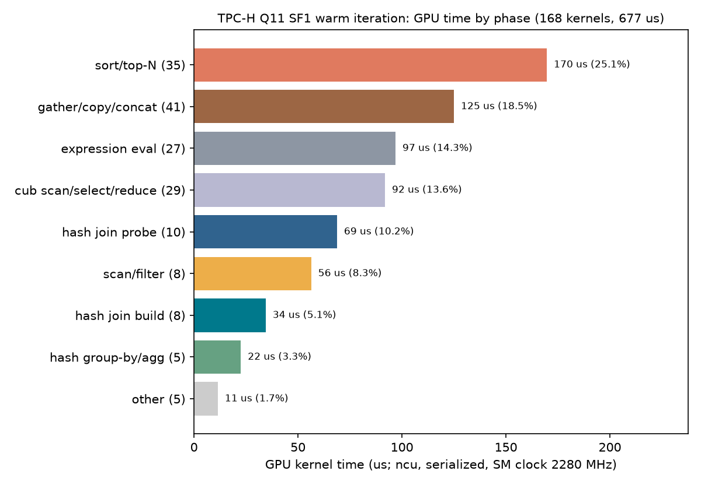
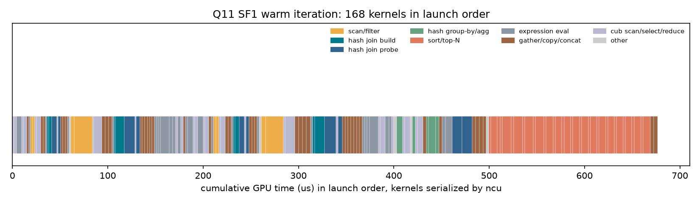
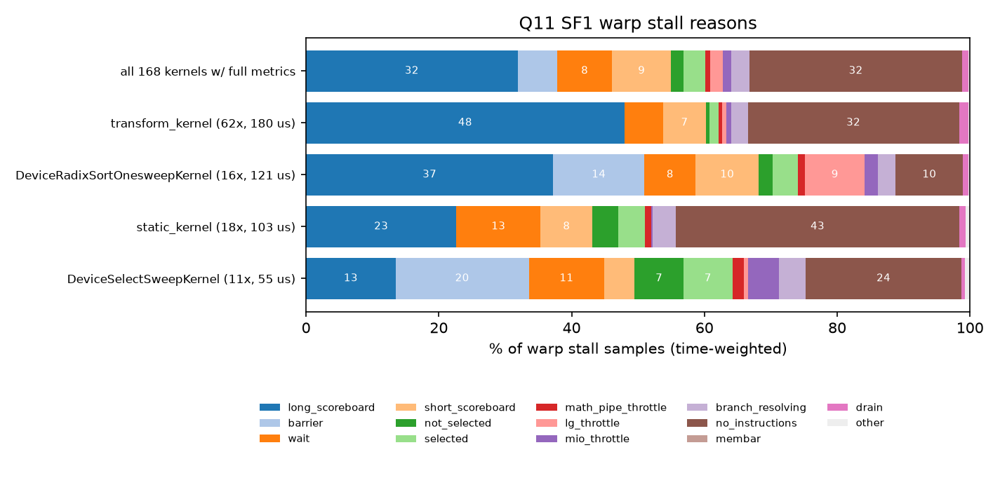
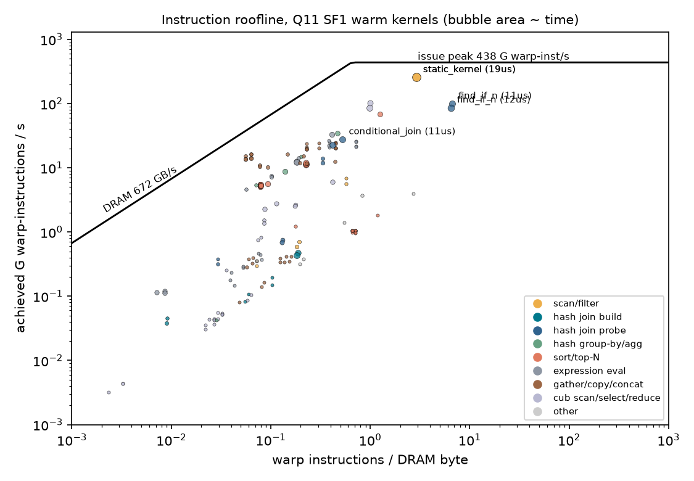

# TPC-H Q11 (SF1) on Sirius, all referenced columns pinned on GPU — Workload Analysis

**Date**: 2026-11-13
**GPU**: NVIDIA GeForce RTX 5070, 12 GB GDDR7 (192-bit, 672 GB/s), Blackwell sm_120, 48 SMs
**Workload**: TPC-H Query 11 (important stock identification: `partsupp ⋈ supplier ⋈ nation`, `n_name='GERMANY'`, `GROUP BY ps_partkey HAVING sum(ps_supplycost*ps_availqty) > (same join, sum(...) * 0.00001)`, `ORDER BY value DESC`), scale factor 1. All 8 referenced columns of the 3 tables are pinned in GPU memory with `pin_table(tier='gpu')` (9.63 MB); measured iterations read no file and copy no table data host→device (§3).
**Framework**: Sirius (`sirius-duckdb` release build), DuckDB v2.0, stock libcudf from the pixi env, CUDA runtime 13.5 (copied from the Q8 report)
**Pipeline**: `scripts/tpch_sf1/profile_query.sh 11` (5.2 min end-to-end: 26 s for sql/timing/pcie/selftest + 288 s for list/detail/extract/validate; `pipeline_run.log`); every number below comes from a file in this directory.
**Labels**: *measured* = read from a profiler/log file; *inferred* = derived by arithmetic or reasoning from measured data.

---

## 1. Executive Summary

A warm Q11 takes **10.5 ms end-to-end** (median of 12 timed runs after 3 warmups, range 10–11 ms, `.timer` 1 ms resolution; *measured*, `timing_summary.txt`). DuckDB on the CPU takes 15.0 ms (min 14, max 18), so the GPU is 1.43x faster (15.0/10.5). The result (21,953 rows) equals DuckDB-CPU: compare mode `multiset-with-tolerance` (same rows, different order among ORDER BY ties; max relative difference 0.0 at tolerance 1e-9); consistent across all 15 GPU iterations (`timing_summary.txt`, `timing.json`). The plan scans every table **twice** (the HAVING subquery repeats the join: 6 `GPU_SCAN`s, `query_plan.txt`), so the physical floor is **28.7 µs** (2 x 9.63 MB at 672 GB/s; 14.3 µs for one read; `physical_floor.md`). Sirius is **366x above the 28.7 µs floor** end to end (733x above the one-read floor). The GPU is idle for almost all of that:

| Where the 10.5 ms go (median warm iteration, 1 ms stamps, `timing_summary.txt`) | ms | Label |
|---|---:|---|
| Planning (SQL `QueryBegin` → `transparent_execution`) | 2 | Sirius log, *measured* |
| Engine window (`QueryEnd` of planning → `QueryEnd`) | 4 | Sirius log, *measured* |
| Gap from `QueryEnd` to the next statement (result hand-off, printing 381,659 B of CSV, parsing next statement) | 4 | Sirius log, *measured* (printing share *inferred*) |
| of the engine window: GPU busy (kernels + copies, real clocks, different run: nsys) | **0.347** | `nsys_iteration_breakdown.txt`, *measured* |
| of the engine window: GPU idle | ~3.65 | 4 − 0.347, cross-run, *inferred* (±1 ms) |

The log components (2+4+4 = 10 ms) differ from the 10.5 ms `.timer` median by timer resolution. GPU busy is 3.3% of the 10.5 ms wall (0.347/10.5).

Inside the 0.347 ms of GPU time (nsys; 168 kernels per iteration, deterministic; kernel sum 310.6 µs):

1. **16-pass 128-bit radix sort for `ORDER BY value DESC`: 84.2 µs (27.1%) nsys, 35 launches** (`DeviceRadixSortOnesweepKernel` 67.5 µs, 21.7%, 16 launches of 9 CTAs each; sorts ~22 K rows, §9 RC2).
2. **`transform_kernel` (gathers/casts) 64.4 µs (20.7%), 62 launches**, 61 of them < 5 µs in ncu; **`static_kernel` 51.5 µs (16.6%), 18 launches**, containing the two largest GPU-filling kernels (the 800,000-row `ps_suppkey` membership probes, 1563 CTAs, 5.43 waves).
3. The remaining launches are select/compact, hash-join build/probe and small reductions: 128 of 168 kernels run < 5 µs, 163 are below one wave, 40 are single-CTA (ncu).

The kernels move **33.32 MB of DRAM traffic** (ncu, cold L2) = 1.73x the 19.26 MB two-scan byte floor, yet no kernel exceeds 42.2% of DRAM peak. Q11 at SF1 is **host-orchestration-bound** (GPU busy = 3.3% of wall; 7.37 of the 7.72 ms first→last GPU-op span is idle), then launch-count/latency-bound inside the GPU; it is not bandwidth-bound.

---

## 2. Workload Description

**Query** (`sirius/test/tpch_performance/tpch_queries/orig/q11.sql`; read, not assumed): the HAVING constant is **0.00001** as written (not the standard 0.0001/SF), nation = GERMANY. Result: 21,953 rows, 381,659 B CSV (`result.csv`).

**Cardinalities** (DuckDB-CPU on the same Parquet; *measured*, `physical_floor.md`):

| Step | Rows |
|---|---:|
| partsupp / supplier / nation | 800,000 / 10,000 / 25 |
| suppliers in GERMANY | 396 (3.96%) |
| partsupp rows joining a German supplier | 31,680 (3.96%) |
| distinct `ps_partkey` among them (groups) | 29,818 |
| total `sum(cost*qty)` / HAVING threshold | 78,741,031,094.05 / 787,410.31 |
| groups passing HAVING = result | 21,953 (73.6% of 29,818) |

**Sirius plan** (`query_plan.txt`; *measured*): 38 pipelines (#0–#37): **6 `GPU_SCAN`** (partsupp, supplier, nation each scanned twice: outer query and subquery), 4 `HASH_JOIN` in total, 2 per evaluation (ids 7, 15, 29, 37), 2 `DYNAMIC_FILTER`s per evaluation (each directly after a `GPU_SCAN`), `UNGROUPED_AGGREGATE` + `MERGE_AGGREGATE` for the subquery, a `NESTED_LOOP_JOIN` for the HAVING comparison, `ORDER_BY`, with `PARTITION`/`CONCAT` repartition steps between stages.

**Pinned footprint** (`traces/sirius_log_timing/*.log`, `gpu_pool … allocated=` after each `pin_table`; *measured*): partsupp 9,600,000 B, supplier 30,464 B, nation 768 B; **total 9,631,232 B**. Sirius narrows carriers (partsupp 12.0 B/row pinned vs 20 B/row native, *inferred* from the Parquet types INTEGER, INTEGER, DECIMAL(15,2), INTEGER assuming 8-byte decimals). GPU pool high-water mark for the process: 41,751,040 B (`pcie_verification.txt`; process-lifetime mark including the pin phase; no spill).

---

## 3. PCIe Verification (no table data crosses PCIe in measured iterations)

Sources: `pcie_verification.txt`, `pcie.json`, `ncu_sysmem_check.txt`, `ncu_log_checks_list.txt`, `ncu_log_checks_detail.txt`, `selftest_negative_control.txt`. **OVERALL: PASS.** All numbers *measured*.

| Evidence | Result (wording of the check lines) |
|---|---|
| Pin tier | `sql:pin_tier_gpu`: every pinned SQL script pins each referenced table once with `tier='gpu'`; timing and nsys logs each show 3 `CALL pin_table` statements, all `tier='gpu'`, tables nation, partsupp, supplier |
| Scans served from the pin | `pinned_entry_per_gpu_scan`: every iteration `#assigned pinned entry` == `#GPU_SCAN` operators (**6 scans, 6 assignments**), all of nation, partsupp, supplier present; 0 cache-assignment errors |
| File cache | `fs_cache_zero_every_iteration`: 16 summaries for 15 iterations, `last_cycle[reads=0 hits=0 h2d=0 miss=0 …]` for iterations 1–15; nsys run 9 summaries for 8 iterations, same |
| Downgrade / spill / OOM lines | 0 |
| Pool counters | `gpu_pool allocated` == pinned footprint 9,631,232 B at `QueryBegin` and `QueryEnd` of every iteration; `host_pool` allocated and peak unchanged from iteration 2 |
| Dynamic-filter publication | `no_host_staged_filter_publication`: "0 dynamic-filter publications, all through peer copies (device-side)". The plan has 4 `DYNAMIC_FILTER`s, but the log records 4 publications per iteration (396 and 1 build rows, twice each) with no transport line, so the check counted 0, so it shows nothing about how the key sets reach the probe; the nsys copy table below is the evidence |
| Parquet decode kernels (nsys) | `no_parquet_decode_kernels`: 0 among 1,344 kernels of all 8 iterations |
| Unified memory | UM CPU+GPU page-fault collection on; faults per measured iteration [0,0,0,0,0]; no managed-memory API call in the trace (tables written by nsys only when a fault occurs; none present) |
| Kernels reading host memory in place | `ncu_sysmem_check.txt`: "168 kernels, 0 with SM (tex) sysmem-aperture sectors (total 0); all-source sysmem sectors per kernel min/max [265.0, 275.0] (info only) … pcie__read/write_bytes (rate x duration, includes driver/ncu traffic) 0 / 1796096 B -> PASS". The 1.80 MB write figure includes driver/ncu traffic by the check's own wording; I did not attribute it |
| ncu runs themselves | `OVERALL ncu list logs: PASS`, `OVERALL ncu detail logs: PASS` (same residency checks on the three list runs and the `--set full` run) |

nsys CUDA trace (`traces/q11_nsys.sqlite`, Nsight Systems 2025.5.2), per measured iteration (identical in all 5):

| Direction | Copies | Bytes | Largest single copy | Interpretation |
|---|---:|---:|---:|---|
| H2D (pinned/pageable → device) | 51 | 1,313 | 100 B (limit 5,000 B) | scalars/parameters (*inferred* from sizes) |
| D2H (device → pinned/pageable) | 40 | 439,270 | 439,060 B (limit 1,526,636 B total) | the result: 21,953 rows x 20 B = 439,060 B exactly (*inferred* layout: 4 B key + 16 B decimal128) |
| D2D | 6 | 34 | 8 B | on-device |

The single-copy H2D limit (5,000 B) is data-relative (half the rows of `supplier`, the smallest table ≥ 8,192 rows); `nation` (25 rows) is below the limit's resolution, so its evidence is the log checks plus the sysmem check (`pcie_verification.txt`). The pin phase copied 5,137,357 B H2D in 168 copies (largest 1,048,576 B) and 25,682,381 B D2D (decode on device, *inferred*), outside the measured iterations.

**Negative control** (`selftest_negative_control.txt`): the same nsys run with `partsupp` left unpinned makes `pcie_verify.py` exit 1 (expected) with 9 FAIL lines: pinned tables ≠ referenced (sql, timing log, nsys log), "4 assigned for 6 GPU_SCANs, missing tables ['partsupp']", non-zero file-cache reads (`reads=2 hits=5 h2d=5 miss=1`), Parquet `count_page_headers_kernel`/`decode_page_headers_kernel` launches, and "up to 85 copies, 10,218,379 B total, largest single 5,033,440 B (limits: single <= 5000 B, total <= 1048576 B)". `SELFTEST: PASS (verification detected the unpinned table)`.

Not covered: the aggregate SM aperture counter reads 0 everywhere, so its sensitivity could not be tested here; the sysmem check and the byte check are independent of each other.

---

## 4. Environment

| Component | Version / setting |
|---|---|
| GPU / driver | RTX 5070 (sm_120, 48 SMs, 12 GB, 48 MB L2) / 580.173.02 (driver re-queried with `nvidia-smi`; L2 size copied from Q8) |
| Nsight Compute | 2025.2.1 (re-queried) via `sudo -n`; `--set full --import-source yes` on all 168 warm kernels |
| ncu clocks | locked by ncu: SM ≈ 2.28 GHz median (`ncu_extract_summary.txt`: 2280 MHz) |
| Nsight Systems | 2025.5.2; `-t cuda -s none --cpuctxsw=none` plus UM page-fault collection |
| CPU | Intel i9-13900K, 125 GB RAM (copied from the Q8 report; not re-queried) |
| Sirius config | `scripts/tpch_sf1/sirius.yaml`: 4 pipeline threads, GPU pool 25% of 12 GB, 1 GB pinned host pool (2 pools), `enable_duckdb_fallback=false` (unchanged) |

---

## 5. Physical Floor vs Measured

Details: `physical_floor.md` (written before reading any profile).

| Scenario | Bytes | Floor @ 672 GB/s |
|---|---:|---:|
| A. Read every pinned column once (narrowed) | 9.63 MB | 14.3 µs |
| **A2. Same, twice (6 scans in the plan)** | 19.26 MB | **28.7 µs** |
| A'2. Native widths (*inferred*), twice | 32.16 MB | 47.9 µs |
| A-min. Predicate-forced bytes, one evaluation | ≈ 3.79 MB | 5.6 µs |
| B. A2 + materialising join output (31,680 x 16 B, twice), 29,818 groups, 21,953 result rows | ≈ 22.53 MB | 33.5 µs |

Compute floor: ~0.04 G simple ops → < 5 µs (*inferred*). Launch-count bound: 168 kernels x ~2 µs ≈ 0.336 ms (*inferred*; the 2 µs is carried over from Q2 via the Q8 note, not measured here; the smallest Q11 kernel is 1.50 µs in ncu).

| Measured | Value | x A2 (28.7 µs) | x A (14.3 µs) |
|---|---:|---:|---:|
| End-to-end warm median (`.timer`) | 10.5 ms | 366x | 733x |
| Engine window (Sirius log, unprofiled) | 4 ms | 140x | 279x |
| GPU busy per iteration (nsys, real clocks) | 0.347 ms (0.347–0.350) | 12.1x | 24.2x |
| Sum of kernel durations (nsys) | 0.3106 ms | 10.8x | 21.7x |
| First→last GPU op (nsys, includes idle gaps) | 7.72 ms (median) | 269x | 539x |
| Sum of kernel durations (ncu, serialized, 2.28 GHz, L2 flushed per kernel) | 676.7 µs | 23.6x | 47.2x |
| DRAM bytes moved by all 168 kernels (ncu, cold L2) | 33.32 MB | 1.73x of A2 bytes | 3.46x of A bytes |

GPU busy (0.347 ms) is 1.03x the 0.336 ms launch-count bound (*inferred*). Kernels move more bytes than the floor because many small kernels re-read/re-write intermediates through a cold L2 and gathers touch whole sectors (§9 RC3, *inferred*).

---

## 6. Kernel, Phase and Operator Breakdown

Sources: `phase_breakdown.txt`, `operator_breakdown.txt`, `warm_kernel_summary.txt`, `nsys_iteration_breakdown.txt`. ncu times are serialized, clock-locked and taken with L2 flushed before each kernel (DRAM bytes are cold-L2); nsys times are real clocks. Never summed together here.

| Phase (`kclass.py`) | Kernels | ncu µs | % | DRAM MB |
|---|---:|---:|---:|---:|
| sort / top-N | 35 | 169.6 | 25.1 | 7.97 |
| gather / copy / concat | 41 | 125.0 | 18.5 | 11.87 |
| expression eval | 27 | 96.9 | 14.3 | 4.15 |
| cub scan / select / reduce | 29 | 91.8 | 13.6 | 2.47 |
| hash join probe | 10 | 68.7 | 10.2 | 1.90 |
| scan / filter (dynamic-filter probe + key-set build) | 8 | 56.3 | 8.3 | 3.42 |
| hash join build | 8 | 34.4 | 5.1 | 0.09 |
| hash group-by / agg | 5 | 22.5 | 3.3 | 1.42 |
| other | 5 | 11.4 | 1.7 | 0.03 |
| **Total** | **168** | **676.7** | 100 | 33.32 |

| Kernel family | Launches | ncu µs (%) | nsys µs/iter (%) | ncu/nsys |
|---|---:|---:|---:|---:|
| `DeviceRadixSortOnesweepKernel` | 16 | 120.9 (17.9) | 67.5 (21.7) | 1.8 |
| `transform_kernel` (gathers, casts) | 62 | 180.4 (26.7) | 64.4 (20.7) | 2.8 |
| `static_kernel` (for_each: probes, binary ops, inits) | 18 | 102.9 (15.2) | 51.5 (16.6) | 2.0 |
| `DeviceSelectSweepKernel` | 11 | 55.3 (8.2) | 32.1 (10.3) | 1.7 |
| `insert_if_n` (hash build / key set) | 6 | 35.4 (5.2) | 20.2 (6.5) | 1.8 |
| `find_if_n` (hash probe) | 4 | 33.3 (4.9) | 18.9 (6.1) | 1.8 |
| `DeviceRadixSortInitKernel` | 17 | 38.9 (5.8) | 11.7 (3.8) | 3.3 |

Operator view (`operator_breakdown.txt`): sort/top-N 25.1% (35 kernels), fixed-width gathers 18.2% (40), select/compact 8.9% (18), binary-op expressions 8.3% (10), dynamic-filter probe 6.4% (4), cast/unary 6.0% (17), join output/compaction 5.2% (6). there are no `other: <name>` rows (the `other` phase is 1.7% from fill/copy/init kernels already named), so no `kclass.py` rule was added.

By position in the warm iteration (ncu, `ncu_warm_metrics.json`, *measured*): evaluation 1 (pos 0–54, ends in the ungrouped reduce and the scalar x0.00001 multiply, so it is the HAVING subquery, *inferred*) 55 kernels, 189.4 µs (28.0%); evaluation 2 (pos 55–122, ends in group-by) 68 kernels, 264.7 µs (39.1%); HAVING comparison (`compute_conditional_join_output_size` + `conditional_join` + gathers, pos 123–130) 8 kernels, 45.4 µs (6.7%); sort (131–165) 35 kernels, 169.6 µs (25.1%); final gathers (166–167) 7.6 µs (1.1%).

Small-kernel profile (*measured*, `phase_breakdown.txt`, `ncu_warm_metrics.json`): median kernel 2.75 µs (list pass, `warm_kernel_summary.txt`); **128 kernels < 5 µs (345.0 µs, 51.0% of ncu time)**, 161 < 10 µs (584.7 µs, 86.4%); 163 of 168 below one wave; 113 with grid < 48 CTAs; **40 single-CTA kernels hold 103.8 µs (15.3%)**. Only **5 kernels reach ≥ 1 wave and they hold 63.0 µs (9.3%)**: two probes (pos 25, 80: 18.8/19.0 µs, 5.43 waves), two `DeviceSelectSweepKernel` (pos 27, 82: 8.4/10.0 µs, 1.45 waves), one radix histogram (pos 132: 6.8 µs). ncu/nsys is 2.18 overall (676.7/310.6) and larger for tiny kernels.





---

## 7. Top Kernels (ncu `--set full`)

Sources: `top_kernel_details.txt`, `ncu_warm_metrics.json`, `plots/q11_roofline.png`, `plots/q11_stalls.png`. Cold-L2, serialized, locked clock.

| Kernel (launch pos) | µs | Grid x Blk | Regs | Occ. ach/theo | IPC | DRAM GB/s (%) | Top stalls (%) |
|---|---:|---|---:|---|---:|---|---|
| `static_kernel` membership probe, `short` carrier (80, 25) | 19.0 / 18.8 | 1563x256 | 37 | 83.0 / 100 | 2.73 | 87.2 (13.2) / 87.8 (13.3) | long_sb 31.7, wait 26.1, not_selected 9.5 |
| `find_if_n` hash probe (90, 34) | 12.1 / 10.7 | 248x128 | 38 | 36.9 / 100 | 1.02 | 13.4 (2.0) / 15.0 (2.3) | long_sb 30.0, barrier 27.0, wait 17.0 |
| `conditional_join` (125) | 10.7 | 233x128 | 60 | 38.6 / 66.7 | 0.31 | 52.8 (8.0) | no_inst 54.0, long_sb 31.6 |
| `insert_if_n` hash build (89, 33) | 10.4 / 9.4 | 4x128 | 22 | 5.4 / 100 | 0.09 | 2.4 (0.4) | long_sb 50.0, no_inst 14.8 |
| `compute_conditional_join_output_size` (124) | 10.3 | 233x128 | 58 | 37.5 / 66.7 | 0.26 | 54.7 (8.3) | no_inst 49.8, long_sb 34.5 |
| `DeviceSelectSweepKernel` over 800 K rows (82, 27) | 10.0 / 8.4 | 139x384 | 80 | 41.3 / 50.0 | 1.24 | 86.2 (13.1) / 102.1 (15.5) | barrier 28.8, wait 14.7 |
| `DeviceRadixSortOnesweepKernel` (135 longest of 16) | 9.4 | 9x384 | 79 | 24.5 / 50.0 | 0.79 | 49.8 (7.5) | barrier 25.4, long_sb 23.9 (SASS samples, §8) |
| `transform_kernel` unique_copy (110, longest of 62) | 6.1 | 124x256 | 48 | 41.5 / 83.3 | 0.55 | 73.5 (10.9) | long_sb 44.2, no_inst 18.0, lg 17.4 (SASS samples, §8) |

- **Probe pos 80/25 are the largest of the 5 kernels that reach ≥ 1 wave** (the others: DeviceSelectSweep pos 27/82 at 1.45 waves, radix histogram pos 132 at 1.0). Each reads 1.65 MB DRAM (*measured*), ≈ 800,000 rows x 2 B (*inferred*: the kernel name carries `integral_probe_adapter<short, int>`, i.e. a 2-byte carrier for `ps_suppkey`). Its DRAM floor is 1.65 MB / 672 GB/s = 2.46 µs; measured 19.0 µs = **7.7x the bandwidth floor**; SM throughput 60.5%, ALU pipe 34.4%, LSU 20.9%, thread efficiency 23.9, 4.85e6 warp instructions (388 per launched warp, 12,504 warps). It is issue/latency-bound, not byte-bound (no SASS was exported for it: `static_kernel` is family #3).
- Probe `find_if_n` pos 90: 248x128 = 31,744 threads for 31,680 rows (*inferred*: the dynamic-filtered partsupp rows probing the 396-key build side); thread efficiency 9.3, 0.43 waves.
- Hash build pos 89/33: grid 4x128 = 512 threads for the 396-row build side (*inferred*), SM active 0.1%, `sm_active_frac` 0.05: 10.4 µs of latency for ~4.5 K warp instructions.
- Sort pos 135–165: 16 Onesweep launches of 9 CTAs (0.09 waves), 6.7–9.4 µs each (ncu), 0.47 MB DRAM each.
- Time-weighted stall mix over all 168 kernels (`ncu_extract_summary.txt`): no_instructions 31.9%, long_scoreboard 31.9%, short_scoreboard 8.8%, wait 8.3%, barrier 6.0%, selected 3.3%, branch_resolving 2.8%, lg_throttle 1.9%. `no_instructions` is high because most kernels are so short that instruction fetch at kernel start dominates (*inferred*).
- Roofline: highest DRAM rate is 276.5 GB/s (42.2% of peak, `transform_kernel` gather pos 30, 3.5 µs); 13 kernels exceed 100 GB/s; no kernel is near the 672 GB/s ceiling, and the 40 single-CTA kernels sit orders of magnitude below both ceilings.





---

## 8. Instruction-Level Evidence

The pipeline exports SASS for the top-2 ncu families: `transform_kernel` (#1 by ncu, 26.7%) and `DeviceRadixSortOnesweepKernel` (#2 by ncu, #1 by nsys real clock, 21.7% vs 20.7%). Both are shown. Sources: `sass/transform_kernel_hotspots.txt`, `sass/DeviceRadixSortOnesweepKernel_hotspots.txt`, `…_inst_inventory.csv`.

### 8a. `transform_kernel` — longest launch pos 110 (6.1 µs, 3.4% of the family's 180.4 µs; 1 of 62 launches, other instantiations are plain gather/cast copies without SASS here)

| Property | Value | Label |
|---|---|---|
| Kernel | `transform_kernel<…, bool*, long, always_true, cudf::unique_copy_fn<…, groupby::permuted_row_equality_comparator<…>>>`: writes one bool per row (adjacent-row equality for the group-by) | measured (name); role *inferred* |
| Launch | 124x256 = 31,744 threads; 990 `STG.E.U8` warp executions x 32 = 31,680 = the join-output rows | measured; row meaning *inferred* |
| Static vs executed | 7,096 SASS instructions, 225 (3.2%) ever execute; 2.123e5 warp instructions = 214 per warp | measured |
| Mix (% of executed / of stall samples) | Move 23.1 / 4.6, Int 22.2 / 32.2, Control 17.4 / 5.4, **Local (spill) 12.1 / 35.5**, Const load 8.9 / 18.7 | measured |

Stall samples (482 total, small): `LDC R1, c[0x0][0x37c]` at +0x00000 (kernel entry) 79 (16.4%, `no_inst`: the first instruction fetch, *inferred* i-cache miss at warp start); `LDL.U8 R33, [R42+0x28]` at +0x01ba0 72 (14.9%, long_sb); `SHF.R.S32.HI R3, RZ, 0x1f, R2` at +0x01950 43 (8.9%, long_sb); `STL.64 [R1+0x18], R8` at +0x00210 39 (8.1%, `lg_throttle`); `ISETP.EQ.U32.AND P0, PT, R2, R6, PT` at +0x02400 38 (7.9%, long_sb).

Register-confirmed chain (+0x018d0…+0x01970, all `exe=984`, same window):
```
+0x018d0  IMAD R2, R0, 0x100, R2          // idx = R0*256 + R2 (tid/ctaid by shape, inferred)      samp=16 short_sb
+0x018e0  STL  [R1+0x48], R2              // spill idx to the stack frame
+0x01930  CALL.REL.NOINC 0x7f497a994a90   // non-inlined call (comparator, inferred)                samp=11 long_sb
+0x01940  LDL.LU.64 R2, [R1+0x48]         // reload idx after the call (writes R2:R3)
+0x01950  SHF.R.S32.HI R3, RZ, 0x1f, R2   // reads R2 written one instruction earlier             samp=43 long_sb
+0x01960  IADD.64 R2, R2, UR6 ; +0x01970 STG.E.U8 desc[UR12][R2.64], R0   // out[idx] = flag
```
The `SHF` reads R2, which `LDL.LU.64` at +0x01940 writes, so its 42 long-scoreboard samples are a spill/reload round trip around the call. The prologue `STL.64 [R1+0x10…0x38]` (+0x001d0…+0x00290, 6 stores, frame `IADD R1, R1, -0x70` at +0x00030) holds 75 `lg_throttle` samples (15.6% of 482): the functor/comparator arguments are copied into the per-thread stack (*inferred* from shape). **Not confirmed:** at +0x01ba0 `LDL.U8 R33, [R42+0x28]` reads R42 and writes R33; neither is written in the 8-instruction window before it (window holds `LDL.64 R10`, `LD.E R20/R22`, `R2UR`), so the producer is outside the window; likewise +0x02400 has no context window in the file. No per-row chain is claimed for those two.

### 8b. `DeviceRadixSortOnesweepKernel` — longest launch pos 135 (9.4 µs, 9x384 CTAs, key type `__int128`, value `int`, 142 stall samples)

1,277 of 1,680 static instructions execute (76.0%); executed mix: integer 52.3% (43.7% of samples), control flow 7.9% (23.2%), warp collective 6.7%, shared load/store 5.6%/4.3%. Stall reasons over all instructions: barrier 25.4%, long_sb 23.9%, short_sb 19.7%. Top PC: `@P0 BRA 0x7f497a9ec190` at +0x04170 (19 samples, 13.4%, barrier) directly after `STG.E` (+0x04140) and `BAR.SYNC.DEFER_BLOCKING 0x0` (+0x04150): warps wait at the CTA barrier. Register-confirmed load use (window +0x00520…): `LDG.E.128 R8, desc[UR8][R2.64+0xa00]` (+0x00580, `exe=12`) → `LOP3.LUT R36, RZ, R8, RZ, 0x33, !PT` (+0x00610, `exe=108`, 13 long_sb samples) reads R8 (bitwise NOT of the key word; a descending-order key transform, *inferred*). The `exe=12` path is the partial-tile path; 96 executions use `LDG.E.128 R8, desc[UR8][R16.64+0xa00]` at +0x002b0 (full-tile path, outside this window; `exe=96` in `sass/DeviceRadixSortOnesweepKernel_pos135_source.csv`), so 96 + 12 = 108 matches the LOP3's count. Seven `LDG.E.128` per thread x 384 threads = 2,688 keys per CTA x 9 CTAs = 24,192 ≥ 21,953 > 21,504 (*inferred* row count). Samples are few (142): reliable in kind, not in percentages.

---

## 9. Root Cause Analysis

### RC1 — Host orchestration: GPU idle for 95.5% of the 7.72 ms first→last-op span

```
Symptom: wall 10.5 ms; GPU busy 0.347 ms (3.3%); first→last GPU op 7.72 ms so 7.37 ms (95.5%) idle inside it   [measured nsys / arithmetic]
 → WHY? one GPU op (kernel/copy/memset) per 28.9 µs of span (7.72 ms / 267 ops), while the median kernel is 2.75 µs (ncu list pass; 2.88 µs in the full pass) and the nsys mean is 1.85 µs  [measured; ratios inferred]
 → WHY spaced out? per iteration the host issues 201 cudaStreamSynchronize + 88 cuStreamSynchronize (0.448 + 0.197 ms CPU, summed over threads, under nsys),
   181 pool allocs + ~180 frees, 81 batched + 16 plain memcpys, 168 launches (`nsys_iteration_breakdown.txt`)    [measured, nsys]
 → WHY do they serialise? sizes/counts are read back between small kernels (the D2H copies are 8-byte-scale readbacks plus the 439,060 B result; interpretation inferred)   [inferred]
 ROOT: operator-at-a-time execution of a 38-pipeline plan whose per-step host latency (sync + alloc + launch) exceeds the 1.85 µs average GPU work per kernel; the HAVING subquery re-executes the whole join (2 evaluations, 123 kernels, 454.1 µs ncu = 67.1%).
```
Planning (2 ms) and the result hand-off gap (4 ms) are separate CPU costs outside the engine window and not profiled further.

### RC2 — 16-pass 128-bit radix sort for `ORDER BY value DESC`: 35 launches, 169.6 µs ncu (25.1%) / 84.2 µs nsys (27.1%)

```
Symptom: 16 Onesweep + 17 Init + histogram/exclusive-sum launches for ~22 K rows; Onesweep alone 67.5 µs nsys (4.2 µs per pass), 120.9 µs ncu   [measured]
 → WHY 16 passes? the Onesweep instantiation is `<__int128, int, unsigned int>`: a 128-bit key (the DECIMAL sum) sorted by 8-bit digits = 16 passes (digit width inferred); every pass is an Init + Onesweep pair, serialised on the previous pass's output   [name measured, mechanism inferred]
 → WHY slow per pass? 9 CTAs on 48 SMs (0.09 waves; SM active fraction avg 12.2%), 6.7–9.4 µs ncu, IPC ~0.5; stalls barrier 25.4% / long_sb 23.9% / short_sb 19.7% (SASS, 142 samples); 79 regs, 44,032 B static smem   [measured]
 → WHY does it not use the machine? the keys fit in 21,953 x 20 B = 0.44 MB; one pass moves 0.47 MB DRAM (measured) — 16 passes = 7.5 MB, 17x the key array — and the work fits in 9 tiles of 2,688 keys   [measured/inferred]
 ROOT: a general radix path over the full key width for a sub-wave input: cost is passes x (launch + barrier-bound single tile wave), not bytes. Floor for this step is ~1 µs of DRAM time (inferred); it costs 84.2 µs real-clock.
```

### RC3 — 62 `transform_kernel` + 40 single-CTA + 128 sub-5 µs kernels: gather/cast chains

```
Symptom: transform_kernel 180.4 µs ncu / 64.4 µs nsys over 62 launches (avg 2.91 µs ncu); 40 fixed-width gathers = 122.9 µs ncu, 11.87 MB DRAM for the gather/copy phase; 128 kernels < 5 µs = 345.0 µs (51.0%)   [measured]
 → WHY slow per element? longest launch (pos 110): 214 warp-inst per warp, 12.1% of executed instructions are local-memory (spill) and 35.5% of stall samples; the idx spill → CALL → reload chain (§8a, register-confirmed)   [measured]
 → WHY so many launches? after each join the output is gathered column by column (pos 28–30, 37–42, 83–86, 93–99, 117, 121, 126–129, 166–167); gathers of ~31,680 rows reach 257–276 GB/s at 3.5 µs for ~0.97 MB: ≈ 30 B per row, i.e. one 32 B sector per 4 B element on a 3.96%-dense selection (sector-amplified gather, inferred)   [DRAM measured; mechanism inferred]
 → WHY does that cost wall time? each is ~2–4 µs of GPU work behind a launch + sync + pool alloc (RC1)   [inferred]
 ROOT: at SF1 only 31,680 rows survive the supplier/nation filter (3.96% of partsupp), so per-kernel fixed latency (smallest kernel 1.50 µs ncu) dominates payload; launch count, not gather bytes, sets the time.
```

---

## 10. Gap Analysis

| Component of the 10.5 ms warm wall time | ms | Evidence | Label |
|---|---:|---|---|
| Planning | 2 | Sirius log | measured |
| Gap to next statement (result fetch/print) | 4 | Sirius log | measured |
| Engine window | 4 | Sirius log | measured |
| — GPU idle inside the engine window (RC1) | ~3.65 | log 4 − nsys 0.347 | inferred (cross-run) |
| — GPU busy: sort (RC2, 35 launches) | 0.084 | nsys | measured |
| — GPU busy: `transform_kernel` (RC3) | 0.064 | nsys | measured |
| — GPU busy: `static_kernel` (probes, binary ops, inits) | 0.052 | nsys | measured |
| — GPU busy: all other kernels (0.3106 − 0.084 − 0.064 − 0.052 = 0.111) + copies/memsets (0.347 − 0.3106 = 0.037) | 0.148 | nsys kernel sum minus the three rows above, plus busy − kernel sum | inferred |
| Physical floor (two scans) / one scan | 0.0287 / 0.0143 | `physical_floor.md` | computed |

Log components do not sum exactly to 10.5 (1 ms resolution). nsys lengthens the engine window to 9 ms median (vs 4 ms unprofiled), so nsys host-side times are used for counts and ratios only. Wall/floor = 366x; GPU busy/floor = 12.1x; the floor (28.7 µs) is below the GPU time of the sort alone (84.2 µs).

---

## 11. Optimization Directions (generic; no query-specific kernel fusion)

| # | Direction | Expected effect | Evidence |
|---|---|---|---|
| 1 | Fewer host round trips in the executor: avoid per-step stream syncs for size readbacks, reuse pool allocations across statements | targets ~3.65 ms idle | RC1: 289 syncs, 181 allocs, 267 GPU ops per iteration |
| 2 | Planner-level common-subexpression reuse: evaluate the identical join once for both the outer query and the HAVING scalar subquery (one materialised result instead of two evaluations) | removes 6 → 3 scans and roughly one of the two 55–68-kernel evaluations (189–265 µs ncu) | §6: 123 kernels, 454.1 µs ncu in the two evaluations |
| 3 | Sort: restrict radix digits to the key's significant bit range (CUB `begin_bit/end_bit` from a min/max pass) or use a block-/merge-sort path for ≤ ~24 K rows instead of 16 full-width passes | up to ~84 µs of nsys GPU time | RC2: 16 passes, 9 CTAs, 0.09 waves |
| 4 | Multi-column gather: one general `gather(table, map)` launch for all columns sharing an index map, instead of one `transform_kernel` per column | fewer of the 40 gather launches (122.9 µs ncu) | RC3 |
| 5 | Library: pass the unique_copy comparator/functor through parameter space and allow it to inline, removing the stack copy and spill/reload around `CALL.REL.NOINC` | shortens the per-thread chain of the unique_copy launches | §8a: 12.1% local instructions, 35.5% of stall samples |
| 6 | Plan caching for repeated statements | targets 2 ms planning | log |

Fusing Q11's specific operator chain would also remove launches, but it is out of scope by project policy: cuDF kernels stay general-purpose library operators.

---

## 12. Determinism and Profiling Method

- **Launch counts are deterministic** (*measured*, `warm_kernel_summary.txt`, `ncu_plan.json`, `pcie.json`): 168 launches per iteration in the three ncu list runs (pin+3/4/5 iterations: 780 / 948 / 1,116 launches) and in all 8 nsys iterations; added-iteration multisets identical (`STABLE: True`).
- **Launch order was also identical here**: iteration 4 vs 5 differ at 0 positions (`warm_kernel_summary.txt`; the 4 pipeline threads can interleave in principle). The `-s 948 -c 168` slice matched the expected multiset (`ncu_slice_check.txt`: 168 vs 168, 0 names reconciled, identical order True).
- **ncu policy branch**: 168 ≤ `NCU_FULL_MAX` (1000) → `full_all`, `--set full --import-source yes` on all 168 launches. The light + families branch was not used.
- Result order among ORDER BY ties varies between runs (iteration compare modes `exact` and `multiset-with-tolerance`, `results_bitwise_identical: false`, `timing.json`); the multiset is identical.
- nsys windows: 5 measured iterations (4–8), kernel counts [168]x5, GPU busy 0.347–0.350 ms.
- Timing: 3 warmups + 12 timed iterations; warmup times 71.0 / 13.0 / 11.0 ms; DuckDB-CPU first 23.0 ms. `validate_pipeline.txt`: SUMMARY q11: 72 PASS, 0 FAIL, 1 PENDING (the report).

## 13. Limitations

- ncu durations are serialized, clock-locked (2.28 GHz) and taken after L2 flushes; tiny kernels are overstated (ncu/nsys 2.18 overall, 2.8 for `transform_kernel`). Real-clock kernel times come only from nsys; the two are never summed together.
- ncu flushes L2 before each kernel, so the 33.32 MB of "DRAM traffic" is cold-cache traffic; the 9.63 MB working set fits in the 48 MB L2, so real in-query DRAM traffic may be lower.
- Wall splits come from 1 ms Sirius log stamps and the 1 ms `.timer`; the ~3.65 ms "GPU idle" is a difference of two runs (log: unprofiled, GPU busy: nsys) and carries about ±1 ms. What the 4 ms inter-statement gap contains (CSV printing) is inferred.
- Native column widths (20 B/row partsupp), the 2-byte `ps_suppkey` carrier, the 128-bit/8-bit-digit pass count, the sorted row count (21,953; consistent with 2,688 keys/CTA x 9), which evaluation is the subquery, and what each small H2D/D2H copy carries are inferred from names, grids and per-thread load counts, not read from Sirius.
- SASS covers only the longest launch of each of the top-2 ncu families (transform pos 110 = 1 of 62; Onesweep pos 135 = 1 of 16); sample counts are small (482 and 142). The probe kernels (`static_kernel`, 37.8 µs ncu), `find_if_n`, `conditional_join` and select kernels are analysed from ncu metrics only. Two hot transform PCs (+0x01ba0, +0x02400) have their producer outside the exported window.
- The ~2 µs launch floor is carried over from Q2; the smallest Q11 kernel is 1.50 µs ncu.
- `no_host_staged_filter_publication` saw 0 publications and therefore proves nothing about the dynamic-filter transport; `nation` (25 rows) is below the byte-limit resolution of the PCIe check.
- Only the pinned configuration was profiled; there is no unpinned timing comparison (the negative control only checks residency detection).

## 14. Raw Data

| File | Contents |
|---|---|
| `timing_summary.txt`, `timing.json`, `result.csv`, `traces/timing_run.txt`, `traces/duckdb_cpu_run.txt` | timing (3 warmup + 12 timed), result, DuckDB-CPU baseline, compare mode |
| `query_plan.txt`, `sql/` | Sirius pipeline plan, generated SQL |
| `pcie_verification.txt`, `pcie.json`, `traces/q11_nsys.{nsys-rep,sqlite}`, `traces/sirius_log_*` | PCIe evidence |
| `ncu_sysmem_check.txt`, `ncu_log_checks_{list,detail}.txt`, `selftest_negative_control.txt`, `selftest/` | host-memory-in-place check, residency checks on the ncu runs, negative control |
| `nsys_iteration_breakdown.{txt,json}` | per-iteration GPU busy, API counts, real-clock kernel times |
| `warm_kernel_list.json`, `warm_kernel_summary.txt`, `ncu_plan.json`, `traces/ncu_list_x{3,4,5}.csv` | list passes, determinism, profiling plan |
| `profiles/q11_warm_full.ncu-rep`, `ncu_slice_check.txt` | full ncu report of the warm iteration (168 kernels) |
| `ncu_warm_metrics.json`, `ncu_extract_summary.txt`, `phase_breakdown.*`, `operator_breakdown.txt`, `top_kernel_details.txt` | extracted metrics |
| `sass/` | SASS hotspots for `transform_kernel` and `DeviceRadixSortOnesweepKernel` |
| `plots/q11_*.png` | phase breakdown, kernel sequence, roofline, stall mix |
| `physical_floor.md` | floor |
| `pipeline_run.log`, `validate_pipeline.txt` | pipeline logs and validation |
