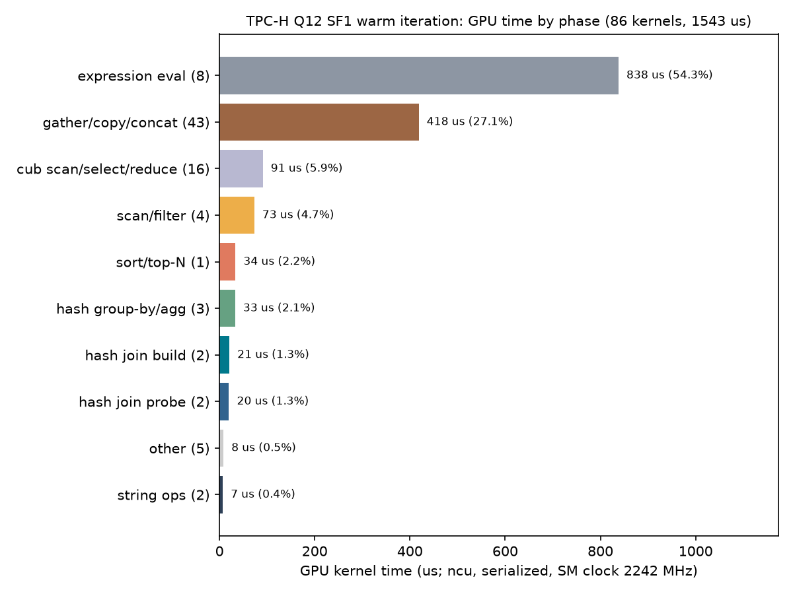
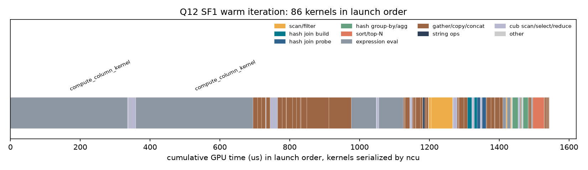
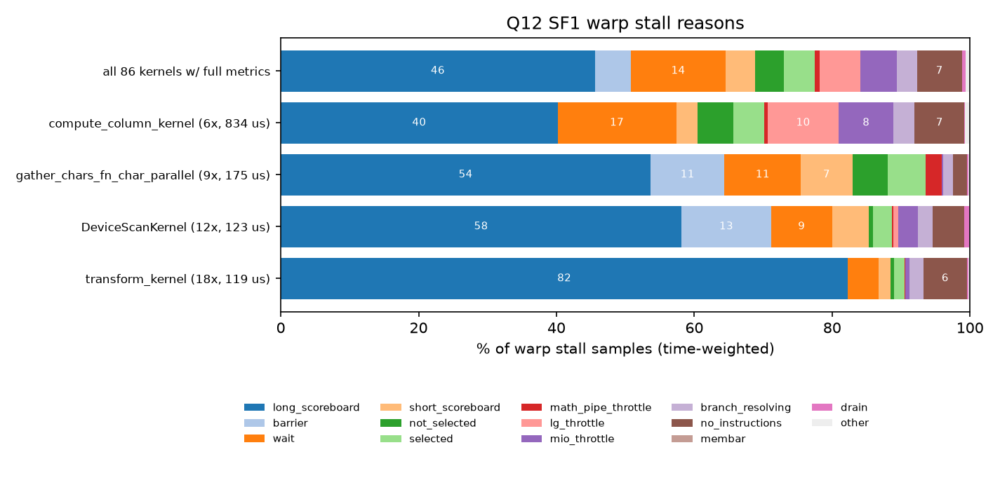
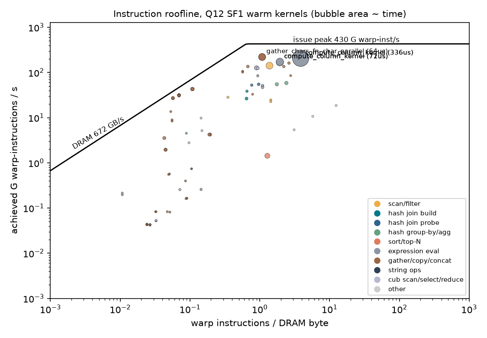

# TPC-H Q12 (SF1) on Sirius, all referenced columns pinned on GPU — Workload Analysis

**Date**: 2026-11-13
**GPU**: NVIDIA GeForce RTX 5070, 12 GB GDDR7 (192-bit, 672 GB/s), Blackwell sm_120, 48 SMs
**Workload**: TPC-H Query 12 (shipping modes and order priority: `orders ⋈ lineitem`, `l_shipmode IN ('TRUCK','REG AIR')`, `l_commitdate < l_receiptdate`, `l_shipdate < l_commitdate`, `l_receiptdate` in 1994, two CASE sums grouped by `l_shipmode`, ORDER BY; constants read from `q12.sql`), scale factor 1. The 7 referenced columns of 2 tables are pinned in GPU memory with `pin_table(tier='gpu')` (134.34 MB); measured iterations read no table data from host (§3).
**Framework**: Sirius (`sirius-duckdb` release build), DuckDB v2.0, stock libcudf from the pixi env, CUDA runtime 13.5
**Pipeline**: `scripts/tpch_sf1/profile_query.sh 12` (159 s of pipeline stages: 14 s for sql/timing/pcie/selftest + 145 s for list/detail/extract/validate; `pipeline_run.log`); every number below comes from a file in this directory.
**Labels**: *measured* = read from a profiler/log file; *inferred* = derived by arithmetic or reasoning from measured data.

---

## 1. Executive Summary

A warm Q12 takes **5.0 ms end-to-end** (median of 12 timed runs after 3 warmups, range 5–6 ms, `.timer` 1 ms resolution; *measured*, `timing_summary.txt`). DuckDB on the CPU takes 21.0 ms (min 20, max 24), so the GPU is 4.2x faster (*inferred* ratio). The 2-row result equals DuckDB-CPU exactly (compare mode `exact`, max relative difference 0.0, tolerance 1e-9, identical across all 15 GPU iterations; `timing.json`). The first (cold) iteration takes 53.0 ms.

| Where the 5.0 ms go (median warm iteration, 1 ms stamps) | ms | Source |
|---|---:|---|
| Planning (DuckDB optimizer + Sirius plan build, 12 pipelines) | 2 | Sirius log, *measured* |
| Engine window (timing run) | 3 | Sirius log, *measured* |
| Gap from `QueryEnd` to the next statement | 1 | Sirius log, *measured* (the three medians sum to 6 ms vs the 5.0 ms median wall: 1 ms stamps, medians of parts) |
| GPU busy (kernels + copies, real clocks, nsys run) | **1.129** | `nsys_iteration_breakdown.txt`, *measured* |
| Engine window with the GPU idle (host orchestration) | ~1.9 | engine 3 ms (timing run) − GPU busy 1.129 ms (nsys run), *inferred*, ±1 ms |

GPU busy is 22.6% of the 5.0 ms wall (*inferred*). Inside the 1.119 ms of kernel time (nsys, 86 kernels per iteration, deterministic):

1. **`compute_column_kernel` (the libcudf AST expression evaluator): 646.9 µs, 57.8%, 6 launches.** Two launches of 3.0 M rows each (ncu 335.8 µs each, 40.7 waves) evaluate the lineitem predicate. They are bound by the load/store pipe (LSU 93.8% busy, IPC 1.92, 103 load requests per warp), not by DRAM (8.2% of peak, 53.9 GB/s). The kernel is 12.5x slower than the DRAM time of its own 18.1 MB (*inferred*).
2. **String gathers: `gather_chars_fn_char_parallel` 118.5 µs (10.6%), 9 launches**; the whole "gather: strings" operator (27 kernels incl. scans) is 297.2 µs ncu (19.3%). The two largest launches copy characters one byte per lane (`LDG.E.U8` → `STG.E.U8`) and reach 207.7 GB/s (31% of peak).
3. **`transform_kernel` 80.7 µs (7.2%), 18 launches**: 8 of them (grid ≈ 247, 95.1 µs ncu) are fixed-width gathers running at 446–490 GB/s (66–73% of peak): the only kernels near the bandwidth ceiling.

Against the physical floor of 199.9 µs (134.34 MB at 672 GB/s, `physical_floor.md`): GPU busy is **5.65x** the floor, the wall is **25.0x** (*inferred*). 40 of 86 kernels last < 5 µs in the ncu list pass (41 in the full pass); 26 are single-CTA. Q12 is limited by an expression-evaluation kernel and by orchestration, not by DRAM bandwidth.



---

## 2. Workload Description

- Plan (`query_plan.txt`, counted by distinct ids 0–17): **18 operators in 12 pipelines**: 2 GPU_SCANs (ids 0, 4), 1 FILTER (id 1), 1 DYNAMIC_FILTER (id 5), 1 HASH_JOIN (id 8), PROJECTION (9), HASH_GROUP_BY (10) + MERGE_GROUP_BY (12), ORDER_BY (13) with SORT_SAMPLE/SORT_PARTITION/MERGE_SORT (14–16), 3 PARTITION (2, 6, 11), 2 CONCAT (3, 7), RESULT_COLLECTOR (17).
- Build side = the filtered lineitem scan (pipeline #0 → FILTER): the log says "30912 build rows" for the dynamic-filter publication (`traces/sirius_log_timing/*.log`), equal to the DuckDB-CPU count of rows passing all lineitem predicates. Probe side = the orders scan carrying the dynamic filter (pipeline #3). Table-to-scan assignment is *inferred* from that row count.
- Row counts and selectivities (DuckDB-CPU on the Parquet, `physical_floor.md`): lineitem 6,001,215; shipmode IN: 1,713,866 (28.56%); all lineitem predicates: **30,912 rows (0.515%)**, 29,028 distinct orders (1.94% of 1,500,000). Result: 2 groups (`result.csv`: REG AIR 6246/9245, TRUCK 6180/9241), 76 B.
- Pinned bytes (`gpu_pool ... QueryEnd allocated=`): orders 24,600,320 B (cols o_orderkey, o_orderpriority), lineitem 109,735,168 B (l_orderkey, l_shipmode, l_commitdate, l_receiptdate, l_shipdate); total **134,335,488 B**.
- 86 kernel launches per warm iteration (list passes: 526/612/698 launches for pin+3/4/5 iterations, +86 each); ncu policy **`full_all`** (86 ≤ 1000), `--set full` on all 86.

## 3. PCIe Verification (`pcie_verification.txt`: `OVERALL: PASS`)

No table data cross PCIe in the measured iterations; only small control copies do (per iteration up to 82 H2D copies / 6,322 B and 51 D2H copies / 296 B) (*measured*; quoted from the check lines):
- `timing_log:pinned_entry_per_gpu_scan` / `nsys_log:...`: "every iteration: #`assigned pinned entry` == #GPU_SCAN operators (2), all of ['lineitem', 'orders'] present".
- `fs_cache_zero_every_iteration`: "16 cache summaries for 15 iterations ... iterations 1..15 all last_cycle[reads=0 hits=0 h2d=0 miss=0 ...]" (nsys run: 9 summaries for 8 iterations, all zero).
- `no_parquet_decode_kernels`: "0 decode/decompress kernels among 688 kernels of all 8 iterations".
- `h2d_measured_iterations`: "up to 82 copies, 6322 B total, largest single 516 B (limits: single <= 65536 B, total <= 1048576 B)". `d2h_measured_iterations`: "up to 51 copies, 296 B total, largest single 88 B (result CSV is 76 B; limit 262144 B)". `no_other_host_copies`: 0 managed/unknown-kind copies. Per-iteration on-device D2D: 6 copies, 123,704 B, largest 61,860 B.
- `unified_memory`: UM CPU+GPU fault collection on; "faults per measured iteration [0, 0, 0, 0, 0]; managed-memory API calls in the whole trace: none" (the fault tables are written only when a fault occurs).
- `pool_counters_stable`: "gpu_pool allocated == pinned footprint 134335488 B at QueryBegin and QueryEnd"; `no_downgrade_or_spill`: 0 lines. `no_host_staged_filter_publication`: "0 dynamic-filter publications, all through peer copies (device-side)" (the line is a zero-count for that check's pattern; the Sirius log itself does report 30,912-row dynamic-filter publications per iteration, and the largest measured H2D copy of 516 B rules out host staging of a 30,912-row filter (*inferred*)).
- Pin phase (not measured iterations): H2D 220 copies, 32,987,196 B, largest 1,048,576 B.
- `ncu_sysmem_check.txt`: 86 kernels, 0 with SM (tex) sysmem-aperture sectors (total 0); the all-source counter reads 265–293 sectors for every kernel (information only); ncu `pcie__read/write_bytes` 0 / 939,520 B (rate x duration, includes driver/ncu traffic). `ncu_log_checks_{list,detail}.txt`: every residency check PASS on all four ncu runs, including "#`assigned pinned entry` == #GPU_SCAN operators (2)".
- Negative control (`selftest_negative_control.txt`): with `lineitem` left unpinned `pcie_verify.py` exited 1 as expected, failing `pinned_entry_per_gpu_scan` ("1 assigned for 2 GPU_SCANs, missing tables ['lineitem']"), `fs_cache_zero_every_iteration` (reads 18, h2d 44), `no_parquet_decode_kernels` (3 decode kernels), `h2d_measured_iterations` (32,293,969 B per iteration, largest 4,545,248 B) and `d2h_measured_iterations`; `SELFTEST: PASS (verification detected the unpinned table)`. Tables below the byte limit: none (both have ≥ 8192 rows).
- GPU memory: pinned footprint 134,335,488 B; gpu_pool high-water 463,537,644 B (process-lifetime, includes the pin phase).

## 4. Environment

| Component | Version / setting |
|---|---|
| GPU / driver | RTX 5070 (sm_120, 48 SMs, 12 GB, 48 MB L2) / 580.173.02 (copied from the Q8 report; not re-queried) |
| Nsight Compute | via `sudo -n`; `--set full --import-source yes` on all 86 warm kernels (version copied from Q8: 2025.2.1, not re-queried) |
| ncu clocks | locked by ncu: SM median 2242 MHz (`ncu_extract_summary.txt`) |
| Nsight Systems | 2025.5.2 (`/home/sai/nsight-systems-2025.5`); `-t cuda -s none --cpuctxsw=none` plus UM page-fault collection |
| CPU | Intel i9-13900K, 125 GB RAM (copied from the Q8 report) |
| Sirius config | `scripts/tpch_sf1/sirius.yaml`: 4 pipeline threads, GPU pool 25% of 12 GB, 1 GB pinned host pool (2 pools), `enable_duckdb_fallback=false` |

## 5. Physical Floor vs Measured

Floors from `physical_floor.md`, written before any ncu output (*inferred* from table statistics):

| Scenario | Bytes | Floor @ 672 GB/s |
|---|---:|---:|
| A. every pinned column once (narrowed) | 134.34 MB | **199.9 µs** |
| A'. native widths (inferred) | 194.4 MB | 289.2 µs |
| A-min. predicate-forced bytes only | ≈ 76.8 MB | 114.3 µs |
| B. A + ~0.4 MB intermediates | ≈ 134.7 MB | ≈ 200.5 µs |
| Compute estimate (~0.05 G simple ops) | | < 10 µs |

| Measured (real clocks unless noted) | Value | × floor A (199.9 µs) |
|---|---:|---:|
| Wall, warm median (`timing.json`) | 5.0 ms | 25.0x |
| nsys GPU busy (`nsys_iteration_breakdown.txt`) | 1.129 ms | 5.65x |
| nsys kernel sum | 1.119 ms | 5.60x |
| ncu serialized kernel sum (clock-locked, cold-L2; not comparable with the rows above) | 1.543 ms | 7.72x |

ncu DRAM traffic for the warm iteration: 164.93 MB (cold-L2, `ncu_extract_summary.txt`), 1.23x the pinned footprint (*inferred*), average 106.9 GB/s over the serialized kernel time.

## 6. Kernel, Phase and Operator Breakdown

Phase table (ncu full pass, serialized, `phase_breakdown.txt`; 86 kernels, 1543.3 µs):

| Phase | Kernels | µs | % | DRAM MB | GB/s |
|---|---:|---:|---:|---:|---:|
| expression eval | 8 | 838.0 | 54.3 | 49.91 | 59.6 |
| gather/copy/concat | 43 | 418.5 | 27.1 | 95.16 | 227.4 |
| cub scan/select/reduce | 16 | 91.1 | 5.9 | 9.30 | 102.1 |
| scan/filter (dynamic-filter probe) | 4 | 73.1 | 4.7 | 7.17 | 98.2 |
| sort/top-N | 1 | 33.6 | 2.2 | 0.04 | 1.2 |
| hash group-by/agg | 3 | 32.9 | 2.1 | 0.99 | 30.1 |
| hash join build / probe | 2 / 2 | 20.8 / 19.9 | 1.3 / 1.3 | 1.03 / 1.26 | 49.3 / 63.2 |
| other + string ops | 5 + 2 | 8.4 + 6.9 | 0.5 + 0.4 | 0.02 + 0.04 | |

Operators (`operator_breakdown.txt`): expression AST 6 kernels 834.1 µs (54.0%); gather: strings 27 kernels 297.2 µs (19.3%); gather/scatter fixed-width 14 kernels 111.9 µs (7.3%); cub select/compact 12 kernels 78.9 µs (5.1%); dynamic-filter membership probe 1 kernel 61.6 µs (4.0%); sort 33.6 µs; group-by 3 kernels 32.9 µs; hash join build+probe 4 kernels 40.7 µs (2.6%). `other:` rows total 5.0 µs (0.3%), so `kclass.py` was not edited.

Kernel-size facts (*measured*, ncu full pass): 41 kernels < 5 µs, 54 < 10 µs (182.7 µs, 11.8% of time); 71 kernels launch < 1 wave (435.4 µs) and 39 have grid < 48 CTAs; 26 are single-CTA. The top-10 kernels hold 69.9% of time. Real-clock nsys kernel time by family (mean per measured iteration, 1119.2 µs): compute_column 646.9 (57.8%), gather_chars 118.5 (10.6%), transform 80.7 (7.2%), DeviceScan 75.4 (6.7%), DeviceSelectSweep 51.1 (4.6%), static_kernel 51.0 (4.6%), merge sort 25.5 (2.3%).

Per-iteration CPU-side API (nsys, mean of 5): 241 `cudaStreamSynchronize` (1.696 ms CPU, summed over threads), 86 `cudaLaunchKernel` (0.373 ms), 133 `cudaMemcpyBatchAsync` (0.400 ms), 176 `cudaMallocFromPoolAsync`/`cudaFreeAsync`.




## 7. Top Kernels (ncu `--set full`, serialized, clock-locked, L2 flushed per kernel)

| pos | Kernel (operator, *inferred* from grid) | µs | grid × blk | waves | SM% | DRAM% | GB/s | main stall |
|---:|---|---:|---|---:|---:|---:|---:|---|
| 0 | compute_column<128,0,0> (lineitem predicate, partition 1) | 335.8 | 23450 × 128 | 40.7 | 93.3 | 8.2 | 53.9 | long_sb 38.2% |
| 3 | compute_column<128,0,0> (partition 2) | 335.8 | 23435 × 128 | 40.7 | 93.1 | 8.1 | 53.9 | long_sb 38.4% |
| 20/23 | compute_column<128,0,1> (second AST stage) | 71.5 / 70.7 | 3458 / 3463 × 128 | 8.0 | 67.8 | 13.4 | 88.8 | long_sb 47.4% |
| 19/18 | gather_chars_fn_char_parallel | 63.7 / 63.2 | 13830 / 13851 × 128 | 24.0 | 52.9 | 31.4 | 207.7 | long_sb 52.9% |
| 40 | static_kernel (dynamic-filter membership probe, orders) | 61.6 | 2930 × 256 | 10.2 | 35.0 | 16.1 | 106.3 | long_sb 68.2% |
| 80 | MergeSortBlockSort (2 result rows) | 33.6 | 1 × 256 | 0.00 | 0.4 | 0.2 | 1.2 | barrier 58.3% |
| 2/9 | DeviceSelectSweep | 21.3 | 522 × 384 | 5.4 | 45.7 | 21.8 | 143.9 | |
| 13/17 | DeviceScanKernel | 17.1 / 16.9 | 165 × 224 | 0.86 | 18.6 | 60.4 | 398.0 | |

(`top_kernel_details.txt`.) Time-weighted stall mix over all 86 kernels: long_scoreboard 45.6%, wait 13.7%, no_instructions 6.5%, lg_throttle 5.9%, mio_throttle 5.4%, barrier 5.3%. Roofline reading: only kernels such as `transform_kernel` (446–490 GB/s, 66–73% of 672 GB/s) and the select/scan kernels (up to 400 GB/s) approach the memory ceiling; the #1 kernel is at 8% of DRAM peak while its LSU pipe is 93.8% busy, i.e. it sits against the load/store-issue ceiling, not the bandwidth ceiling. The 86-kernel launch list is dominated in count by tiny kernels (§6).




## 8. Instruction-Level Evidence for the #1 kernel (`sass/compute_column_kernel_hotspots.txt`, pos 0)

Kernel: `cudf::compute_column_kernel<128,0,0>` (table_device_view, ast::expression_device_view, mutable_column_device_view); 40 registers/thread, 16,400 static instructions of which **239 ever execute (1.5%)**; 6.969e7 executed warp instructions, 35,397 stall samples (*measured*). Per warp (93,800 warps, *inferred* from grid): 743 warp instructions and 103 global-load requests (9.66e6 / 93,800).

Instruction mix (executed): int arithmetic 48.7%, control flow 16.0%, global load 14.5% (21.1% of stalls), const load 7.9%, **local (spill) 4.6% (10.4% of stalls)**. Stall reasons: long_sb 38.2%, wait 16.9%, lg_throttle 12.2%, mio_throttle 9.5%.

The loop PCs run 656,593 warp-executions = 7.0 per warp, the `+0x18130` block 375,196 = 4.0 per warp, `+0x2f930` 281,397 = 3.0 per warp (*measured* counts; that these are per-AST-node iterations of an expression interpreter is *inferred* from the 7/4/3 pattern).

Chain A (window around `+0x17d30`, all instructions below have exe = 656,593; `exe=0` code at +0x17cb0…+0x17d00 is excluded):
```
+0x17d10  LDL.LU R11, [R1+0x50]          ; spill reload (local memory)      samp 304
+0x17d20  LDC.64  R4, c[0x0][0x3d0]
+0x17d30  IMAD.WIDE R8, R11, 0x4, R4     ; reads R11 (LDL) and R4 (LDC)     samp 1046, long_sb 1001
+0x17d40  LDC.64  R4, c[0x0][0x390]
+0x17d50  LDG.E   R25, desc[UR8][R8.64]  ; reads R8 from the IMAD.WIDE      samp 402
```
So the stalled `IMAD.WIDE` waits on the spill reload of R11 (register-level match, *measured*). The consumers of R25 appear in the top-25 list but outside the window: `+0x17d80 IMAD.WIDE R24, R25, 0x18, R4` (long_sb 463), `+0x17d90 LDG.E R10, [R24.64+0x4]`, `+0x17de0 ISETP.GT.AND P0, PT, R10, 0xe, PT` (long_sb 451). The instructions between +0x17d50 and +0x17d80 are not shown, so that R25 is the same value is *inferred* from the register names. Together: spill-reload → index load → record load → compare is a 3-load dependent chain per node (what the loads fetch, e.g. AST node/operand descriptors, is *inferred*).

Chain B (window around `+0x18180`, the single hottest PC, 2311 samples = 6.5%):
```
+0x18130  LDG.E R15, desc[UR8][R14.64+0xc]
+0x18140  LDC.64 R8, c[0x0][0x3a0]
+0x18150  IMAD.WIDE R8, R15, 0x20, R8     ; reads R15 (LDG), R8 (LDC)   samp 599
+0x18160  LDG.E.64 R8, desc[UR8][R8.64+0x10]   ; reads R8                samp 392
+0x18170  LD.E.U16 R12, desc[UR8][R8.64]  ; reads R8:R9 from the LDG.64   samp 879
>>+0x18180 ISETP.GT.AND P0, PT, R6, 0x14, PT   ; samp 2311, long_sb 2288
```
The first four links are register-exact (R15 → R8 → R8 → R12: three dependent global loads). The stalled `ISETP` however reads **R6**, not R12; no instruction in the window writes R6, so its producer is outside the window and the stall cannot be attributed to the quoted chain (a shared scoreboard slot with the R12 load is possible, *inferred*, not shown). `thr=31.0` active lanes of 32 at all these PCs (ncu `thread_eff` 32.0): the lanes are active; this is not a divergence problem.

Reading: the kernel executes many dependent small loads per row (L1 hit 95.0%, L2 hit 94.3% cold-flush, LSU pipe 93.8%, ALU 19.1%) and carries spills (32 static local instructions, 4.6% of executed instructions, 10.4% of stalls). Why the compiler spilled at 40 registers is not determined.

## 9. Root Cause Analysis

**RC1: the lineitem predicate evaluation (`compute_column_kernel`, 646.9 µs nsys = 57.8% of kernel time)**
- Symptom (*measured*): two 3.0 M-row launches take 335.8 µs each (ncu), 112 ps per row; the family is 834.1 µs ncu (54.0%) / 646.9 µs nsys.
- WHY slow? DRAM is not the limit: 18.10 MB at 53.9 GB/s = 8.2% of peak; the DRAM time of 18.1 MB is 26.9 µs, 12.5x faster than measured (*inferred*). The LSU pipe is 93.8% busy at IPC 1.92 and SM% = 93.3 (*measured*).
- WHY is the LSU saturated? 103 load requests per warp (9.66e6 requests over 93,800 warps) for ~6 B of DRAM data per row (18.10 MB / 3.0016 M rows) (*measured* counts, ratios *inferred*): the evaluator re-loads per-node descriptors for every row, hitting L1 95.0% of the time.
- WHY are those loads exposed? They are dependent (chains A and B, §8: 3 loads deep per node, one of them a spill reload); long_sb is 38.2% of stalls and wait 16.9% (*measured*).
- ROOT (*inferred*): the generic AST interpreter executes a 6-conjunct, string/date predicate row by row with 239 executed static instructions in 7/4/3-iteration loops; its cost scales with expression size × rows, so evaluating the predicate on all 6.0 M rows dominates a query whose result needs only 30,912 rows (0.515%).

**RC2: string materialisation (`gather_chars_fn_char_parallel` + scans, 297.2 µs ncu for the operator)**
- Symptom (*measured*): 9 launches, 174.5 µs ncu (11.3%), 118.5 µs nsys; the two biggest take 63.7/63.2 µs at 207.7/209.5 GB/s.
- WHY? Hotspots (`sass/gather_chars_fn_char_parallel_hotspots.txt`): `+0x018b0 STG.E.U8 [R10.64], R9` has 1071 samples (16.7%, long_sb 1066) and reads R9 written four instructions earlier by `+0x01870 LDG.E.U8 R9, [R8.64]` (register-exact, same window): a byte-at-a-time load-then-store. 67,584 executions at 28 active lanes = 1.89 M characters per launch (*measured* product; ≈ 0.44 M strings at 4.29 chars is *inferred*).
- WHY? `+0x01810 SHF.R.S32.HI R11, RZ, 0x1f, R10` (1047 samples) reads R10 from `+0x01800 @!P0 LD.E R10, [R14.64]` (register-exact): an offset load feeds the address of the byte copy. For `+0x01770 IADD3 R19, R0, ...` (836 samples) the only load of R0 in the window (`+0x016f0`) has exe = 0, so its producer is outside the executed window.
- ROOT (*inferred*): the string columns are gathered with a per-byte path (per-launch DRAM 13.2 MB for 1.89 M chars written, 31% of peak): the operator pays a scan + gather launch pair per string column per partition (27 kernels, 19.3%), because strings need offsets before chars.

**RC3: launch and orchestration overhead (the other 3.9 ms of wall)**
- Symptom (*measured*): wall 5.0 ms vs GPU busy 1.129 ms; engine window GPU idle ~1.9 ms (*inferred*); planning 2 ms.
- WHY? 86 launches, 241 `cudaStreamSynchronize` calls (1.696 ms CPU summed over all threads), 133 batch copies and 176 pool alloc/free pairs per iteration (*measured*); 26 kernels are single-CTA and 41 take < 5 µs (ncu), so they cannot hide the host latency (*inferred*).
- ROOT (*inferred*): per-operator pipeline barriers and a result path of 51 tiny D2H copies (296 B) with syncs; "each sync waits for a µs-scale kernel" is not measured (nsys gives call counts and summed CPU time only).

## 10. Gap Analysis

| Layer | Time | × floor A | Source |
|---|---:|---:|---|
| Floor A (134.34 MB / 672 GB/s) | 199.9 µs | 1.0x | `physical_floor.md` |
| nsys GPU busy | 1129 µs | 5.65x | `nsys_iteration_breakdown.txt` |
| Engine window (timing run) | 3000 µs | 15.0x | Sirius log |
| Wall | 5000 µs | 25.0x | `timing.json` |

The 5.65x GPU gap decomposes (nsys, *inferred* shares): 646.9 µs (57.8%) in compute_column, of which the two big launches are ncu 671.6 µs of the 834.1 µs family. If compute_column ran at the DRAM time of its ~49.9 MB (ncu, 74.3 µs) the GPU busy time would drop by roughly 0.5 ms (*inferred*, mixing the ncu byte count with nsys time). The remaining 3.9 ms of wall is planning, synchronisation and result handling, not GPU work.

## 11. Optimization Directions (general-purpose; no query-specific fusion)

1. **Make the AST evaluator cheaper per row (libcudf operator, general).** Attack the 103 loads per warp: hoist per-node descriptor loads out of the row loop into shared/constant memory, and avoid register spills (32 static local instructions, regs = 40). Expected: bring the 3.0 M-row launches from 335.8 µs toward the ~27 µs DRAM time of their bytes; the realistic target is a multiple, not 12x (*inferred*).
2. **Filter pushdown on cheap columns first.** Apply the dictionary/short-string `IN` test and date comparisons as separate vectorised comparison kernels (libcudf's binary ops) before the remaining conjuncts, so later stages see 1.71 M rows (shipmode IN) instead of 6.0 M (selectivities in §2; stage cardinalities of pos 20/23 are not identified, see §13).
3. **Cut synchronisation and allocation churn.** 241 syncs, 176 alloc/free pairs and 86 launches for a 30,912-row result: batch the per-partition pipelines, and reuse pool allocations (*inferred* benefit; GPU idle ~1.9 ms of engine window).
4. **String gather: a vectorised char copy** (4/8/16 B per lane) in `gather_chars_fn_char_parallel` would raise the 207.7 GB/s per-launch rate toward the 446–490 GB/s the fixed-width gathers reach (*inferred*).
Kernel fusion is mentioned only as context: it would lower launch counts but is out of scope here.

## 12. Determinism and Profiling Method

- **Launch counts are deterministic** (*measured*, `warm_kernel_summary.txt`, `ncu_plan.json`, `pcie.json`): every iteration = 86 launches in the three ncu list runs (526/612/698) and in all 8 nsys iterations; `STABLE: True`, added-iteration multisets equal.
- **Launch order is not**: iteration 4 vs 5 differ at 14 positions, x4 vs x5 prefix at 32. The slice needs only counts and multisets (`ncu_slice_check.txt`).
- **ncu policy branch**: 86 ≤ `NCU_FULL_MAX` (1000) → `full_all`; the light + families branch was not used.
- nsys: 5 measured iterations (4–8), kernels [86]x5, GPU busy 1.116–1.138 ms; nsys roughly doubles the engine window (6 ms vs 3 ms in the timing log), so wall splits come from the timing log.
- Timing: 3 warmups + 12 timed iterations; DuckDB-CPU same protocol (first 27.0 ms).
- ncu durations are serialized, clock-locked and L2-flushed per kernel; they are never summed with nsys times.

## 13. Limitations

- ncu serialized kernel sum 1543.3 µs vs nsys 1119.2 µs (1.38x); tiny kernels are overstated by ncu. All real-clock claims use nsys.
- ncu DRAM bytes (164.93 MB) are cold-L2 traffic; the 134.3 MB working set exceeds the 48 MB L2 either way.
- Wall splits are 1 ms stamps; the ~1.9 ms "GPU idle" mixes the timing run and the nsys run (±1 ms) and the three log medians sum to 6 ms vs a 5.0 ms wall.
- Which scan/partition each launch handles is *inferred* from grid size × block (pos 0/3 ≈ 3.0 M rows each = lineitem halves; pos 61/63 grid 242 × 128 = 30,976 ≈ 30,912 build rows). The ~0.886 M rows of pos 20/23 do not match any selectivity I measured (several DuckDB-CPU selectivities were checked; none matched, and they are not recorded in `physical_floor.md`) and are unidentified.
- What the loads in §8 fetch (AST node data, descriptors) and why the compiler spilled are inferences. Chain A's R25 link crosses unseen instructions; Chain B's stalled `ISETP` reads R6 whose producer is outside the window.
- SASS covers the top 2 families only (compute_column, gather_chars); the dynamic-filter probe, transform and scan kernels are analysed from ncu metrics only. Stall-sample counts on small kernels are small.
- One hit-rate (pos 81 L2) read 110.8% and is clamped to 100 in `ncu_warm_metrics.json` (raw kept). The ~2 µs smallest-kernel figure is carried over from earlier queries, not re-measured.
- Only the pinned configuration was profiled; no unpinned timing comparison (the negative control checks residency detection only). Native widths (28.29 B/row lineitem) are inferred; the 1e-9 result tolerance was not exercised (max rel diff 0.0).

## 14. Raw Data

| File | Contents |
|---|---|
| `timing_summary.txt`, `timing.json`, `result.csv`, `traces/timing_run.txt`, `traces/duckdb_cpu_run.txt` | timing, result, CPU baseline, compare mode |
| `query_plan.txt`, `sql/` | Sirius plan, generated SQL |
| `pcie_verification.txt`, `pcie.json`, `traces/q12_nsys.{nsys-rep,sqlite}`, `traces/sirius_log_*` | PCIe evidence |
| `ncu_sysmem_check.txt`, `ncu_log_checks_{list,detail}.txt`, `selftest_negative_control.txt`, `selftest/` | host-memory-in-place, residency checks, negative control |
| `nsys_iteration_breakdown.{txt,json}` | GPU busy, API counts, real-clock kernel times |
| `warm_kernel_list.json`, `warm_kernel_summary.txt`, `ncu_plan.json`, `traces/ncu_list_x{3,4,5}.csv` | list passes, determinism, plan |
| `profiles/q12_warm_full.ncu-rep`, `ncu_slice_check.txt` | full ncu report (86 kernels) |
| `ncu_warm_metrics.json`, `ncu_extract_summary.txt`, `phase_breakdown.txt`, `operator_breakdown.txt`, `top_kernel_details.txt` | extracted metrics |
| `sass/` | hotspots for `compute_column_kernel` and `gather_chars_fn_char_parallel` |
| `plots/q12_*.png` | phase breakdown, kernel sequence, roofline, stall mix |
| `physical_floor.md`, `pipeline_run.log`, `validate_pipeline.txt` | floor, logs, validation |
