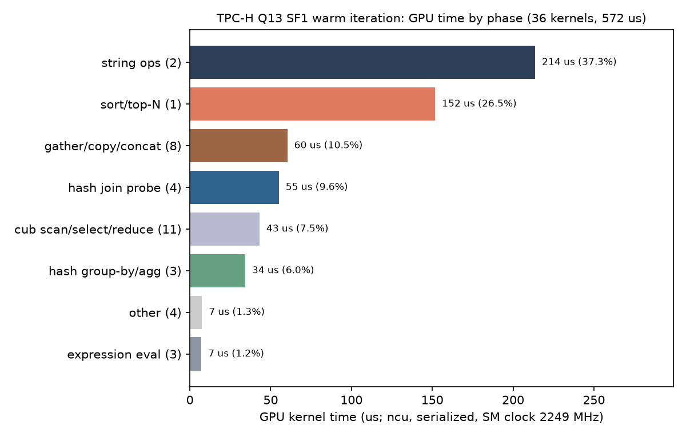
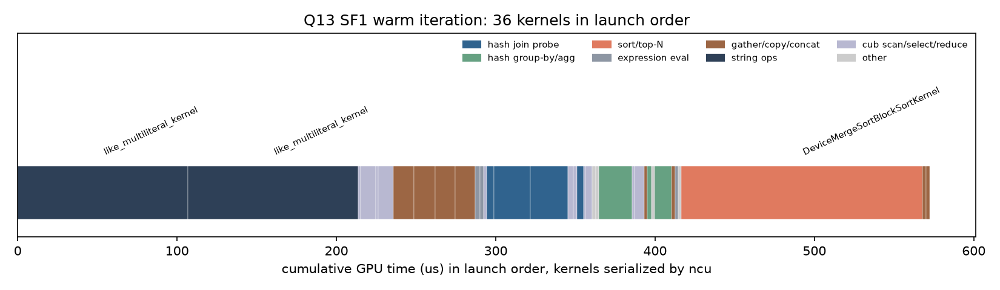
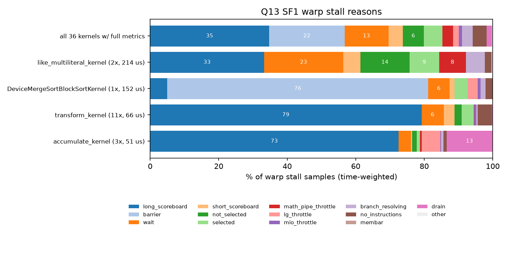
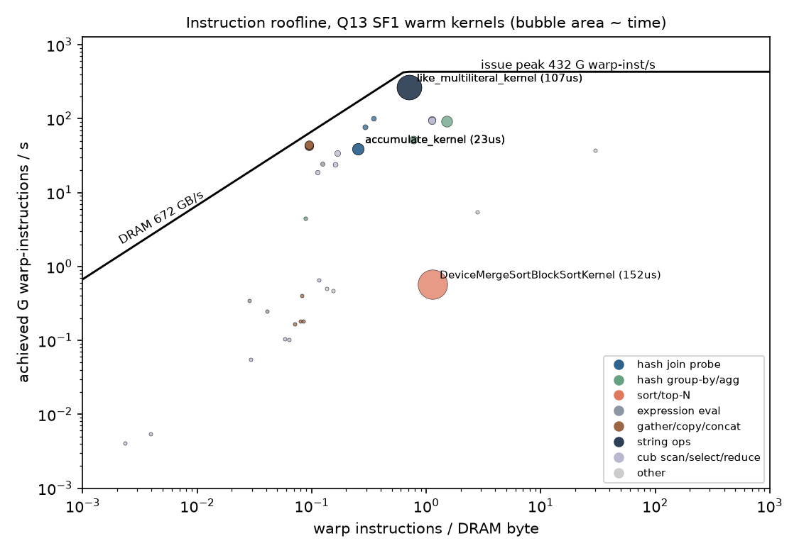

# TPC-H Q13 (SF1) on Sirius, all referenced columns pinned on GPU — Workload Analysis

**Date**: 2026-11-13
**GPU**: NVIDIA GeForce RTX 5070, 12 GB GDDR7 (192-bit, 672 GB/s), Blackwell sm_120, 48 SMs
**Workload**: TPC-H Query 13 (customer distribution: `customer LEFT OUTER JOIN orders ON c_custkey = o_custkey AND o_comment NOT LIKE '%special%requests%'`, `count(o_orderkey)` per customer, then group by that count, ORDER BY custdist DESC, c_count DESC; text read from `q13.sql`), scale factor 1. The 4 referenced columns of 2 tables are pinned in GPU memory with `pin_table(tier='gpu')` (91.37 MB, 86.2% of it `o_comment`); measured iterations read no table data from host (§3).
**Framework**: Sirius (`sirius-duckdb` release build), DuckDB v2.0, stock libcudf from the pixi env, CUDA runtime 13.5
**Pipeline**: `scripts/tpch_sf1/profile_query.sh 13` (about 89 s of pipeline stages: sql 0 s, timing 3 s, pcie 7 s, selftest 5 s, list 10 s, detail 52 s, extract 6 s, validate 0 s, plus a 6 s `extract validate` rerun after a `kclass.py` rule; `pipeline_run.log`); every number below comes from a file in this directory.
**Labels**: *measured* = read from a profiler/log file; *inferred* = derived by arithmetic or reasoning from measured data.

---

## 1. Executive Summary

A warm Q13 takes **3.0 ms end-to-end** (median of 12 timed runs after 3 warmups, range 3–4 ms, `.timer` 1 ms resolution; *measured*, `timing_summary.txt`). DuckDB on the CPU takes 86.0 ms (min 84, max 89), so the GPU is 28.7x faster (*inferred* ratio). The 42-row result equals DuckDB-CPU exactly (compare mode `exact`, max relative difference 0.0, tolerance 1e-9, identical across all 15 GPU iterations; `timing.json`). The first (cold) iteration takes 48.0 ms. The query ran on the GPU with `enable_duckdb_fallback=false`: the LEFT OUTER JOIN with the `NOT LIKE` predicate is supported (no `ERROR.txt`).

| Where the 3.0 ms go (median warm iteration, 1 ms stamps) | ms | Source |
|---|---:|---|
| Planning (DuckDB optimizer + Sirius plan build, 11 pipelines) | 1 | Sirius log, *measured* |
| Engine window (timing run) | 2 | Sirius log, *measured* |
| Gap from `QueryEnd` to the next statement | 0 | Sirius log, *measured* (1 + 2 + 0 = 3 = wall) |
| GPU busy (kernels + copies, real clocks, nsys run) | **0.449** | `nsys_iteration_breakdown.txt`, *measured* |
| Engine window with the GPU idle (host orchestration) | ~1.55 | engine 2 ms (timing run) − GPU busy 0.449 ms (nsys run), *inferred*, ±1 ms |

GPU busy is 15.0% of the 3.0 ms wall (*inferred*). Inside the 460.2 µs of kernel time (nsys, 36 kernels per iteration, deterministic):

1. **`like_multiliteral_kernel` (Sirius' `NOT LIKE '%special%requests%'` kernel): 201.7 µs, 43.8%, 2 launches** of 750,080 threads each (ncu 106.8 µs each). It reads 39.7 MB per launch at 372 GB/s (56.2% of DRAM peak) while SM throughput is 65.7%: neither ceiling is reached; 14.1 of 32 active lanes per instruction (44%) and a per-row serial byte scan are the cost (§8, §9).
2. **`DeviceMergeSortBlockSortKernel`: 118.1 µs, 25.7%, 1 launch** (ncu 151.7 µs): a single-CTA generic row-comparator sort that orders what is, by DuckDB-CPU, a 42-row result; 0.1% of DRAM peak, one SM busy.
3. **`transform_kernel` (fixed-width gathers and tiny single-CTA transforms): 44.4 µs, 9.7%, 11 launches**; the four 5.97 MB gathers run at 455–476 GB/s (68–71% of peak), the only kernels near the bandwidth ceiling.

Against the physical floor of **136.0 µs** (91.37 MB at 672 GB/s, `physical_floor.md`): GPU busy is **3.30x** the floor, the wall is **22.1x** (*inferred*). 22 of 36 kernels last < 5 µs (ncu), 13 are single-CTA. Q13 is limited by one string-scan kernel, one over-general sort, and host orchestration, not by DRAM bandwidth.



---

## 2. Workload Description

- Plan (`query_plan.txt`, counted by distinct ids 0–13): **14 operators in 11 pipelines**: 2 GPU_SCANs (ids 0, 2), 3 PARTITION (1, 3, 7), 1 DENSE_COUNT_JOIN (4), PROJECTION (5), HASH_GROUP_BY (6) + MERGE_GROUP_BY (8), ORDER_BY (9) with SORT_SAMPLE/SORT_PARTITION/MERGE_SORT (10–12), RESULT_COLLECTOR (13). **No FILTER, no DYNAMIC_FILTER, no HASH_JOIN** (0 dynamic filters; the log check reports "0 dynamic-filter publications"). The join's inputs are labelled `port: preserved` (pipeline #1, from scan id 0) and `port: counted` (pipeline #3, from scan id 2). The plan text does not name the LIKE predicate; that it runs inside the join/scan stage is *inferred* from `like_multiliteral_kernel` running first in every iteration. Scan id 0 = customer, id 2 = orders is *inferred* from the pin-assignment order in the log and the kernel grids.
- Row counts and selectivities (DuckDB-CPU on the Parquet, `physical_floor.md`): customer 150,000; orders 1,500,000; `o_comment` mean 48.51 chars (min 19, max 78); matching `%special%requests%`: 16,082 (1.07%), surviving: **1,483,918 (98.93%)**; 99,995 distinct customers among the survivors; 50,005 customers have c_count = 0; inner group-by 150,000 rows; outer group-by 42 groups (max c_count 41). Result `result.csv`: 42 rows, 312 B.
- Pinned bytes (`gpu_pool ... QueryEnd allocated=`): customer 600,064 B (c_custkey), orders 90,771,456 B (o_custkey, o_orderkey, o_comment); total **91,371,520 B**. `o_comment` chars 72,770,808 B + 4 B offsets 6,000,000 B = 78.77 MB (offset width *inferred*) = 86.2% of the footprint.
- 36 kernel launches per warm iteration (list passes: 343/379/415 launches for pin+3/4/5 iterations, +36 each); ncu policy **`full_all`** (36 ≤ 1000), `--set full` on all 36.

## 3. PCIe Verification (`pcie_verification.txt`: `OVERALL: PASS`)

No table data cross PCIe in the measured iterations; only small control copies do (per iteration up to 13 H2D copies / 354 B and 9 D2H copies / 720 B) (*measured*; quoted from the check lines):
- `timing_log:pinned_entry_per_gpu_scan` / `nsys_log:...`: "every iteration: #`assigned pinned entry` == #GPU_SCAN operators (2), all of ['customer', 'orders'] present" (2 GPU scans, 2 pinned-entry assignments per iteration).
- `fs_cache_zero_every_iteration`: "16 cache summaries for 15 iterations ... iterations 1..15 all last_cycle[reads=0 hits=0 h2d=0 miss=0 ...]" (nsys run: 9 summaries for 8 iterations, all zero).
- `no_parquet_decode_kernels`: "0 decode/decompress kernels among 288 kernels of all 8 iterations".
- `h2d_measured_iterations`: "up to 13 copies, 354 B total, largest single 128 B (limits: single <= 65536 B, total <= 1048576 B)". `d2h_measured_iterations`: "up to 9 copies, 720 B total, largest single 672 B (result CSV is 312 B; limit 262144 B)". `no_other_host_copies`: 0 managed/unknown-kind copies. On-device D2D per iteration: 1 copy, 600,000 B (= 150,000 × 4 B; what it carries is *inferred*: the per-customer counter array).
- `unified_memory`: UM CPU+GPU fault collection on; "faults per measured iteration [0, 0, 0, 0, 0]; managed-memory API calls in the whole trace: none" (the fault tables are written only when a fault occurs).
- `pool_counters_stable`: "gpu_pool allocated == pinned footprint 91371520 B at QueryBegin and QueryEnd"; `no_downgrade_or_spill`: "0 downgrade/spill/OOM lines". `no_host_staged_filter_publication`: "0 dynamic-filter publications, all through peer copies (device-side)": a zero-count for that pattern; this plan has no dynamic filter, so the check shows nothing about how filters would travel.
- Pin phase (not measured iterations): H2D 167 copies, 31,140,973 B, largest 1,048,576 B; D2D 15 copies, 49,011,235 B, largest 36,406,847 B. H2D is below the 91.37 MB footprint; the remainder arriving by D2D is *inferred* to be on-device expansion of the loaded columns.
- `ncu_sysmem_check.txt`: "36 kernels, 0 with SM (tex) sysmem-aperture sectors (total 0); all-source sysmem sectors per kernel min/max [265.0, 285.0] (info only)"; ncu `pcie__read/write_bytes` 0 / 391,168 B (rate x duration, includes driver/ncu traffic). `ncu_log_checks_{list,detail}.txt`: every residency check PASS on all four ncu runs.
- Negative control (`selftest_negative_control.txt`): with `orders` left unpinned `pcie_verify.py` exited 1 as expected, failing `pinned_entry_per_gpu_scan` ("1 assigned for 2 GPU_SCANs, missing tables ['orders']"), `fs_cache_zero_every_iteration` (reads 4, h2d 32), `no_parquet_decode_kernels` (3 decode kernels), `h2d_measured_iterations` ("up to 61 copies, 31134871 B total, largest single 13507243 B") and others; `SELFTEST: PASS (verification detected the unpinned table)`. Tables below the byte limit: none.
- GPU memory: pinned footprint 91,371,520 B; gpu_pool high-water 273,513,216 B (process-lifetime, includes the pin phase).

## 4. Environment

| Component | Version / setting |
|---|---|
| GPU / driver | RTX 5070 (sm_120, 48 SMs, 12 GB, 48 MB L2) / 580.173.02 (copied from the Q12 report; not re-queried) |
| Nsight Compute | via `sudo -n`; `--set full --import-source yes` on all 36 warm kernels (version copied from Q12: not re-queried) |
| ncu clocks | locked by ncu: SM median 2249 MHz (`ncu_extract_summary.txt`) |
| Nsight Systems | 2025.5.2 (`/home/sai/nsight-systems-2025.5`); `-t cuda -s none --cpuctxsw=none` plus UM page-fault collection |
| CPU | Intel i9-13900K, 125 GB RAM (copied from the Q12 report) |
| Sirius config | `scripts/tpch_sf1/sirius.yaml`: 4 pipeline threads, GPU pool 25% of 12 GB, 1 GB pinned host pool (2 pools), `enable_duckdb_fallback=false` |

## 5. Physical Floor vs Measured

Floors from `physical_floor.md`, written before any ncu output (*inferred* from table statistics):

| Scenario | Bytes | Floor @ 672 GB/s |
|---|---:|---:|
| A. every pinned column once | 91.37 MB | **136.0 µs** |
| A'. native widths (inferred; equals A, strings are not narrowed) | 91.37 MB | 136.0 µs |
| A-min. predicate-forced bytes only (o_comment, o_custkey, c_custkey) | ≈ 85.37 MB | 127.0 µs |
| B. A + 14.27 MB of materialised intermediates | ≈ 105.64 MB | ≈ 157.2 µs |
| Compute estimate (~0.16 G byte-ops) | | < 20 µs |
| Launch-count bound (36 kernels × ~2 µs, figure imported from Q2, not re-measured) | | ~72 µs |

| Measured (real clocks unless noted) | Value | × floor A (136.0 µs) | × floor B (157.2 µs) |
|---|---:|---:|---:|
| Wall, warm median (`timing.json`) | 3.0 ms | 22.1x | 19.1x |
| nsys GPU busy (`nsys_iteration_breakdown.txt`) | 0.449 ms | 3.30x | 2.86x |
| nsys kernel sum | 0.460 ms | 3.38x | 2.93x |
| ncu serialized kernel sum (clock-locked, cold-L2; not comparable with the rows above) | 0.572 ms | 4.21x | 3.64x |

ncu DRAM traffic for the warm iteration: 120.04 MB (cold-L2, `ncu_extract_summary.txt`), 1.31x the pinned footprint (*inferred*), average 209.7 GB/s over the serialized kernel time. The like kernel alone reads 79.52 MB over its 2 launches, 1.01x the 78.77 MB of `o_comment` data.

## 6. Kernel, Phase and Operator Breakdown

Phase table (ncu full pass, serialized, `phase_breakdown.txt`; 36 kernels, 572.4 µs):

| Phase | Kernels | µs | % | DRAM MB | GB/s |
|---|---:|---:|---:|---:|---:|
| string ops | 2 | 213.6 | 37.3 | 79.52 | 372.3 |
| sort/top-N | 1 | 151.7 | 26.5 | 0.08 | 0.5 |
| gather/copy/concat | 8 | 60.3 | 10.5 | 23.91 | 396.7 |
| hash join probe (dense count join, see below) | 4 | 55.0 | 9.6 | 9.57 | 173.8 |
| cub scan/select/reduce | 11 | 43.0 | 7.5 | 4.15 | 96.3 |
| hash group-by/agg | 3 | 34.2 | 6.0 | 2.13 | 62.4 |
| other / expression eval | 4 / 3 | 7.5 / 7.1 | 1.3 / 1.2 | 0.02 / 0.66 | |

Operators (`operator_breakdown.txt`): `like_multiliteral` 2 kernels 213.6 µs (37.3%); sort 1 kernel 151.7 µs (26.5%); gather/scatter fixed-width 8 kernels 60.3 µs (10.5%); dense count join accumulate/emit 4 kernels 55.0 µs (9.6%); group-by 3 kernels 34.2 µs (6.0%); cub select/compact 6 kernels 29.8 µs; cub reduce/find 5 kernels 13.3 µs. **`kclass.py` edited**: before the edit `other: accumulate_kernel` (3 kernels, 50.9 µs) + `other: emit_kernel` (4.1 µs) = 55.0 µs (9.6%) exceeded the 5% limit; I added one rule mapping `sirius::...(accumulate_kernel|emit_kernel)` to phase "hash join probe", operator "dense count join: accumulate/emit (sirius)". That these are the DENSE_COUNT_JOIN's kernels is *inferred* from names, atomics (§9) and the plan; after the edit `other:` rows total 3.6 µs (0.6%: `transform_kernel` 2.0, `static_kernel` 1.6).

Kernel-size facts (*measured*, ncu full pass): 22 kernels < 5 µs, 25 < 10 µs (77.8 µs, 13.6% of time); 26 launch < 1 wave (261.5 µs) and 16 have grid < 48 CTAs; 13 are single-CTA (counted from `ncu_warm_metrics.json`). The top-10 kernels hold 84.5% of time. Real-clock nsys kernel time by family (mean per measured iteration, 460.2 µs): like_multiliteral 201.7 (43.8%), merge sort 118.1 (25.7%), transform 44.4 (9.7%), accumulate 36.7 (8.0%), DeviceSelectSweep 18.5 (4.0%), mapping_indices 16.7 (3.6%), single_pass_shmem_aggs 7.3 (1.6%).

Kernel order (ncu list/full, *measured*; roles *inferred*): pos 0–1 two LIKE launches (one per half of orders, grid 2930 × 256 = 750,080 threads ≈ 750,000 rows each); 2–5 compaction of the LIKE masks; 6–9 four fixed-width gathers of 5.97 MB (750K rows × 4 B read + written); 10–12 reduce/min-max; 13–15 three `accumulate_kernel` (two with 2.32e4 warp-level atomics, ≈ 742K lane-atomics, ≈ one per surviving row); 16–18 reduce + `emit_kernel`; 19–22 find/init; 23–29 group-by (`mapping_indices`, `single_pass_shmem_aggs`); 30–35 small single-CTA transforms and the sort (pos 33).

Per-iteration CPU-side API (nsys, mean of 5): 46 `cudaStreamSynchronize` (0.455 ms CPU, summed over threads) + 29 `cuStreamSynchronize` (0.206 ms), 36 `cudaLaunchKernel` (0.212 ms), 19 `cudaMemcpyBatchAsync` (0.110 ms), 46 `cudaMallocFromPoolAsync` / 46 `cudaFreeAsync`.




## 7. Top Kernels (ncu `--set full`, serialized, clock-locked, L2 flushed per kernel)

| pos | Kernel (operator, *inferred*) | µs | grid × blk | waves | SM% | DRAM% | GB/s | main stall |
|---:|---|---:|---|---:|---:|---:|---:|---|
| 33 | MergeSortBlockSort (42-row ORDER BY) | 151.7 | 1 × 256 | 0.01 | 0.2 | 0.1 | 0.5 | barrier 76.2% |
| 1 / 0 | like_multiliteral (orders half 1 / 2) | 106.8 / 106.8 | 2930 × 256 | 12.2 | 65.7 / 66.3 | 56.2 / 56.3 | 372.0 / 372.6 | long_sb 33.4% |
| 15 / 14 | accumulate_kernel (count per custkey) | 23.4 / 22.9 | 288 × 256 | 1.0 | 12.6 | 23.2 | 153 | long_sb 75.8% |
| 23 | mapping_indices (group-by) | 21.0 | 240 × 128 | 1.0 | 21.4 | 9.2 | 61.0 | long_sb 34.7% |
| 6–9 | transform_kernel (gather, 4 launches) | 12.5–13.1 | 264 × 256 | 0.92 | 12.4–12.7 | 69.0–72.0 | 455–476 | long_sb ~90% |
| 29 | single_pass_shmem_aggs | 10.7 | 240 × 128 | 0.71 | 11.8 | 10.2 | 67.8 | |
| 3 / 5 | DeviceSelectSweep | 9.4 / 9.6 | 131 × 384 | 1.36 | 37 | 13 | 85 | |

(`top_kernel_details.txt`.) Time-weighted stall mix over all 36 kernels: long_scoreboard 34.7%, barrier 22.0%, wait 12.8%, not_selected 6.1%, selected 5.5% (`ncu_extract_summary.txt`); the barrier share is the sort kernel. Roofline reading: only the four gathers (68–72% of 672 GB/s) approach the DRAM ceiling; the LIKE kernel is at 56% DRAM and 65.7% SM, i.e. it sits under both ceilings (instruction issue with lane waste, §8); the sort kernel is at 0.1% of DRAM and 0.2% SM.




## 8. Instruction-Level Evidence for the #1 kernel by real-clock time: `like_multiliteral_kernel` (`sass/like_multiliteral_kernel_hotspots.txt`, pos 1)

(By ncu time the single sort launch is #1 at 151.7 µs; by family and by nsys the LIKE kernel is #1, 213.6 µs ncu / 201.7 µs nsys, so SASS evidence for it comes first; the sort follows.)

Kernel: `sirius::like_multiliteral_kernel<int>(offsets, chars, ..., like_multiliteral_pattern_desc, bool*)`; 46 registers, 936 static instructions, **333 ever executed (35.6%)**; 2.833e7 executed warp instructions, 10,970 stall samples, `thread_eff` 14.1 lanes of 32 (44%), IPC 2.57 (*measured*). Mix: int arithmetic 55.3% of executed (66.3% of stalls), control flow 18.9%, move 17.5%, global load 1.7%, global store 0.1%.
Per row (*inferred* from grid: 2930 × 256 = 750,080 threads ≈ 750,000 orders rows, one thread per row, 23,438 executions of the per-warp prologue): 37.8 warp-instructions per row-thread, i.e. ≈ 24.9 issue lane-slots per character (36.39 M chars per launch); at 14.1 active lanes of 32 ≈ 11.0 useful lane-instructions per character.

Hot loop, 249,265 warp executions = 10.6 per warp (*measured* counts); active lanes `thr=20.0` of 32 in the loop, `thr=1.0` in the code at +0x01950/+0x00ee0 (exe 73,634 / 95,626). The constants `0x0101010101010101` and `0x8080808080808080` in the loop (`UMOV.64 UR10, 0x101010101010101` at +0xc90/+0xd80, `MOV.64 R22, 0x8080808080808080` at +0xc40) are the classic 8-bytes-at-a-time zero-byte/match test, so the loop is an 8-byte stride scan (*inferred*); the 10.6 iterations per warp ≈ ceil(78 / 8) = 10 for the longest string (max 78 chars) suggests each warp runs until its longest row finishes, which would explain the 20-of-32 active lanes (*inferred*).

Chain A (once per row-thread, exe = 23,438, window around `+0x00270`; `exe=0` at +0x1f0 excluded):
```
+0x00230  LDG.E.CONSTANT R14, desc[UR8][R2.64]        ; first of two adjacent 4 B loads
+0x00240  LDG.E.CONSTANT R12, desc[UR8][R2.64+0x4]
+0x00270  SHF.R.S32.HI R15, RZ, 0x1f, R14             ; samp 539, long_sb 494; reads R14
+0x00290  IADD.64 R4, -R14, R12                        ; reads R14 and R12
```
Register-exact: the stalled `SHF` reads R14 written by the `LDG` at +0x230 (same window, `long_sb`). That the two loads are `offsets[i]`/`offsets[i+1]` and the `IADD.64` is the string length is *inferred* from shape.

Chain B (the hottest PC, `+0x00cb0`, 2545 samples = 23.2%, long_sb 2465):
```
+0x00c50  LOP3.LUT R20, R7, R0, RZ, 0x3c, !PT
+0x00c80  LOP3.LUT R22, R7, R2, RZ, 0x3c, !PT
+0x00cb0  LOP3.LUT R25, R18, R2, RZ, 0x3c, !PT        ; reads R18 and R2
+0x00cc0  IADD.64 R22, R22, -UR10
```
`LOP3 R25 = R18 ^ R2` reads R18, but **no instruction inside this window (+0xc30…+0xcc0) writes R18 or R2**, so the producer is outside the window. The only global load writing the R18:R19 pair in the top-25 list is `+0x008d0 LDG.E.64.CONSTANT R18, desc[UR8][R18.64+0x8]` (exe = 249,265, same count as the stalled instruction); that it feeds `+0xcb0` (and `+0x007f0 MOV R8, R19`, 624 samples, long_sb 598, whose window +0x770…+0x810 likewise contains no producer of R19) is *inferred* from register names and equal execution counts, and across the loop back-edge for `+0x7f0`. The hotspot data therefore support: the hottest instructions wait on an 8-byte character-word load whose latency is exposed because the next word's address depends on the loop counter, not on the data, but each iteration's XOR/zero-byte test needs the just-loaded word (*inferred*).

Second kernel in the top-2 (`sass/DeviceMergeSortBlockSortKernel_hotspots.txt`, pos 33, 1 CTA × 256 threads): 13,648 static instructions of which 2,084 execute (15.3%); **8.709e4 executed warp instructions in total, only 340 stall samples** (statistically thin); local (spill) instructions are 13.2% of executed (1,042 static `LDL/STL`); stall `barrier` = 76.2%, 206 samples (60.6%) at `+0x08bf0 LDC.64 R30` three instructions after `+0x08bc0 BAR.SYNC.DEFER_BLOCKING 0x0` (exe = 8 warps once). That means the stalled warps wait at the barrier for the other warps of the CTA; which warp is late, and why, is not visible in the samples. Comparator code (`LD.E.64` at +0x11fa0/+0x11fb0 then `ISETP` at +0x11fc0, exe 276, `thr=2.0`) runs on 2 lanes.

## 9. Root Cause Analysis

**RC1: the `NOT LIKE '%special%requests%'` scan (`like_multiliteral_kernel`, 201.7 µs nsys = 43.8% of kernel time)**
- Symptom (*measured*): 2 launches × 106.8 µs (ncu), 39.74 MB each at 372.0 GB/s (56.2% of peak), SM 65.7%, IPC 2.57, 12.2 waves.
- WHY not at the DRAM floor? 39.74 MB at 672 GB/s is 59.1 µs; the launch takes 106.8 µs = 1.81x that (*inferred*, ncu cold-L2 bytes vs ncu time). DRAM is only 56% busy and SM 65.7%; the stalls are long_sb 33.4%, wait 23.2%, not_selected 14.1% (*measured*).
- WHY? `thread_eff` is 14.1 of 32 lanes and 37.8 warp-instructions are issued per row (24.9 lane-slots per character, §8) (*measured* counts, ratios *inferred*): the work is a serial per-row byte scan whose 8-byte-stride loop runs 10.6 times per warp at 20 of 32 active lanes, and the second-literal code at 1 active lane.
- WHY are lanes idle? Rows are 19–78 chars, so lanes whose string ended wait for the longest row of the warp, and only lanes that found `special` continue to `requests` (*inferred* from `thr=` values and the string length range).
- ROOT (*inferred*): one-thread-per-row string matching has no cross-lane work sharing; its cost is set by the longest string per warp and the 1-lane tail, not by bytes read. Since 98.93% of rows survive the NOT LIKE, the scan produces almost no reduction (1,483,918 of 1,500,000 rows).

**RC2: the ORDER BY sort (`DeviceMergeSortBlockSortKernel`, 118.1 µs nsys = 25.7%, 151.7 µs ncu)**
- Symptom (*measured*): a single 1 × 256-thread launch, SM busy on 1 of 48 SMs (max/avg 48.00, active fraction 0.02), 0.1% of DRAM peak, IPC 0.25.
- WHY slow? 8.709e4 warp instructions on 8 warps ≈ 10.9 K instructions per warp, 13.2% of them local-memory spill traffic, 76.2% of stall samples at a CTA barrier (*measured*; only 340 samples).
- WHY so much work? The kernel is a generic libcudf block sort over a lexicographic row comparator (13,648 static instructions, 2,084 executed); its input is, by DuckDB-CPU, the 42 outer-group rows (*inferred*: the sort input cardinality is not logged). 118.1 µs for ~42 rows is ≈ 2.8 µs per row.
- ROOT (*inferred*): fixed cost of a large generic template (spills, barriers, 2-lane comparator path) applied to a tiny input; the sort is the second-largest GPU time sink only because everything else is tiny.

**RC3: host orchestration (≈ 2.55 ms of the 3.0 ms wall is not GPU-busy time)**
- Symptom (*measured*): wall 3.0 ms (planning 1 ms + engine 2 ms) vs GPU busy 0.449 ms; GPU first→last op span 3.12 ms in the nsys run (`nsys_iteration_breakdown.txt`).
- WHY? 36 launches (0.212 ms CPU summed), 75 sync calls (0.661 ms CPU summed over all threads), 19 batch copies, 46 pool alloc/free pairs per iteration (*measured*); 22 kernels last < 5 µs (ncu) and 13 are single-CTA, so they cannot hide host latency (*inferred*).
- ROOT (*inferred*): per-operator pipeline barriers (11 pipelines, 14 operators) plus a result path of 9 small D2H copies (720 B); "each sync waits for a µs-scale kernel" is not measured (nsys gives call counts and summed CPU time only). The ~1.55 ms engine idle mixes the timing run and the nsys run (±1 ms).

## 10. Gap Analysis

| Layer | Time | × floor A | Source |
|---|---:|---:|---|
| Floor A (91.37 MB / 672 GB/s) | 136.0 µs | 1.0x | `physical_floor.md` |
| nsys GPU busy | 449 µs | 3.30x | `nsys_iteration_breakdown.txt` |
| Engine window (timing run) | 2000 µs | 14.7x | Sirius log |
| Wall | 3000 µs | 22.1x | `timing.json` |

The 3.30x GPU gap decomposes (nsys, *inferred* shares of 460.2 µs kernel time): 201.7 µs LIKE (43.8%), 118.1 µs sort (25.7%), 140.4 µs everything else (30.5%, 33 kernels). If the two LIKE launches ran at the DRAM time of their 79.52 MB (118.3 µs ≈ 2 × 59.1 µs, mixing the ncu byte count with a floor) instead of 201.7 µs, GPU busy would drop by up to ~0.08 ms; if the sort were negligible, by up to ~0.12 ms (*inferred* upper bounds; not measured). Even then GPU busy stays ≥ ~0.25 ms, and the remaining ≈ 2.5 ms of wall is planning and host orchestration.

## 11. Optimization Directions (general-purpose; no query-specific fusion)

1. **Share the work of a string-matching kernel across lanes (libcudf/Sirius string operator, general).** Replace one-thread-per-row scanning by a warp- or CTA-cooperative scan balanced by characters (using the offsets array), with 16 B vector loads. Ceiling from the bytes: 59.1 µs per launch vs 106.8 µs now (≤ 1.8x per launch, ~0.08 ms of GPU busy; *inferred*).
2. **A small-input path for the generic sort** (a single-warp or in-register sort when the row count is below a few hundred; the comparator spills would disappear). Up to 118 µs of 460 µs kernel time (*inferred* upper bound); the 42-row input size is itself *inferred*.
3. **Cut synchronisation and allocation churn.** 75 sync calls, 46 alloc/free pairs and 36 launches for a 42-row result: batch per-partition pipelines, reuse pool allocations (GPU idle ≈ 1.55 ms of the engine window, *inferred*).
4. **Gathers and counts are already near-reasonable.** The four fixed-width gathers reach 455–476 GB/s (68–71% of peak); the three `accumulate_kernel` launches are bound by atomic latency (long_sb 75.8%, L2 hit 86.7%) and total 50.9 µs (8.9%): lower priority.
Kernel fusion is mentioned only as context: it would lower launch counts but is out of scope here.

## 12. Determinism and Profiling Method

- **Launch counts are deterministic** (*measured*, `warm_kernel_summary.txt`, `ncu_plan.json`, `pcie.json`): every iteration = 36 launches in the three ncu list runs (343/379/415) and in all 8 nsys iterations; `STABLE: True`, added-iteration multisets equal.
- **Launch order is not fully deterministic**: x5 iteration 4 vs 5 differ at 0 positions, x4 vs first N4 of x5 at 11 positions. The slice needs only counts and multisets (`ncu_slice_check.txt`: multiset match True; 1 name reconciled on function/grid/block; identical launch order False).
- **ncu policy branch**: 36 ≤ `NCU_FULL_MAX` (1000) → `full_all`; the light + families branch was not used.
- nsys: 5 measured iterations (4–8), kernels [36]×5, GPU busy 0.445–0.463 ms, 61 GPU ops per iteration; nsys doubles the engine window (4 ms vs 2 ms in the timing log), so wall splits come from the timing log.
- Timing: 3 warmups + 12 timed iterations; DuckDB-CPU same protocol (first 93.0 ms).
- ncu durations are serialized, clock-locked and L2-flushed per kernel; they are never summed with nsys times.

## 13. Limitations

- ncu serialized kernel sum 572.4 µs vs nsys 460.2 µs (1.24x); tiny kernels are overstated by ncu, the sort is overstated (151.7 vs 118.1 µs). All real-clock claims use nsys.
- ncu DRAM bytes (120.04 MB) are cold-L2 traffic; the 91.4 MB working set exceeds the 48 MB L2 either way. The "1.81x of the DRAM time" for LIKE mixes ncu bytes with an ideal floor.
- Wall splits are 1 ms stamps; the ~1.55 ms "GPU idle" mixes the timing run and the nsys run (±1 ms).
- Which scan/partition each launch handles, and operator roles (LIKE halves, gathers, dense count join, 42-row sort input) are *inferred* from grid × block, byte counts, names and the plan, not from per-kernel logs. The plan text does not show where the LIKE predicate lives.
- §8: Chain B's producer (R18/R19) is outside the context window; the link to `+0x008d0` is inferred. What the loads fetch (offsets, character words), the 8-byte SWAR interpretation and why lanes are inactive are inferences. The sort kernel has only 340 stall samples, and the cause of its barrier wait is not determined.
- SASS covers the top 2 families only (like_multiliteral, merge sort). One hit-rate (pos 19, `init_found_pos_pointer`, L2 hit) read 107.5% and is clamped to 100 in `ncu_warm_metrics.json` (raw kept). The ~2 µs smallest-kernel figure is carried over from earlier queries, not re-measured.
- Pin-phase H2D (31.14 MB) is below the footprint (91.37 MB); how the remainder is produced is inferred. Only the pinned configuration was profiled; no unpinned timing (the negative control checks residency detection only). Native widths are inferred (strings are not narrowed); the 1e-9 result tolerance was not exercised (max rel diff 0.0). `kclass.py` operator names for accumulate/emit are inferred.

## 14. Raw Data

| File | Contents |
|---|---|
| `timing_summary.txt`, `timing.json`, `result.csv`, `traces/timing_run.txt`, `traces/duckdb_cpu_run.txt` | timing, result, CPU baseline, compare mode |
| `query_plan.txt`, `sql/` | Sirius plan, generated SQL |
| `pcie_verification.txt`, `pcie.json`, `traces/q13_nsys.{nsys-rep,sqlite}`, `traces/sirius_log_*` | PCIe evidence |
| `ncu_sysmem_check.txt`, `ncu_log_checks_{list,detail}.txt`, `selftest_negative_control.txt`, `selftest/` | host-memory-in-place, residency checks, negative control |
| `nsys_iteration_breakdown.{txt,json}` | GPU busy, API counts, real-clock kernel times |
| `warm_kernel_list.json`, `warm_kernel_summary.txt`, `ncu_plan.json`, `traces/ncu_list_x{3,4,5}.csv` | list passes, determinism, plan |
| `profiles/q13_warm_full.ncu-rep`, `ncu_slice_check.txt` | full ncu report (36 kernels) |
| `ncu_warm_metrics.json`, `ncu_extract_summary.txt`, `phase_breakdown.txt`, `operator_breakdown.txt`, `top_kernel_details.txt` | extracted metrics |
| `sass/` | hotspots for `like_multiliteral_kernel` and `DeviceMergeSortBlockSortKernel` |
| `plots/q13_*.png` | phase breakdown, kernel sequence, roofline, stall mix |
| `physical_floor.md`, `pipeline_run.log`, `validate_pipeline.txt` | floor, logs, validation |
