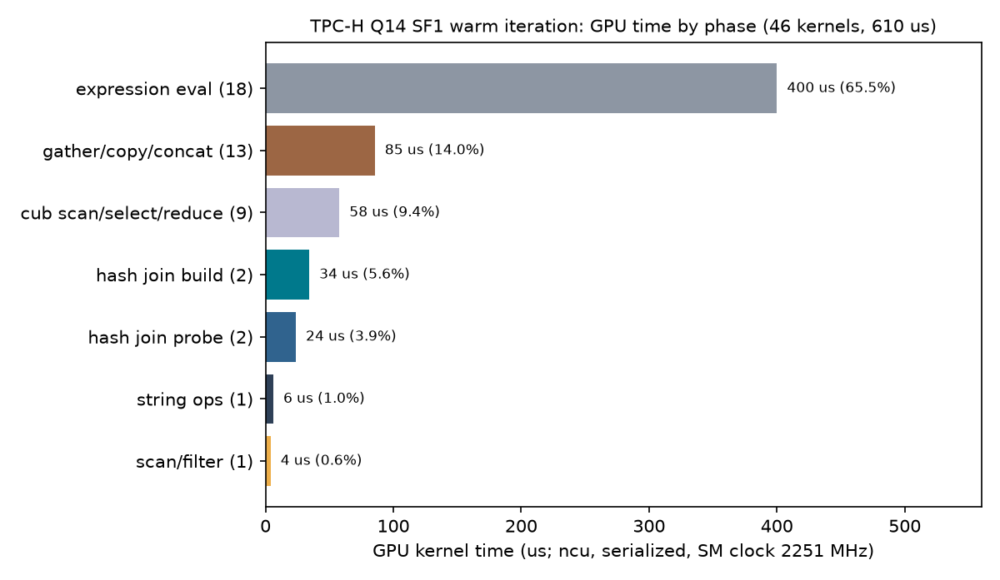
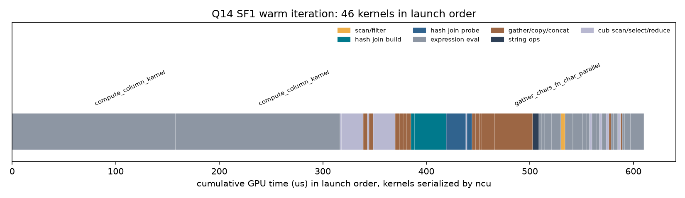
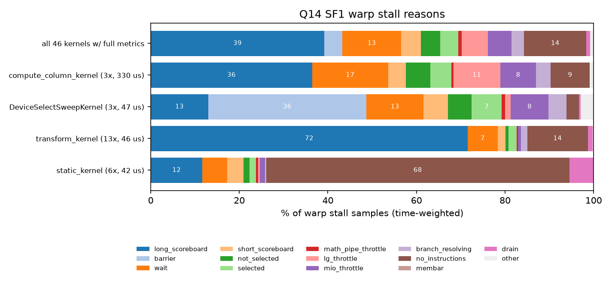
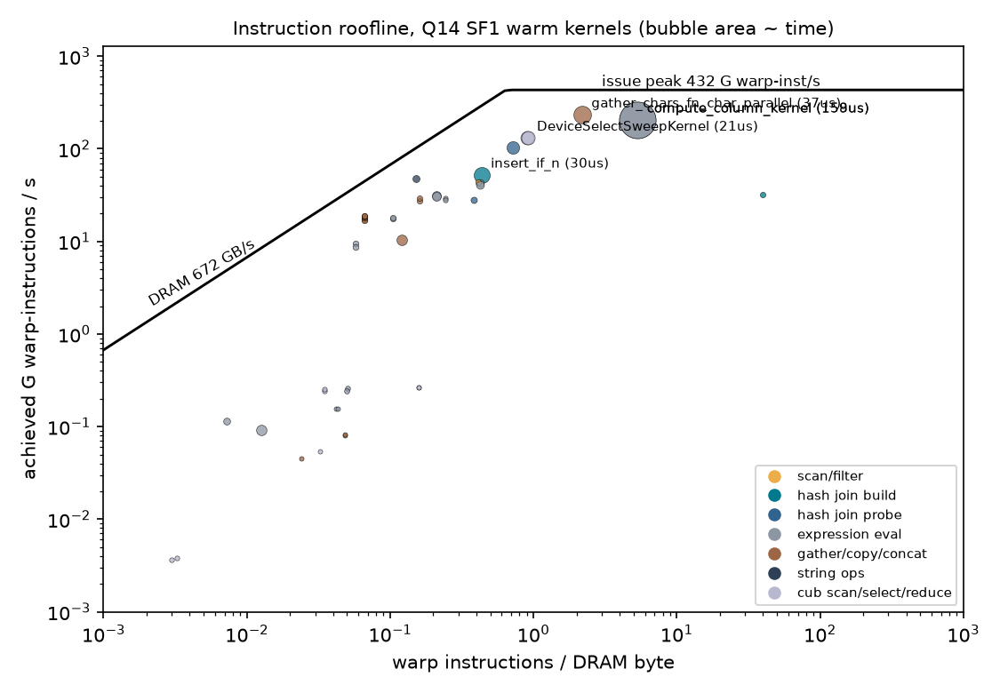

# TPC-H Q14 (SF1) on Sirius, all referenced columns pinned on GPU — Workload Analysis

**Date**: 2026-11-13
**GPU**: NVIDIA GeForce RTX 5070, 12 GB GDDR7 (192-bit, 672 GB/s), Blackwell sm_120, 48 SMs
**Workload**: TPC-H Query 14 (promotion effect: `lineitem ⋈ part` on partkey, `l_shipdate` in [1994-08-01, 1994-09-01), `100.00 * sum(case when p_type like 'PROMO%' then l_extendedprice*(1-l_discount) else 0 end) / sum(l_extendedprice*(1-l_discount))`, one DOUBLE result; constants read from `q14.sql`), scale factor 1. The 6 referenced columns of 2 tables are pinned in GPU memory with `pin_table(tier='gpu')` (89.74 MB); measured iterations read no table data from host (§3).
**Framework**: Sirius (`sirius-duckdb` release build), DuckDB v2.0, stock libcudf from the pixi env, CUDA runtime 13.5
**Pipeline**: `scripts/tpch_sf1/profile_query.sh 14` (112 s of pipeline stages: 15 s for sql/timing/pcie/selftest + 97 s for list/detail/extract/validate; `pipeline_run.log`); every number below comes from a file in this directory.
**Labels**: *measured* = read from a profiler/log file; *inferred* = derived by arithmetic or reasoning from measured data.

---

## 1. Executive Summary

A warm Q14 takes **4.0 ms end-to-end** (median of 12 timed runs after 3 warmups, range 4–5 ms, `.timer` 1 ms resolution; *measured*, `timing_summary.txt`). DuckDB on the CPU takes 20.0 ms (min 17, max 22), so the GPU is 5.0x faster (*inferred* ratio). The 1-row DOUBLE result (16.45836327537756, `result.csv`) equals DuckDB-CPU exactly: compare mode `exact`, max relative difference 0.0, tolerance 1e-9, identical across all 15 GPU iterations (`timing.json`). The first (cold) iteration takes 42.0 ms.

| Where the 4.0 ms go (median warm iteration, 1 ms stamps) | ms | Source |
|---|---:|---|
| Planning (DuckDB optimizer + Sirius plan build, 9 pipelines) | 2 | Sirius log, *measured* |
| Engine window (timing run) | 2 | Sirius log, *measured* |
| Gap from `QueryEnd` to the next statement | 0 | Sirius log, *measured* (planning + engine = 4 ms = the wall median) |
| GPU busy (kernels + copies, real clocks, nsys run) | **0.456** | `nsys_iteration_breakdown.txt`, *measured* |
| Engine window with the GPU idle (host orchestration) | ~1.5 | engine 2 ms (timing run) − GPU busy 0.456 ms (nsys run), *inferred*, ±1 ms |

GPU busy is 11.4% of the 4.0 ms wall (456/4000, *inferred*; 9.1% of the 5.0 ms nsys engine window). Inside the 411.3 µs of kernel time (nsys, 46 kernels per iteration, deterministic):

1. **`compute_column_kernel` (libcudf AST expression evaluator): 254.0 µs, 61.8%, 3 launches.** Two launches of ~3.0 M rows each (ncu 158.8 / 157.9 µs, 40.7 waves) evaluate the lineitem date predicate (*inferred* from grid). They are bound by the load/store pipe (LSU 91.7% busy, IPC 1.96, 45 load requests per warp), not by DRAM (5.8% of peak, 38.4 GB/s). Each is 17.5x slower than the DRAM time of its own 6.09 MB (*inferred*).
2. **`DeviceSelectSweepKernel`: 33.8 µs (8.2%), 3 launches** (ncu shows two 521/522-CTA launches reading ~3.06 MB each and a third 121-CTA launch; that these compact the predicate mask is *inferred*) and **`gather_chars_fn_char_parallel`: 25.2 µs (6.1%), 1 launch**: the p_type string gather, with a 13.1 µs ncu prefix-scan before it (`DeviceScanKernel`, 29 CTAs).
3. **`transform_kernel` 24.6 µs (6.0%), 13 launches**, **`insert_if_n` (hash build over 200,064 threads = the 200,000 part rows) 16.0 µs (3.9%)**, `find_if_n` (probe) 11.8 µs.

Against the physical floor of 133.5 µs (89.74 MB at 672 GB/s, `physical_floor.md`): GPU busy is **3.41x** the floor, the wall is **29.95x** (*inferred*). 31 of 46 kernels last < 5 µs in the ncu full pass and 14 are single-CTA. Q14 is limited by one expression-evaluation kernel pair (GPU side) and by host orchestration (wall), not by DRAM bandwidth.



---

## 2. Workload Description

- Plan (`query_plan.txt`, counted by distinct ids 0–11): **12 operators in 9 pipelines**: 2 GPU_SCANs (ids 0, 3), 1 HASH_JOIN (id 6, INNER), 2 PROJECTION (7, 10), UNGROUPED_AGGREGATE (8) + MERGE_AGGREGATE (9), 2 PARTITION (1, 4), 2 CONCAT (2, 5), RESULT_COLLECTOR (11). No FILTER and no DYNAMIC_FILTER operator appears in the plan; the Sirius log says "Not wiring dynamic filter(s): build side carries neither filter nor opaque-build evidence (build est 200000 rows)" (`traces/sirius_log_timing/*.log`), so **0 dynamic filters**.
- Build side = part (log: build est 200,000 rows; the `insert_if_n` grid 1563 × 128 = 200,064 threads matches). Probe side = the filtered lineitem: `find_if_n` grid 602 × 128 = 77,056 ≈ 77,041 qualifying rows. Where the date predicate runs (inside the scan, not a plan operator) is *inferred* from the two ~3.0 M-row `compute_column_kernel` launches at the start of the warm iteration.
- Row counts and selectivities (DuckDB-CPU on the Parquet, `physical_floor.md`): lineitem 6,001,215; shipdate window 77,041 (1.284%), touching 63,924 distinct partkeys; part 200,000, `p_type LIKE 'PROMO%'` 33,174 (16.59%); 12,665 of the 77,041 joined rows (16.44%) are PROMO. Result: 1 row, 32 B.
- Pinned bytes (`gpu_pool ... QueryEnd allocated=`): lineitem 84,017,920 B (l_partkey, l_extendedprice, l_discount, l_shipdate), part 5,720,320 B (p_partkey, p_type); total **89,738,240 B**.
- 46 kernel launches per warm iteration (list passes: 364/410/456 launches for pin+3/4/5 iterations, +46 each); ncu policy **`full_all`** (46 ≤ 1000), `--set full` on all 46.

## 3. PCIe Verification (`pcie_verification.txt`: `OVERALL: PASS`)

No table data cross PCIe in the measured iterations; only small control copies do (per iteration up to 55 H2D copies / 1,918 B and 37 D2H copies / 167 B) (*measured*; quoted from the check lines):
- `timing_log:pinned_entry_per_gpu_scan` / `nsys_log:...`: "every iteration: #`assigned pinned entry` == #GPU_SCAN operators (2), all of ['lineitem', 'part'] present".
- `fs_cache_zero_every_iteration`: "16 cache summaries for 15 iterations ... iterations 1..15 all last_cycle[reads=0 hits=0 h2d=0 miss=0 ...]" (nsys run: 9 summaries for 8 iterations, all zero).
- `no_parquet_decode_kernels`: "0 decode/decompress kernels among 368 kernels of all 8 iterations".
- `h2d_measured_iterations`: "up to 55 copies, 1918 B total, largest single 276 B (limits: single <= 65536 B, total <= 1048576 B)". `d2h_measured_iterations`: "up to 37 copies, 167 B total, largest single 48 B (result CSV is 32 B; limit 262144 B)". `no_other_host_copies`: 0 managed/unknown-kind copies. Per-iteration on-device D2D: 15 copies, 6,644,476 B, largest 4,119,946 B.
- `unified_memory`: UM CPU+GPU fault collection on; "faults per measured iteration [0, 0, 0, 0, 0]; managed-memory API calls in the whole trace: none" (the fault tables are written only when a fault occurs).
- `pool_counters_stable`: "gpu_pool allocated == pinned footprint 89738240 B at QueryBegin and QueryEnd"; `no_downgrade_or_spill`: 0 lines. `no_host_staged_filter_publication`: "0 dynamic-filter publications, all through peer copies (device-side)" (a zero-count for that check's pattern; for Q14 it agrees with the log line that no dynamic filter is wired, so the check saw nothing and says nothing about how filters would be transferred).
- Pin phase (not measured iterations): H2D 202 copies, 45,909,832 B, largest 1,048,576 B.
- `ncu_sysmem_check.txt`: 46 kernels, 0 with SM (tex) sysmem-aperture sectors (total 0); the all-source counter reads 265–285 sectors for every kernel (information only); ncu `pcie__read/write_bytes` 512 / 500,224 B (rate x duration, includes driver/ncu traffic). `ncu_log_checks_{list,detail}.txt`: every residency check PASS on all four ncu runs, including "#`assigned pinned entry` == #GPU_SCAN operators (2)".
- Negative control (`selftest_negative_control.txt`): with `lineitem` left unpinned `pcie_verify.py` exited 1 as expected, failing `pinned_entry_per_gpu_scan` ("1 assigned for 2 GPU_SCANs, missing tables ['lineitem']"), `fs_cache_zero_every_iteration` (reads 18, h2d 59), `no_parquet_decode_kernels` (3 decode kernels), `h2d_measured_iterations` (45,696,349 B per iteration, largest 3,560,399 B) and `d2h_measured_iterations` (855,147 B); `SELFTEST: PASS (verification detected the unpinned table)`. Tables below the byte limit: none (both have ≥ 8192 rows).
- GPU memory: pinned footprint 89,738,240 B; gpu_pool high-water 347,509,590 B (process-lifetime, includes the pin phase).

## 4. Environment

| Component | Version / setting |
|---|---|
| GPU / driver | RTX 5070 (sm_120, 48 SMs, 12 GB, 48 MB L2) / 580.173.02 (copied from the Q12 report; not re-queried) |
| Nsight Compute | via `sudo -n`; `--set full --import-source yes` on all 46 warm kernels (version copied from the Q12 report: 2025.2.1, not re-queried) |
| ncu clocks | locked by ncu: SM median 2251 MHz (`ncu_extract_summary.txt`) |
| Nsight Systems | 2025.5.2 (`/home/sai/nsight-systems-2025.5`); `-t cuda -s none --cpuctxsw=none` plus UM page-fault collection |
| CPU | Intel i9-13900K, 125 GB RAM (copied from the Q12 report) |
| Sirius config | `scripts/tpch_sf1/sirius.yaml`: 4 pipeline threads, GPU pool 25% of 12 GB, 1 GB pinned host pool (2 pools), `enable_duckdb_fallback=false` |

## 5. Physical Floor vs Measured

Floors from `physical_floor.md`, written before any ncu output (*inferred* from table statistics):

| Scenario | Bytes | Floor @ 672 GB/s |
|---|---:|---:|
| A. every pinned column once (narrowed) | 89.74 MB | **133.5 µs** |
| A'. native widths (inferred) | 149.75 MB | 222.8 µs |
| A-min. predicate-forced bytes only | ≈ 27.9 MB | 41.5 µs |
| B. A + ~1.85 MB filtered-lineitem intermediates | ≈ 91.6 MB | ≈ 136.3 µs |
| Compute estimate (~0.02 G simple ops) | | < 5 µs |

| Measured (real clocks unless noted) | Value | × floor A (133.5 µs) |
|---|---:|---:|
| Wall, warm median (`timing.json`) | 4.0 ms | 29.95x |
| nsys GPU busy (`nsys_iteration_breakdown.txt`) | 0.456 ms | 3.41x |
| nsys kernel sum | 0.411 ms | 3.08x |
| ncu serialized kernel sum (clock-locked, cold-L2; not comparable with the rows above) | 0.610 ms | 4.57x |

ncu DRAM traffic for the warm iteration: 47.50 MB (cold-L2, `ncu_extract_summary.txt`), 0.53x the pinned footprint (*inferred*: most of lineitem's non-date columns are never read because only 77,041 rows survive), average 77.8 GB/s (11.6% of peak) over the serialized kernel time. Against A' the wall is 17.95x and GPU busy 2.05x (*inferred*).

## 6. Kernel, Phase and Operator Breakdown

Phases (`phase_breakdown.txt`, ncu full pass, serialized total 610.3 µs): expression eval 18 kernels 399.9 µs (65.5%); gather/copy/concat 13 kernels 85.3 µs (14.0%); cub scan/select/reduce 9 kernels 57.6 µs (9.4%); hash join build 2 / probe 2: 34.0 / 23.6 µs (5.6% / 3.9%); string ops 1 kernel 6.0 µs (1.0%); scan/filter 1 kernel 3.8 µs (0.6%).

Operators (`operator_breakdown.txt`; no `other:` rows): expression AST 3 kernels 329.5 µs (54.0%); expression binary op 9 kernels 52.2 µs (8.5%); gather: strings 3 kernels 51.3 µs (8.4%); cub select/compact 5 kernels 46.9 µs (7.7%); hash join build (insert) 1 kernel 30.5 µs (5.0%); gather/scatter fixed-width 8 kernels 30.0 µs (4.9%); hash join probe 1 kernel 18.8 µs (3.1%); expression cast/unary 6 kernels 18.2 µs (3.0%); cub reduce/find 4 kernels 10.7 µs (1.8%); string ops 1 kernel 6.0 µs; join output/compaction 4.7 µs; copy/concat 4.0 µs; mask compaction 3.8 µs; hash-table init 3.6 µs.

Kernel-size facts (*measured*, ncu full pass): 31 kernels < 5 µs, 37 < 10 µs (139.3 µs, 22.8% of time); 37 kernels launch < 1 wave (157.8 µs) and 19 have grid < 48 CTAs; 14 are single-CTA (grid 1, from `ncu_warm_metrics.json`). The top-10 kernels hold 78.7% of time. Real-clock nsys kernel time by family (mean per measured iteration, 411.3 µs total): compute_column 254.0 (61.8%), DeviceSelectSweep 33.8 (8.2%), gather_chars 25.2 (6.1%), transform 24.6 (6.0%), static_kernel 20.0 (4.9%), insert_if_n 16.0 (3.9%), find_if_n 11.8 (2.9%), DeviceScan 9.0 (2.2%), DeviceReduce 5.4 (1.3%).

Per-iteration CPU-side API (nsys, mean of 5): 155 `cudaStreamSynchronize` (0.625 ms CPU, summed over threads), 46 `cudaLaunchKernel` (0.273 ms), 95 `cudaMemcpyBatchAsync` (0.394 ms), 99 `cudaMallocFromPoolAsync` and 99 `cudaFreeAsync` (0.173 + 0.105 ms); all CPU time listed sums to 1.893 ms over all threads (*inferred* sum of the table rows).




## 7. Top Kernels (ncu `--set full`, serialized, clock-locked, L2 flushed per kernel)

| pos | Kernel (operator, *inferred* from grid) | µs | grid × blk | waves | SM% | DRAM% | GB/s | main stall |
|---:|---|---:|---|---:|---:|---:|---:|---|
| 1 | compute_column<128,0,0> (lineitem predicate, half 2) | 158.8 | 23450 × 128 | 40.7 | 90.6 | 5.8 | 38.4 | long_sb 36.7% |
| 0 | compute_column<128,0,0> (half 1) | 157.9 | 23435 × 128 | 40.7 | 90.7 | 5.8 | 38.6 | long_sb 37.3% |
| 21 | gather_chars_fn_char_parallel (p_type chars) | 36.7 | 2408 × 128 | 4.18 | 62.0 | 16.1 | 106.4 | long_sb 49.7% |
| 13 | insert_if_n (hash build, part) | 30.5 | 1563 × 128 | 2.71 | 12.6 | 18.1 | 120.0 | long_sb 80.9% |
| 7 / 3 | DeviceSelectSweepKernel (mask compaction) | 21.3 / 21.0 | 522 / 521 × 384 | 5.4 | 35.6 | 21.7 | 143.4 | barrier 34.1% |
| 14 | find_if_n (hash probe, 77,056 threads) | 18.8 | 602 × 128 | 1.05 | 24.8 | 22.0 | 145.1 | long_sb 47.5% |
| 20 | DeviceScanKernel (string offsets) | 13.1 | 29 × 224 | 0.15 | 3.9 | 13.1 | 86.3 | long_sb 72.2% |
| 45 | compute_column<128,0,1> (final 1-CTA expression) | 12.8 | 1 × 128 | 0.00 | 0.0 | 1.1 | 7.3 | n/a |
| 22 | transform_kernel (string op, `like` prefix test *inferred*) | 6.0 | 151 × 256 | 0.52 | 13.4 | 48.3 | 318.0 | n/a |

The two compute_column launches are 316.7 µs = 51.9% of the 610.3 µs ncu kernel sum (*inferred* sum). Time-weighted stall mix over all 46 kernels (`ncu_extract_summary.txt`): long_scoreboard 39.2%, no_instructions 14.0%, wait 13.2%, lg_throttle 6.0%, mio_throttle 5.3%, short_scoreboard 4.5%. No kernel is near the DRAM ceiling: the best is `transform_kernel` pos 22 at 318 GB/s (47% of peak, one launch, not a family average); the average over all 46 kernels is 77.8 GB/s.




## 8. Instruction-Level Evidence for the #1 kernel (`sass/compute_column_kernel_hotspots.txt`, pos 1)

Kernel: `cudf::compute_column_kernel<128,0,0>`; 40 registers/thread, 16,400 static instructions of which **239 ever execute (1.5%)**; 3.255e7 executed warp instructions, 16,212 stall samples (*measured*). Per warp (93,799 warps, *inferred* from the entry-PC execution count): 347 warp instructions and 45.0 global-load requests (4.22e6 / 93,799) for a single 3.0 M-row pass, i.e. one thread per row.

Instruction mix (executed): int arithmetic 48.4% (49.5% of stalls), control flow 15.3%, global load 13.3% (18.7% of stalls), const load 8.9%, **local (spill) 5.2% (12.1% of stalls)**. Stall reasons: long_sb 36.7%, wait 17.5%, lg_throttle 11.2%, mio_throttle 8.8%. Loop PCs execute 281,397 times = 3.0 per warp, others 187,598 = 2.0 per warp (*measured* counts; that these are per-AST-node iterations of an interpreter, and that three nodes correspond to the two date comparisons plus their AND, is *inferred* from the 3/2 pattern).

Chain A (spill reload → index → load; window around `+0x17d30`, all executed, exe = 281,397; the `exe=0` code at +0x17cb0…+0x17d00 is excluded):
```
+0x17d10  LDL.LU R11, [R1+0x50]          ; spill reload                       samp 150
+0x17d20  LDC.64  R4, c[0x0][0x3d0]
+0x17d30  IMAD.WIDE R8, R11, 0x4, R4     ; reads R11 (LDL) and R4 (LDC)       samp 474, long_sb 447
+0x17d40  LDC.64  R4, c[0x0][0x390]
+0x17d50  LDG.E   R25, desc[UR8][R8.64]  ; reads R8 from the IMAD.WIDE        samp 160
```
The stalled `IMAD.WIDE` reads R11, which the `LDL.LU` two instructions earlier writes (register-exact, *measured*): the stall is a local-memory (spill) reload latency.

Chain B (window around `+0x18180`, the single hottest PC, 914 samples = 5.6%):
```
+0x18130  LDG.E R15, desc[UR8][R14.64+0xc]
+0x18140  LDC.64 R8, c[0x0][0x3a0]
+0x18150  IMAD.WIDE R8, R15, 0x20, R8     ; reads R15 (LDG), R8 (LDC)        samp 273, long_sb 258
+0x18160  LDG.E.64 R8, desc[UR8][R8.64+0x10]   ; reads R8                      samp 137
+0x18170  LD.E.U16 R12, desc[UR8][R8.64]  ; reads R8:R9 from the LDG.64        samp 379, long_sb 272
>>+0x18180 ISETP.GT.AND P0, PT, R6, 0x14, PT   ; samp 914, long_sb 899
```
The first four links are register-exact (R15 → R8 → R8 → R12: three dependent global loads, all exe = 187,598). The stalled `ISETP` however reads **R6**, not R12, and no instruction in the window writes R6, so its producer is outside the window and the 914 samples cannot be attributed to the quoted chain. A third chain exists at `+0x2c0`/`+0x2f0` (window `+0x270..+0x310`): `LDL.LU.64 R10, [R1+0x48]` (398 samples, lg 143 / mio 101) is followed by `SHF.L.U64.HI R5, R10, 0x2, R11` (547 samples, long_sb 526), which reads R10:R11, the registers that `LDL.LU.64` writes (register-exact). The top-25 list also shows `+0x00340 LDG.E R6, desc[UR8][R6.64]`, but whether that load is the producer of the R6 read at `+0x18180` is not visible (different region) and is *inferred* only.

Reading: the kernel does ~45 load requests per warp, three dependent global loads per node in chain B plus spill reloads (32 static local instructions, 1.688e6 executed = 5.2%), for a one-column date comparison; L1 hit 95.4%, L2 hit 95.5% (cold flush), LSU pipe 91.7%, ALU 19.1%, `thr` = 31.0 active lanes of 32 at all hot PCs (ncu `thread_eff` 32.0): lanes are active, so this is not divergence. What the loads fetch (node records, operand descriptors) and why the compiler spilled at 40 registers are inferences/undetermined.

## 9. Root Cause Analysis

**Sink 1: AST expression evaluation (54.0% of ncu time; 61.8% of nsys kernel time)**
- Symptom: two launches take 158.8 + 157.9 µs (ncu) for ~3.0 M rows each; the DRAM time of their 6.09 MB each would be 9.1 µs at 672 GB/s (*inferred*, 17.5x gap).
- WHY: the kernel is issue/LSU-bound, not memory-bound: SM 90.6%, LSU pipe 91.7%, IPC 1.96, DRAM 5.8% (38.4 GB/s) (*measured*, `top_kernel_details.txt`).
- WHY: each warp executes 347 instructions and 45 load requests for 32 rows; a pass over one 4-byte-or-narrower date column needs about one coalesced request per warp, so most requests fetch something other than column data (*inferred*: interpreter metadata/stack).
- WHY: the executed path is a 3-iteration node loop with chains of 3 dependent global loads (chain B, register-exact) and spill reloads (chain A and the `+0x2c0` chain, register-exact); 16,212 stall samples are 36.7% long_sb, 17.5% wait, 11.2% lg_throttle (*measured*).
- ROOT: a general per-row interpreter (libcudf `compute_column` over an `ast::expression_device_view`) whose cost scales with instruction/load count per row, not bytes: 347 warp-instructions per row-lane at 40.7 waves (*measured counts, mechanism inferred*).

**Sink 2: host orchestration (wall 4.0 ms vs GPU busy 0.456 ms)**
- Symptom: wall is 29.95x the floor while GPU busy is 3.41x (*inferred*).
- WHY: log medians split planning 2 ms + engine 2 ms (*measured*, 1 ms stamps); in the nsys run the first→last GPU operation spans 4.02 ms with 0.456 ms busy, so ~3.56 ms inside that span is GPU idle (*inferred*, nsys run inflates the engine window to 5.0 ms).
- WHY: per iteration 155 stream syncs, 95 batched memcpys, 99 alloc/free pairs and 46 launches (CPU 1.893 ms summed over threads), for a result of 32 B; 37 D2H copies of 167 B in total (*measured*).
- WHY: 31 of 46 kernels last < 5 µs, so each is shorter than the host-side cost of launching and synchronising it (the "syncs wait for µs-scale kernels" claim is *inferred*; nsys measures only call counts and CPU time).
- ROOT: an operator-at-a-time pipeline (9 pipelines, 12 operators) pays fixed host cost per operator, which at SF1 (77,041 surviving rows) dwarfs GPU work (*inferred*).

**Sink 3: string path for `p_type` (gather: strings 51.3 µs ncu, 8.4%; plus the 6.0 µs string op)**
- Symptom: the 3 "gather: strings" kernels (scan init 1.5 µs, offset scan 13.1 µs, char gather 36.7 µs = 51.3 µs) plus a 6.0 µs string transform for 77,041 rows (*measured* times; row count from `physical_floor.md`, kernel↔row mapping *inferred*: 2408 × 128 ≈ 4.0 threads per probe row).
- WHY: `gather_chars_fn_char_parallel` stalls 49.7% on long scoreboard at 106.4 GB/s (15.8% of peak, one launch) with 56.6% L1 hit; it must wait for the offsets scan (`DeviceScanKernel`, 29 CTAs = 0.15 wave, long_sb 72.2%, SM 3.9%) (*measured*, order from `warm_kernel_list.json` positions 19–21).
- WHY: the scan is a decoupled look-back over ~77 k elements in 29 CTAs, so it is latency-bound, not throughput-bound (*inferred*; no SASS captured for it, only the top-2 families have SASS).
- ROOT: variable-length strings need offsets, then a gather, before any `LIKE` can run; the cost is fixed-latency stages on small inputs (*inferred*).

## 10. Gap Analysis

| Layer | Time | × floor A | Source |
|---|---:|---:|---|
| Floor A (89.74 MB / 672 GB/s) | 133.5 µs | 1.0x | `physical_floor.md` |
| nsys kernel sum | 411.3 µs | 3.08x | `nsys_iteration_breakdown.txt` |
| nsys GPU busy | 456 µs | 3.41x | same |
| Engine window (timing run) | 2000 µs | 14.98x | Sirius log |
| Wall | 4000 µs | 29.95x | `timing.json` |

The 3.41x GPU gap (322.5 µs above the floor, *inferred* difference) is: 254.0 µs (61.8% of kernel time) in compute_column; 44.7 µs between busy and kernel sum (memcpy/memset not overlapped by kernels, *inferred* difference 456 − 411.3). If compute_column ran at the DRAM time of its ~12.3 MB (ncu, 18.3 µs) the GPU-busy time would drop by ~0.2 ms (*inferred*, mixing an ncu byte count with an nsys time). The remaining 3.5 ms of wall is planning (2 ms), synchronisation and result handling, not GPU work (*inferred*). The 46-launch implementation bound (~0.09 ms at ~2 µs, carried over from earlier queries) is below the measured GPU busy time.

## 11. Optimization Directions (general-purpose; no query-specific fusion)

1. **Make the AST evaluator cheaper per row (libcudf operator, general).** Attack the 45 loads and 347 instructions per warp: keep per-node descriptors in registers/shared/constant memory instead of re-loading them per row, and avoid spills (32 static local instructions, 40 registers). Expected: pull the 3.0 M-row launches from ~158 µs toward the 9.1 µs DRAM time of their bytes; a realistic target is a multiple, not 17x (*inferred*).
2. **Prefer vectorised comparison kernels for simple conjunctive predicates** in the Sirius-to-libcudf expression translation: the plan already uses 13 `transform_kernel` launches (11 at 150–152 CTAs taking 2.7–6.0 µs, 2 single-CTA launches at 2.4 µs) for comparable element-wise work (ncu, one launch each), versus 158 µs for the AST launch (*measured*, not like-for-like: different expressions and row counts).
3. **Cut synchronisation and allocation churn.** 155 syncs, 99 alloc/free pairs and 46 launches for a 77,041-row problem: batch per-partition pipelines, reuse pool allocations (*inferred* benefit; GPU idle ~1.5 ms of the timing-run engine window).
4. **String path:** a cheaper prefix test that avoids materialising full 20.6-character `p_type` values (e.g. comparing against the offsets/chars in place) would remove the char gather and offsets scan (*inferred* ≤ 57.3 µs ncu, 51.3 + 6.0 minus the cost of the in-place test).
Kernel fusion is mentioned only as context: it would lower launch counts but is out of scope here.

## 12. Determinism and Profiling Method

- **Launch counts are deterministic** (*measured*, `warm_kernel_summary.txt`, `ncu_plan.json`, `pcie.json`): every iteration = 46 launches in the three ncu list runs (364/410/456) and in all 8 nsys iterations; `STABLE: True`, added-iteration multisets equal.
- **Launch order is not**: iteration 4 vs 5 differ at 7 positions, x4 vs x5 prefix at 25. The slice needs only counts and multisets (`ncu_slice_check.txt`).
- **ncu policy branch**: 46 ≤ `NCU_FULL_MAX` (1000) → `full_all`; the light + families branch was not used.
- nsys: 5 measured iterations (4–8), kernels [46]x5, GPU busy 0.454–0.458 ms, kernel time 409.5–412.6 µs per iteration; nsys engine window 5.0 ms vs 2 ms in the timing log, so wall splits come from the timing log.
- Timing: 3 warmups + 12 timed iterations; DuckDB-CPU same protocol (first 24.0 ms).
- ncu durations are serialized, clock-locked (SM median 2251 MHz) and L2-flushed per kernel; they are never summed with nsys times. The list pass sums to 600.7 µs, the full pass to 610.3 µs; full-pass numbers are used throughout except where a source is named.
- Validation: `validate_pipeline.txt` `SUMMARY q14: 72 PASS, 0 FAIL, 1 PENDING` (PENDING = this report).

## 13. Limitations

- ncu serialized kernel sum 610.3 µs vs nsys 411.3 µs (1.48x); tiny kernels are overstated by ncu. All real-clock claims use nsys.
- ncu DRAM bytes (47.50 MB) are cold-L2 traffic; nothing here says what the 48 MB L2 retains between iterations.
- Wall splits are 1 ms stamps; the ~1.5 ms "GPU idle" mixes the timing run (engine 2 ms) and the nsys run (GPU busy), ±1 ms.
- Which scan/operator each launch belongs to is *inferred* from grid size × block (pos 0/1 ≈ 3.0 M rows each; pos 13: 200,064 ≈ 200,000 part rows; pos 14: 77,056 ≈ 77,041 rows; pos 21 ≈ 4 × 77,041). That the predicate runs as an AST launch inside the scan, and which kernel is the `LIKE` test, are not shown by `query_plan.txt`.
- What the loads in §8 fetch (AST node data, descriptors) and why the compiler spilled are inferences. Chain A and the `+0x2c0` chain are register-exact within their windows; Chain B's stalled `ISETP` reads R6 whose producer is outside the window.
- SASS covers the top 2 families only (compute_column, DeviceSelectSweep); the string gather, hash build/probe and scan kernels are analysed from ncu metrics only. Stall-sample counts on small kernels are small. The `DeviceSelectSweepKernel` SASS (30.4% of samples at one barrier `UMOV` at `+0x046b0`) was read only for its hotspot list, not analysed further.
- No hit rate exceeded 100% (`ncu_extract_summary.txt`: "none" clamped). The ~2 µs smallest-kernel figure is carried over from earlier queries, not re-measured.
- Only the pinned configuration was profiled; no unpinned timing comparison. Native widths (24 B/row lineitem, DECIMAL(15,2) assumed 8 B) are inferred. The 1e-9 result tolerance was not exercised (max rel diff 0.0, compare mode `exact`). `PCIE_*` limits are at their defaults.

## 14. Raw Data

| File | Contents |
|---|---|
| `timing_summary.txt`, `timing.json`, `result.csv`, `traces/timing_run.txt`, `traces/duckdb_cpu_run.txt` | timing, result, CPU baseline, compare mode |
| `query_plan.txt`, `sql/` | Sirius plan, generated SQL |
| `pcie_verification.txt`, `pcie.json`, `traces/q14_nsys.{nsys-rep,sqlite}`, `traces/sirius_log_*` | PCIe evidence |
| `ncu_sysmem_check.txt`, `ncu_log_checks_{list,detail}.txt`, `selftest_negative_control.txt`, `selftest/` | host-memory-in-place, residency checks, negative control |
| `nsys_iteration_breakdown.{txt,json}` | GPU busy, API counts, real-clock kernel times |
| `warm_kernel_list.json`, `warm_kernel_summary.txt`, `ncu_plan.json`, `traces/ncu_list_x{3,4,5}.csv` | list passes, determinism, plan |
| `profiles/q14_warm_full.ncu-rep`, `ncu_slice_check.txt` | full ncu report (46 kernels) |
| `ncu_warm_metrics.json`, `ncu_extract_summary.txt`, `phase_breakdown.txt`, `operator_breakdown.txt`, `top_kernel_details.txt` | extracted metrics |
| `sass/` | hotspots for `compute_column_kernel` and `DeviceSelectSweepKernel` |
| `physical_floor.md`, `validate_pipeline.txt` | floor written before ncu, validation |
| `plots/q14_*.png` | phase breakdown, kernel sequence, roofline, stall mix |
