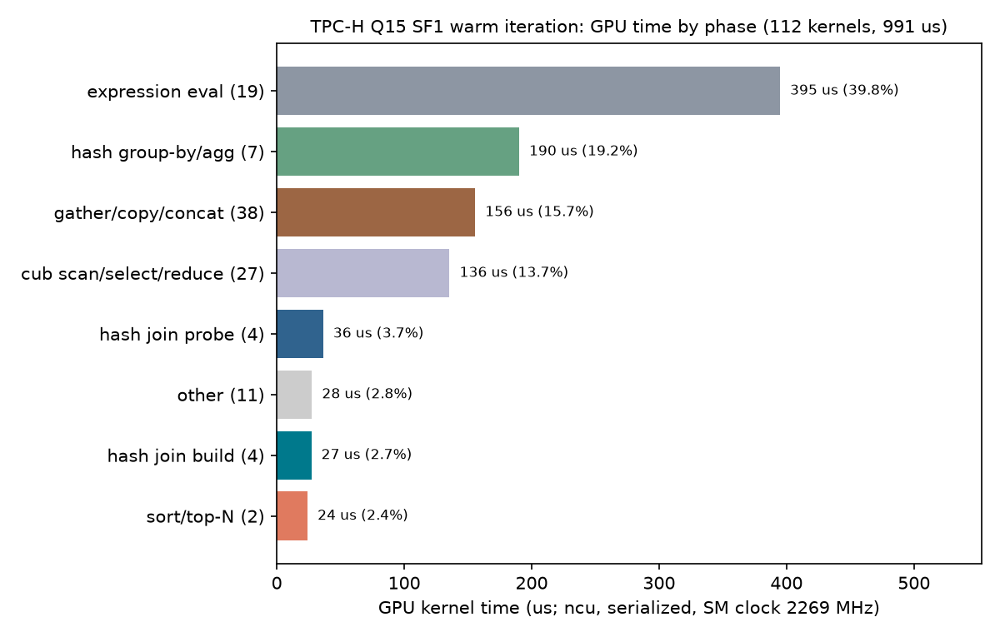
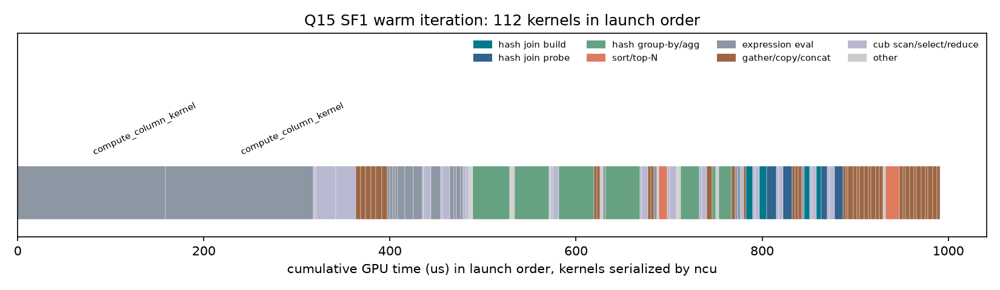
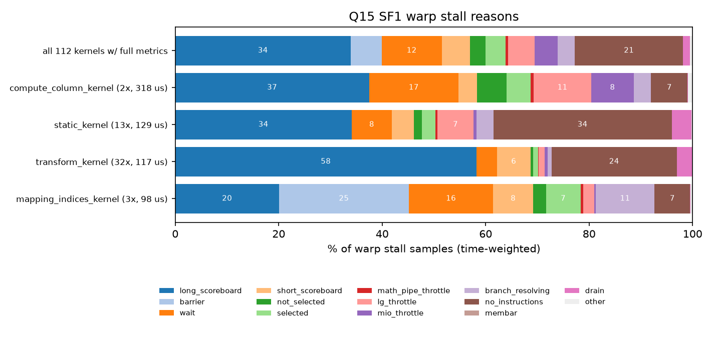
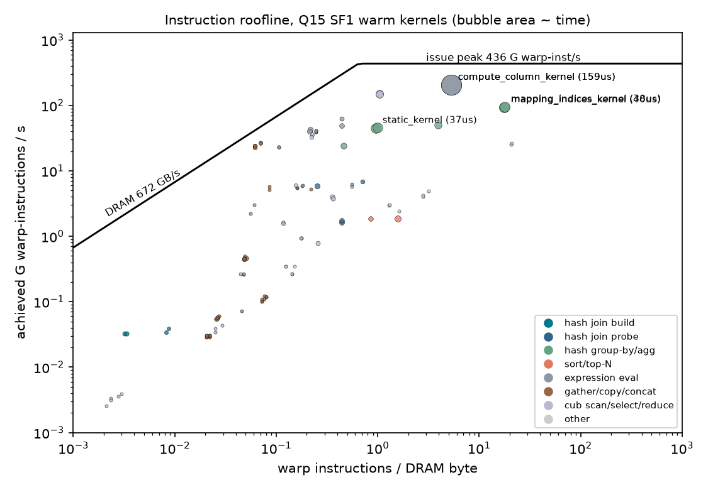

# TPC-H Q15 (SF1) on Sirius, all referenced columns pinned on GPU — Workload Analysis

**Date**: 2026-11-13
**GPU**: NVIDIA GeForce RTX 5070, 12 GB GDDR7 (192-bit, 672 GB/s), Blackwell sm_120, 48 SMs
**Workload**: TPC-H Query 15 (top supplier: CTE `revenue_view` = per-`l_suppkey` sum(l_extendedprice*(1-l_discount)) over `l_shipdate` in [1993-05-01, 1993-08-01), joined to `supplier` and filtered by `total_revenue = (select max(total_revenue) from revenue_view)`, ORDER BY s_suppkey; constants read from `q15.sql`), scale factor 1
**Framework**: Sirius (`sirius-duckdb` release build), DuckDB, stock libcudf, CUDA 13 runtime
**Pipeline**: `scripts/tpch_sf1/profile_query.sh 15` (232 s of stages: 14 s for sql/timing/pcie/selftest + 218 s for list/detail/extract/validate; `pipeline_run.log`); every number below comes from a file in this directory.
**Labels**: *measured* = read from a profiler/log file; *inferred* = derived by arithmetic or reasoning from measured data.

---

## 1. Executive Summary

- Q15 runs fully on the GPU path (no fallback) with all data resident: both scans (lineitem id=0, supplier id=17) were served from pinned entries in every iteration, 0 Parquet-decode kernels, per measured iteration H2D 2,613 B (largest copy 276 B) and D2H 390 B (largest 96 B) (`pcie_verification.txt`, *measured*).
- Warm median **5.0 ms** (min 5, max 6, 12 timed) vs DuckDB-CPU warm median 16.0 ms (3.2x) (`timing_summary.txt`). Result: 1 row (supplier 5890, total_revenue 1882892.8342), equal to DuckDB-CPU in compare mode `exact`, max relative difference 0.0 (`timing.json`, `timing_summary.txt`).
- The query is a **72.74 MB, 108.2 µs** memory problem (`physical_floor.md`, *inferred* from table stats). Wall is 46.2x the floor; GPU-busy (nsys) is 0.646 ms = 5.97x the floor; 112 kernels per iteration.
- #1 time sink: `compute_column_kernel` (cudf AST evaluation), 2 launches over lineitem: 39.5% of real-clock kernel time (245.1 of 620.7 µs, nsys) and 32.0% of serialized ncu time (317.7 of 991.4 µs). It is issue/LSU-bound (SM 90.6%, LSU pipe 91.6%), not DRAM-bound (DRAM 5.8% of peak).
- Q15's lineitem is scanned **once** (one GPU_SCAN id=0 feeding the CTE operator id=6); the second CTE reference reads the materialised CTE, not lineitem again (`query_plan.txt`).

Where the wall time goes (median, different runs kept separate):

| Component | Value | Source / label |
|---|---:|---|
| Wall per warm iteration | 5.0 ms | `timing_summary.txt`, 1 ms timer, measured |
| Planning (Sirius log) | 2 ms (40%) | `timing_summary.txt`, measured |
| Engine window (Sirius log) | 3 ms (60%) | `timing_summary.txt`, measured |
| GPU busy, real clocks | 0.646 ms (12.9% of 5.0 ms wall) | `nsys_iteration_breakdown.txt`, nsys run (its engine window is 6 ms), measured; the ratio mixes two runs |
| first→last GPU op | 5.30 ms | `nsys_iteration_breakdown.txt`, measured |
| Sum of kernels (ncu, serialized, base clocks, cold L2) | 991.4 µs | `phase_breakdown.txt`; not comparable with nsys |

## 2. Workload Description

- Query: `sql` text in `sirius/test/tpch_performance/tpch_queries/orig/q15.sql` (window 1993-05-01..1993-08-01). Single statement with a CTE referenced twice.
- Rows (DuckDB-CPU on the Parquet, `physical_floor.md`): lineitem 6,001,215; window matches 227,694 (3.79%); supplier 10,000; groups after CTE group-by 10,000 (all suppliers); max(total_revenue)=1882892.8342 attained by 1 supplier; result 1 row (122 B CSV).
- Plan (distinct ids in `query_plan.txt`, *measured*): **2 GPU_SCAN** (id 0 lineitem, id 17 supplier); 1 HASH_GROUP_BY (id 2) + MERGE_GROUP_BY (id 4); 1 CTE (id 6); 3 PROJECTION (ids 1, 5, 7); 1 UNGROUPED_AGGREGATE (id 8) + MERGE_AGGREGATE (id 9); **2 HASH_JOIN** (id 14: CTE rows probe the 1-row max, so the DECIMAL equality is executed as an INNER hash join on `total_revenue`; id 20: supplier ⋈ result); 1 ORDER_BY (id 21) with SORT_SAMPLE/SORT_PARTITION/MERGE_SORT (ids 22-24); no FILTER operator (the date predicate is evaluated inside scan/projection expressions; not identified further in the files). **0 dynamic filters** wired: the log says "Not wiring dynamic filter(s): build side carries neither filter nor opaque-build evidence (build est 1 rows)" and "(build est 10000 rows)" (`traces/sirius_log_timing/*.log`).
- Pin map (`sql/q15_timing.sql`): lineitem l_suppkey, l_extendedprice, l_discount, l_shipdate; supplier s_suppkey, s_name, s_address, s_phone; both `tier='gpu'`.
- Pinned footprint (`pcie_verification.txt`): 72,736,256 B (lineitem 72,015,360 = 12.00 B/row; supplier 720,896 B).

## 3. PCIe Verification

`pcie_verification.txt` ends `OVERALL: PASS`. Quoted checks:
- `timing_log:pinned_entry_per_gpu_scan: every iteration: #assigned pinned entry == #GPU_SCAN operators (2), all of ['lineitem', 'supplier'] present` (same line for the nsys run and every ncu run, `ncu_log_checks_{list,detail}.txt`). So 2 GPU scans = 2 pinned-entry assignments.
- `fs_cache_zero_every_iteration: 16 cache summaries for 15 iterations ... iterations 1..15 all last_cycle[reads=0 hits=0 h2d=0 miss=0 ...]`; `no_parquet_decode_kernels: 0 decode/decompress kernels among 896 kernels`.
- `h2d_measured_iterations: per measured iteration: up to 66 copies, 2613 B total, largest single 276 B (limits: single <= 5000 B, total <= 1048576 B)`; `d2h_measured_iterations: up to 52 copies, 390 B total, largest single 96 B (result CSV is 122 B; limit 262144 B)`; `no_other_host_copies: 0 copies with a non-device source and destination`.
- `unified_memory`: UM CPU+GPU fault collection on; fault tables absent; "faults per measured iteration [0, 0, 0, 0, 0]; managed-memory API calls in the whole trace: none".
- `no_host_staged_filter_publication: 0 dynamic-filter publications, all through peer copies (device-side)`: this line saw zero publications, so it says nothing about how a filter would be transferred; none exist in this plan.
- `pool_counters_stable`: gpu_pool allocated == pinned footprint 72,736,256 B at QueryBegin/QueryEnd in every iteration; `no_downgrade_or_spill: 0 ... lines`. GPU pool peak (process-lifetime high-water, includes the pin phase) 312,784,856 B.
- Sysmem aperture (`ncu_sysmem_check.txt`): `q15_warm_full.ncu-rep: 112 kernels, 0 with SM (tex) sysmem-aperture sectors (total 0)`; the all-source counter reads 265-285 sectors for every kernel (info only).
- Negative control (`selftest_negative_control.txt`): lineitem left unpinned → `SELFTEST: PASS (verification detected the unpinned table)`; it failed `pinned_entry_per_gpu_scan` ("1 assigned for 2 GPU_SCANs, missing tables ['lineitem']"), `no_parquet_decode_kernels`, and `h2d_measured_iterations` (42,419,969 B per iteration, largest 3,560,399 B).
- Pin phase (not measured iterations): H2D 215 copies, 42,844,725 B, largest 1,048,576 B.

## 4. Environment

| Component | Version / setting |
|---|---|
| GPU | RTX 5070 (sm_120, 48 SMs, 12 GB, 48 MB L2); driver/ncu/CPU versions not re-queried in this run (same machine as the Q12 report) |
| Nsight Compute | via `sudo -n`; `--set full --import-source yes` on all 112 warm kernels (policy `full_all`, threshold 1000) |
| ncu clocks | locked by ncu: SM median 2269 MHz (`ncu_extract_summary.txt`) |
| Nsight Systems | 2025.5.2; `-t cuda -s none --cpuctxsw=none` plus UM page-fault collection |
| Sirius config | `scripts/tpch_sf1/sirius.yaml`: GPU pool 25% of 12 GB, 1 GB pinned host pool, `enable_duckdb_fallback=false` |

## 5. Physical Floor vs Measured

Floors (`physical_floor.md`, written before any ncu output, *inferred* from table statistics):

| Scenario | Bytes | Floor @ 672 GB/s |
|---|---:|---:|
| A. all pinned columns once (narrowed) | 72.74 MB | 108.2 µs |
| A'. native widths | ≈ 144.77 MB | ≈ 215.4 µs |
| A-min. predicate-forced bytes | ≈ 28.60 MB | 42.6 µs |
| B. A + group-by materialisation | ≈ 73.2 MB | ≈ 109.0 µs |
| Compute | ~0.02 G simple ops | < 5 µs |

| Measured | Value | Ratio to floor A (108.2 µs) |
|---|---:|---:|
| Wall, warm median | 5.0 ms | 46.2x |
| GPU busy (nsys, real clocks) | 0.646 ms | 5.97x |
| nsys kernel-time sum | 0.6207 ms | 5.74x |
| ncu serialized sum (cold L2, base clock) | 991.4 µs | 9.2x (reported for reference only) |

The two `compute_column_kernel` launches alone moved 12.18 MB cold-L2 DRAM (`phase_breakdown.txt` family row) = 18.1 µs at 672 GB/s, but took 317.7 µs of ncu time (17.5x their own traffic floor; both *measured*/arithmetic, ncu cold-L2).

## 6. Kernel, Phase and Operator Breakdown

Warm iteration = 112 kernels (list pass, nsys and full pass agree; `warm_kernel_summary.txt`). ncu policy: `full_all` (112 ≤ 1000), `--set full` on all. Full-pass phases (`phase_breakdown.txt`, ncu serialized total 991.4 µs):

| Phase | Kernels | µs | % |
|---|---:|---:|---:|
| expression eval | 19 | 394.8 | 39.8 |
| hash group-by/agg | 7 | 190.1 | 19.2 |
| gather/copy/concat | 38 | 155.6 | 15.7 |
| cub scan/select/reduce | 27 | 135.6 | 13.7 |
| hash join probe | 4 | 36.4 | 3.7 |
| other | 11 | 27.6 | 2.8 |
| hash join build | 4 | 27.1 | 2.7 |
| sort/top-N | 2 | 24.2 | 2.4 |

Operators (`operator_breakdown.txt`): expression AST 2 kernels 317.7 µs (32.0%); group-by/aggregation 7 / 190.1 (19.2%); fixed-width gather/scatter 19 / 80.7 (8.1%); string gather 18 / 72.6 (7.3%); select/compact 10 / 70.1 (7.1%); binary-op expressions 8 / 50.9 (5.1%). `other:` rows total 15.5 µs (1.6%), so `kclass.py` was not edited.
Small-kernel counts (full pass, ncu): 69 kernels < 5 µs, 99 < 10 µs (41.3% of time, 409.1 µs, in kernels < 10 µs); 102 kernels have fewer than 1 wave (48 SMs); 75 have grid < 48 CTAs. Top-10 kernels = 55.2% of time. Median kernel in the list pass 3.36 µs.
Real-clock families (nsys mean per measured iteration, total 620.7 µs): compute_column_kernel 245.1 µs (39.5%), static_kernel 82.1 (13.2%), mapping_indices_kernel 77.4 (12.5%), transform_kernel 58.8 (9.5%), DeviceSelectSweepKernel 43.7 (7.0%).





## 7. Top Kernels (ncu `--set full`, serialized, locked clocks, L2 flushed per kernel)

| Pos | Kernel | µs | Grid×blk | SM% | DRAM% / GB/s | Dominant stalls |
|---:|---|---:|---|---:|---|---|
| 0 | compute_column_kernel<128,0,0> | 158.9 | 23450×128 (40.7 waves) | 90.6 | 5.8 / 38.3 | long_sb 37.3, wait 17.3, lg 10.9, mio 8.2 |
| 1 | compute_column_kernel | 158.8 | 23435×128 | 90.6 | 5.8 / 38.3 | long_sb 37.6, wait 17.3 |
| 32 | groupby::mapping_indices_kernel | 39.6 | 240×128 (1.0 wave) | 21.9 | 0.8 / 5.2 | barrier 29.6, wait 16.8, long_sb 14.7, branch 11.8 |
| 39 | mapping_indices_kernel | 38.2 | 240×128 | 22.6 | 0.8 / 5.3 | barrier 29.4 |
| 35 | static_kernel (compute_single_pass_aggs_sparse_output) | 37.2 | 221×256 (2.3 waves) | 11.9 | 7.1 / 46.8 | long_sb 49.7, lg 12.7 |
| 44 | static_kernel (same) | 37.1 | 225×256 | 12.0 | 7.0 / 46.3 | long_sb 49.7 |
| 5, 4 | DeviceSelectSweepKernel | 21.3, 20.9 | 522×384 (5.4 waves) | 38-40 | 21.7-22.1 / 143-146 | barrier 31, wait 14 |

- Only the two compute_column_kernel launches run many waves (> 40); next are the select sweeps (5.4 waves), the aggregation static_kernels (2.3) and mapping_indices (1.0); no kernel reaches the 672 GB/s ceiling (best DRAM% is 59.6: transform_kernel pos 11, 392.9 GB/s, one 5.7 µs launch; 16 kernels exceed 22.1%; cold L2). The roofline plot therefore shows every kernel far below the DRAM roof.
- mapping_indices_kernel: thread_eff 8.1 (few active lanes per warp), IPC 1.19-1.22, 1.00 waves; compute_column_kernel: ipc 1.96, thread_eff 32.0 (all lanes active), occupancy 91.2% achieved.
- Hit rates: no value > 100% needed clamping (`ncu_extract_summary.txt`).





## 8. Instruction-Level Evidence for the #1 kernel (`sass/compute_column_kernel_hotspots.txt`, launch pos 0, ncu)

Kernel-wide (*measured*): 3.255e7 warp-instructions executed, 16,400 static instructions of which only 239 (1.5%) ever execute; classes by executed share: Int Arithmetic 48.4% (49.7% of stall samples), Control Flow 15.3%, Global Load 13.3% (19.0% of stalls), Const Load 8.9%, **Local (spill) 5.2% of executed instructions but 11.6% of stalls**, FP Arithmetic 0.3%. Global load requests 4.22e6, local/shared bank conflicts 9.61e5. 16,240 stall samples; no single PC exceeds 5.6%.

Entry blocks execute 93,799 warps = 3.0 M threads, consistent with one lineitem row per thread over about half the table per launch (grid 23450×128 = 3,001,600 and 23435×128 = 2,999,680 threads, sum 6,001,280 ≥ 6,001,215 rows; *inferred*). Executed instructions per warp = 3.255e7 / 93,799 = 346.5 (*inferred* division) — for a predicate/arithmetic expression of a few operators.

Three hot chains, checked register by register inside the quoted windows:

1. **Descriptor pointer chase** (PC +0x18130..+0x18180, 187,598 warp-executions, 31 lanes):
```
+0x18130 LDG.E R15, [R14.64+0xc]
+0x18150 IMAD.WIDE R8, R15, 0x20, R8        ; reads R15 (the load above) + base R8 from LDC.64 @ +0x18140
+0x18160 LDG.E.64 R8, [R8.64+0x10]          ; reads R8
+0x18170 LD.E.U16 R12, [R8.64]              ; reads R8, writes R12
+0x18180 ISETP.GT.AND P0, PT, R6, 0x14, PT  ; 905 samples (5.6%, long_sb), reads R6
```
Three dependent global loads in series. The hottest instruction, `ISETP ... R6`, does **not** read R12 or R8; R6's producer is outside this context window, so the exact load it waits on is not shown (it is the next consumer after the chain; the long_sb stall attribution to it is measured, the producer is unknown). That the chain walks an expression-node table (0x20-byte stride) is *inferred* from the shape.
2. **Spill reload → address → load** (+0x17d10..+0x17d50, 281,397 warp-executions):
```
+0x17d10 LDL.LU R11, [R1+0x50]
+0x17d30 IMAD.WIDE R8, R11, 0x4, R4   ; 483 samples (long_sb 463), reads R11 written by the LDL.LU
+0x17d50 LDG.E R25, [R8.64]
```
3. **Spill reload at kernel start** (+0x002c0..+0x002f0): `LDL.LU.64 R10,[R1+0x48]` → `SHF.L.U64.HI R5, R10, 0x2, R11` (460 samples, long_sb; reads R10/R11, written by the LDL.LU) with the matching store `STL.64 [R1+0x48], R10` at +0x00380 (top-25 list, outside the window) and a separate spill store `STL.64 [R1+0x58], R6` at +0x00170 (lg 186 + mio 122). Code with `exe=0` in the windows (e.g. +0x17cb0..+0x17d00, +0x18100..+0x18120) is never executed and is excluded.

Interpretation (*inferred*): the kernel is a generic expression interpreter whose per-row work is dominated by dependent loads of expression metadata and by local-memory spills (the kernel uses 40 registers and still spills), which saturates the LSU pipe (91.6%) while DRAM sits at 5.8%.

## 9. Root Cause Analysis

**Sink 1: `compute_column_kernel` (39.5% nsys / 32.0% ncu).**
- Symptom: 2 launches, 158.9 + 158.8 µs ncu, 12.18 MB DRAM (cold) = 38.3 GB/s each, 5.7% of 672 GB/s (*measured*).
- WHY → SM 90.6%, LSU pipe 91.6%, IPC 1.96 with 91.2% occupancy: the SMs are issue/LSU-saturated, not waiting for DRAM (*measured*).
- WHY → 4.22e6 global load requests and 3.255e7 warp-instructions per launch for 3.0 M rows ≈ 45 load requests and 346 instructions per warp-row (*inferred* division) while the row's real data is ~2 B (12.18 MB / 6,001,215 rows = 2.03 B/row, *inferred*; the narrowed carrier width was not inspected).
- WHY → chains 1-3 above: three dependent loads per expression node plus spill reload/store traffic (local = 5.2% of instructions, 11.6% of stalls; lg+mio throttle 19.1% of samples) (*measured*).
- ROOT: libcudf's general AST kernel re-interprets the expression tree from global-memory node tables for every row; cost scales with instructions per row, not bytes, so a 6.0 M-row evaluation costs 17.5x its DRAM floor (*inferred*).

**Sink 2: group-by of the 227,694 window rows into 10,000 groups (group-by operator: 7 kernels, 190.1 µs ncu = 19.2%; the families mapping_indices_kernel and static_kernel are 12.5% and 13.2% of nsys time, but static_kernel's 13 launches include non-group-by ones).**
- Symptom: mapping_indices_kernel 39.6 / 38.2 µs, grid 240, exactly 1.0 wave, thread_eff 8.1, barrier stall 29.6% (*measured*).
- WHY → few active lanes and CTA-wide barriers: with many rows hashing to a 10,000-entry set, lanes diverge (branch_resolving 11.8%) and wait at barriers (*inferred* divergence).
- WHY → the aggregation kernel `static_kernel` pos 35: long_sb 49.7%, IPC 0.53, atomics 5,274 warp-executions. Hot instruction `ATOM.E.ADD.64.STRONG.SYS [R28], R32` at +0x12a7f0 (7.3%, 3,529 executions, 31 lanes): R28 is formed by the preceding `IADD.64 R28, R38, R28`, but R32 is not written in the window, so the long_sb wait comes from a producer outside the window (*measured* stall, producer unknown). Second chain: `LDG.E.64 R24,[R24.64+0x10]` → `LEA R22, P0, R20, R24, 0x1` → `LD.E.U16 R22` → `PRMT R19, R22, 0x7770` (234 samples at the PRMT; each instruction reads the previous one's destination; dependent two-load chain, *measured* registers).
- ROOT: the per-row sparse-output aggregation is latency-bound dependent loads and 64-bit atomics on a 10,000-group table with ~114 K qualifying rows per launch (3,529 warp-executions × 31.0 active lanes ≈ 109 K vs 227,694/2 = 113.8 K; *inferred*, within 4%), far too small to hide latency (*inferred*).

**Sink 3: launch/host-latency structure (wall 5.0 ms vs GPU busy 0.646 ms).**
- Symptom: GPU busy is 12.9% of the wall (cross-run ratio; nsys-run busy 10.8% of its 6 ms engine window).
- WHY → 112 kernels per iteration, 69 below 5 µs and 99 below 10 µs (ncu full pass); per iteration nsys counts 210 cudaStreamSynchronize + 56 cuStreamSynchronize, 193 cudaMallocFromPoolAsync, 112 cudaLaunchKernel (CPU time summed over threads 0.815, 0.468, 0.228, 0.475 ms; `nsys_iteration_breakdown.txt`, *measured*).
- WHY → 20 pipelines (ids 0-19, `query_plan.txt`) each with full or partial barriers; the 3 aggregates (CTE → max → join) serialise the plan (*inferred* from barrier labels).
- ROOT: planning 2 ms (40% of wall, *measured*) plus 26 plan operators (ids 0–25) issuing 112 kernels and 266 stream synchronizations (210 + 56) per iteration; "each sync waits for a µs-scale kernel" is *inferred* (nsys gives only call counts and summed CPU time).

## 10. Gap Analysis

- Wall / floor = 5.0 ms / 108.2 µs = 46.2x; of that, ~2 ms (40%) is planning before any GPU work (*measured*), leaving 3 ms engine = 27.7x the floor.
- GPU busy / floor = 5.97x. Of the 0.646 ms, 39.5% (245.1 µs) is the AST kernels whose DRAM traffic would take 18.1 µs; the rest is dominated by ~110 small kernels (nsys kernel total 620.7 µs, of which families beyond the top-5 = 113.6 µs).
- The data-movement floor is therefore not the limiter: even the pure kernel time (nsys 620.7 µs) is 5.74x the floor, with SM-issue and latency as the bounds (DRAM% ≤ 59.6 for every kernel, the maximum in a sub-wave transform_kernel launch).
- GPU vs CPU: 5.0 vs 16.0 ms warm (3.2x).

## 11. Optimization Directions (general-purpose; no query-specific fusion)

1. Make cudf's AST `compute_column_kernel` cheaper per row (*proposal*): keep the node table in constant/shared memory (chains 1-3 show per-row global descriptor loads) and cap the register spill; a general library improvement benefiting every AST user. The ceiling for the two launches is their 18.1 µs DRAM floor against 245 µs real-clock time.
2. For libcudf group-by with a small group count, improve the sparse-aggregation kernel's load/atomic latency hiding (e.g. more work per thread, or the shared-memory path when groups fit); the mapping kernel runs 1.0 wave with 8.1 of 32 lanes active per instruction.
3. Reduce host-side overhead: fewer stream synchronizations and pool allocations per operator, and cheaper planning (2 ms of 5 ms); a general engine property since GPU busy is only 12.9% of wall.
4. (Context only, not recommended here by project rule: kernel fusion would cut launches; cuDF kernels stay general-purpose.)

## 12. Determinism and Profiling Method

- Timing: 3 warmup + 12 timed iterations, same 15 on DuckDB-CPU; result identical across all 15 GPU iterations and `exact` vs CPU (`timing.json`; tolerance 1e-9; max rel diff 0.0). `1 ms` timer resolution.
- Kernel counts stable: 112 per iteration in all 8 nsys iterations; ncu list passes 582/694/806 launches, +112 per iteration, multisets equal (`warm_kernel_summary.txt`: STABLE True); launch order differs at 47 positions between iterations 4 and 5 (multi-threaded pipelines), only counts/multisets are used.
- ncu: warm 5th iteration only (`-s 694 -c 112`), `full_all`; slice check passed (`ncu_slice_check.txt`). ncu durations are serialized, clock-locked (SM median 2269 MHz) and L2-flushed per kernel; nsys (2025.5.2, real clocks) is the source of busy times; the two are never summed together.
- Validation: `validate_pipeline.txt` SUMMARY q15: 72 PASS, 0 FAIL, 1 PENDING (the report).

## 13. Limitations

- ncu DRAM bytes and hit rates are cold-L2 values; in a real iteration the 72 MB working set partly lives in the 48 MB L2 (not measured).
- Which AST expression the two compute_column_kernel launches evaluate (date predicate vs revenue expression) is not recorded in any file; "one row per thread over half the table" is inferred from grid sizes.
- Meanings of loads (descriptor/node tables), lane inactivity (divergence), and the 2 B/row carrier width are inferred. The producers of R6 (+0x18180) and R32 (+0x12a7f0) are outside the SASS context windows.
- The launch-floor assumption (~2 µs smallest kernel) was imported from Q2 and not re-measured; planning/engine split has 1 ms resolution; wall/GPU-busy ratio mixes the timing run with the nsys run.
- Sampling counts are modest (16,240 samples for the #1 kernel; 3,201 for static_kernel).
- Only SF1 was run; the 2-scan / single-lineitem-read result is for this Sirius CTE planning.

## 14. Raw Data

`timing.json`, `timing_summary.txt`, `pcie_verification.txt`, `selftest_negative_control.txt`, `nsys_iteration_breakdown.txt`, `warm_kernel_summary.txt`, `ncu_plan.json`, `phase_breakdown.txt`, `operator_breakdown.txt`, `top_kernel_details.txt`, `ncu_extract_summary.txt`, `ncu_sysmem_check.txt`, `ncu_log_checks_{list,detail}.txt`, `sass/compute_column_kernel_hotspots.txt`, `sass/static_kernel_hotspots.txt`, `query_plan.txt`, `physical_floor.md`, `validate_pipeline.txt`, `pipeline_run.log`, `plots/q15_*.png`.
