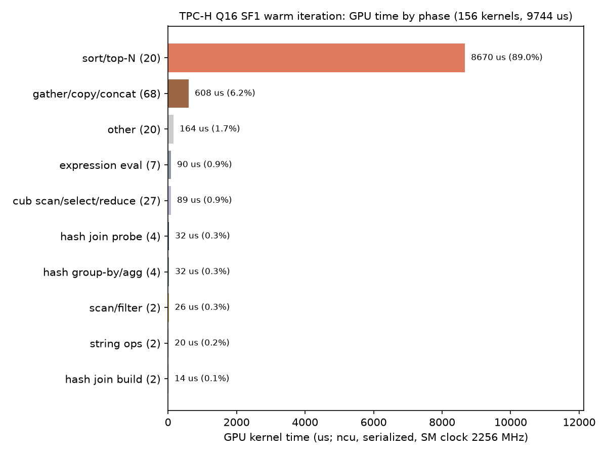
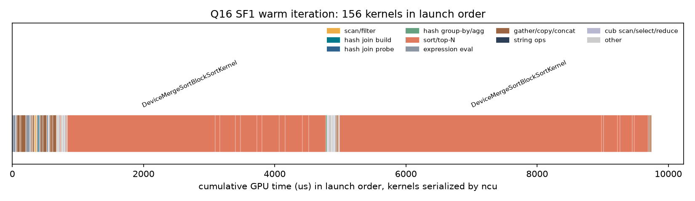
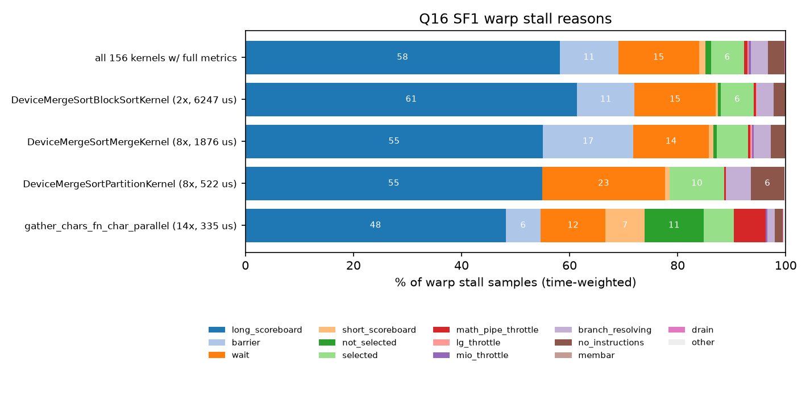
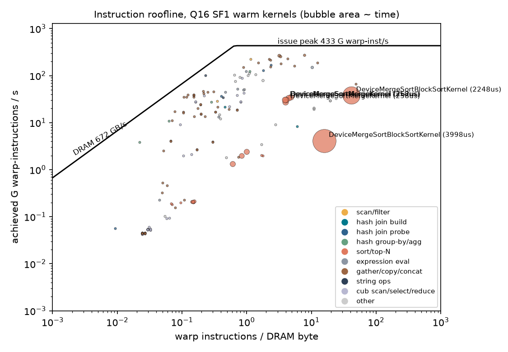

# TPC-H Q16 (SF1) on Sirius, all referenced columns pinned on GPU — Workload Analysis

**Date**: 2026-11-13
**GPU**: NVIDIA GeForce RTX 5070, 12 GB GDDR7 (192-bit, 672 GB/s), Blackwell sm_120, 48 SMs
**Workload**: TPC-H Query 16 (parts/supplier relationship: `partsupp ⋈ part`, `p_brand <> 'Brand#21'`, `p_type NOT LIKE 'MEDIUM PLATED%'`, `p_size IN (38,2,8,31,44,5,14,24)`, `ps_suppkey NOT IN (supplier WHERE s_comment LIKE '%Customer%Complaints%')`, `count(distinct ps_suppkey)` grouped by (p_brand, p_type, p_size), ORDER BY supplier_cnt desc, p_brand, p_type, p_size; constants read from `q16.sql`), scale factor 1. The 8 referenced columns of 3 tables are pinned in GPU memory with `pin_table(tier='gpu')` (13,807,104 B).
**Framework**: Sirius (`sirius-duckdb` release build), DuckDB v2.0, stock libcudf from the pixi env, CUDA runtime 13.5
**Pipeline**: `scripts/tpch_sf1/profile_query.sh 16` (16 s for sql/timing/pcie/selftest + 271 s for list/detail/extract/validate = 287 s of stages; `pipeline_run.log`); every number below comes from a file in this directory.
**Labels**: *measured* = read from a profiler/log file; *inferred* = derived by arithmetic or reasoning from measured data.

---

## 1. Executive Summary

A warm Q16 takes **19.0 ms end-to-end** (median of 12 timed runs after 3 warmups, range 17-20 ms, `.timer` 1 ms resolution; *measured*, `timing_summary.txt`). DuckDB on the CPU takes 28.5 ms (min 27, max 34), so the GPU is 1.50x faster (*inferred* ratio). The 18,368-row result equals DuckDB-CPU exactly (compare mode `exact`, i.e. same row order, max relative difference 0.0, tolerance 1e-9, identical across all 15 GPU iterations; `timing.json`). No table data cross PCIe in the measured iterations; per iteration 84 small H2D copies (6,656 B) and 73 D2H copies (927,035 B, mostly the result) do (section 3).

| Where the 19.0 ms go (median warm iteration, 1 ms stamps) | ms | Source |
|---|---:|---|
| Planning (DuckDB optimizer + Sirius plan build, 18 pipelines) | 2 | Sirius log, *measured* |
| Engine window (timing run) | 13 | Sirius log, *measured* |
| Gap from `QueryEnd` to the next statement | 4 | Sirius log, *measured* (2 + 13 + 4 = 19) |
| GPU busy (kernels + copies, real clocks, nsys run) | **7.486** | `nsys_iteration_breakdown.txt`, *measured* |
| Engine window with the GPU idle (host orchestration) | ~5.5 | engine 13 ms (timing run) − GPU busy 7.486 ms (nsys run), *inferred*, ±1 ms |

GPU busy is 39.4% of the 19.0 ms wall (*inferred*). Inside the 7399.6 µs of kernel time (nsys, 156 kernels per iteration, deterministic) **cuDF/cub merge sort over a row-lexicographic comparator takes 6752.1 µs = 91.2%** (*inferred* sum of three families; 90.2% of GPU busy):

1. **`DeviceMergeSortBlockSortKernel`: 5003.2 µs, 67.6%, 2 launches** (nsys). Grid 28 (1796 µs) and grid 5 (3206 µs) on a 48-SM GPU. The grid-5 launch (ncu 3998.5 µs) is limited by a byte-at-a-time string comparator: two `LD.E.U8` → `ISETP.NE` loops hold 37.3% of its stall samples, each at 13.0 of 32 lanes active (section 8).
2. **`DeviceMergeSortMergeKernel` 1449.0 µs (19.6%, 8 launches) and `DeviceMergeSortPartitionKernel` 299.9 µs (4.1%, 8 single-CTA launches)**: the merge passes after the two block sorts, running the same comparator.
3. **String gathers: `gather_chars_fn_char_parallel` 223.6 µs (3.0%), 14 launches**; the "gather: strings" operator (42 kernels incl. scans) is 514.8 µs ncu (5.3%).

Against the physical floor of 20.5 µs (13.81 MB at 672 GB/s, `physical_floor.md`): GPU busy is **364x** the floor, the wall **925x** (*inferred*); against the 37.8 µs floor with one materialisation: 198x / 503x. 83 of 156 kernels last < 5 µs (full ncu pass); 131 launch fewer than 48 CTAs' worth of one wave. Q16 is limited by a latency-bound, low-parallelism, string-comparing sort, not by DRAM bandwidth (the top kernel reads 0.3 GB/s).



---

## 2. Workload Description

- Plan (`query_plan.txt`, counted by distinct ids 0-26): **27 operators in 18 pipelines**: 3 GPU_SCANs (ids 0 supplier, 3 part, 7 partsupp; assignment from the `assigned pinned entry` lines), 1 FILTER (id 4) + 1 FILTER (id 16), 1 DYNAMIC_FILTER (id 8), 2 HASH_JOINs (id 11 `INNER`, id 15 `MARK`, the NOT IN anti-test), PROJECTIONs (12, 17, 18), HASH_GROUP_BY (19) + MERGE_GROUP_BY (21), ORDER_BY (22) with SORT_SAMPLE/SORT_PARTITION/MERGE_SORT (23-25), 5 PARTITION (1, 5, 9, 13, 20), 4 CONCAT (2, 6, 10, 14), RESULT_COLLECTOR (26).
- Dynamic filter: the log says "pushed 1 dynamic filter(s) ... (29770 build rows, 1 bound keys of 1 admitted)" once per iteration (15 in the timing log); 29,770 equals the DuckDB-CPU count of parts passing the three part predicates (`physical_floor.md`).
- Row counts and selectivities (DuckDB-CPU on the Parquet): part 200,000 → 29,770 (14.9%); partsupp 800,000 → 119,080 joined rows → 119,033 after removing the **4** complaint suppliers (of 10,000); **18,368 groups** (supplier_cnt takes 15 values, 3-32). Result CSV 650,813 B.
- Pinned bytes (`gpu_pool ... QueryEnd allocated=`): partsupp 4,800,000 B (ps_partkey, ps_suppkey), part 8,320,768 B (p_partkey, p_brand, p_type, p_size), supplier 686,336 B (s_suppkey, s_comment); total **13,807,104 B**.
- 156 kernel launches per warm iteration (list passes: 777/933/1089 launches for pin+3/4/5 iterations, +156 each); ncu policy **`full_all`** (156 ≤ 1000), `--set full` on all 156.

## 3. PCIe Verification (`pcie_verification.txt`: `OVERALL: PASS`)

All table data are served from the GPU pin in the measured iterations (*measured*; quoted from the check lines):
- `timing_log:pinned_entry_per_gpu_scan` / `nsys_log:...`: "every iteration: #`assigned pinned entry` == #GPU_SCAN operators (3), all of ['part', 'partsupp', 'supplier'] present" (3 GPU scans vs 3 pinned-entry assignments).
- `fs_cache_zero_every_iteration`: "16 cache summaries for 15 iterations ... iterations 1..15 all last_cycle[reads=0 hits=0 h2d=0 miss=0 ...]" (nsys run: 9 summaries for 8 iterations, all zero).
- `no_parquet_decode_kernels`: "0 decode/decompress kernels among 1248 kernels of all 8 iterations".
- `h2d_measured_iterations`: "up to 84 copies, 6656 B total, largest single 852 B (limits: single <= 5000 B, total <= 1048576 B)".
- **`d2h_measured_iterations`: "up to 73 copies, 927035 B total, largest single 893932 B (result CSV is 650813 B; limit 2603252 B)"**. The limit applied is max(256 KiB, 4 × 650,813 B) = 2,603,252 B and **is the default** (`pcie_verification.txt` last block: limits equal defaults; no PCIE_* override). The D2H bytes are the 18,368-row result (strings included) coming back to the host: 927,035 B is 1.42x the CSV size (*inferred* ratio); the largest copy being the result's character buffer is an inference from its size.
- `no_other_host_copies`: 0 managed/unknown-kind copies. Per-iteration on-device D2D: 21 copies, 6,857,315 B, largest 2,460,360 B.
- `unified_memory`: UM CPU+GPU fault collection on; "faults per measured iteration [0, 0, 0, 0, 0]; managed-memory API calls in the whole trace: none".
- `pool_counters_stable`: "gpu_pool allocated == pinned footprint 13807104 B at QueryBegin and QueryEnd"; `no_downgrade_or_spill`: 0 lines.
- `no_host_staged_filter_publication`: "15 filter publication(s) logged in query iterations; 0 carry a transport line ... no transport line was logged, so this check does not show how those filters move". So **it shows nothing about transport**; the no-PCIe claim for the filter rests on the H2D byte bound (largest single H2D copy 852 B) and `ncu_sysmem_check.txt`.
- Pin phase (not measured iterations): H2D 167 copies, 2,242,002 B, largest 1,048,572 B.
- `ncu_sysmem_check.txt`: 156 kernels, 0 with SM (tex) sysmem-aperture sectors (total 0); the all-source counter reads 265-325 sectors per kernel (information only); ncu `pcie__read/write_bytes` 2560 / 1,736,704 B (rate x duration, includes driver/ncu traffic). `ncu_log_checks_{list,detail}.txt`: every residency check PASS.
- Negative control (`selftest_negative_control.txt`): with `partsupp` left unpinned `pcie_verify.py` exited 1 as expected, failing `pinned_entry_per_gpu_scan` ("2 assigned for 3 GPU_SCANs, missing tables ['partsupp']"), `fs_cache_zero_every_iteration`, `no_parquet_decode_kernels` (3 decode kernels) and `h2d_measured_iterations` (1,503,635 B per iteration, largest 1,451,200 B); `SELFTEST: PASS`.
- GPU memory: pinned footprint 13,807,104 B; gpu_pool high-water **38,767,222 B** (process-lifetime, includes the pin phase).

## 4. Environment

| Component | Version / setting |
|---|---|
| GPU / driver | RTX 5070 (sm_120, 48 SMs, 12 GB, 48 MB L2) / 580.173.02 (copied from earlier reports; not re-queried) |
| Nsight Compute | via `sudo -n`; `--set full --import-source yes` on all 156 warm kernels (version copied from earlier reports, not re-queried) |
| ncu clocks | locked by ncu: SM median 2256 MHz (`ncu_extract_summary.txt`) |
| Nsight Systems | 2025.5.2 (`/home/sai/nsight-systems-2025.5`); `-t cuda -s none --cpuctxsw=none` plus UM page-fault collection |
| CPU | Intel i9-13900K, 125 GB RAM (copied from earlier reports) |
| Sirius config | `scripts/tpch_sf1/sirius.yaml`: 4 pipeline threads, GPU pool 25% of 12 GB, 1 GB pinned host pool (2 pools), `enable_duckdb_fallback=false` |

## 5. Physical Floor vs Measured

| Scenario (`physical_floor.md`, written before any ncu output) | Bytes | Floor |
|---|---:|---:|
| A. every pinned column once (narrowed) | 13.81 MB | 20.5 µs |
| A'. native widths (inferred) | 16.03 MB | 23.8 µs |
| A-min. predicate-forced bytes | 13.30 MB | 19.8 µs |
| B. A + one write+read of the 119,033 joined rows (~5.79 MB each way, inferred) | 25.4 MB | 37.8 µs |
| Compute estimate | | < 10 µs (inferred) |
| Launch-count bound: 156 kernels × ~2 µs (figure carried over from earlier queries, not re-measured) | | ~0.31 ms |

| Measured layer | Time | × floor A (20.5 µs) | × floor B (37.8 µs) | Source |
|---|---:|---:|---:|---|
| nsys kernel time | 7399.6 µs | 360x | 196x | `nsys_iteration_breakdown.txt` |
| nsys GPU busy | 7486 µs | 364x | 198x | same |
| Engine window (timing run) | 13,000 µs | 633x | 344x | Sirius log |
| Wall | 19,000 µs | 925x | 503x | `timing.json` |
| ncu serialized kernel sum (cold L2, locked clocks; not comparable with nsys rows) | 9744.2 µs | | | `ncu_extract_summary.txt` |

Even the launch-count bound (0.31 ms) is 24x below GPU busy: the gap is not launch overhead but the sort kernels (section 9). ncu's sum is 1.32x nsys's (clock lock, serialization, L2 flush).

## 6. Kernel, Phase and Operator Breakdown

ncu pass (`phase_breakdown.txt`, 156 kernels, 9744.2 µs; serialized, clock-locked, L2 flushed per kernel):

| Phase | Kernels | µs | % |
|---|---:|---:|---:|
| sort/top-N | 20 | 8670.0 | 89.0 |
| gather/copy/concat | 68 | 608.4 | 6.2 |
| other | 20 | 163.8 | 1.7 |
| expression eval | 7 | 89.9 | 0.9 |
| cub scan/select/reduce | 27 | 89.1 | 0.9 |
| hash join probe / group-by / build / scan-filter / string ops | 4 / 4 / 2 / 2 / 2 | 31.9 / 31.6 / 13.8 / 26.0 / 19.7 | 0.3 / 0.3 / 0.1 / 0.3 / 0.2 |

- The 20 sort kernels are 2 BlockSort + 8 Merge + 8 Partition + 2 RadixSortSingleTile (`warm_kernel_summary.txt`). The 8 merge/partition pairs are 5 passes after the grid-28 block sort and 3 passes after the grid-5 one (kernel positions 90-100 and 141-147 in `warm_kernel_list.json`).
- `operator_breakdown.txt`: "other: static_kernel" 5 kernels 14.0 µs, "other: transform_kernel" 4.4 µs (< 0.2% total): no `kclass.py` rules were added. The hash-join/group-by/scan operators total 0.3% each; there is one `like_multiliteral_kernel` (8.5 µs, the supplier LIKE) and one dynamic-filter probe (19.3 µs).
- Tiny kernels (full pass): 83 < 5 µs, 103 < 10 µs (together 341.8 µs, 3.5% of ncu time); 131 kernels fill < 1 wave (9207.0 µs: the sort kernels are among them); 85 have grid < 48 CTAs. Median kernel 4.86 µs (list pass).
- nsys real-clock kernel time per iteration: 7399.6 µs total; BlockSort 67.6%, Merge 19.6%, Partition 4.1%, gather_chars 3.0%, transform 1.3%, Scan 1.1%.




## 7. Top Kernels (ncu `--set full`, serialized, clock-locked, L2 flushed per kernel)

From `top_kernel_details.txt` / `ncu_extract_summary.txt` (ncu µs; "lanes" = `smsp__thread_inst_executed_per_inst_executed`, active lanes per warp instruction out of 32):

| pos | Kernel | ncu µs | % | grid×blk | SM% | DRAM GB/s | Waves | Lanes of 32 | IPC | Top stall |
|---:|---|---:|---:|---|---:|---:|---:|---:|---:|---|
| 141 | BlockSort | 3998.5 | 41.0 | 5×256 | 1.1 | 0.3 | 0.03 | 15.3 (48%) | 0.40 | long_sb 64.4% |
| 90 | BlockSort | 2248.4 | 23.1 | 28×256 | 10.6 | 0.9 | 0.15 | 15.6 (49%) | 0.64 | long_sb 56.1% |
| 98 | Merge | 261.8 | 2.7 | 28×256 | 8.5 | 7.5 | 0.15 | 19.3 | 0.51 | long_sb 59.4% |
| 147 | Merge (final pass, 5 CTAs) | 213.2 | 2.2 | 5×256 | 0.4 | 2.2 | 0.03 | 24.2 | 0.24 | barrier 45.6% |
| 99 | Partition | 97.7 | 1.0 | 1×256 | 0.1 | 1.4 | 0.01 | not recorded in `top_kernel_details.txt` excerpt | | |
| 15 | gather_chars | 75.6 | 0.8 | 5800×128 | 68.6 | 84.6 | 10.07 | | | |

- Family totals (full pass): BlockSort 6246.8 µs (64.1%, 2), Merge 1875.7 (19.2%, 8), Partition 521.5 (5.4%, 8), gather_chars 335.5 (3.4%, 14, 73.5 GB/s family average), transform 188.1 (1.9%, 37). Time-weighted stall mix over all kernels: long_scoreboard 58.2%, wait 14.9%, barrier 10.9%, selected 6.1%.
- gather_chars fills the GPU best (up to 10.07 waves); compute_column (3.62), static_kernel (5.43), insert_if_n (2.15), find_if_n/contains_if_n/copy_range (1.62), DeviceSelectSweep (1.45) and add_if_shmem (1.0) also reach ≥ 1 wave, transform_kernel does not (max 0.97) (pos 15: 10.07 waves, 91.5% occupancy, 84.6 GB/s = 12.6% of 672 GB/s; pos 12 reaches 100.6 GB/s). The sort kernels use 0.01-0.15 waves; DRAM traffic of the top kernel is 1.06 MB, so there is no bandwidth ceiling to compare against.




## 8. Instruction-Level Evidence for the #1 kernel (`sass/DeviceMergeSortBlockSortKernel_hotspots.txt`, pos 141)

Launch: grid 5, 256 threads, 64 regs, 16.6% achieved occupancy, 1.66e7 warp instructions, 40,621 stall samples; 4219 of 13,648 static instructions ever executed (*measured*). Instruction classes: Int Arithmetic 36.9% of executed (71.1% of stalls), Move/Special 34.1%, Control 13.7%, local-memory spill 2.6% (1042 static); Global Load only 688 warp executions.

**The hot loop (two copies, +0x2d110 and +0x2d340), quoted from the window:**
```
+0x2d110 exe=272657 thr=13.0  LD.E.U8 R12, desc[UR8][R8.64]
+0x2d120 exe=272657 thr=13.0  LD.E.U8 R13, desc[UR10][R6.64]
+0x2d130 exe=272657 samp=8050 (19.8%) [long_sb=7989]  ISETP.NE.U32.AND P3, PT, R12, R13, PT
+0x2d140 exe=272657           @P3 BRA ...
+0x2d150 exe=267386           IADD R5, R5, 0x1
```
and the same shape at +0x2d340/+0x2d350 (`LD.E.U8 R6` / `LD.E.U8 R7`) feeding `ISETP.NE.U32.AND P1, PT, R6, R7` at +0x2d360 (7107 samples, 17.5%, long_sb=7041).
- Register-level chain (*measured*, both producers inside the window): `ISETP` at +0x2d130 reads R12 (loaded at +0x2d110) and R13 (loaded at +0x2d120), issued back to back; the second chain reads R6 and R7 loaded at +0x2d340/+0x2d350. The compare waits on the global load (long scoreboard): 7989 + 7041 = 15,030 long_sb samples = 37.0% of all samples; with other stall reasons the two instructions hold 15,157 = 37.3%.
- Loop shape (*inferred* from counts): the counter R5 is zeroed at +0x2d0c0 (`HFMA2 R5, -RZ, RZ, 0, 0`, exe 21,386) and incremented at +0x2d150 (exe 267,386). 272,657 / 21,386 = 12.7 byte compares per loop entry, and 267,386 / 272,657 = 98.1% of compares found equal bytes (loop continues). The strings therefore share long prefixes (*inferred*: p_brand 'Brand#NN', p_type words, with supplier_cnt ties); the "byte-wise string comparator" reading is an inference from `LD.E.U8` + equality test; R8 is initialised by MOV.64 R8, R28 at +0x2d0b0 (in the window); the producers of R6, R10 and R28 and the per-iteration address updates are outside the window and not claimed.
- Lane activity: 13.0 of 32 lanes active (41%) in this loop; why lanes are inactive (divergent comparison outcomes between rows of a warp) is *inferred*. Kernel-wide 15.3 of 32 (48%).
- Second hot spot (*measured*): +0x08bf0 (`LDC.64 R30, c[0x0][0x3f0]`, exe 8, 2266 barrier samples, 5.6%) is the third instruction after `BAR.SYNC.DEFER_BLOCKING 0x0` (+0x08bc0): the CTA's warps wait for the slowest warp, 13.4% barrier stall overall.
- Local-memory comparator state: `LDL.U8 R5, [R2+0x58]` (+0x10280) then `ISETP.NE.U32.AND P0, PT, R5, RZ` (+0x102a0, 1469 samples, 1463 long_sb) reads that same R5 two instructions later; `IMAD.WIDE.U32 R6, R0, 0x4, R6` (+0x10300, 1523 samples) follows an `LDL.64 R6`: they read values the compiler keeps in local memory (spilled). Reading these as comparator null/validity checks is an inference.
- Tile size: `IMAD R55, R55, 0x11` (+0x08be0, immediate 17) with 256 threads gives 17 items per thread = 4352 rows per CTA (*inferred*); 18,368 rows → 5 CTAs and 119,033 rows → 28 CTAs, matching the grids 5 and 28 (*inferred* row counts for each sort).
- The merge kernel shows the same pattern (`sass/DeviceMergeSortMergeKernel_hotspots.txt`, pos 98): `LD.E.U8 R13`/`R16` → `ISETP.NE.U32 R13, R16` at +0x197b0 (1806 samples) and `LD.E.U8 R7`/`R10` → `ISETP.NE R7, R10` at +0x199e0 (1119), together 19.0% of that kernel's samples; lanes 11.0 and 6.0 of 32 at the two loops.

## 9. Root Cause Analysis

**Sink 1: BlockSort pos 141 (the ORDER BY on the 18,368 group rows): nsys 3206 µs mean (grid-5 launches), ncu 3998.5 µs; 43.3% of nsys kernel time** (3206/7399.6 for the mean launch, *inferred*).
- Symptom: 3.2 ms for sorting 18,368 rows (about 175 ns per row, *inferred*), while the 6.5x larger sort in pos 90 takes 1.8 ms (~15 ns per row, *inferred* row counts). *measured* times.
- WHY 1: only 5 of 48 SMs work (grid 5, 0.03 waves, SM% 1.1, *measured*); each CTA sorts a 4352-row tile alone, so latency is not hidden by other CTAs (*inferred*).
- WHY 2: inside a CTA the comparator is serial and memory-latency-bound: IPC 0.40, long_scoreboard 64.4%, 15.3 of 32 lanes active (*measured*); 37.3% of samples are the two byte-compare `ISETP`s waiting on `LD.E.U8` pairs (section 8).
- WHY 3: the comparison is over (supplier_cnt desc, p_brand, p_type, p_size) with string keys; supplier_cnt has only 15 distinct values over 18,368 rows (DuckDB-CPU, recorded in `physical_floor.md`), so most comparisons tie and descend to the strings, and 98.1% of byte compares find equal bytes (*measured* counts, interpretation *inferred*).
- ROOT: libcudf's row-lexicographic comparator is evaluated per comparison inside cub's merge sort with a one-byte-per-load string compare, on tiles of 4352 rows; it is generic and not specialised for few-CTA, tie-heavy string keys (*inferred* from instruction mix and grids).

**Sink 2: BlockSort pos 90 + 5 merge passes (grid 28): nsys 1796 µs (block sort) + part of the 1749 µs merge+partition work (split between the two sorts not measured)** (*inferred* split: merge family 1449.0 + partition 299.9 µs over both sorts).
- Symptom: 28-CTA sort (waves 0.15, 58% of SMs used, SM% 10.6) takes 2248.4 µs ncu, 3.06e6 warp instructions per CTA vs 3.32e6 in pos 141 (1.08x), yet 1.78x less time (*measured*, per-CTA instruction counts *inferred* by dividing).
- WHY 1: same comparator, long_scoreboard 56.1%, 15.6 of 32 lanes (*measured*).
- WHY 2: 8 Partition launches are single-CTA (grid 1, 2.1% occupancy): 521.5 µs ncu, each 28.6-97.7 µs, serialised before every merge pass (*measured*); the merge kernels show lanes 17.6-19.3 of 32 and the same byte loops (section 8).
- WHY 3: merge-sort depth is log2(tiles): 5 passes for 28 tiles and 3 for 5 tiles (kernel list), each pass re-reads the strings through the comparator (*inferred*).
- ROOT: sort cost scales with comparisons × per-compare string latency, not with bytes: the pos 90 sort reads 2.06 MB (0.9 GB/s) in 2248.4 µs (*measured*). Which operator (count-distinct dedup of ~119 K rows in the group-by) owns this sort is *inferred* from its position after the hyperloglog and string-gather kernels; the kernel names do not say.

**Sink 3: orchestration, GPU idle ~5.5 ms of the 13 ms engine window** (*inferred*, mixes timing and nsys runs, ±1 ms).
- Symptom: GPU busy 7.486 ms vs engine 13 ms (timing run) / 15 ms (nsys run), plus 4 ms gap and 2 ms planning (*measured*).
- WHY 1: per iteration 289 `cudaStreamSynchronize` calls (7.534 ms CPU summed over threads), 47 `cuStreamSynchronize`, 242 pool allocs and 242 frees, 168 `cudaMemcpyBatchAsync`, 156 launches (`nsys_iteration_breakdown.txt`, *measured*).
- WHY 2: 18 pipelines with PARTITION/CONCAT stages at 119 K or 18 K rows; 83 kernels last < 5 µs (*measured*).
- ROOT: at SF1 the per-pipeline orchestration is of the same order as the useful GPU work; "each sync waits for a µs-scale kernel" is *inferred* (nsys measures only call counts and CPU time).

## 10. Gap Analysis

| Layer | Time | × floor A | Source |
|---|---:|---:|---|
| Floor A (13.81 MB / 672 GB/s) | 20.5 µs | 1.0x | `physical_floor.md` |
| Floor B | 37.8 µs | 1.8x | same |
| nsys GPU busy | 7486 µs | 364x | `nsys_iteration_breakdown.txt` |
| Engine window (timing run) | 13,000 µs | 633x | Sirius log |
| Wall | 19,000 µs | 925x | `timing.json` |

The GPU gap decomposes (nsys, *inferred* shares): sort families 6752.1 µs (90.2% of busy); everything else 733.9 µs (7486 − 6752.1), which alone would be 36x floor A, still dominated by 130+ launches of a few µs. If the sorts took a tenth of their time the GPU-busy figure would drop to ~1.4 ms (*inferred*). The 11.5 ms of wall outside GPU busy is planning (2 ms), result handling and host orchestration (*inferred*).

## 11. Optimization Directions (general-purpose; no query-specific fusion)

1. **Cheaper string comparison in libcudf's row comparator.** Compare 4/8/16 bytes per load (or a cached order-preserving 8-byte prefix per string key) instead of one `LD.E.U8` per byte: the two byte loops hold 37.3% of the top kernel's samples; expected effect a multiple on the sort kernels, not 10x (*inferred*).
2. **Rank-encode low-cardinality string keys before multi-key sorts.** p_brand (25 distinct) and p_type (150 distinct) become small integers, so cub's merge or radix sort compares ints (general libcudf operator; *inferred* benefit).
3. **Sort with more CTAs / smaller tiles when the input is small.** 5 CTAs on 48 SMs (0.03 waves) leave 90% of the GPU idle; the tile of 4352 rows forces ceil(n/4352) CTAs (*inferred* tile size). A hybrid that uses a segmented or multi-pass radix path below ~100 K rows would use the machine (*inferred*).
4. **Avoid comparison sorts for `count(distinct)` dedup**: use a hash-based distinct when the key set fits in cache (operator attribution of pos 90 is *inferred*, see section 9).
5. **Cut synchronisation and allocation churn** (289 syncs, 242 alloc/free pairs, 156 launches for an 18 K-row result): batch the pipelines and reuse pool allocations (*inferred* benefit; ~5.5 ms GPU idle in the engine window).
6. String gather: a vectorised char copy in `gather_chars_fn_char_parallel` would raise 73.5 GB/s (family average) toward the fixed-width gathers (*inferred*).
Kernel fusion is mentioned only as context: it would lower launch counts but is out of scope here.

## 12. Determinism and Profiling Method

- **Launch counts are deterministic** (*measured*, `warm_kernel_summary.txt`, `ncu_plan.json`, `pcie.json`): every iteration = 156 launches in the three ncu list runs (777/933/1089) and in all 8 nsys iterations; `STABLE: True`, added-iteration multisets equal.
- **Launch order**: iteration 4 vs 5 differ at 0 positions in the list passes; the full-pass report matched the expected multiset with 3 names reconciled on (function, grid, block), identical launch order False (`ncu_slice_check.txt`).
- **ncu policy branch**: 156 ≤ `NCU_FULL_MAX` (1000) → `full_all`; the light + families branch was not used.
- nsys: 5 measured iterations (4-8), kernels [156]x5, GPU busy 7.467-7.503 ms; nsys inflates the engine window (15 ms vs 13 ms in the timing log), so wall splits come from the timing log.
- Timing: 3 warmups + 12 timed iterations; DuckDB-CPU same protocol (first 38.0 ms); first GPU iteration 83.0 ms.
- Result compare: `exact` (rows identical in order to DuckDB-CPU), max relative difference 0.0.
- ncu durations are serialized, clock-locked and L2-flushed per kernel; they are never summed with nsys times.

## 13. Limitations

- ncu serialized kernel sum 9744.2 µs vs nsys 7399.6 µs (1.32x); tiny kernels are overstated by ncu. All real-clock claims use nsys. ncu DRAM bytes (101.49 MB) are cold-L2 traffic.
- Wall splits are 1 ms stamps; the ~5.5 ms "GPU idle" mixes the timing run and the nsys run (±1 ms).
- Which sort belongs to which operator, and the row counts per sort (119,033 and 18,368), are *inferred* from grid sizes (28 and 5 CTAs × 4352 rows) and kernel position; the ncu report has no row counts. The 17-items-per-thread tile is read from an immediate in SASS.
- What the byte loads fetch (string characters), why the compare loop continues 98.1% of the time (shared prefixes), why lanes are inactive and what the `LDL` values are, are inferences from instruction shape; the counts are measured. The producer of the address registers of the hot loop lies outside the context window and is not claimed.
- SASS covers the top 2 families only (BlockSort, Merge); Partition, gather_chars, transform and the scan kernels are analysed from ncu metrics only.
- Dynamic-filter publication: 15 "pushed 1 dynamic filter(s)" lines but no transport line, so the check line shows nothing about transport (section 3).
- Only the pinned configuration was profiled; no unpinned timing comparison. Native widths (16.03 MB) are inferred; the 1e-9 result tolerance was not exercised (max rel diff 0.0). The ~2 µs smallest-kernel figure is carried over from earlier queries, not re-measured.

## 14. Raw Data

| File | Contents |
|---|---|
| `timing_summary.txt`, `timing.json`, `result.csv`, `traces/timing_run.txt`, `traces/duckdb_cpu_run.txt` | timing, result, CPU baseline, compare mode |
| `query_plan.txt`, `sql/` | Sirius plan, generated SQL |
| `pcie_verification.txt`, `pcie.json`, `traces/q16_nsys.{nsys-rep,sqlite}`, `traces/sirius_log_*` | PCIe evidence |
| `ncu_sysmem_check.txt`, `ncu_log_checks_{list,detail}.txt`, `selftest_negative_control.txt`, `selftest/` | host-memory-in-place, residency checks, negative control |
| `nsys_iteration_breakdown.{txt,json}` | GPU busy, API counts, real-clock kernel times |
| `warm_kernel_list.json`, `warm_kernel_summary.txt`, `ncu_plan.json`, `ncu_slice_check.txt` | warm kernel list, launch counts, slice check |
| `profiles/q16_warm_full.ncu-rep`, `ncu_warm_metrics.json`, `ncu_extract_summary.txt`, `top_kernel_details.txt` | ncu `--set full` data |
| `phase_breakdown.txt`, `operator_breakdown.txt`, `sass/`, `plots/` | breakdowns, SASS hotspots, plots |
| `physical_floor.md`, `validate_pipeline.txt`, `pipeline_run.log` | floor, validator output, pipeline log |
