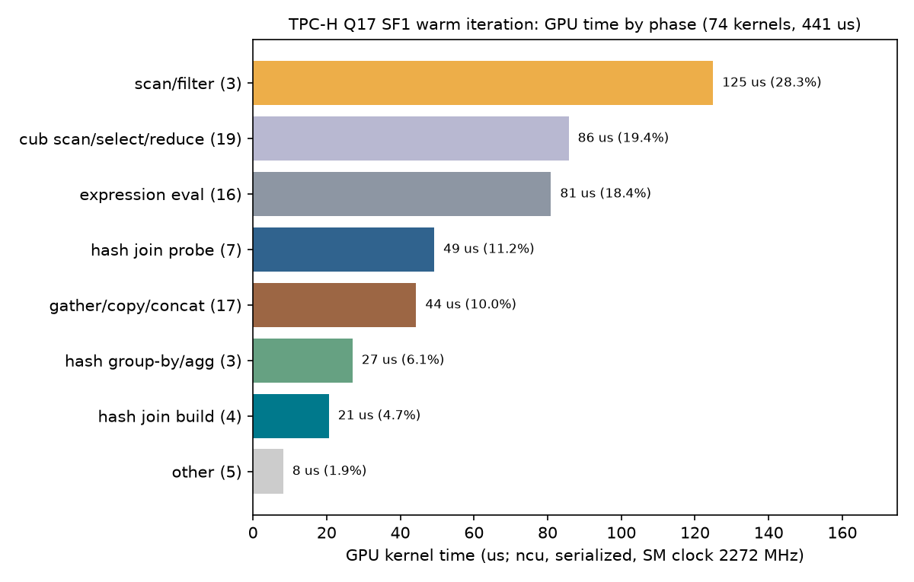
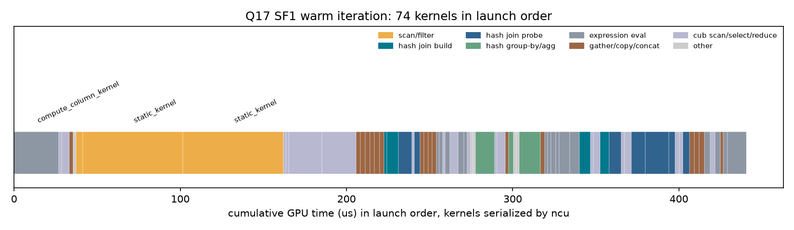
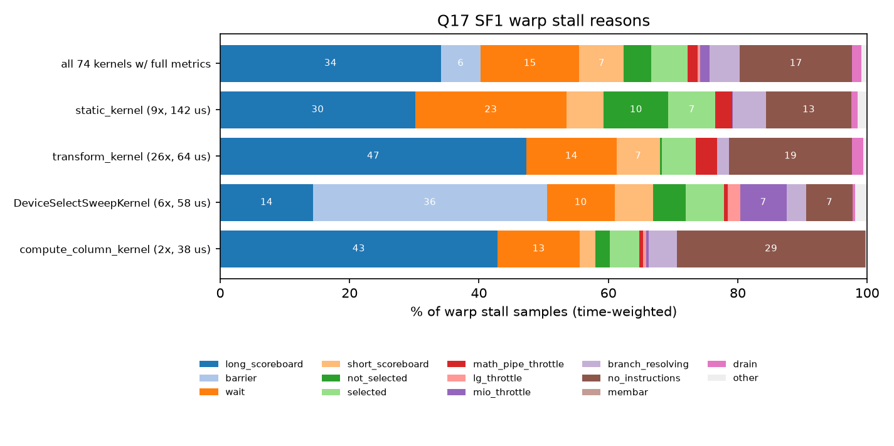
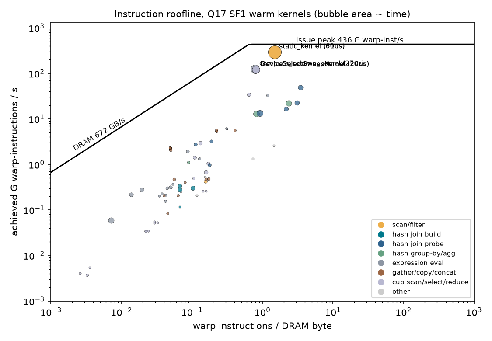

# TPC-H Q17 (SF1) on Sirius, all referenced columns pinned on GPU — Workload Analysis

**Date**: 2026-11-13
**GPU**: NVIDIA GeForce RTX 5070, 12 GB GDDR7 (192-bit, 672 GB/s), Blackwell sm_120, 48 SMs
**Workload**: TPC-H Query 17 (small-quantity-order revenue: `lineitem ⋈ part`, `p_brand = 'Brand#13'`, `p_container = 'JUMBO CAN'`, correlated scalar subquery `l_quantity < 0.2 * avg(l_quantity)` per part key, `sum(l_extendedprice) / 7.0`; constants read from `q17.sql`, not the standard TPC-H ones), scale factor 1
**Framework**: Sirius (`sirius-duckdb` release build), DuckDB v2.0, stock libcudf from the pixi env, CUDA runtime 13.5
**Pipeline**: `scripts/tpch_sf1/profile_query.sh 17` (154 s of stage time: 15 s for sql/timing/pcie/selftest + 139 s for list/detail/extract/validate; `pipeline_run.log`); every number below comes from a file in this directory.
**Labels**: *measured* = read from a profiler/log file; *inferred* = derived by arithmetic or reasoning from measured data.

---

## 1. Executive Summary

A warm Q17 takes **5.5 ms end-to-end** (median of 12 timed runs after 3 warmups, range 5–6 ms, stdev 0.50, `.timer` 1 ms resolution; *measured*, `timing_summary.txt`). DuckDB on the CPU takes 22.0 ms (min 22, max 24), so the GPU is 4.0x faster (*inferred* ratio). The 1-row DOUBLE result (376087.5371428571, `result.csv`) equals DuckDB-CPU exactly: compare mode `exact`, max relative difference 0.0, tolerance 1e-9; identical across all 15 GPU iterations (`timing.json`). So the division by 7.0 produced no last-digit difference here. The first (cold) iteration takes 56.0 ms.

| Where the 5.5 ms go (median warm iteration, 1 ms stamps) | ms | Source |
|---|---:|---|
| Planning (DuckDB optimizer + Sirius plan build, 18 pipelines) | 3 | Sirius log, *measured* |
| Engine window (timing run) | 3 | Sirius log, *measured* |
| Gap from `QueryEnd` to next statement | 0 | Sirius log, *measured* (3 + 3 + 0 = 6 vs 5.5 ms median wall: 1 ms stamps, medians of parts) |
| GPU busy (kernels + copies, real clocks, nsys run) | **0.282** | `nsys_iteration_breakdown.txt`, *measured* |
| Engine window with the GPU idle (host orchestration) | ~2.7 | engine 3 ms (timing run) − GPU busy 0.282 ms (nsys run), *inferred*, ±1 ms |

GPU busy is 5.1% of the 5.5 ms wall (*inferred*). Inside the 252.3 µs of kernel time (nsys, 74 kernels per iteration, deterministic):

1. **`static_kernel` (`cub::for_each`, here the dynamic-filter `membership_probe_functor`): 98.6 µs, 39.1% (9 launches in the family).** Two launches of ~3.0 M lineitem keys each (ncu 60.4 and 60.5 µs, 20.3 waves) probe a 231-key cuco set. They are limited by integer-ALU issue and the key-load latency (SM 72%, IPC 2.92, 24.5 of 32 lanes active), not by DRAM (30% of peak, 199 GB/s). Their DRAM bytes (24.11 MB) equal l_partkey read once (24.0 MB).
2. **`DeviceSelectSweepKernel`: 39.1 µs, 15.5% (6 launches)**: two 20 µs ncu launches (grid ~521 × 384) compact index lists over the large batches; the other four are < 5 µs.
3. **`transform_kernel`: 26.5 µs, 10.5% (26 launches, ncu full-pass avg 2.45 µs; 2.58 µs in the list pass)**: tiny gathers through a permutation iterator (grid 14 in the profiled one).

Against the physical floor of 115.4 µs (77.53 MB at 672 GB/s, `physical_floor.md`): GPU busy is **2.44x** the floor, the nsys kernel sum 2.19x, the wall **47.7x** (*inferred*). 56 of 74 kernels last < 5 µs (ncu full pass), 69 launch < 1 wave. Q17 at SF1 is limited by host orchestration and by one probe kernel pair, not by DRAM bandwidth.



---

## 2. Workload Description

- Plan (`query_plan.txt`, counted by distinct ids 0–26): **27 operators in 18 pipelines**: 2 GPU_SCANs (ids 0, 3), 1 DYNAMIC_FILTER (id 4), 2 HASH_JOINs (ids 7, 21), 1 CTE (id 10), HASH_GROUP_BY (12) + MERGE_GROUP_BY (14), UNGROUPED_AGGREGATE (23) + MERGE_AGGREGATE (24), 7 PROJECTIONs (8, 9, 11, 15, 18, 22, 25), 5 PARTITION (1, 5, 13, 16, 19), 4 CONCAT (2, 6, 17, 20), RESULT_COLLECTOR (26).
- Decorrelation (*measured* from the plan shape): HASH_JOIN id 7 (part ⋈ lineitem) feeds a CTE (id 10) read twice: by the avg-per-partkey HASH_GROUP_BY (id 12), whose result is the build side of HASH_JOIN id 21, and by the probe side of id 21 (pipeline #12). **lineitem is scanned once (GPU_SCAN id 3, with the DYNAMIC_FILTER id 4); part is scanned once (id 0).** Which scan is which table is *inferred* (id 3 carries the filter; the log says "231 build rows", equal to the DuckDB-CPU part count below).
- Dynamic filter: 15 publications for 15 iterations, each "pushed 1 dynamic filter(s) across 1 active target(s) of 1 wired target(s) (231 build rows, 1 bound keys of 1 admitted)" (`traces/sirius_log_timing/*.log`).
- Row counts (DuckDB-CPU on the Parquet, `physical_floor.md`): part 200,000 → **231** pass brand+container (0.1155%); lineitem 6,001,215 → **6,984** rows join those parts (0.116%); 231 groups in the avg subquery; **636** rows survive `l_quantity < 0.2*avg`; 1 result row.
- Pinned bytes (`gpu_pool ... QueryEnd allocated=`): lineitem 72,015,360 B (l_partkey, l_extendedprice, l_quantity; 12.00 B/row), part 5,515,520 B (p_partkey, p_brand, p_container); total **77,530,880 B**.
- 74 kernel launches per warm iteration (list passes: 455/529/603 launches for pin+3/4/5 iterations, +74 each); ncu policy **`full_all`** (74 ≤ 1000), `--set full` on all 74.

## 3. PCIe Verification (`pcie_verification.txt`: `OVERALL: PASS`)

No table data cross PCIe in the measured iterations; only small control copies do (per iteration up to 43 H2D copies / 2,258 B and 25 D2H copies / 154 B) (*measured*; quoted from the check lines):
- `timing_log:pinned_entry_per_gpu_scan` / `nsys_log:...`: "every iteration: #`assigned pinned entry` == #GPU_SCAN operators (2), all of ['lineitem', 'part'] present". Operators counted by distinct ids in `query_plan.txt`: GPU_SCAN ids 0 and 3 = 2 scans, 2 pinned-entry assignments (lineitem is not scanned twice).
- `fs_cache_zero_every_iteration`: "16 cache summaries for 15 iterations ... iterations 1..15 all last_cycle[reads=0 hits=0 h2d=0 miss=0 ...]" (nsys run: 9 summaries for 8 iterations, all zero).
- `no_parquet_decode_kernels`: "0 decode/decompress kernels among 592 kernels of all 8 iterations".
- `h2d_measured_iterations`: "up to 43 copies, 2258 B total, largest single 320 B (limits: single <= 65536 B, total <= 1048576 B)". `d2h_measured_iterations`: "up to 25 copies, 154 B total, largest single 24 B (result CSV is 29 B; limit 262144 B)". `no_other_host_copies`: 0 managed/unknown-kind copies. Per-iteration on-device D2D: 15 copies, 90,310 B, largest 14,060 B.
- `unified_memory`: UM CPU+GPU fault collection on; "faults per measured iteration [0, 0, 0, 0, 0]; managed-memory API calls in the whole trace: none" (fault tables are written only when a fault occurs).
- `pool_counters_stable`: "gpu_pool allocated == pinned footprint 77530880 B at QueryBegin and QueryEnd"; `no_downgrade_or_spill`: 0 lines.
- `no_host_staged_filter_publication`: "15 filter publication(s) logged in query iterations; 0 carry a transport line, all 'peer copies' (device-side), 0 host-staged; no transport line was logged, so this check does not show how those filters move". **That line shows nothing about transport.** The no-PCIe claim for the 231-key filter rests on the per-iteration H2D bound (2,258 B total, largest 320 B) and on `ncu_sysmem_check.txt`, not on this check.
- Pin phase (not measured iterations): H2D 184 copies, 38,239,940 B, largest 1,048,576 B; D2H 133 copies, 663,982 B; D2D 15 copies, 20,636,154 B.
- `ncu_sysmem_check.txt`: 74 kernels, 0 with SM (tex) sysmem-aperture sectors (total 0); the all-source counter reads 265–279 sectors per kernel (information only); ncu `pcie__read/write_bytes` 0 / 795,648 B (rate x duration, includes driver/ncu traffic). `ncu_log_checks_{list,detail}.txt`: every residency check PASS on all ncu runs.
- Negative control (`selftest_negative_control.txt`): with `lineitem` left unpinned `pcie_verify.py` exited 1 as expected, failing `pinned_entry_per_gpu_scan` ("1 assigned for 2 GPU_SCANs, missing tables ['lineitem']"), `fs_cache_zero_every_iteration` (reads 12, h2d 48), `no_parquet_decode_kernels` (3 decode kernels found), `h2d_measured_iterations` (37,943,030 B per iteration, largest 3,810,961 B) and `d2h_measured_iterations` (639,276 B); `SELFTEST: PASS (verification detected the unpinned table)`. Tables below the byte limit: none (both have ≥ 8192 rows).
- GPU memory: pinned footprint 77,530,880 B; gpu_pool high-water 293,579,484 B (process-lifetime, includes the pin phase; reported as "≤ high-water").

## 4. Environment

| Component | Version / setting |
|---|---|
| GPU / driver | RTX 5070 (sm_120, 48 SMs, 12 GB, 48 MB L2) / 580.173.02 (copied from the Q12 report; not re-queried) |
| Nsight Compute | via `sudo -n`; `--set full --import-source yes` on all 74 warm kernels (version copied from Q12, not re-queried) |
| ncu clocks | locked by ncu: SM median 2272 MHz (`ncu_extract_summary.txt`) |
| Nsight Systems | 2025.5.2 (`/home/sai/nsight-systems-2025.5`); `-t cuda -s none --cpuctxsw=none` plus UM page-fault collection |
| CPU | Intel i9-13900K, 125 GB RAM (copied from the Q12 report) |
| Sirius config | `scripts/tpch_sf1/sirius.yaml`: 4 pipeline threads, GPU pool 25% of 12 GB, 1 GB pinned host pool (2 pools), `enable_duckdb_fallback=false` |

## 5. Physical Floor vs Measured

Floors from `physical_floor.md`, written before any ncu output (*inferred* from table statistics):

| Scenario | Bytes | Floor @ 672 GB/s |
|---|---:|---:|
| A. every pinned column once (narrowed) | 77.53 MB | **115.4 µs** |
| A'. native widths (inferred) | ≈ 125.54 MB | ≈ 186.8 µs |
| A-min. predicate-forced bytes only | ≈ 29.6 MB | 44.1 µs |
| B. A + ~0.28 MB intermediates | ≈ 77.81 MB | ≈ 115.8 µs |
| Compute estimate (~0.03 G simple ops) | | < 10 µs |

| Measured (real clocks unless noted) | Value | × floor A (115.4 µs) |
|---|---:|---:|
| Wall, warm median (`timing.json`) | 5.5 ms | 47.7x |
| nsys GPU busy (`nsys_iteration_breakdown.txt`) | 282 µs | 2.44x |
| nsys kernel sum | 252.3 µs | 2.19x |
| ncu serialized kernel sum (clock-locked, cold-L2; not comparable with the rows above) | 440.7 µs | 3.82x |

Against A-min (44.1 µs): GPU busy 6.4x, wall 124.7x (*inferred*). ncu DRAM traffic for the warm iteration: 37.83 MB (cold-L2, `phase_breakdown.txt`) = 0.49x the pinned footprint (*inferred*), average 85.8 GB/s over the serialized kernel time. This is consistent with A-min: l_partkey (24.0 MB) is read in full, the rest is small.

## 6. Kernel, Phase and Operator Breakdown

Phase table (ncu full pass, serialized, `phase_breakdown.txt`; 74 kernels, 440.7 µs):

| Phase | Kernels | µs | % | DRAM MB | GB/s |
|---|---:|---:|---:|---:|---:|
| scan/filter (dynamic-filter probe) | 3 | 124.9 | 28.3 | 24.12 | 193.2 |
| cub scan/select/reduce | 19 | 85.7 | 19.4 | 6.64 | 77.5 |
| expression eval | 16 | 80.9 | 18.4 | 4.94 | 61.0 |
| hash join probe | 7 | 49.2 | 11.2 | 0.62 | 12.6 |
| gather/copy/concat | 17 | 44.3 | 10.0 | 1.07 | 24.1 |
| hash group-by/agg | 3 | 27.0 | 6.1 | 0.35 | 12.8 |
| hash join build | 4 | 20.6 | 4.7 | 0.08 | 3.8 |
| other | 5 | 8.2 | 1.9 | 0.02 | 2.6 |

Operators (`operator_breakdown.txt`): dynamic-filter membership probe 2 kernels 120.9 µs (27.4%, 24.11 MB, 199.4 GB/s); cub select/compact 10 kernels 60.0 µs (13.6%); gather/scatter fixed-width 16 kernels 42.4 µs (9.6%); expression AST 2 kernels 38.4 µs (8.7%); group-by 3 kernels 27.0 µs (6.1%); hash join output/compaction 4 kernels 25.5 µs; hash join probe 3 kernels 23.6 µs; binary-op / cast expressions 5 + 9 kernels 42.5 µs; hash join build 3 kernels 19.0 µs. `other:` rows total 5.0 µs (`other: transform_kernel` 3.5 + `other: static_kernel` 1.5 = 1.1%), so `kclass.py` was not edited.

Kernel-size facts (*measured*, ncu full pass): 56 kernels < 5 µs, 65 < 10 µs (202.5 µs, 46.0% of time); 69 kernels launch < 1 wave (252.4 µs) and 65 have grid < 48 CTAs; the top-10 kernels hold 56.0% of time. Real-clock nsys kernel time by family (mean per measured iteration, 252.3 µs): static_kernel 98.6 (39.1%), DeviceSelectSweep 39.1 (15.5%), transform 26.5 (10.5%), compute_column 19.7 (7.8%), mapping_indices 8.8 (3.5%), insert_if_n 6.5 (2.6%), filter_join_indices 6.2 (2.4%), single_pass_shmem_aggs 5.6 (2.2%).

Per-iteration CPU-side API (nsys, mean of 5, summed over threads: 1.862 ms for the 15 listed calls): 136 `cudaStreamSynchronize` (0.351 ms) + 47 `cuStreamSynchronize` (0.232 ms), 74 `cudaLaunchKernel` (0.452 ms), 68 `cudaMemcpyBatchAsync` (0.244 ms), 123 `cudaMallocFromPoolAsync` + 123 `cudaFreeAsync` (0.169 + 0.089 ms).




## 7. Top Kernels (ncu `--set full`, serialized, clock-locked, L2 flushed per kernel)

| pos | Kernel (role *inferred* from grid/shape) | µs | grid × blk | waves | SM% | DRAM% | GB/s | main stall |
|---:|---|---:|---|---:|---:|---:|---:|---|
| 7 | static_kernel / membership_probe (lineitem batch 1) | 60.5 | 5863 × 256 | 20.4 | 72.0 | 30.1 | 199.2 | long_sb 31.9% |
| 6 | static_kernel / membership_probe (lineitem batch 2) | 60.4 | 5859 × 256 | 20.3 | 71.5 | 30.2 | 199.7 | long_sb 34.4% |
| 0 | compute_column<128,0,1> (grid ≈ 200 K threads = part rows: part predicate) | 26.9 | 1563 × 128 | 3.6 | 46.5 | 24.2 | 159.8 | long_sb 51.9% |
| 11 / 10 | DeviceSelectSweep (counting-iterator index compaction) | 20.4 / 20.1 | 521 / 522 × 384 | 5.4 | 34.0 | 22.8 / 23.0 | 150–152 | barrier 37.8% / 39.0% |
| 60 | filter_join_indices_kernel (post-join residual filter) | 14.1 | 28 × 256 | 0.10 | 4.5 | 2.2 | 14.5 | no_inst 40.4% |
| 44 | single_pass_shmem_aggs (avg-per-partkey group-by) | 12.8 | 55 × 128 | 0.29 | 3.0 | 2.4 | 15.8 | no_inst 40.8% |
| 73 | compute_column<128,0,1> (1 CTA, 678 warp-instr.) | 11.5 | 1 × 128 | 0.00 | 0.0 | 1.2 | 8.2 | no_inst 60.9% |
| 37 | mapping_indices_kernel | 11.5 | 55 × 128 | 0.23 | 5.2 | 1.4 | 9.5 | (`top_kernel_details.txt`) |

Only pos 6/7 fill the GPU (20 waves); even they sit at 30% of the 672 GB/s ceiling. Pos 0 and 10/11 are 3.6–5.4 waves at 23–24% DRAM. All others are sub-wave. Time-weighted stall mix over all 74 kernels (`ncu_extract_summary.txt`): long_scoreboard 34.1%, no_instructions 17.4%, wait 15.3%, short_scoreboard 6.9%, barrier 6.1%.




## 8. Instruction-Level Evidence for the #1 kernel (`sass/static_kernel_hotspots.txt`, pos 7, 60.5 µs)

Kernel: `for_each::static_kernel<..., sirius::membership_probe_functor<integral_probe_adapter<int,int>, set_lookup<cuco::static_set_ref<int,1,...double_hashing...>>>>`. 2,896 static instructions (580, 20.0%, ever executed), 1.797e7 warp instructions executed, 5,958 stall samples. Class mix by executed instructions: integer arithmetic 55.3%, control flow 15.5%, move 9.5%, const load 7.2%, uniform 5.2%, FP 3.7%, global load 3.1%, global store 0.5%. Active lanes per executed warp instruction: **24.5 of 32 (77%)** (`thread_eff`, a lane count, not a percentage).

The two hottest PCs, each 11.7% of all samples (1,395 of 5,958 together = 23.4%, 1,372 of them `long_scoreboard`):

```
+0x003c0 exe=46896 thr=32  LDG.E R34, desc[UR40][R24.64]          ; load key
+0x003e0 exe=46896 thr=32  IMAD R0, R34, -0x3d4d51c3, R29         ; samp=700, long_sb=688
+0x003f0                    SHF.L.W.U32.HI R0, R0, 0x11, R0
+0x00400                    IMAD R0, R0, 0x27d4eb2f, RZ

+0x019c0 exe=46896 thr=32  LDG.E R24, desc[UR40][R24.64+0x400]    ; load next key
+0x019e0 exe=46896 thr=32  IMAD R29, R24, -0x3d4d51c3, R29        ; samp=695, long_sb=684
+0x019f0                    SHF.L.W.U32.HI R29, R29, 0x11, R29
+0x01a00                    IMAD R29, R29, 0x27d4eb2f, RZ
```

Register check (*measured* from the quoted window): `+0x003c0` writes R34 and `+0x003e0` reads R34 (and R29, whose producer is outside the window); `+0x019c0` writes R24 and `+0x019e0` reads R24. Both IMADs are two instructions after their load (one uniform ULOP3 between) and 98% of their samples are long-scoreboard, so they wait for the global load of the key (*measured* stall reason; that the loaded value is the l_partkey probe key and that the constants form a xxHash32-style integer hash (0xC2B2AE3D, rotate 17, 0x27D4EB2F) are *inferred* from shape). The two chains are the two keys per thread (second address = first + 0x400 bytes = 256 ints); `exe` 46,896 per chain × 32 lanes × 2 keys = 3.00 M rows per launch, so the two launches cover the 6,001,215 rows (*inferred*). The validity-bit load before `+0x003c0` (`LDG.E R5` at `+0x00370`) and the block above it show `exe=0` and are not part of any per-row chain.

After the hash, the probe loop compares the loaded slot against the key (`ISETP.NE.U32.AND P2, PT, R34, R3, PT` at `+0x00e50`, `+0x00ee0`, `+0x00f70`, `+0x024a0` ...) with 3–16 active lanes (thr = 16.0, 6.0, 3.0, 16.0 at those PCs) and 47–61 K executions: lanes thin out in the probe continuation (the cause, early exit on an empty slot versus collisions in the 231-key set, is *inferred*). These ISETPs stall on `long_sb` (45–73 long_sb samples, 49–78 samples in total, each); the producer of the slot value is not inside any quoted window, so I do not name it. Per row: 17.97 M warp instructions / 3.00 M rows = **6.0 warp instructions per row** (*inferred*), 5,958 samples over 60.5 µs; IPC 2.92, SM 72%, ALU pipe 37.2%, LSU 22.5%: the kernel is issue-limited by hash and probe arithmetic plus the key-load latency, which is why DRAM sits at 30% even though occupancy is 85%.

## 9. Root Cause Analysis

**Sink 1: the two dynamic-filter probe launches (ncu 120.9 µs, 27.4%; nsys family `static_kernel` 98.6 µs, 39.1%)**
- Symptom: 2 × ~60 µs at 199 GB/s = 29.7% of peak (*measured*, `top_kernel_details.txt`), against 35.7 µs for reading 24.0 MB at 672 GB/s (*inferred*): 3.4x slower than the DRAM time of its own bytes.
- WHY 1: the kernel is not waiting on DRAM bandwidth; SM 72%, IPC 2.92, 55.3% of executed instructions are integer ALU (*measured*).
- WHY 2: each row costs ~6.0 warp instructions, i.e. ~383 instructions per thread for its 2 keys (17.97 M / 46,904 warps), ~147 thread instructions per row at 24.5 active lanes (*inferred* by division) and the first use of each loaded key stalls 688/700 and 684/695 samples on the load (*measured*).
- WHY 3: only 24.5 of 32 lanes are active on average and probe-loop PCs run with 3–16 lanes (*measured*), so the continuation executes as thin warps.
- ROOT: a generic open-addressing hash membership test is applied per row for a filter that has 231 keys among 200,000 possible partkeys (99.88% of rows are rejected, 6,984 of 6,001,215 pass; *measured* counts). The cost is per-row ALU work, not bytes (*inferred*).

**Sink 2: host orchestration (wall 5.5 ms vs GPU busy 0.282 ms)**
- Symptom: GPU busy is 5.1% of the wall (*inferred* from nsys vs `.timer`).
- WHY 1: planning takes 3 ms and the engine window 3 ms (1 ms stamps, `timing_summary.txt`); the engine window has ~2.7 ms with the GPU idle (*inferred*, mixes runs).
- WHY 2: per iteration 18 pipelines, 74 launches, 183 stream syncs, 68 batch memcpys and 246 pool alloc/free calls (*measured*, nsys API summary), ~1.86 ms of summed CPU time across threads (in the nsys run, which inflates the engine window to 6 ms).
- WHY 3: sync call counts are consistent with host waits for intermediate sizes (231 build rows, 6,984 joined rows, 231 groups, 636 survivors); that each sync waits for a µs-scale kernel is *inferred*, nsys measures only counts and CPU time.
- ROOT: with 636–6,984-row intermediates, the 18-pipeline decorrelated plan is dominated by per-operator launch/sync/allocation latency rather than data volume (*inferred*).

**Sink 3: the tiny-kernel tail (56 kernels < 5 µs, 65 < 10 µs = 202.5 µs / 46.0% of ncu time)**
- Symptom: 69 of 74 kernels launch < 1 wave; median kernel 2.91 µs (`warm_kernel_summary.txt`, list pass).
- WHY 1: after the part filter (231 rows) and the join (6,984 rows) most operators see ≤ 7 K rows; e.g. `compute_column` pos 73 is 1 CTA with 678 warp instructions and takes 11.5 µs (ncu, 3.7 of 32 lanes), `filter_join_indices` 14.1 µs at 0.10 waves.
- WHY 2: these durations are latency, not throughput: 1.3–14 GB/s (*measured*).
- ROOT: library operators are general-purpose and launched per operator; at SF1 their fixed launch/ramp/tail cost (~2 µs for the smallest, imported from Q2, not re-measured) bounds the GPU-side time at ~74 × 2 µs ≈ 0.15 ms (*inferred*).

## 10. Gap Analysis

| Gap | Size | Explained by |
|---|---:|---|
| Wall 5.5 ms → GPU busy 0.282 ms | 5.2 ms (94.9%) | planning 3 ms + host-side orchestration (sink 2), *measured*/*inferred* |
| GPU busy 282 µs → floor A 115.4 µs | 167 µs (1.44x floor) | probe kernels ~ +63 µs over their DRAM time (nsys static_kernel family of 9 launches 98.6 µs vs ~35.7 µs bytes, mixed basis, *inferred*; +85 µs on the ncu basis, 120.9 − 35.7), tiny-kernel tail (sink 3) |
| Floor A → A-min 44.1 µs | 71 µs | reading l_quantity and l_extendedprice for all 6.0 M rows (48 MB of pinned bytes) although only 6,984 rows need them |

Q17 is not bandwidth-bound: ncu average 85.8 GB/s (12.8% of peak) over its kernels; the only filled-GPU kernels reach 29.7%.

## 11. Optimization Directions (general-purpose library/engine changes; no query-specific fusion)

1. **Cheaper membership probe for small integer key sets** (targets sink 1, up to ~120 µs ncu): a bitmap/range-bounded filter for dense int32 keys (partkey 1..200,000 = 25 KB) or a probe with an early-out before the double-hash loop would cut the ~6.0 warp instructions (~147 thread instructions) per row that dominate. Expected bound: the 35.7 µs byte time of l_partkey.
2. **Lower host overhead per pipeline** (sink 2, ~2.7 ms idle engine window + 3 ms planning): plan caching, fewer stream syncs for tiny intermediates, pooled scratch instead of 123 alloc/free pairs.
3. **Narrower stored carriers** for DECIMAL columns would lower only floor A; the 77.5 MB → 29.6 MB A-min gap comes from reading l_quantity/l_extendedprice of non-matching rows, not from carrier width, and neither moves the measured time at SF1.
4. Fusion of the small operators would address sink 3 but is out of scope (project rule: cuDF kernels stay general-purpose); mentioned as context only.

## 12. Determinism and Profiling Method

- Results: identical across all 15 GPU iterations and equal to DuckDB-CPU, mode `exact`, max relative difference 0.0 (`timing.json`).
- Kernel counts per iteration stable: nsys [74 × 8], ncu list passes +74 per added iteration, added-iteration multisets equal (`warm_kernel_summary.txt`). Launch order differs (8 positions between x5 iteration 4 and 5, 22 between x4 and x5) because 4 pipeline threads interleave; only counts and multisets are used.
- ncu profiled the warm (5th) iteration with `-s 529 -c 74`; slice check PASS (`ncu_slice_check.txt`). ncu times are serialized, clock-locked (2272 MHz median) and taken after an L2 flush; nsys gives real-clock times; the two are never summed together in this report.
- Validation: `validate_pipeline.txt` → `SUMMARY q17: 72 PASS, 0 FAIL, 1 PENDING` (the pending one is this report).

## 13. Limitations

- `.timer` has 1 ms resolution; planning/engine splits are medians of 1 ms stamps and do not add exactly to the wall median (6 vs 5.5 ms).
- The "engine window with GPU idle" row mixes the timing run (3 ms) with the nsys run (GPU busy); nsys roughly doubles the engine window (6 ms there).
- Roles of kernels other than the membership probe (part predicate, index compaction, final scalar expression) are inferred from grid sizes and cardinalities, not from source mapping. The 3.0 M rows per probe launch come from instruction counts (`exe` × 32 × 2 keys).
- The `transform_kernel` hotspots file has only 43 samples (grid 14): not used for any chain.
- ncu DRAM bytes and hit rates are cold-L2 values; durations of tiny kernels are inflated versus real clocks. Environment versions are copied from the Q12 report, not re-queried.
- `no_host_staged_filter_publication` saw no transport line; see Section 3 for what the claim rests on.
- Floors A' and A-min use inferred native widths (DECIMAL(15,2) assumed 8 B, 4 B string offsets).

## 14. Raw Data

`timing.json`, `timing_summary.txt`, `result.csv`, `query_plan.txt`, `pcie_verification.txt`, `selftest_negative_control.txt`, `nsys_iteration_breakdown.txt`, `warm_kernel_summary.txt`, `ncu_plan.json`, `ncu_slice_check.txt`, `ncu_log_checks_{list,detail}.txt`, `ncu_sysmem_check.txt`, `ncu_extract_summary.txt`, `ncu_warm_metrics.json`, `phase_breakdown.txt`, `operator_breakdown.txt`, `top_kernel_details.txt`, `sass/static_kernel_hotspots.txt`, `sass/transform_kernel_hotspots.txt`, `physical_floor.md`, `validate_pipeline.txt`, `profiles/q17_warm_full.ncu-rep`, `traces/`, `plots/q17_*.png`, `pipeline_run.log`.
