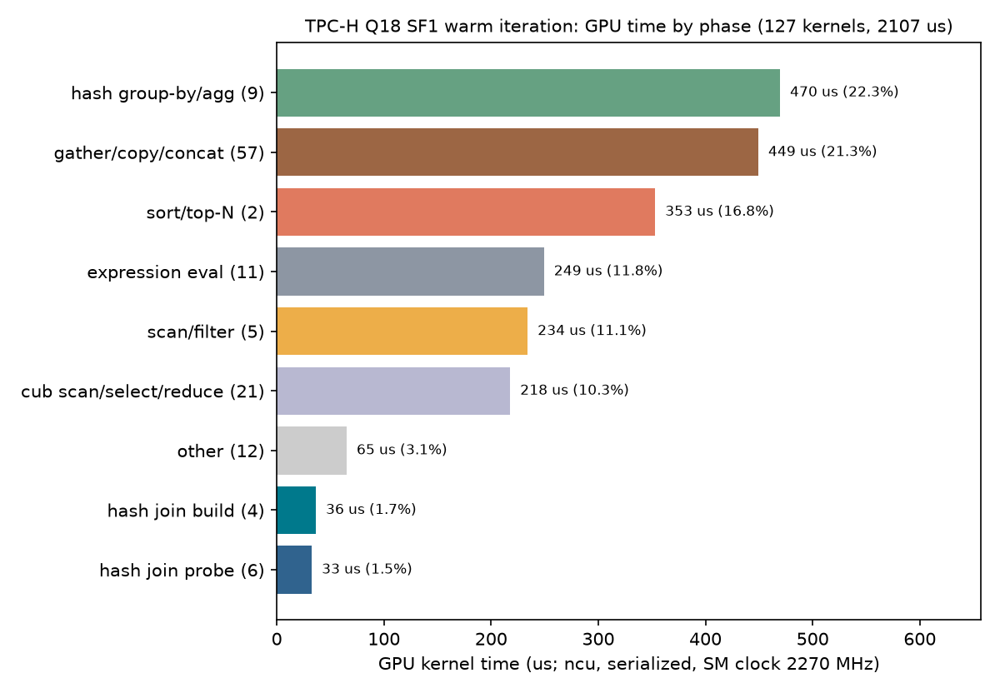
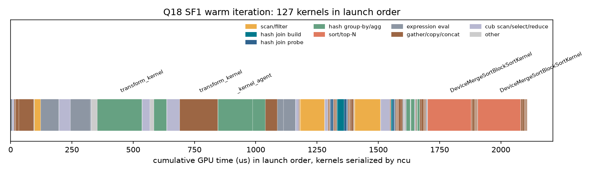
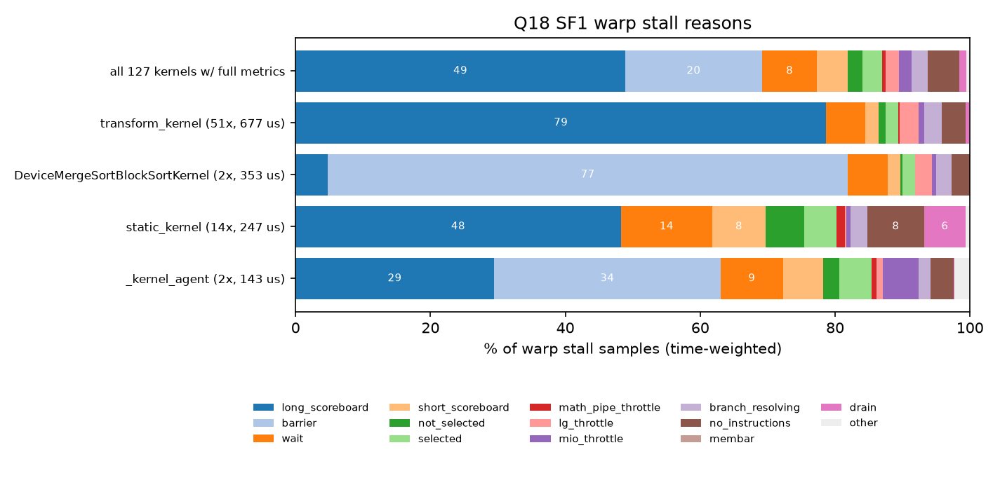
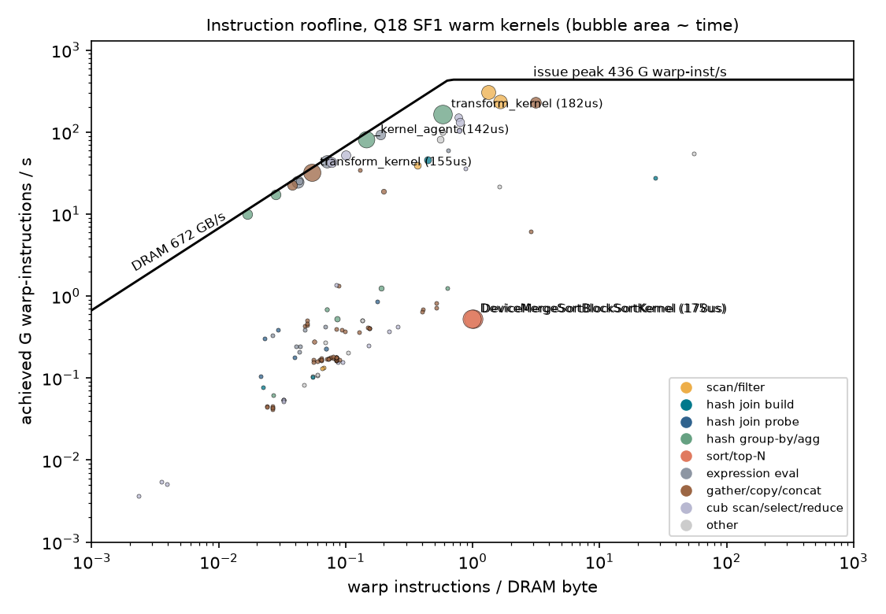

# TPC-H Q18 (SF1) on Sirius, all referenced columns pinned on GPU — Workload Analysis

**Date**: 2026-11-13
**GPU**: NVIDIA GeForce RTX 5070, 12 GB GDDR7 (192-bit, 672 GB/s), Blackwell sm_120, 48 SMs
**Workload**: TPC-H Query 18 (large-volume customers: `o_orderkey IN (select l_orderkey from lineitem group by l_orderkey having sum(l_quantity) > 300)`, customer ⋈ orders ⋈ lineitem, 5-column group-by, `ORDER BY o_totalprice DESC, o_orderdate LIMIT 100`; constants read from `q18.sql`), scale factor 1. The 8 referenced columns of 3 tables are pinned in GPU memory with `pin_table(tier='gpu')` (72.91 MB).
**Framework**: Sirius (`sirius-duckdb` release build), DuckDB v2.0, stock libcudf from the pixi env, CUDA runtime 13.5
**Pipeline**: `scripts/tpch_sf1/profile_query.sh 18` (227 s: 15 s for sql/timing/pcie/selftest + 212 s for list/detail/extract/validate; `pipeline_run.log`); every number below comes from a file in this directory.
**Labels**: *measured* = read from a profiler/log file; *inferred* = derived by arithmetic or reasoning from measured data.

---

## 1. Executive Summary

A warm Q18 takes **8.0 ms end-to-end** (median of 12 timed runs after 3 warmups, range 7–8 ms, `.timer` 1 ms resolution; *measured*, `timing_summary.txt`; first iteration 53.0 ms). DuckDB on the CPU takes 43.0 ms (min 38, max 45), so the GPU is 5.4x faster (*inferred* ratio). The 57-row result equals DuckDB-CPU exactly (compare mode `exact`, max relative difference 0.0, tolerance 1e-9, identical across all 15 GPU iterations; `timing.json`). The result has 57 rows, fewer than LIMIT 100, because only 57 of the 1,500,000 orders exceed the threshold of 300 (`physical_floor.md`).

| Where the 8.0 ms go (median warm iteration, 1 ms stamps) | ms | Source |
|---|---:|---|
| Planning (DuckDB optimizer + Sirius plan build, 24 pipelines) | 2 | Sirius log, *measured* (`timing_summary.txt`) |
| Engine window (timing run) | 5 | Sirius log, *measured* |
| Gap from `QueryEnd` to the next statement | 1 | Sirius log, *measured* (2 + 5 + 1 = 8, equal to the median wall) |
| GPU busy (kernels + copies, real clocks, nsys run) | **1.866** | `nsys_iteration_breakdown.txt`, *measured* |
| Engine window with the GPU idle (host orchestration) | ~3.1 | engine 5 ms (timing run) − GPU busy 1.866 ms (nsys run), *inferred*, ±1 ms |

GPU busy is 23.3% of the 8.0 ms wall (*inferred*). Inside the 1723.2 µs of kernel time (nsys, 127 kernels per iteration, deterministic):

1. **`transform_kernel`: 649.9 µs, 37.7% (nsys), 51 launches.** Its longest launch (pos 16, 181.7 µs ncu) is `cudf::unique_copy_fn` over all 6,001,215 lineitem rows (187,538 warp executions × 32 lanes, *measured*), the group-boundary step of the 1.5 M-group aggregation (role *inferred*). It is neither DRAM-bound (ncu DRAM% 43.1; 285.1 GB/s = 42.4% of 672 GB/s) nor SM-bound (SM 67.2%); LSU pipe 69.7%, 65.5% of stalls long-scoreboard on dependent loads (§8).
2. **`DeviceMergeSortBlockSortKernel`: 275.5 µs, 16.0% (nsys), 2 launches of grid = 1 CTA (178.0 and 175.0 µs ncu).** One CTA on one of 48 SMs (SM active fraction 0.02), 77% of stall samples at a barrier, 17.5 of 32 lanes active on average (§8–9). Two single-CTA kernels cost more than any other single launch except pos 16.
3. **`static_kernel`: 176.6 µs, 10.2% (nsys), 14 launches**: the dynamic-filter membership probe over 6.0 M-row launches (pos 65: 104.0 µs ncu, grid 11,722) and 1.5 M-group-scale element-wise kernels at 74–94% of DRAM peak.

Against the physical floor of 108.5 µs (72.91 MB at 672 GB/s, `physical_floor.md`; 179.9 µs if lineitem's two scans are both counted): GPU busy is **17.2x** the 108.5 µs floor (10.4x the 179.9 µs one), kernel time 15.9x (9.6x), the wall **73.7x** (44.5x) (*inferred*). 81 of 127 kernels last < 5 µs (full pass), 100 are sub-wave. Unlike Q10/Q12, Q18 does contain several kernels that fill the GPU at 83–94% of DRAM peak (6.0 M-row gathers/casts/reductions, §7), but the query is limited by two latency-bound kernels (unique_copy, single-CTA sorts) and host orchestration, not by bandwidth.



---

## 2. Workload Description

- Plan (`query_plan.txt`, counted by distinct ids 0–33): **34 operators in 24 pipelines**: **4 GPU_SCANs** (ids 0, 3, 10, 20), **3 HASH_JOINs** (14, 17, 24), **2 DYNAMIC_FILTERs** (11, 21), 2 HASH_GROUP_BYs (4, 27) with MERGE_GROUP_BYs (6, 29), FILTER (7), PROJECTIONs (25, 26, 30), TOP_N (31) + MERGE_TOP_N (32), PARTITION/CONCAT stages, RESULT_COLLECTOR (33).
- **lineitem is scanned twice** (ids 3 and 20). Table assignment from the "assigned pinned entry" lines (`traces/sirius_log_timing/*.log`): id 0 customer, 3 lineitem, 10 orders, 20 lineitem. Pipeline #3 is GPU_SCAN(3) → HASH_GROUP_BY(4): the inner `group by l_orderkey` over all lineitem, then MERGE_GROUP_BY(6) → FILTER(7) (the HAVING).
- The Sirius log reports 3 dynamic-filter publications per iteration ("pushed 1 dynamic filter(s) … (149999 build rows …)", then "(57 build rows …)" twice), against 2 DYNAMIC_FILTER operators in the plan; the log wires 3 hash joins per iteration, each "with 1 dynamic-filter probe target(s) (1 scan-bound …)" (build est 758,634 / 150,000 / 300,000 rows), i.e. one publication per HASH_JOIN (14, 17, 24); which scan receives the third filter is not in the log.
- Row counts (DuckDB-CPU on the Parquet, `physical_floor.md`): lineitem 6,001,215; orders 1,500,000; customer 150,000; the inner group-by has **1,500,000 groups** (4.0 rows/group); 57 groups pass `sum > 300`; the 57 orders have 399 lineitem rows and 57 customers. Result: 57 rows, 3,558 B (`result.csv`).
- Pinned bytes (`physical_floor.md`, Sirius log): customer 3,900,160 + orders 21,000,448 + lineitem 48,009,728 = **72,910,336 B**. lineitem pins only l_orderkey and l_quantity (8.00 B/row).
- Query properties that matter at the kernel level (*inferred* from kernel names and sizes): the 1.5 M-group aggregation runs through a sort-based primitive family (`ReduceByKeyAgent`, `unique_copy_fn`) rather than a hash-table kernel; no multi-CTA sort kernel appears in the warm list (only the two single-CTA block sorts, §9). That the input order is already key-sorted is a hypothesis; I did not verify it.

---

## 3. PCIe Verification (`pcie_verification.txt`: `OVERALL: PASS`)

No table data cross PCIe in the measured iterations; only small control copies do (per iteration 51 H2D copies / 1,998 B, 40 D2H copies / 19,926 B) (*measured*; quoted from the check lines):
- `timing_log:pinned_entry_per_gpu_scan` / `nsys_log:...`: "every iteration: #`assigned pinned entry` == #GPU_SCAN operators (4), all of ['customer', 'lineitem', 'orders'] present". **4 GPU scans, 4 pinned-entry assignments** (lineitem assigned twice, ids 3 and 20), in every iteration of the timing, nsys and ncu runs.
- `fs_cache_zero_every_iteration`: "16 cache summaries for 15 iterations … iterations 1..15 all last_cycle[reads=0 hits=0 h2d=0 miss=0 ...]" (nsys run: 9 summaries for 8 iterations, all zero).
- `no_parquet_decode_kernels`: "0 decode/decompress kernels among 1016 kernels of all 8 iterations".
- `h2d_measured_iterations`: "up to 51 copies, 1998 B total, largest single 384 B (limits: single <= 65536 B, total <= 1048576 B)". `d2h_measured_iterations`: "up to 40 copies, 19926 B total, largest single 16384 B (result CSV is 3558 B; limit 262144 B)". `no_other_host_copies`: 0 managed/unknown-kind copies. On-device D2D per iteration: 15 copies, 48,013,064 B, largest 24,004,860 B (= 6,001,215 × 4 B, so a 4-byte column of the lineitem row count; which column is *inferred*).
- `unified_memory`: UM CPU+GPU fault collection on; "faults per measured iteration [0, 0, 0, 0, 0]; managed-memory API calls in the whole trace: none" (fault tables are written only when a fault occurs).
- `pool_counters_stable`: "gpu_pool allocated == pinned footprint 72910336 B at QueryBegin and QueryEnd"; `no_downgrade_or_spill`: "0 downgrade/spill/OOM lines in query iterations".
- `no_host_staged_filter_publication`: "45 filter publication(s) logged in query iterations; 0 carry a transport line, all 'peer copies' (device-side), 0 host-staged; **no transport line was logged, so this check does not show how those filters move**". So this check shows nothing about transport; the no-PCIe claim for the 3 publications per iteration rests on the H2D byte bound (≤ 1998 B and ≤ 384 B per copy per iteration) and on the sysmem check below.
- Pin phase (not measured iterations): H2D 175 copies, 18,938,055 B, largest 1,048,576 B.
- `ncu_sysmem_check.txt`: 127 kernels, 0 with SM (tex) sysmem-aperture sectors (total 0); the all-source counter reads 265–293 sectors for every kernel (information only); ncu `pcie__read/write_bytes` 0 / 1,373,184 B (rate × duration, includes driver/ncu traffic). `ncu_log_checks_{list,detail}.txt`: every residency check PASS.
- Negative control (`selftest_negative_control.txt`): with `lineitem` unpinned, `pcie_verify.py` exited 1 as expected and failed `pinned_entry_per_gpu_scan` ("2 assigned for 4 GPU_SCANs, missing tables ['lineitem']"), `fs_cache_zero_every_iteration` (reads 24, h2d 19), `no_parquet_decode_kernels` (3 decode kernels), `h2d_measured_iterations` (13,546,834 B, largest single 754,681 B) and `d2h_measured_iterations`; "SELFTEST: PASS (verification detected the unpinned table)".
- GPU memory: pinned footprint 72,910,336 B; gpu_pool high-water 283,292,672 B (process-lifetime, includes the pin phase), well inside the 25% pool. No downgrade, no spill, no `PCIE_*` override (limits equal defaults).

## 4. Environment

| Component | Version / setting |
|---|---|
| GPU / driver | RTX 5070 (sm_120, 48 SMs, 12 GB, 48 MB L2) / 580.173.02 (queried this run) |
| Nsight Compute | via `sudo -n`; `--set full --import-source yes` on all 127 warm kernels (version copied from the Q12 report, not re-queried) |
| ncu clocks | locked by ncu: SM median 2270 MHz (`ncu_extract_summary.txt`) |
| Nsight Systems | 2025.5.2 (`/home/sai/nsight-systems-2025.5`); `-t cuda -s none --cpuctxsw=none` plus UM page-fault collection |
| CPU | Intel i9-13900K, 125 GB RAM (copied from the Q12 report) |
| Sirius config | `scripts/tpch_sf1/sirius.yaml`: 4 pipeline threads, GPU pool 25% of 12 GB, 1 GB pinned host pool (2 pools), `enable_duckdb_fallback=false` |

## 5. Physical Floor vs Measured

| Quantity | Value | Source / label |
|---|---:|---|
| Floor A: 72.91 MB once | 108.5 µs | `physical_floor.md`, *inferred* |
| Floor A'': lineitem columns read by both scans (120.92 MB) | 179.9 µs | `physical_floor.md`, *inferred* |
| Floor A-min (predicate-forced bytes, 78.0 MB) | 116.1 µs | `physical_floor.md`, *inferred* |
| Observed DRAM traffic, all 127 kernels (ncu, cold L2) | 574.09 MB (7.87x the pinned bytes, 4.75x A'') | `phase_breakdown.txt`; time at peak 854.3 µs (*inferred*) |
| Kernel time, real clocks (nsys, mean of 5) | 1723.2 µs | `nsys_iteration_breakdown.txt` |
| GPU busy (kernels+copies+memsets union, nsys) | 1866 µs (1.860–1.866 over iterations 4–8) | same |
| ncu kernel sum (serialized, base clock, L2 flushed) | 2106.9 µs | `phase_breakdown.txt` (never mixed with nsys) |
| Wall (median) | 8000 µs | `timing_summary.txt` |

Ratios (*inferred*): GPU busy / A = 17.2x, / A'' = 10.4x; kernel (nsys) / A = 15.9x, / A'' = 9.6x; wall / A = 73.7x, / A'' = 44.5x. The first→last GPU op span is 7.62 ms in the nsys run (iteration 4, 6.81–8.74 over 4–8), 4.1x the GPU busy time of 1.866 ms.
The 0.143 ms difference between GPU busy and kernel time is copy/memset time (*inferred*; the 48.0 MB of D2D copies per iteration alone would take 0.143 ms at 672 GB/s counting read+write, which suggests the union is dominated by them).
Compute estimate from the floor file: ≈ 20 µs for the 6.0 M-row aggregation (*inferred*); the aggregation is not compute-bound, it is limited as described in §9.

## 6. Kernel, Phase and Operator Breakdown

127 kernels per warm iteration, deterministic (`warm_kernel_summary.txt`: 627/754/881 launches in the three list runs, +127 per iteration, `STABLE: True`). ncu policy: **`full_all`** (127 ≤ `NCU_FULL_MAX` 1000); the light + families branch was not used. `phase_breakdown.txt` (ncu, serialized, 2106.9 µs):

| Phase | Kernels | µs | % |
|---|---:|---:|---:|
| hash group-by/agg (kclass label) | 9 | 469.5 | 22.3 |
| gather/copy/concat | 57 | 449.2 | 21.3 |
| sort/top-N | 2 | 353.0 | 16.8 |
| expression eval | 11 | 249.3 | 11.8 |
| scan/filter | 5 | 234.0 | 11.1 |
| cub scan/select/reduce | 21 | 217.7 | 10.3 |
| other / hash join build / hash join probe | 12 / 4 / 6 | 65.2 / 36.4 / 32.6 | 3.1 / 1.7 / 1.5 |

Counts (*measured*, `phase_breakdown.txt` footer, full pass): 81 kernels < 5 µs, 98 < 10 µs (the list pass in `warm_kernel_summary.txt` counts 97 < 10 µs); these 98 kernels sum 298.0 µs (14.1%). **100 kernels have < 1 wave (683.5 µs, 32.4%), 98 have a grid < 48 CTAs**; the 100 include the two sorts (353.0 µs), so the other 98 sub-wave kernels total 330.5 µs (*inferred* difference). The remaining 27 kernels (1423.4 µs, 67.6%) fill the GPU. Operator labels come from kernel-name rules in `kclass.py`, not from plan tracing; e.g. the `DeviceReduceKernel` (minmax_pair<long>) on 49.4 MB is labelled "expression: binary op".

`operator_breakdown.txt`: group-by / aggregation 9 kernels 469.5 µs (22.3%); sort / top-N 2 kernels 353.0 µs (16.8%); gather/scatter fixed-width 39 kernels 296.8 µs (14.1%, 421.9 GB/s); dynamic filter membership probe 2 kernels 201.1 µs (9.5%); gather strings 18 kernels 152.4 µs (7.2%); expression binary 142.7 µs and cast/unary 106.6 µs; cub select/compact 15 kernels 113.5 µs; hash join build+probe+output+init: 10 kernels 69.0 µs (3.3%, *inferred* sum). `other:` rows 0.1% (1 kernel), so `kclass.py` was not edited.
Real-clock family shares (nsys, 1723.2 µs): transform_kernel 649.9 (37.7%), MergeSortBlockSort 275.5 (16.0%), static_kernel 176.6 (10.2%), `_kernel_agent` 143.2 (8.3%), DeviceSelectSweep 80.9 (4.7%), fused_membership_mask 79.2 (4.6%), find_kernel 62.0 (3.6%).




## 7. Top Kernels (ncu `--set full`, serialized, clock-locked, L2 flushed per kernel)

`top_kernel_details.txt`, `ncu_warm_metrics.json` (cold-L2 DRAM bytes and hit rates). GB/s as % of the 672 GB/s peak is *inferred*.

| pos | Kernel (what it is, label) | µs | grid × blk | DRAM MB, GB/s (% of 672) | SM% | lanes active / 32 | Bound by |
|---:|---|---:|---|---|---:|---:|---|
| 16 | `transform_kernel` + `cudf::unique_copy_fn` over counting_iterator (6.0 M rows; role *inferred*) | 181.7 | 1804×256 | 51.80, 285.1 (42.4%) | 67.2 | 27.3 | dependent loads / LSU 69.7% |
| 108 / 118 | `DeviceMergeSortBlockSortKernel`, row comparator | 178.0 / 175.0 | 1×256 | 0.09, 0.5 | 0.2 | 17.5 / 17.6 | barrier 77%, one SM |
| 23 | `transform_kernel` gather through `permutation_iterator<const long*, indexalator>` | 155.4 | 3908×256 | 93.71, 602.9 (89.7%) | 9.0 | 32.0 | DRAM ceiling (long_sb 96.0%) |
| 25 | `ReduceByKeyAgent` (groupby sum, `null_replaced_value_accessor`) | 141.6 | 2605×256 | 79.06, 558.2 (83.1%) | 33.5 | 31.8 | DRAM near ceiling; 6.78e5 of 1.70e6 shared accesses bank-conflicted (40%, *inferred* ratio) |
| 65 | `static_kernel` dynamic-filter membership probe (`cuco::static_set_ref`) | 104.0 | 11722×256 | 24.05, 231.4 (34.4%) | 72.3 | 27.5 | ALU/LSU, 40.7 waves |
| 35 | `fused_membership_mask_kernel` | 97.2 | 4096×256 | 13.86, 142.6 (21.2%) | 57.1 | 26.5 | mixed (long_sb 35.9%, wait 20.9%) |
| 12 | `DeviceReduceKernel` minmax_pair<long> | 80.4 | 1440×256 | 49.41, 614.7 (91.5%) | 11.5 | 31.6 | DRAM ceiling |
| 9 | `transform_kernel` cast | 74.3 | 2132×256 | 43.14, 580.6 (86.4%) | 9.9 | 31.8 | DRAM |

- Kernels near the bandwidth ceiling (≥ 80% of 672 GB/s, *inferred* ratios): pos 23 (89.7%), 12 (91.5%), 20 (static_kernel 51.1 µs, 619.7 GB/s, 92.2%), 25 (83.1%), 22 (DeviceScanKernel 51.5 µs, 547.3 GB/s, 81.5%), 26/27/28/9. These lineitem-scale passes move 7–16 B per lineitem row (pos 9 7.2, pos 12 8.2, pos 25 13.2, pos 23 15.6 B/row, ncu cold-L2) at 81–92% of peak: they are already efficient per byte; the cost is the number of full-width passes (574.09 MB cold-L2 traffic vs 72.91 MB pinned).
- Time-weighted stall mix over all 127 kernels (`ncu_extract_summary.txt`): long_scoreboard 48.9%, barrier 20.3%, wait 8.1%, no_instructions 4.7%, short_scoreboard 4.6%, selected 3.0%. The barrier share is mostly the two sorts and pos 25.
- One L2 hit rate (pos 95) read 100.8% and is clamped to 100 (raw kept).




## 8. Instruction-Level Evidence for the #1 kernel (`sass/transform_kernel_hotspots.txt`, pos 16; #2 family: `sass/DeviceMergeSortBlockSortKernel_hotspots.txt`, pos 108)

Pos 16 (181.7 µs, 3.02e7 warp instructions, 18,281 stall samples, 7,096 static instructions of which 455 ever executed). Warp-level execution counts of 187,538 on the hot loads ≈ 6,001,216 lanes ÷ 32: one pass over every lineitem row (*measured* counts; row identity *inferred*).
Instruction mix: Int Arithmetic 26.3% of executed (48.0% of stall samples), Move 26.1%, Control Flow 20.3%, **Local (spill) 11.9% (30.1% of samples; 3.59e6 warp instructions ≈ 19.2 per 32 rows)**.

**Chain A (register-exact, same window, `+0x02400`, 22.2% of samples, 4,062, long_sb 4,046):**
```
+0x023e0  LD.E R2, desc[UR16][R2.64]
+0x023f0  LD.E R6, desc[UR18][R6.64]
+0x02400  ISETP.EQ.U32.AND P0, PT, R2, R6, PT   <- stalls; reads R2 and R6
```
The ISETP reads exactly the two registers the two preceding generic loads (`LD.E`) write, 31.0 lanes active. The two values are compared for equality (the adjacent-row key comparison of `unique_copy_fn`; what they load is *inferred*). The loads issue back to back, so the compare waits for the slower of two long-latency loads for every 32 rows; the loop is one warp-instruction chain per row-group, not bandwidth.

**Chain B (`+0x01ba0`, 22.1% of samples, 4,031, long_sb 3,997):**
```
+0x01b20  LDL.64 R10, [R42+0x18]
+0x01b70  LD.E R20, desc[UR16][R20.64]
+0x01b80  LD.E R22, desc[UR18][R22.64]
+0x01ba0  LDL.U8 R33, [R42+0x28]            <- stalls
```
The only source register of the stalled `LDL.U8` is R42, which is written by `IADD R42, R42, -UR9` at `+0x019e0` (outside this window, in the +0x01a20 window; the only per-row writer of R42; not a load). The producer of the long-scoreboard wait is therefore **not identifiable inside the window** (candidates are the preceding `LD.E`/`LDL` in flight; I do not claim a register dependence). What is measured: a local-memory (stack) load is the single hottest stalled instruction pair, with 187,538 executions at 31 lanes; that it is a spill/stack reload of a comparator object is *inferred*.
Other hot instructions: `+0x01a20 ISETP.NE.U32.AND P0,PT,R4,R2` (686 samples) follows `LDL R4,[R1+0x40]` (+0x019f0) and uses R4; its R2 is set by `HFMA2 R2,-RZ,RZ,0,0` (+0x019c0, exe 187,538) only on the first pass: the ISETP executes 375,076 times and R2 is also written by `LDL R2, [R42+0x38]` at +0x1b570 (exe 375,076, 7 lanes, outside the window), so whether the wait is on R4 or R2 is not determined (executed 375,076 times at 19 lanes, *measured*). Instructions with `exe=0` (e.g. `+0x01ea0`, `+0x1b630`, `+0x02420`) are not part of any per-row chain.
Why lanes are inactive (27.3 of 32 = 85% on average; 19 lanes at the +0x01a20 block, 7 at `+0x1b570`) is *inferred* to be divergence in the multi-column comparison path.

**Pos 108 (single-CTA sort):** only 400 stall samples, 9.37e4 warp instructions, 8 warps. 77.0% of samples are `barrier`; one `LDC.64 R30, c[0x0][0x3f0]` at `+0x08bf0` right after `BAR.SYNC` at `+0x08bc0` takes 252 samples (63.0%). It is the instruction after the barrier, not a load that is waited on: the warps sit at the barrier. `exe=8` there (once per warp). The per-thread phase uses a loop executed 136 = 17 × 8 times (`+0x0ca30`, 17 items per thread × 8 warps, 32 lanes active), and the later merge phase runs with 1–3 lanes active (`thr=3.0`, `thr=2.0` at `+0x101f0`, `+0x102a0`). 12.4% of executed instructions are local-memory (1,042 static). The slow warp(s) that the others wait for are outside what 400 samples resolve.

## 9. Root Cause Analysis

**RC1: unique_copy over 6.0 M rows (`transform_kernel`, 649.9 µs nsys family; 181.7 µs ncu for pos 16)**
- Symptom (*measured*): 181.7 µs for 6,001,215 rows = 30.3 ps/row, 51.80 MB DRAM = 8.6 B/row; the DRAM time of those bytes at 672 GB/s is 77.1 µs, so the kernel is 2.4x slower than its own byte floor (*inferred*).
- WHY slow? SM% 67.2, LSU pipe 69.7%, IPC 1.63, 161 warp instructions per 32 rows (3.02e7 / 187,538); DRAM 43.1% (*measured*, ratios *inferred*). It issues 14 global load requests per row-group while only 8.6 B/row come from DRAM; L1 hit 76.5%, L2 77.2%.
- WHY are loads exposed? Chain A: two generic `LD.E` feed a single compare (long_sb 65.5% of stalls); Chain B: a local-memory load stalls 22.1% of samples; 11.9% of executed instructions are spill traffic (*measured*).
- WHY spills and generic loads? The row comparator is the generic cudf type-dispatching one (kernel name shows `unique_copy_fn` with iterators and a dynamic comparator; *inferred*), (stack-frame size not measured).
- ROOT (*inferred*): a general-purpose row-equality comparator evaluated per row for a single fixed-width key; cost = 6.0 M rows × (2 generic loads + spilled comparator state), not memory bandwidth.

**RC2: two single-CTA `DeviceMergeSortBlockSortKernel` launches (275.5 µs nsys = 16.0%; 353.0 µs ncu = 16.8%)**
- Symptom (*measured*): grid = 1, 256 threads, 17.4 KB smem, 0.09 MB DRAM, 175–178 µs each; nsys average 137.8 µs per launch (275.5 / 2, *inferred*). The input size is not recorded; each CTA sorts at most 256 × 17 = 4,352 items (17 items per thread from the loop count, *inferred*). The result has 57 rows and the last aggregation has 399 input rows (DuckDB-CPU), so the sorted inputs are small (which operator each sort serves is *inferred*: plausibly the sort-based 5-key aggregation over 399 rows and the ORDER BY).
- WHY 175 µs for a tiny input? One SM of 48 is active (active_frac 0.02, `SM busy max/avg 48.00`), 8 warps, IPC 0.23: 404,060 cycles (178.0 µs × 2.27 GHz) for 11,708 warp instructions per warp = 34.5 cycles per warp instruction (*inferred*).
- WHY? 77% of samples are barrier stalls; at most 3 lanes are active in the merge phase (`thr=3.0`); 12.4% local-memory instructions; the comparator is `device_row_comparator<0, nullate::DYNAMIC, …>` over a multi-column key (*measured* names/counts).
- ROOT (*inferred*): the multi-column row comparator makes each compare cost hundreds of cycles, and a single CTA cannot hide that latency; the kernel is latency-bound on one SM, much longer than the 2–8 µs kernels around it. ncu adds a cold L2 and instruction cache; the nsys real-clock value (275.5 µs for 2 launches) shows the cost is not an ncu artifact.

**RC3: host orchestration around 127 launches**
- Symptom (*measured*): wall 8.0 ms vs GPU busy 1.866 ms; the first→last GPU op span is 7.62 ms (iteration 4) and the GPU is busy 24.5% of it (1.866 / 7.62, *inferred*).
- WHY? 81 of 127 kernels last < 5 µs; per iteration 179 `cudaStreamSynchronize` calls (1.714 ms summed CPU time), 62 `cuStreamSynchronize` (0.341 ms), 127 launches (0.450 ms), 183 `cudaMallocFromPoolAsync` (0.178 ms) (`nsys_iteration_breakdown.txt`, *measured*). Planning takes 2–3 ms (timing log 2, nsys run 3).
- ROOT (*inferred*): pipeline-per-operator execution with a synchronise after nearly every stage keeps the GPU waiting on host-side orchestration; the sub-wave kernels add only 330.5 µs of ncu time, i.e. they are not the cost, the host round trips between them are.

## 10. Gap Analysis

| Layer | Time | × floor A (108.5 µs) | Cause |
|---|---:|---:|---|
| Floor A (bytes ÷ 672 GB/s) | 108.5 µs | 1.0 | 72.91 MB once |
| Observed traffic at peak (cold-L2, ncu) | 854.3 µs | 7.9 | 574.09 MB: lineitem read/gathered/cast several times (6.0 M-row passes at 7–16 B/row) |
| Kernels, real clock (nsys) | 1723.2 µs | 15.9 | + latency-bound unique_copy (RC1) and single-CTA sorts (RC2) |
| GPU busy (nsys) | 1866 µs | 17.2 | + 48.0 MB D2D copies |
| Wall | 8000 µs | 73.7 | + host orchestration, planning (RC3) |

(*inferred*, all from the files named in §5). ncu bytes are 4.75x the 120.9 MB two-scan floor; at peak bandwidth all 127 kernels' 574.09 MB would need ~0.85 ms, while the whole 8.0 ms wall is 9.4x that.

## 11. Optimization Directions (general-purpose; no query-specific fusion)

1. **Fast path in libcudf `unique_copy`/row-equality for a single fixed-width key** (RC1): a typed key comparison instead of the generic dynamic row comparator would remove the 11.9% spill traffic and the generic `LD.E` pair; target ≥ 2x on pos 16 (*inferred* upper bound: the byte floor is 77 µs).
2. **Small-input sort strategy for `DeviceMergeSortBlockSortKernel` with row comparators** (RC2): fewer items per thread and more CTAs/warps for inputs ≤ a few thousand rows, or a precomputed single-key rank before the sort, so the compare cost is spread over more SMs (*inferred*, untested).
3. **Reduce full-width lineitem passes in the sort-based aggregation** (gather 93.7 MB, cast 43.1 MB, min/max 49.4 MB, reduce-by-key 79.1 MB, unique_copy 51.8 MB, all ncu cold-L2): skip passes whose result is already known from the key's sortedness metadata, and avoid widening l_quantity from its pinned 4 B to 8 B (the minmax kernel reads 8 B/row: 49.4 MB / 6.0 M; widening is *inferred*).
4. **Fewer synchronisations and graph/batch submission of the ~80 tiny kernels** (RC3): 179 stream syncs and 3.1 ms of idle GPU per iteration dominate; coalescing small-stage launches into CUDA graphs is a runtime-level change, not a kernel change.
5. Context only: fusing the tiny kernels would also help but is out of scope under the project rule (cuDF kernels stay general-purpose library operators).

## 12. Determinism and Profiling Method

- **Launch counts are deterministic** (*measured*, `warm_kernel_summary.txt`, `ncu_plan.json`, `pcie.json`): every iteration = 127 launches in the three ncu list runs (627/754/881) and in all 8 nsys iterations; `STABLE: True`; launch order identical between x5 iterations 4 and 5 (0 differing positions).
- **ncu policy branch**: `full_all` (127 ≤ 1000); `ncu_slice_check.txt`: 127 kernels vs 127 expected, multiset match True, 0 reconciled names.
- nsys: 5 measured iterations (4–8), kernels [127]×5, GPU busy 1.860–1.866 ms; nsys inflates the engine window (8 ms median vs 5 ms in the timing log), so wall splits come from the timing log.
- Timing: 3 warmups + 12 timed iterations; DuckDB-CPU same protocol (first 50.0 ms, warm median 43.0 ms).
- ncu durations are serialized, clock-locked (SM median 2270 MHz vs boost ~3.09 GHz) and taken with the L2 flushed before each kernel; they are never summed with nsys times.

## 13. Limitations

- ncu serialized kernel sum 2106.9 µs vs nsys 1723.2 µs (1.22x); tiny kernels are overstated by ncu. All real-clock claims use nsys. DRAM bytes (574.09 MB) are cold-L2 traffic.
- `ncu_extract_summary.txt` family table differs slightly from `phase_breakdown.txt` (e.g. transform_kernel 673.2 vs 677.3 µs, sort 355.7 vs 353.0); I used `phase_breakdown.txt`/`operator_breakdown.txt`; cause not checked.
- Wall splits are 1 ms stamps; the ~3.1 ms "GPU idle" mixes the timing run and the nsys run (±1 ms).
- Which plan operator each kernel belongs to is *inferred* from names, grid × block, byte volumes and `kclass.py` rules (no per-kernel operator tracing). That the 1.5 M-group aggregation uses a sort-based path with an already-sorted input is a hypothesis; the full kernel list contains no multi-CTA sort. Which operator each of the two single-CTA sorts serves is *inferred*; the sorted row counts were not measured.
- SASS covers the top 2 families only (transform_kernel pos 16 and DeviceMergeSortBlockSort pos 108). The sort kernel has only 400 stall samples; the barrier attribution is solid but the slow-warp cause is not resolved. What the loads in §8 fetch and why the compiler spilled are inferences; Chain B has no register-exact producer in its window.
- 3 dynamic-filter publications per iteration match the 3 wired hash joins in the log (vs 2 DYNAMIC_FILTER plan operators); the target of the third is not identified; the first publication reports 149,999 build rows against 150,000 customer rows (not investigated).
- The ~2 µs smallest-kernel figure is carried over from earlier queries, not re-measured. Only the pinned configuration was profiled; no unpinned timing comparison.

## 14. Raw Data

| File | Contents |
|---|---|
| `timing_summary.txt`, `timing.json`, `result.csv`, `traces/timing_run.txt`, `traces/duckdb_cpu_run.txt` | timing, result, CPU baseline, compare mode |
| `query_plan.txt`, `sql/` | Sirius plan, generated SQL |
| `pcie_verification.txt`, `pcie.json`, `traces/q18_nsys.{nsys-rep,sqlite}`, `traces/sirius_log_*` | PCIe evidence |
| `ncu_sysmem_check.txt`, `ncu_log_checks_{list,detail}.txt`, `selftest_negative_control.txt`, `selftest/` | host-memory-in-place, residency checks, negative control |
| `nsys_iteration_breakdown.{txt,json}` | GPU busy, API counts, real-clock kernel times |
| `warm_kernel_list.json`, `warm_kernel_summary.txt`, `ncu_plan.json`, `traces/ncu_list_x{3,4,5}.csv` | list passes, determinism, plan |
| `profiles/q18_warm_full.ncu-rep`, `ncu_slice_check.txt` | full ncu report (127 kernels) |
| `ncu_warm_metrics.json`, `ncu_extract_summary.txt`, `phase_breakdown.txt`, `operator_breakdown.txt`, `top_kernel_details.txt` | extracted metrics |
| `sass/` | hotspots for `transform_kernel` and `DeviceMergeSortBlockSortKernel` |
| `plots/q18_*.png` | phase breakdown, kernel sequence, roofline, stall mix |
| `physical_floor.md`, `pipeline_run.log`, `validate_pipeline.txt` | floor, logs, validation |
