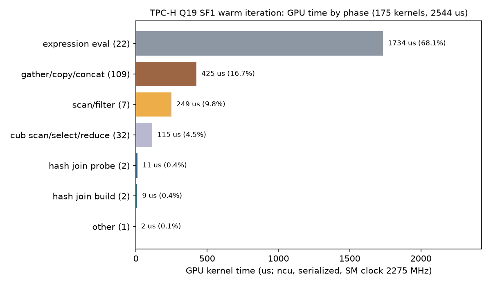
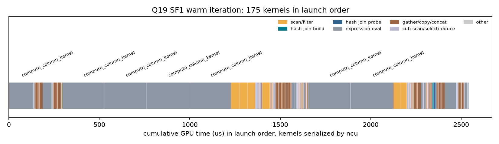
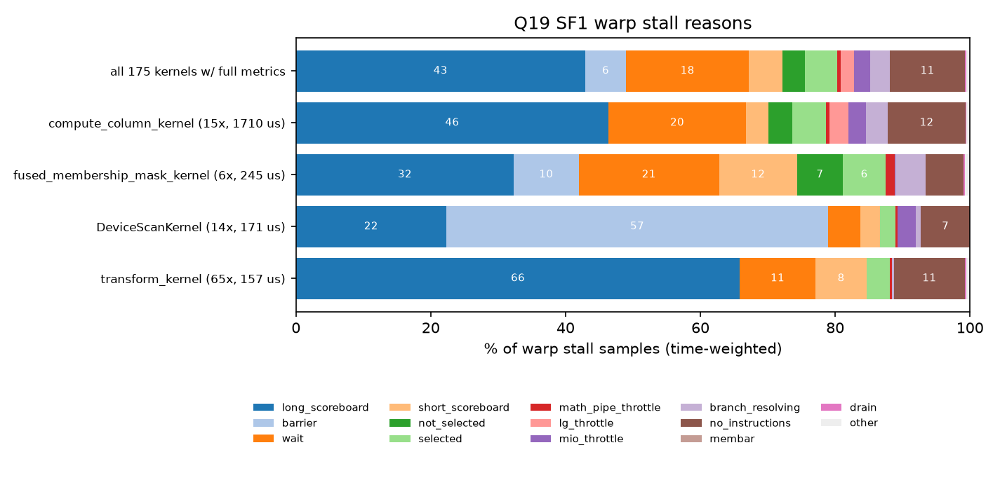
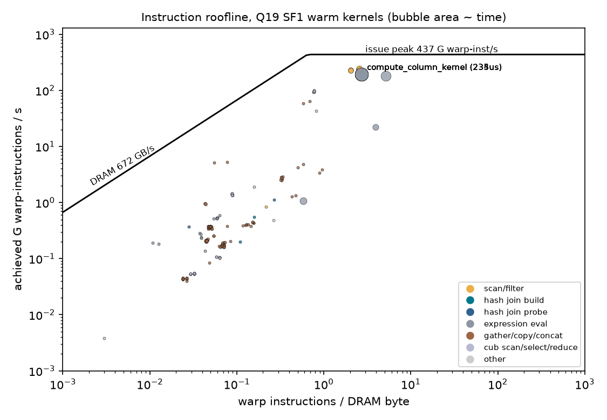

# TPC-H Q19 (SF1) on Sirius, all referenced columns pinned on GPU — Workload Analysis

**Date**: 2026-11-13
**GPU**: NVIDIA GeForce RTX 5070, 12 GB GDDR7 (192-bit, 672 GB/s), Blackwell sm_120, 48 SMs
**Workload**: TPC-H Query 19 (discounted revenue: `lineitem ⋈ part` under a three-branch OR of brand/container/size/quantity/shipmode/shipinstruct predicates, one ungrouped `sum`; constants read from `q19.sql`: Brand#41/13/55, quantities 2/14/23), scale factor 1. The 10 referenced columns of 2 tables are pinned in GPU memory with `pin_table(tier='gpu')` (247.47 MB); measured iterations read no table data from host (§3).
**Framework**: Sirius (`sirius-duckdb` release build), DuckDB v2.0, stock libcudf from the pixi env, CUDA runtime 13.5
**Pipeline**: `scripts/tpch_sf1/profile_query.sh 19` (309 s of pipeline stages: 15 s for sql/timing/pcie/selftest + 294 s for list/detail/extract/validate; `pipeline_run.log`); every number below comes from a file in this directory.
**Labels**: *measured* = read from a profiler/log file; *inferred* = derived by arithmetic or reasoning from measured data.

---

## 1. Executive Summary

- Pinned-GPU Sirius runs Q19 in **9.0 ms** warm median (min 8, max 9; 12 timed iterations) vs **25.0 ms** DuckDB-CPU (2.8x); GPU and CPU results are exactly equal (`timing_summary.txt`, *measured*). Revenue = 4332821.7153.
- No table data cross PCIe in measured iterations: per iteration 309 H2D copies / 23,256 B (largest 2,508 B), 171 D2H copies / 510 B (largest 24 B) (`pcie_verification.txt`, *measured*). `OVERALL: PASS`; negative control detects an unpinned table.
- The GPU is busy **1.851 ms** per iteration (nsys, real clocks), 23% of the 8.0 ms nsys engine window; 175 kernels, 126 of them < 5 µs (ncu pass) (*measured*).
- **One kernel family dominates**: `compute_column_kernel` (the cuDF AST expression interpreter) is 71.3% of real-clock kernel time (1293.6 of 1815.3 µs, nsys). Seven launches fill the GPU (6 over ~1.0 M lineitem rows each at 231.7–234.7 µs ncu, 1 over the 200 K part rows at 136 µs). Its hottest SASS is a byte-wise string compare loop run by 7 of 32 lanes (§8).
- Floors (`physical_floor.md`): 247.47 MB / 672 GB/s = **368.3 µs** (narrowed), 235.2 µs minimal. GPU busy is **5.03x** the 368.3 µs floor; wall is **24.4x**.

| Where the wall time goes (timing-run Sirius log medians, 1 ms stamps; `timing_summary.txt`) | ms | share of 9.0 ms |
|---|---:|---:|
| Planning (DuckDB + Sirius plan) | 3.0 | 33% |
| Engine window | 6.0 | 67% |
| of which GPU busy (nsys run: 1.851 ms, different run, ±1 ms) | ≈ 1.9 | ≈ 21% |
| Gap to next statement | 0.0 | 0% |

The ~4 ms of engine time without GPU activity is host-side orchestration (830 `cudaStreamSynchronize` calls per iteration, 5.33 ms summed CPU time over all threads, `nsys_iteration_breakdown.txt`); its causal role is *inferred*.

## 2. Workload Description

- `lineitem` 6,001,215 rows, `part` 200,000 rows (`pcie_verification.txt`). Per-table filters (DuckDB-CPU, `physical_floor.md`): `shipmode IN (AIR, AIR REG)` 858,104 (14.30%); `shipinstruct = 'DELIVER IN PERSON'` 1,500,048 (24.99%); both 214,377 (3.57%); part-side OR predicate **510 rows (0.255%)**; join with both sides pre-filtered 583 rows; final 138 rows; result 1 row (21 B).
- Plan (`query_plan.txt`, operators counted by distinct id: 15 operators ids 0–14 in 9 pipelines): 2 GPU_SCAN (ids 0, 4), 3 FILTER (ids 1, 6, 10), 1 DYNAMIC_FILTER (id 5), 1 HASH_JOIN (id 9), 1 PROJECTION (11), UNGROUPED_AGGREGATE (12), MERGE_AGGREGATE (13), RESULT_COLLECTOR (14), 2 PARTITION (2, 7), 2 CONCAT (3, 8). 1 join, 1 dynamic filter. Pipelines: part scan → FILTER(1) → partition/concat → join build; lineitem scan → DYNAMIC_FILTER(5) → FILTER(6) → partition/concat → join probe → FILTER(10) → PROJECTION → aggregate.
- **How the disjunction is evaluated** (`query_plan.txt` shows operator ids only, no expression text; the rest is *inferred*): DuckDB-side the OR is split so that each scan carries a filter (FILTER 1 on part, FILTER 6 on lineitem) and the full OR is re-checked after the join (FILTER 10). Supporting measurements: the log says the dynamic filter has **510 build rows** (`dynamic_filter_publisher`), equal to my DuckDB-CPU count of the part-side predicate; `compute_column_kernel` launches exist with grid×block ≈ part rows (1563×128 = 200,064) and ≈ lineitem rows (six grids 7807–7821, sum 46,887×128 = 6,001,536 vs 6,001,215 rows); six tiny `compute_column_kernel` launches (grid 3–4, ≈ 9.4–10.2 µs) and one 3-CTA launch (64.3 µs) are consistent with the post-join residual (inferred). All filter expressions run through the **AST expression interpreter**, string comparisons included (the SASS at §8 contains a byte loop with `LD.E.U8`). Which of the 18 predicate pieces (3 brand `=`, 12 container IN members, 3 size ranges, quantity ranges, shipmode IN, shipinstruct `=`) is evaluated in which kernel is not visible in the files.
- Pinned footprint (`traces/sirius_log_timing/*.log`, gpu_pool `allocated=` after each pin): lineitem **241,758,208 B** (40.28 B/row; l_partkey, l_extendedprice, l_discount, l_quantity, l_shipmode, l_shipinstruct), part **5,715,712 B** (28.58 B/row; p_partkey, p_brand, p_container, p_size); total **247,473,920 B**. The log does not split pinned bytes into string vs numeric; at native widths (inferred) strings are 24.29 of 52.28 B/row of lineitem (46.5% incl. offsets).

## 3. PCIe Verification (`pcie_verification.txt`: `OVERALL: PASS`)

- `sql:pin_tier_gpu` PASS (each referenced table pinned once, `tier='gpu'`); `timing_log`/`nsys_log:pin_tier_gpu` PASS (2 `CALL pin_table`, tables lineitem, part).
- `pinned_entry_per_gpu_scan` PASS in both logs: #`assigned pinned entry` == #GPU_SCAN operators (2) in every iteration, both tables present (GPU scans 2 = pinned-entry assignments 2).
- `fs_cache_zero_every_iteration` PASS: 16 summaries for 15 timing iterations, all last_cycle `reads=0 hits=0 h2d=0 miss=0`; same for the nsys run (9 for 8). `no_parquet_decode_kernels` PASS: 0 decode/decompress kernels among 1400 kernels of 8 iterations. `no_downgrade_or_spill` PASS; `pool_counters_stable` PASS (gpu_pool allocated = 247,473,920 B at every QueryBegin/QueryEnd).
- `h2d_measured_iterations` PASS: per measured iteration up to 309 copies, 23,256 B, largest 2,508 B (limits 65,536 B single, 1,048,576 B total). `d2h_measured_iterations` PASS: 171 copies, 510 B, largest 24 B (result CSV 21 B; limit 262,144 B). 3 D2D copies / 17 B. In `traces/q19_nsys.sqlite`, all post-pin H2D copies are API `cudaMemcpyBatchAsync` (5 of 2,477 are `cudaMemcpyAsync`). Per iteration, 252 of the 309 copies (≈20.1 KB of 23.3 KB, 86%) are the last copy on their stream before a `compute_column_kernel`. These include all 15 pageable copies (276–2,508 B, one per `compute_column` launch) and pinned 1–17 B copies. The rest precede `DeviceScanInitKernel` (79 B, 8 B) and `fused_concatenate_kernel` (384/56/4 B). What they carry is *inferred*: the pageable copies are probably serialised AST expression data, and the 3/6/7/8/17 B sizes match string literal lengths ('AIR', 'DELIVER IN PERSON').
- `no_host_staged_filter_publication` PASS, but the line reads "15 filter publication(s) logged … 0 carry a transport line … no transport line was logged, so this check does not show how those filters move". The log gives one "pushed 1 dynamic filter(s) … (510 build rows, 1 bound keys of 1 admitted)" line per query; the no-PCIe claim for the filter rests on the H2D byte bound and the sysmem check.
- `unified_memory` PASS: UM fault collection on, 0 faults per measured iteration, no managed-memory API calls. `no_other_host_copies` PASS.
- `ncu_sysmem_check.txt`: 175 kernels, **0** with SM (tex) sysmem-aperture sectors; the all-source counter reads 265–293 sectors per kernel (info only); pcie read/write 1,024 / 1,889,792 B (rate × duration, includes driver/ncu traffic) -> PASS. `ncu_log_checks_{list,detail}.txt`: all residency checks PASS in the 3 list runs and the detail run.
- `selftest_negative_control.txt`: with `lineitem` left unpinned `pcie_verify.py` exits 1 and reports FAILs (pinned_entry_per_gpu_scan "1 assigned for 2 GPU_SCANs", decode kernels found, H2D 45.3 MB/iteration) -> `SELFTEST: PASS`. This shows detection of an unpinned table; it says nothing about other leak routes.
- Pin phase (not measured iterations): H2D 425 copies, 45,725,995 B, largest 1,048,576 B; D2D 24 copies / 13.4 MB; D2H 367 copies / 1.33 MB. GPU memory: pinned 247,473,920 B; gpu_pool high-water **730,986,460 B** (process-lifetime mark incl. pin phase).

## 4. Environment

| Component | Version / setting |
|---|---|
| GPU / driver | RTX 5070 (sm_120, 48 SMs, 12 GB, 48 MB L2) / 580.173.02 (copied from the Q12 report; not re-queried) |
| Nsight Compute | via `sudo -n`; `--set full --import-source yes` on all 175 warm kernels (version copied from Q12 report, not re-queried) |
| ncu clocks | locked by ncu: SM median 2275 MHz (`ncu_extract_summary.txt`) |
| Nsight Systems | 2025.5.2 (`/home/sai/nsight-systems-2025.5`); `-t cuda -s none --cpuctxsw=none` plus UM page-fault collection |
| CPU | Intel i9-13900K, 125 GB RAM (copied from the Q12 report; not re-queried) |
| Sirius config | `scripts/tpch_sf1/sirius.yaml`: 4 pipeline threads, GPU pool 25% of 12 GB, 1 GB pinned host pool (2 pools), `enable_duckdb_fallback=false` |

## 5. Physical Floor vs Measured

| Quantity | Value | Source |
|---|---:|---|
| Floor A (247.47 MB pinned, once) | 368.3 µs | `physical_floor.md` |
| Floor A' native widths (inferred 320.1 MB) | 476.3 µs | same |
| Floor A-min (predicate bytes only, ≈158.1 MB) | 235.2 µs | same |
| Floor B (A + 12.0 MB materialisation, inferred) | 386.1 µs | same |
| Launch-count bound: 175 × ~2 µs (2 µs from Q2, not re-measured; inferred) | ~0.35 ms | same |
| GPU busy per iteration (nsys, real clock) | 1.851 ms | `nsys_iteration_breakdown.txt` |
| Kernel time per iteration (nsys, mean) | 1815.3 µs | same |
| Wall median (timing run) | 9.0 ms | `timing_summary.txt` |

Ratios (recomputed): GPU busy / floor A = 5.03x; / A' = 3.89x; / A-min = 7.87x; kernel time / floor A = 4.93x; wall / floor A = 24.4x; wall / A-min = 38.3x. (Wall and GPU busy come from different runs, so the ratio wall/busy = 4.9x is approximate.) ncu serialized time is 2544.4 µs and is kept apart (clock-locked, L2 flushed). ncu cold-L2 DRAM traffic summed over kernels is 141.74 MB (57.3% of the pinned bytes): the work does not even read all pinned columns at DRAM level, but the kernels that dominate time are far from the bandwidth ceiling (§7). The gap is **not memory-floor-bound**: the 368 µs floor is 20% of GPU busy time and 4% of wall.

## 6. Kernel, Phase and Operator Breakdown

From `phase_breakdown.txt` / `operator_breakdown.txt` (ncu full pass, serialized; total 2544.4 µs, 175 kernels):

| Phase | Kernels | ncu µs | % |
|---|---:|---:|---:|
| expression eval | 22 | 1733.5 | 68.1 |
| gather/copy/concat | 109 | 425.0 | 16.7 |
| scan/filter (dynamic-filter membership probe) | 7 | 249.2 | 9.8 |
| cub scan/select/reduce | 32 | 115.0 | 4.5 |
| hash join probe / build | 2 / 2 | 11.1 / 9.0 | 0.4 / 0.4 |
| other | 1 | 1.5 | 0.1 |

Operators: expression AST 15 kernels 1709.7 µs (67.2%); gather: strings 42 / 260.4 µs (10.2%); dynamic filter membership probe 6 / 245.2 (9.6%); gather/scatter fixed-width 62 / 150.3 (5.9%); cub/thrust select/compact 31 / 112.4 (4.4%). Hash join total (build + probe + output + table init) 4 kernels, 20.1 µs. No `other:` rows; `kclass.py` not edited.

Counts (`phase_breakdown.txt` footer, *measured*): 126 kernels < 5 µs, 146 < 10 µs (471.4 µs = 18.5% of ncu time); 156 kernels have < 1 wave (709.7 µs); 153 have grid < 48 CTAs; 81 have grid = 1 (`ncu_warm_metrics.json`). Only 19 kernels reach ≥ 1 wave (§7). Top-10 kernels = 66.6% of ncu time.

Real-clock (nsys, per iteration): compute_column 1293.6 µs (71.3%), fused_membership_mask 203.7 (11.2%), DeviceScanKernel 97.0 (5.3%), transform_kernel 71.8 (4.0%), DeviceSelectSweep 62.0 (3.4%), gather_chars 33.9 (1.9%).





## 7. Top Kernels (ncu `--set full`, serialized, clock-locked, L2 flushed per kernel)

| Family | Launches | ncu µs (share) | Fills GPU? | Notes (`top_kernel_details.txt`, `ncu_warm_metrics.json`) |
|---|---:|---:|---|---|
| compute_column_kernel | 15 | 1709.7 (67.2%) | 7 launches ≥ 1 wave: 6 × 18.1 waves (231.7–234.7 µs), 1 × 3.62 waves (135.9 µs) | SM/LSU 80.2%, DRAM 10.8% (71 GB/s), IPC 1.79, occupancy 71.3 of 75%, 56 regs, 29.0 of 32 lanes active |
| fused_membership_mask_kernel | 6 | 245.2 (9.6%) | 6 launches, 16.3 waves, 36–44 µs | DRAM 14.0–17.1% (92–113 GB/s), IPC 2.2–2.3, 17.95 of 32 lanes (14.9 in the two 36 µs launches) |
| DeviceSelectSweepKernel | 16 | 90.5 (3.6%) | 6 launches at 1.81 waves (8.2–8.8 µs) | the best DRAM% over all 175 kernels is here: 19.76% (pos 50, 129 GB/s) |
| DeviceScanKernel | 14 | 171.3 (6.7%) | none (grid 1–3 CTAs, 12.2 µs average) | 12 of 14 single-CTA, latency-bound |
| transform_kernel | 65 | 157.0 (6.2%) | none (grid ≤ 29, 2.4 µs average) | |
| gather_chars_fn_char_parallel | 14 | 67.3 (2.6%) | none | |

Families that reach ≥ 1 wave: compute_column_kernel, fused_membership_mask_kernel, DeviceSelectSweepKernel — 19 launches, 1834.8 µs (72.1% of ncu time). **No kernel is near the 672 GB/s ceiling** (max 19.76% DRAM, 129 GB/s). The AST kernel is limited by instruction/LSU issue: LSU pipe 81.4%, ALU 18.5%, FMA 4.3%, L1 hit 94.6% (cold L2 hit 20.4%), DRAM 16.7 MB per launch = 71 GB/s. Time-weighted stall mix over all kernels: long_scoreboard 42.9%, wait 18.2%, no_instructions 11.1%, barrier 6.1%, short_scoreboard 5.0%, selected 4.9% (`ncu_extract_summary.txt`).





## 8. Instruction-Level Evidence for the #1 kernel (`sass/compute_column_kernel_hotspots.txt`, pos 25, 234.7 µs)

Kernel: `cudf::compute_column_kernel<128, 0, 1>`, grid 7813 × 128 = 1,000,064 threads (one lineitem batch, *inferred*). 28,752 static instructions, only **337 (1.2%)** ever executed; 4.528e7 warp instructions / 31,252 warps = **1,449 warp instructions per 32-row warp** (45 per row-equivalent); 7.5e6 global load requests = 240 per warp. Class mix (executed): integer arithmetic 49.3%, control flow 18.8%, global load 15.3%, const load 6.6%.

**Hotspot 1 — string compare loop** (+0x45400…+0x45450; 3,465 of the kernel's 24,807 stall samples):
```
+0x45400 exe=531284 thr=7.0  LD.E.U8 R5, [R16.64]
+0x45410 exe=531284 thr=7.0  LD.E.U8 R22, [R20.64]
+0x45430 exe=531284 thr=7.0  ISETP.NE.U32.AND P1, PT, R5, R22, PT   <- 2832 samples (11.4%), long_sb=2799
+0x45440 exe=531284 thr=7.0  @P1 BRA 0x…0454b0
+0x45450 exe=531284 thr=7.0  IADD R18, R18, 0x1
```
Register by register: the stalled `ISETP` reads R5 (written by the load at +0x45400) and R22 (written at +0x45410), both in the window, so it waits on two byte loads. The branch on P1 exits on the first mismatch, so the next iteration's loads issue only after the compare resolves (control dependency from the code shape; *inferred* as a serialised chain). Entries: +0x453b0 executes 31,252 times (one per warp), the loop body 531,284 times = **17.0 iterations per entry**, equal to the length of `'DELIVER IN PERSON'` (17 chars) — *inferred* that this loop is the `l_shipinstruct` equality; at the loop 7 of 32 lanes are active (22%), vs 29.0 kernel-wide. The six window instructions take 3,465 samples (14.0%) for 7.0% of warp-instruction executions (3.19e6 of 4.528e7). Lane inactivity is *inferred* to come from earlier predicates / length checks short-circuiting rows (the 24.99% shipinstruct selectivity ≈ 8 of 32 lanes is a plausibility argument, not a measurement).

**Hotspot 2 — pointer chase** (+0x52090…+0x520f0, 187,512 executions at 31 lanes; 372 + 634 + 931 samples at +0x520b0, +0x520e0 and +0x520f0):
```
+0x52090 LDG.E   R33, [R32.64+0xc]
+0x520a0 LDC.64  R20, c[0x0][0x3a0]
+0x520b0 IMAD.WIDE R20, R33, 0x20, R20      <- reads R33 (load above) and R20 (LDC)
+0x520c0 LDG.E.64 R22, [R20.64+0x10]        <- reads R20
+0x520e0 LD.E    R17, [R22.64]              <- reads R22, long_sb=565
+0x520f0 ISETP.GT.AND P0, PT, R24, 0x14     <- 931 samples, long_sb=921; reads R24, not R17
```
R33 → R20 → R22 → R17 is a three-load dependent chain (verified register by register within the window): index, descriptor address (0x20-byte stride), pointer, value. The stalled `ISETP` at +0x520f0 reads R24; **its producer is outside the window**, and R17's consumer is also outside it. Interpreting the chain as AST node/operand-descriptor traversal is *inferred* from the 0x20 stride and the kernel name. The block at +0x52070/+0x52080 has `exe=0` and is not part of the per-row chain.

Stall mix for the kernel: long_scoreboard 44.8%, wait 21.4%, no_instructions 10.6%, selected 5.2%, not_selected 4.0%, branch_resolving 3.3%, mio 3.2%, lg 3.2%.

## 9. Root Cause Analysis

**A. `compute_column_kernel` — 71.3% of real-clock kernel time (1293.6 µs, nsys)**
- Symptom: 6 launches of 231.7–234.7 µs (ncu) over the 6.0 M lineitem rows, 1 over the 200 K part rows (135.9 µs) (*measured*).
- WHY 1: 1,449 warp instructions and 240 global-load requests per 32-row warp, with LSU pipe at 81.4% and DRAM at 10.8% (*measured*): instruction/LSU issue bound, not bandwidth bound.
- WHY 2: the instruction stream is dominated by generic per-row evaluation: 17-iteration byte loop at 7 lanes (§8, *measured* counts, mapping to `'DELIVER IN PERSON'` *inferred*) plus dependent descriptor loads (§8, *measured* chain, meaning *inferred*).
- WHY 3: the string predicates (`l_shipmode IN`, `l_shipinstruct =`) are evaluated inside the AST interpreter over all 6,001,215 rows (grid sizes sum to 6,001,536 threads; *measured*), before the 3.57% that survive (*measured* in DuckDB-CPU) are known.
- ROOT: a general expression interpreter does string compares char by char through generic pointers. The part-side filter costs 3,971 warp instructions per warp (2.48e7 / 6,252 warps) vs 1,449 for lineitem: 2.7x more per row for the 3-branch brand/container/size OR (*measured*; attribution to the branches *inferred*). The cost is instruction count per row, not data volume (16.7 MB per 1 M-row launch).

**B. `fused_membership_mask_kernel` — 11.2% (203.7 µs nsys), 6 launches**
- Symptom: 36–44 µs per launch, 16.3 waves, 92–113 GB/s (14–17% DRAM peak) (*measured*).
- WHY 1: top stall +0x00350 (13.3%) `ISETP.NE.U32 R4` right after `LDG.E.U8 R4, [R4.64]` at +0x00340 (same register, long_sb=579; a byte load, *inferred* null/validity bit), and +0x02fa0 (12.3%) `IMAD R0, R30, -0x3d4d51c3, R3` four instructions after `LDG.E R30, [R30.64]` at +0x02f60 (it reads R30) (key load feeding the hash multiply; constants look like xxHash32 primes, *inferred*), executed by 5 of 32 lanes.
- WHY 2: 13.6% of stall samples are barrier stalls, 398 of them (9.0%) at +0x3ece0 (block-level `BAR.SYNC` after a `REDUX.SUM`; purpose *inferred*, mask-to-count reduction).
- ROOT: a per-row hash probe of 510 build keys (*measured*, log) is load-latency bound with few active lanes; it is not bandwidth-limited. The +0x03630…+0x037d0 region (bucket-slot loads at +0x4/+0x8/+0xc, exe 32,471 → 23,106 → 11,502 at 3 → 1 → 1 lanes) is the in-bucket probe continuation where lanes thin out, not a second probe round; no instruction in the second-round block (+0x12600…+0x12c30) executes in this launch.

**C. Latency tail: 126 kernels < 5 µs (ncu), 81 single-CTA kernels, 830 syncs per iteration**
- Symptom: GPU busy 1.851 ms of an 8.0 ms engine window (nsys) (*measured*).
- WHY 1: 109 gather/copy/concat kernels (425.0 µs ncu), 14 `DeviceScanKernel` of 1–3 CTAs (12 single-CTA; 12.2 µs average) and 65 `transform_kernel` (2.4 µs) are tiny, serial and sub-wave (*measured*).
- WHY 2: they handle 510 build rows and ~100 post-filter rows per batch, so each carries a fixed launch/latency cost (*inferred*).
- ROOT: at SF1 the engine runs ~175 launches and 830 stream syncs for ~0.2 M surviving rows (214,377 rows pass both lineitem string filters, DuckDB-CPU); per-launch latency, not work, sets this tail (*inferred*; nsys measures only call counts and summed CPU time).

## 10. Gap Analysis

| Step | Time | Source |
|---|---:|---|
| Memory floor (A) | 0.368 ms | `physical_floor.md` |
| + AST interpreter instruction cost beyond bandwidth (compute_column 1.294 ms vs its ~0.1 GB DRAM traffic ≈ 0.16 ms at peak, *inferred*) | ≈ +1.1 ms | nsys, ncu DRAM |
| + membership probe 0.204 ms, scans/select/transform/gather ≈ 0.32 ms | ≈ +0.5 ms | nsys |
| GPU busy (not the sum of the rows above: 0.368 + 1.1 + 0.5 = 2.0 ms > 1.851 ms, because the floor overlaps the kernel rows) | 1.851 ms | nsys |
| + host orchestration, syncs, planning (wall 9.0 ms; different run) | ≈ +7.1 ms | `timing_summary.txt` |

The rows above are components, not additive: the floor overlaps the kernel times. `compute_column_kernel` (1.294 ms) plus the membership probe and tail kernels (0.204 ms + about 0.32 ms) sum to 1.818 ms, i.e. the 1815.3 µs of kernel time; the remaining ~0.03 ms of GPU busy is copies/memsets. The 0.368 ms floor is 19.9% of GPU busy and 4.1% of wall. Of the 9.0 ms wall, 3 ms is planning and ~4 ms engine time with no GPU activity (*inferred* host-side).

## 11. Optimization Directions (general-purpose; no query-specific fusion)

1. **Library-level string predicates**: add a native cuDF string equality/IN-list path inside the expression evaluator (word-wise or length-first compare, dictionary/hash for short IN lists) so `compute_column` stops running byte loops; targets 71% of kernel time. Target the 1,449 → ~few hundred warp instructions per warp (*estimate*, not measured).
2. **Reduce interpreter overhead generally**: stage AST node records in shared/constant memory so the 3-deep dependent load chain of §8 leaves the per-row path; target 240 loads per warp.
3. **Ordering of filters**: apply the cheap, selective predicate first (dynamic-filter membership, 510 build keys; or 14.3% shipmode) so the expensive string predicates see fewer rows; a scheduling policy, not a fused kernel.
4. **Batch size / fewer sync points**: larger scan batches (6 per table here) and fewer small kernels for gather/scan reduce the 175 launches and 830 syncs; fusion of operators is noted as context only and is not recommended.
5. Hash probe: improve latency hiding in `fused_membership_mask_kernel` (more independent rows per thread); small effect (11%).

## 12. Determinism and Profiling Method

- **Launch counts are deterministic** (*measured*, `warm_kernel_summary.txt`, `ncu_plan.json`): 175 launches per iteration in the three ncu list runs (1121/1296/1471 total) and in all 8 nsys iterations; `STABLE: True`.
- **Launch order is not**: x5 iteration 4 vs 5 differ at 79 positions, x4 vs x5 prefix at 278; the slice needs only counts and multisets (`ncu_slice_check.txt`).
- **ncu policy branch**: 175 ≤ `NCU_FULL_MAX` (1000) → `full_all` (`--set full --import-source yes` on all 175, skip 1296); the light + families branch was not used.
- nsys: 5 measured iterations (4–8), 175 kernels each, GPU busy 1.835–1.869 ms (median 1.851); the nsys engine window (8.0 ms) is larger than the timing log's 6.0 ms, so wall splits come from the timing log.
- Timing: 3 warmups + 12 timed iterations; DuckDB-CPU same protocol (first 28.0 ms, median 25.0). Result compare: `exact` across 15 GPU iterations and vs CPU (max rel diff 0.0, tol 1e-9; bitwise identical).
- ncu durations are serialized, clock-locked and L2-flushed per kernel; never summed with nsys times.
- Validation (`validate_pipeline.txt`): 72 PASS, 0 FAIL, 1 PENDING (this report).

## 13. Limitations

- ncu serialized sum 2544.4 µs vs nsys kernel time 1815.3 µs (1.40x); tiny kernels are overstated by ncu. All real-clock claims use nsys. Two ncu passes disagree slightly on counts (< 5 µs: 126 in the full pass vs 120 in the list pass); full pass figures are used.
- ncu DRAM bytes are cold-L2 traffic. One L2 hit rate (pos 55) read 102.8% and is clamped to 100 (`ncu_warm_metrics.json`, raw kept).
- Wall splits are 1 ms stamps; the GPU-busy share of wall mixes two runs (±1 ms).
- Which scan/batch each launch handles is *inferred* from grid × block. The 57-CTA `compute_column` launch (pos 11, 47.9 µs, ≈ 7,296 rows) and the ~64 µs 3-CTA launch (pos 153) are **unidentified**: no selectivity I measured matches them. The post-join residual assignment of the 3–4-CTA launches is *inferred*.
- Expression text of the three FILTERs is not in `query_plan.txt`; how the OR is split is *inferred* (§2).
- What the loads in §8 fetch, why lanes are inactive (7 of 32), and that the 17-iteration loop is the shipinstruct compare are *inferences*. The R24 producer at +0x520f0 and the R17 consumer are outside the quoted window.
- SASS covers the top 2 families (compute_column, fused_membership_mask); other kernels rest on ncu metrics only. Pinned string/numeric byte split is not in the log; native widths (52.28 B/row lineitem) are inferred; the ~2 µs smallest-kernel figure is carried over from Q2, not re-measured.
- Only the pinned configuration was profiled; the 1e-9 tolerance was not exercised. The 45.7 MB pin-phase H2D vs 247.5 MB pinned footprint is not explained by the files (presumably compressed Parquet decoded on GPU; *inferred*).

## 14. Raw Data

| File | Contents |
|---|---|
| `timing_summary.txt`, `timing.json`, `result.csv`, `traces/timing_run.txt`, `traces/duckdb_cpu_run.txt` | timing, result, CPU baseline, compare mode |
| `query_plan.txt`, `sql/` | Sirius plan, generated SQL |
| `pcie_verification.txt`, `pcie.json`, `traces/q19_nsys.{nsys-rep,sqlite}`, `traces/sirius_log_*` | PCIe evidence |
| `ncu_sysmem_check.txt`, `ncu_log_checks_{list,detail}.txt`, `selftest_negative_control.txt`, `selftest/` | host-memory-in-place, residency checks, negative control |
| `nsys_iteration_breakdown.{txt,json}` | GPU busy, API counts, real-clock kernel times |
| `warm_kernel_list.json`, `warm_kernel_summary.txt`, `ncu_plan.json`, `traces/ncu_list_x{3,4,5}.csv` | list passes, determinism, plan |
| `profiles/q19_warm_full.ncu-rep`, `ncu_slice_check.txt` | full ncu report (175 kernels) |
| `ncu_warm_metrics.json`, `ncu_extract_summary.txt`, `phase_breakdown.txt`, `operator_breakdown.txt`, `top_kernel_details.txt` | extracted metrics |
| `sass/` | hotspots for `compute_column_kernel` and `fused_membership_mask_kernel` |
| `plots/q19_*.png` | phase breakdown, kernel sequence, roofline, stall mix |
| `physical_floor.md`, `pipeline_run.log`, `validate_pipeline.txt` | floor, logs, validation |
