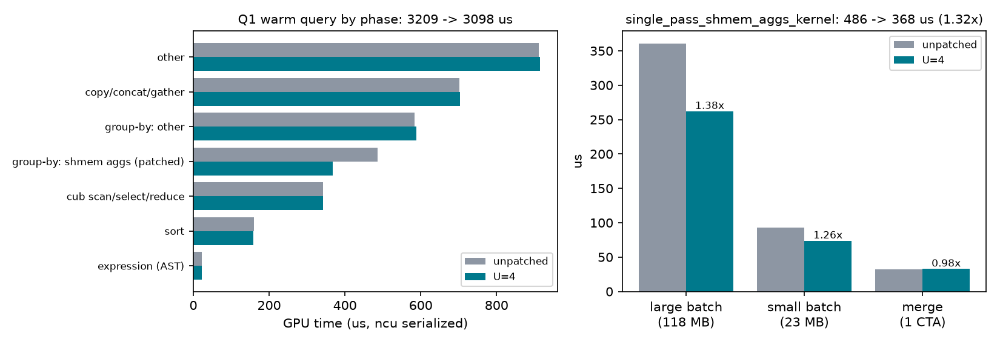

# TPC-H Q1 SF1 on Sirius: group-by aggregation with U=4 row unrolling

RTX 5070 (sm_120, 48 SMs, 672 GB/s), lineitem pinned on the GPU, warm query (iteration 5), profiled with
ncu `--set full` (serialized kernels, SM clock locked at ~2.27 GHz). Baseline results for the shipped
library are in `../q1/`.

## What changed

One function in cuDF v26.10.02 (`cpp/src/groupby/hash/compute_shared_memory_aggs.cu`,
`compute_pre_aggregations`, the row loop of `single_pass_shmem_aggs_kernel`), patch in `u4_unroll.patch`:

- Each thread takes **U = 4 rows** per batch, from 4 consecutive grid-stride iterations
  (`row = base + r*stride`). Every row stays in the block whose shared-memory hash set gave it its
  local slot, so the block-local `local_mapping_index` stays valid.
- For each column the type/aggregation dispatch runs **once per 4 rows** (was once per row).
- For SUM / MIN / MAX on fixed-width columns (`shmem_batch_aggregator<U>`): issue all 4 null checks and
  value loads first, then the 4 shared-memory atomics. Other aggregation kinds keep the original
  per-row path, called for each of the 4 rows.

The kernel goes from 72 to 91 registers. That still fits 5 CTAs per SM, so cuDF's grid stays at 240 x 128.

## Method

| Library | What it is |
|---|---|
| `pixi` | The shipped conda `libcudf 26.10.02` (used for `../q1/`) |
| `orig` | cuDF v26.10.02 built here, same toolchain as `u4`, **no patch**: the control |
| `u4` | Same build plus the patch |

- Build: pixi CUDA 13.5, conda gcc 15, sm_120 only, Release; `libs/` keeps both `.so` files.
- `orig` and `u4` are loaded with `LD_PRELOAD` (`CUDF_PRELOAD=` in `scripts/run_q1.sh`). The pixi env is unchanged.
- Correctness: Q1 output is byte-identical for `pixi`, `orig` and `u4` (4 groups x 3 iterations, same md5).
- Profiling: `RUN_TAG=_{orig,u4} scripts/ncu_profile_q1.sh pin`, three passes as before. Each warm query has 186 kernels.

## Results (orig vs u4, ncu)

| | orig | u4 | change |
|---|---:|---:|---:|
| `single_pass_shmem_aggs_kernel`, all 3 launches | 485.6 us | 368.5 us | **1.32x** (-117 us) |
| large batch (117.9 MB DRAM) | 360.5 us, 327 GB/s | 262.0 us, 450 GB/s | 1.38x |
| small batch (23.3 MB DRAM) | 93.1 us, 250 GB/s | 73.7 us, 316 GB/s | 1.26x |
| merge (1 CTA) | 32.0 us | 32.7 us | 0.98x |
| warp instructions (large batch) | 4.10e7 | 3.02e7 | -26% |
| IPC (large batch) | 1.07 | 1.32 | |
| achieved / theoretical occupancy | 41 / 58% | 41 / 42% | |
| long_scoreboard share of stalls | 48% | 42% | |
| whole warm query, GPU kernel time | 3,208.7 us | 3,097.8 us | -3.5% |

- **Repeatability.** Across all 5 iterations of the lightweight ncu pass, the shmem-aggs total per query
  is 481.7–485.3 us for orig and 352.7–368.3 us for u4. The warm median is 483.1 → 364.0 us
  (`shmem_kernel_all_iterations.txt`).
- **Other kernels are within ±1%.** No other phase changed.
- **Wall clock can't resolve this.** DuckDB's `.timer` has 1 ms resolution. Medians over 57 warm runs
  each are pixi 12 ms, orig 11 ms, u4 12 ms (means 12.49 / 11.35 / 11.77). The ~0.1 ms saving is below
  that resolution (`wall_times.txt`).

Large batch against its floor: 117.9 MB at 672 GB/s = 175 us. u4 reaches 262 us (67% of peak), up from
360.5 us (49%).

## SASS evidence (large-batch launch, `sass/`)

From ncu per-instruction counts:

| | orig | u4 |
|---|---:|---:|
| column-descriptor loads (`LDG.E [desc+0x28]` etc., per row x column) | 574,756 each | 147,911 each (÷3.9) |
| hot `ATOM.E.ADD.64.STRONG.SYS` executions | 412,242 (one site) | 4 sites, ~102–107k each (same total) |
| control-flow instructions executed | 1.13e7 (27.6%) | 5.72e6 (19.0%) |
| global-load instructions executed | 3.55e6 | 1.07e6 |
| hottest instruction's stall share | ATOM 38.5% | ATOM 29.3% |

**Load order in u4.** Each column issues 4 null-mask `LD.E` loads and 4 value `LD.E.64` loads
(0x...f520–0x...f990) before the first atomic (0x...0020). In orig, each atomic directly follows its
own single `LD.E.64` (0x...99e0 → 0x...9a80).

## Finding: the shipped library is 3.4x slower on this kernel, and unrolling is not why

The same kernel from the shipped conda `libcudf` takes **1,358 us** on the large batch, against
360.5 us for the unpatched local build. Same source, same 72 regs, same ~4.1e7 instructions, same clock.

It reproduces in back-to-back runs (`ncu --metrics`, large batch):

| | pixi | orig (local) |
|---|---:|---:|
| duration | 1,280–1,356 us | 367 us |
| SM active cycles: avg / max / min | 1.16M / 3.12M / 0.75M | 0.80M / 0.84M / 0.77M |

In the shipped build one SM runs about 2.7x longer than the average, so the kernel waits on a tail. Its
average SM is also about 45% busier for the same instructions. The local build is balanced.

The cause is not identified. Candidates are differences in compiler version, flags, or the CCCL atomic
implementation between the conda build and this one. A full-library SASS dump of the conda `.so` was
too slow to finish (stopped after 10 min).

Consequences:

- **The `../q1/` numbers are still correct for the shipped library.** That includes group-by at ~50% of GPU time and this kernel at 1.6 ms.
- **Most of that kernel time is this build artifact, not the load→atomic pattern.** The 5x gap between our microbenchmark and the "real" kernel was largely this effect. The local build (486 us) is within 1.4x of the microbenchmark baseline (350 us).
- **Against the shipped library, U=4 looks like 1,626 → 368 us (4.4x).** That number is misleading. The gain attributable to unrolling is the controlled one: **1.32x**.

## Limits

- Only this kernel is patched. Group-by's other kernels (hash / mapping indices, 492 us) and the rest of the query are unchanged.
- Validated only on Q1 (SUM on int64/decimal carriers, nullable inputs).
  - MIN/MAX use the same batched path but were not exercised.
  - COUNT and the other kinds keep the original per-row path.
  - No cuDF unit tests were run.
- U is fixed at 4 at compile time (`SHMEM_AGGS_UNROLL`); U=8 for narrow columns was not tried here.
- ncu durations are at the locked 2.27 GHz clock; at boost clock all kernels are shorter.

## Files

- `REPORT_q1_u4.md`, `comparison.txt`, `q1_u4_vs_orig.png`, `shmem_kernel_all_iterations.txt`, `wall_times.txt`, `u4_unroll.patch`
- `sass/shmem_aggs_{orig,u4}_hotspots.txt`, `sass/shmem_aggs_{orig,u4}_inst_inventory.csv`
- `../../../profiles/q1_sf1_pinned_{orig,u4}_warm_full.ncu-rep`, `../../../traces/ncu_{orig,u4}_warm_full.json`
- Libraries and build: `/home/sai/cs254_project/cudf_u4/libs/`, source at `/home/sai/cs254_project/cudf_u4/cudf` (branch `q1-unroll-u4`)
