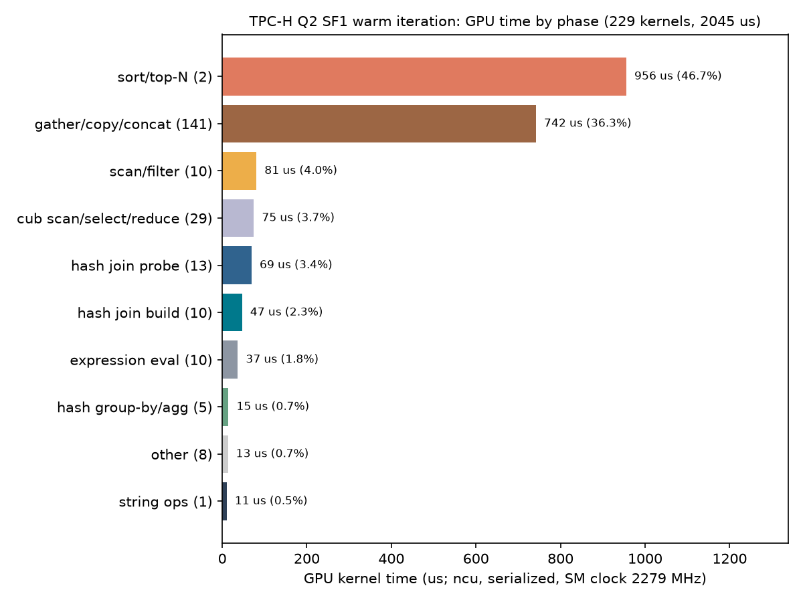
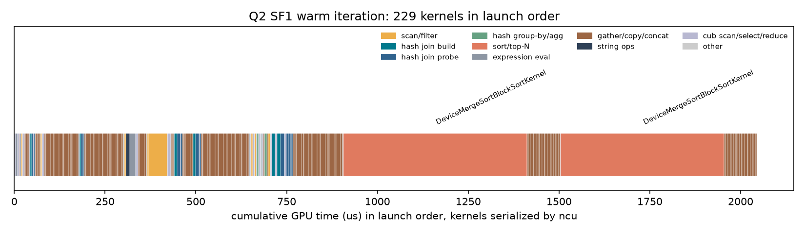
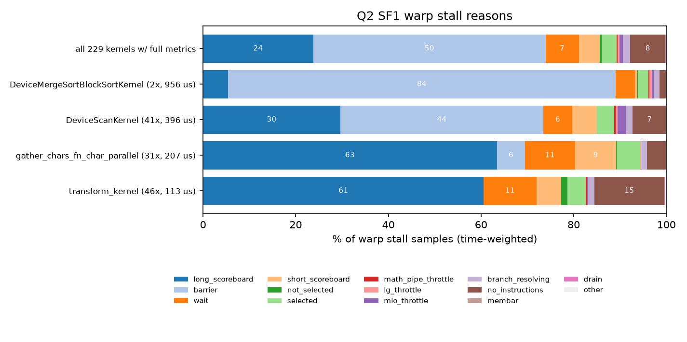
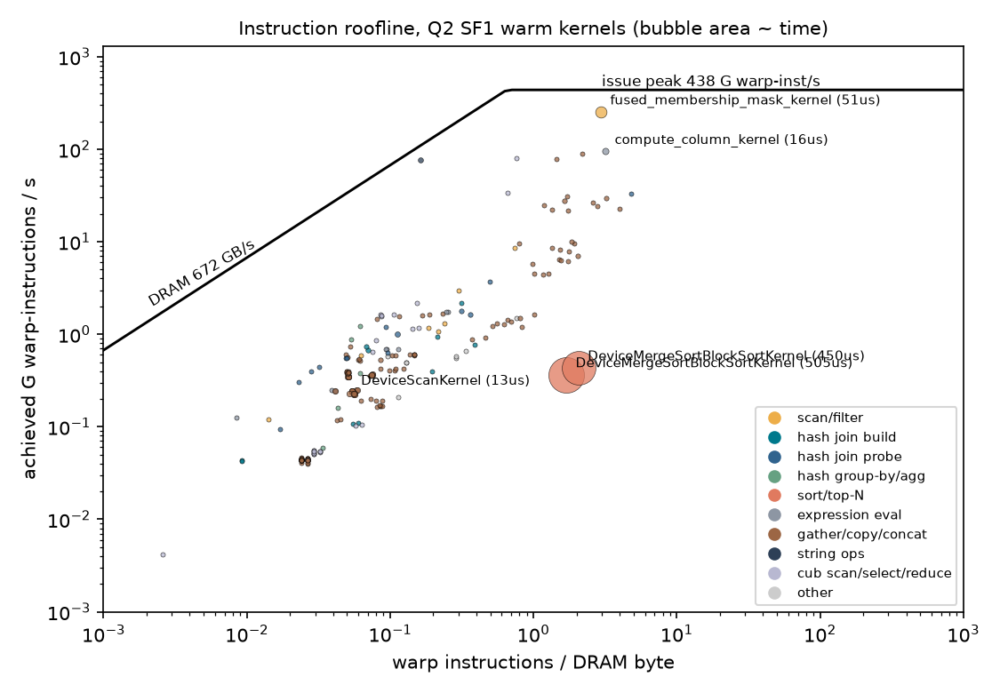

# TPC-H Q2 (SF1) on Sirius, all referenced columns pinned on GPU — Workload Analysis

**Date**: 2026-11-13
**GPU**: NVIDIA GeForce RTX 5070, 12 GB GDDR7 (192-bit, 672 GB/s), Blackwell sm_120, 48 SMs
**Workload**: TPC-H Query 2 (minimum-cost supplier: 5-table join + correlated MIN subquery + ORDER BY … LIMIT 100), scale factor 1. All 19 referenced columns of `part`, `supplier`, `partsupp`, `nation`, `region` are pinned in GPU memory with `pin_table(tier='gpu')` (18.96 MB); measured iterations read no file and copy no table data host→device (§3).
**Framework**: Sirius (`sirius-duckdb` release build), DuckDB v2.0, stock libcudf from the pixi env, CUDA runtime 13.5
**Pipeline**: `scripts/tpch_sf1/profile_query.sh 2` (6.4 min end-to-end); every number below comes from a file in this directory.
**Labels**: *measured* = read from a profiler/log file; *inferred* = derived by arithmetic or reasoning from measured data.

---

## 1. Executive Summary

A warm Q2 takes **10.5 ms end-to-end** (median of 12 timed runs after 3 warmups, range 10–12 ms, `.timer` 1 ms resolution; *measured*, `timing_summary.txt`). DuckDB on the CPU takes 16.0 ms for the same query (results identical, 100 rows). The physical floor is **28 µs** (read the 18.96 MB of pinned columns once at 672 GB/s), so Sirius is **~370× above the floor**. The GPU is not where most of that time goes:

| Where the 10.5 ms go (median warm iteration; medians of 1 ms stamps, so rows sum to ~11) | ms | Source |
|---|---:|---|
| Planning (DuckDB optimizer + Sirius plan build) | 3 | Sirius log, *measured* (1 ms stamps) |
| Gap from `QueryEnd` to the next statement (result fetch and printing) | 1 | Sirius log, *measured* |
| Engine window with the GPU **idle** (host orchestration) | ~5.7 | engine 7 ms (log) − GPU busy 1.32 ms (nsys), *inferred* |
| GPU busy (kernels + copies, real clocks) | **1.32** | nsys, *measured* |

Inside the 1.32 ms of GPU time (nsys, 229 kernels per iteration, deterministic):

1. **Top-N sort: 0.72 ms = 58% of kernel time** (`DeviceMergeSortBlockSortKernel`, 2 launches: TOP_N and MERGE_TOP_N). Each launch is **one 256-thread CTA on one of 48 SMs** that sorts ≤ 485 row indices with cuDF's generic lexicographic row comparator. 83.9% of its stall samples are warps parked at `BAR.SYNC` while the warp that holds the rows walks a ~170 K-instruction dependent chain (generic loads, per-byte string compares with 1 active thread, local-memory spills) at IPC 0.16. The data it touches is 0.11 MB; DRAM throughput is 0.0% of peak.
2. **String gathers: 0.31 ms = 25%** (111 kernels in ncu; offset scan init + offset scan + char gather per string column per join output). Every `DeviceScanKernel` here is a single CTA (grid = 1) and lasts ~4 µs at real clocks for a few thousand rows.
3. Everything else (5 hash joins, dynamic filters, the MIN group-by, casts, compaction): ~0.21 ms over ~116 kernels.

The kernels move only **17.6 MB of DRAM traffic** in total (ncu, all 229 kernels) — about the floor's 18.96 MB — yet take 47× the floor. Q2 at SF1 is **latency- and launch-bound, not bandwidth-bound**: 134 of 229 kernels run a single CTA (75% of serialized GPU time), 226 of 229 run less than one wave, 149 run < 5 µs. Only 3 kernels fill the GPU (≥ 1 wave).

---

## 2. Workload Description

**Query** (`sirius/test/tpch_performance/tpch_queries/orig/q2.sql`): parts with `p_size = 41 AND p_type LIKE '%NICKEL'`, their suppliers in region `EUROPE` whose `ps_supplycost` equals the minimum supply cost for that part over all EUROPE suppliers; output 8 columns (`s_acctbal, s_name, n_name, p_partkey, p_mfgr, s_address, s_phone, s_comment`), `ORDER BY s_acctbal DESC, n_name, s_name, p_partkey LIMIT 100`.

**Row counts and selectivities** (DuckDB-CPU on the same Parquet; *measured*):

| Step | Rows |
|---|---:|
| part / supplier / partsupp / nation / region | 200,000 / 10,000 / 800,000 / 25 / 5 |
| part after `p_size = 41` | 4,022 (2.0%) |
| … and `p_type LIKE '%NICKEL'` | 834 (0.42%) |
| suppliers in EUROPE | 1,987 |
| partsupp ⋈ EUROPE suppliers | 158,960 |
| … restricted to the 834 parts | 662 |
| rows reaching ORDER BY / LIMIT | 485 |
| result | 100 (16.5 KB as CSV) |

**Sirius plan** (`query_plan.txt`; *measured*): 34 pipelines. Each base table is scanned **once** per query: Sirius logs `Computed 1 subquery aggregate(s) from the delim join's outer rows instead of rescanning the subquery's tables`. Operators: 5 `GPU_SCAN` (3 followed by a `DYNAMIC_FILTER` fed from a join build side), 2 more `DYNAMIC_FILTER`s on join edges (ids 35, 40), 5 `HASH_JOIN` (with `PARTITION`/`CONCAT` repartitioning before each), a `CTE` that feeds both the correlated `HASH_GROUP_BY`/`MERGE_GROUP_BY` (MIN supplycost per part) and the final join, then `TOP_N` → `MERGE_TOP_N` → `RESULT_COLLECTOR`. The log reports 5 hash joins wired with dynamic-filter probe targets (build estimates 1, 5, 2,000, 3,200 and 4,000 rows).

**Pinned footprint** (`traces/sirius_log_timing/*.log`, `gpu_pool … allocated=` after each `pin_table`; *measured*): part 9.52 MB, supplier 1.44 MB, partsupp 8.00 MB, nation 1 KB, region 768 B, **total 18,960,128 B**. Sirius narrows carriers (partsupp is 10 B/row instead of 16 B native; `p_size` is int8). GPU pool high-water mark for the whole process: 51.1 MB (reached while pinning; queries never exceeded it). The one-off pin is excluded from all numbers.

---

## 3. PCIe Verification (no table data crosses PCIe in measured iterations)

Sources: `pcie_verification.txt`, `pcie.json`, `ncu_sysmem_check.txt`, `ncu_log_checks_list.txt`, `ncu_log_checks_detail.txt`, `selftest_negative_control.txt`. Every check exits non-zero on failure. **OVERALL: PASS.** All numbers *measured*.

| Evidence | Result |
|---|---|
| Pin tier | every pinned SQL script and every Sirius log shows 5 `CALL pin_table` statements, all `tier='gpu'`, covering all 5 referenced tables |
| Scans served from the pin | in every iteration, the number of `assigned pinned entry` lines equals the number of `GPU_SCAN` operators (5 = 5); 0 cache-assignment errors. (A missing column would be a silent cache miss, so the count is the check.) |
| File cache | 16 `cache summary` lines for 15 iterations (each describes the previous query, the shutdown summary the last): `last_cycle[reads=0 hits=0 h2d=0 miss=0 …]` for iterations 1–15; same for the nsys run (9 for 8) |
| Downgrade / spill / OOM lines during queries | 0 |
| Pool counters | `gpu_pool allocated` equals the pinned footprint (18,960,128 B) at `QueryBegin` and `QueryEnd` of every iteration; `host_pool` allocated and peak unchanged from iteration 2 on |
| Dynamic-filter publication | 5 "pushed" lines per iteration (6 filters; build rows 1, 5, 834, 1,987, 662) and 0 "published through" lines, so the check ("0 dynamic-filter publications", old wording) shows nothing about how these filters move; the no-PCIe claim for them rests on the H2D bound (largest copy 960 B) and the sysmem-aperture check |
| Parquet decode / decompression kernels (nsys, all 8 iterations, 1,832 kernels) | 0 |
| Unified memory | page-fault collection on; 0 faults in measured iterations; no managed-memory API call in the trace |
| Kernels reading host memory in place (ncu system-memory aperture, SM/texture source) | 0 sectors on all 229 profiled kernels (`ncu_sysmem_check.txt`) |
| The ncu runs themselves | the three list runs and the `--set full` run pass the same log checks (tier, pinned entry per scan, file cache, pools) |

nsys CUDA trace (`traces/q2_nsys.sqlite`, Nsight Systems 2025.5.2), copies classified by source and destination memory kind, per measured iteration (identical in all 5):

| Direction | Copies | Bytes | Largest single copy | Interpretation |
|---|---:|---:|---:|---|
| H2D (pinned/pageable → device) | 115 | 6,858 | 960 B (limit 5,000 B) | scalars, literals, small parameter arrays (*inferred* from sizes) |
| D2H (device → pinned/pageable) | 111 | 18,516 | 17,889 B | the 100-row result (16,496 B as CSV) plus size/count readbacks |
| D2D | 16 | 23,709 | 6,306 B | on-device |

The single-copy H2D limit is data-relative (5,000 B, half the row count of `supplier`, the smallest table with ≥ 8,192 rows). `nation` (25 rows) and `region` (5 rows) are smaller than any useful byte limit; for them the evidence is the log checks and the system-memory aperture check, not byte counts. The pin phase copied 4.83 MB H2D (largest 1 MiB) and is outside the measured iterations.

**Negative control** (`selftest_negative_control.txt`): the same run with `partsupp` left unpinned fails 9 checks — 4 pinned entries for 5 scans, non-zero file-cache reads, Parquet `decode_page_headers_kernel` launches, and 3.67 MB H2D per iteration (largest copy 2.14 MB).

Not verified: nsys never produced a GPU-side unified-memory fault table even in a managed-memory test program (CPU-side faults and the managed-API check do work), and the aggregate SM aperture counter is assumed to include all four operation types (every value was 0, so that could not be tested).

---

## 4. Environment

| Component | Version / setting |
|---|---|
| GPU / driver | RTX 5070 (sm_120, 48 SMs, 12 GB, 48 MB L2) / 580.173.02 |
| Nsight Compute | 2025.2.1 via `sudo -n` (counters admin-only); `--set full --import-source yes` on all 229 warm kernels |
| ncu clocks | locked by ncu: SM ≈ 2.29 GHz (median `sm__cycles_elapsed.avg.per_second`) |
| Nsight Systems | 2025.5.2 (`/home/sai/nsight-systems-2025.5`; the 2025.1.3 in `/usr/local/cuda` cannot decode CUDA 13 traces); `-t cuda -s none --cpuctxsw=none` plus unified-memory CPU/GPU page-fault collection |
| CPU | Intel i9-13900K, 125 GB RAM |
| Sirius config | `scripts/tpch_sf1/sirius.yaml`: 4 pipeline threads, GPU pool 25% of 12 GB, 1 GB pinned host pool (2 pools), `enable_duckdb_fallback=false`. The Q1 config used 85% / 8 GB; the smaller pools cut ncu replay cost from 6.8 s to ~1.4 s per kernel. Q2 warm median was 10.5 ms with the Q1 config and 10.0 and 10.5 ms in two runs with this one (within the 1 ms timer resolution). |

---

## 5. Physical Floor vs Measured

Details: `physical_floor.md` (written before reading any profile).

| Scenario | Bytes | Floor @ 672 GB/s |
|---|---:|---:|
| A. Read every pinned column once | 18.96 MB | **28.2 µs** |
| A'. Native widths | 24.45 MB | 36.4 µs |
| A-min. Only predicate-forced columns | 15.4 MB | 22.9 µs |
| B. A + materialised join intermediates (no filter push-down) | 22.8 MB | 33.9 µs |

Compute floor: < 0.1 G simple ops → < 10 µs.

| Measured | Value | × floor (28.2 µs) |
|---|---:|---:|
| End-to-end warm median (`.timer`) | 10.5 ms | 372× |
| Engine window (Sirius log, unprofiled run) | 7 ms | 248× |
| GPU busy per iteration (nsys, real clocks) | 1.321 ms | 47× |
| Sum of kernel durations (nsys) | 1.245 ms | 44× |
| Sum of kernel durations (ncu, serialized, 2.29 GHz, L2 flushed before each kernel) | 2.045 ms | 73× |
| Top-N sort alone (nsys) | 0.724 ms | 26× |
| DRAM bytes moved by all 229 kernels (ncu, cold L2) | 17.56 MB | 0.93× of A's bytes |

The kernels move about the floor's byte count; the excess is entirely time per byte.

---

## 6. Kernel, Phase and Operator Breakdown

Sources: `warm_kernel_summary.txt` (list pass, re-verification run), `phase_breakdown.txt`, `operator_breakdown.txt` (full ncu pass, first run), `nsys_iteration_breakdown.txt` (re-verification run). ncu times are serialized, clock-locked and taken with the L2 cache flushed before each kernel (so its DRAM bytes and hit rates are cold-cache values); nsys times are at real clocks with concurrency.



| Phase (`kclass.py`) | Kernels | ncu µs | % | DRAM MB |
|---|---:|---:|---:|---:|
| sort / top-N | 2 | 955.6 | 46.7 | 0.20 |
| gather / copy / concat | 141 | 741.9 | 36.3 | 4.44 |
| scan / filter (dynamic filters) | 10 | 81.0 | 4.0 | 4.61 |
| cub scan / select / reduce | 29 | 74.7 | 3.7 | 1.58 |
| hash join probe | 13 | 69.4 | 3.4 | 0.59 |
| hash join build | 10 | 46.9 | 2.3 | 0.32 |
| expression eval | 10 | 36.7 | 1.8 | 0.67 |
| hash group-by / agg (MIN per part) | 5 | 14.7 | 0.7 | 0.18 |
| other + string ops (`LIKE '%NICKEL'` = `ends_with`) | 9 | 24.0 | 1.2 | 4.97 |
| **Total** | **229** | **2,044.8** | 100 | 17.56 |

| Kernel family | Launches | ncu µs (%) | nsys µs/iter (%) |
|---|---:|---:|---:|
| `DeviceMergeSortBlockSortKernel` | 2 | 955.6 (46.7) | 723.6 (58.1) |
| `DeviceScanKernel` (37 string offsets + 4 cub scans) | 41 | 395.8 (19.4) | 176.9 (14.2) |
| `gather_chars_fn_char_parallel` | 31 | 206.9 (10.1) | 98.7 (7.9) |
| `transform_kernel` (fixed-width gathers, casts, `ends_with`) | 46 | 112.9 (5.5) | 47.8 (3.8) |
| `DeviceScanInitKernel` | 41 | 63.9 (3.1) | 29.5 (2.4) |
| `fused_membership_mask_kernel` (dynamic filter over partsupp) | 1 | 51.1 (2.5) | 37.0 (3.0) |

Small-kernel profile (`phase_breakdown.txt`; *measured*): median kernel 2.8 µs (ncu full pass; 2.94 µs in the re-verification list pass); 149 kernels < 5 µs, 201 < 10 µs (35% of ncu time); 226 of 229 below one wave; 134 kernels with grid = 1 hold 1,537 µs (75% of ncu time). The ncu/nsys ratio is 1.33 for the merge sort (≈ the SM clock ratio; *inferred*: core-latency-bound) but 2.2 for the ~4 µs offset scans, where ncu's cache flush and per-launch overhead dominate — ncu durations of tiny kernels overstate their real cost.



---

## 7. Top Kernels (ncu `--set full`)

Sources: `top_kernel_details.txt`, `ncu_warm_metrics.json`, `plots/q2_roofline.png`, `plots/q2_stalls.png`.

| Kernel (launch pos) | µs | Grid×Blk | Regs | Occ. ach/theo | IPC | DRAM GB/s (%) | L1 / L2 hit | Top stalls |
|---|---:|---|---:|---|---:|---|---|---|
| `DeviceMergeSortBlockSort` (186, TOP_N) | 505.2 | 1×256 | 64 | 16.6 / 66.7 | 0.16 | 0.2 (0.0) | 66.5 / 72.4 | barrier 83.9, long_sb 5.5, wait 3.5 |
| `DeviceMergeSortBlockSort` (208, MERGE_TOP_N) | 450.5 | 1×256 | 64 | 16.6 / 66.7 | 0.19 | 0.2 (0.0) | 59.5 / 81.2 | barrier 83.4, long_sb 5.2, wait 4.9 |
| `fused_membership_mask_kernel` (83) | 51.1 | 3125×256 | 48 | 78.0 / 83.3 | 2.49 | 85.8 (13.0) | 88.9 / 41.9 | long_sb 24.6, wait 22.5, barrier 12.4 |
| `compute_column_kernel` (74, AST) | 16.4 | 1563×128 | 40 | 88.2 / 100 | 1.02 | 29.8 (4.5) | 90.2 / 77.9 | long_sb 42.2, no_inst 26.7 |
| `DeviceScanKernel` (string offsets, ×41) | 12.8 median | 1×224 | 72 | ~14.5 / 58.3 | 0.11–0.78 (median 0.17) | 4.0–12.1 (0.6–1.9) | 0–85 (median 41) / 67–82 | barrier / long_sb |

- Both merge-sort launches keep **one SM** busy: `sm__cycles_active.max / avg = 48.0` (the other 47 SMs idle), SM throughput 0.1%, DRAM 0.0%.
- The time-weighted stall mix over all 229 kernels is barrier 50.2%, long scoreboard 23.8%, no_instructions 7.6%, wait 7.2%; the barrier share is almost entirely the two sorts.
- The roofline places both sorts ~3 orders of magnitude below both ceilings (0.2 GB/s and ~0.4 G warp-inst/s against 672 GB/s and 439 G warp-inst/s): neither bandwidth nor issue throughput limits them.
- `fused_membership_mask_kernel` is the only kernel that behaves like a "big" kernel (13 waves, IPC 2.49, 60.6% SM throughput), and it is 2.5% of GPU time.




---

## 8. Instruction-Level Evidence — `DeviceMergeSortBlockSortKernel` (launch pos 186, 505 µs)

Source: `sass/DeviceMergeSortBlockSortKernel_hotspots.txt`, `…_inst_inventory.csv`, `…_pos186_source.csv` (ncu source page, 1,141 stall samples).

| Property | Value | Label |
|---|---|---|
| Template | `cub DeviceMergeSortBlockSortKernel<…, int*, …, lexicographic::less_comparator<device_row_comparator<…>>>`: sorts row indices with cuDF's generic row comparator | measured |
| Tile | shared memory 17,424 B = 256 threads × 17 items × 4 B + 16 → tile of 4,352 keys, 17 items per thread | inferred |
| Static vs executed | 13,648 SASS instructions, 2,382 (17.5%) ever execute | measured |
| Executed | 185,143 warp instructions; 15.4 active threads per executed warp instruction on average | measured |
| Instructions outside the uniform 8-warp code (executed > 8 times) | 172,146 (93%) | measured |
| Mix (% of executed) | integer 32.7, move/special 30.8 (R2UR alone 15.7: rebuilding generic-address descriptors), control flow 14.9, generic `LD.E` 8.1, local spills `LDL`/`STL` 7.9 (64-register cap), shared 2.1 | measured |

Where the stall samples fall:

| Instruction | Executions | Samples | Reason |
|---|---:|---:|---|
| `LDC.64 R30, c[0x0][0x3f0]` @ +0x8bf0, third instruction after `BAR.SYNC` @ +0x8bc0 (LOP3, IMAD in between) | 8 (once per warp) | **376 (33.0%)** | barrier |
| `LDC.64` @ +0xcd40 after `BAR.SYNC` @ +0xcd30 | 8 | 207 (18.1%) | barrier |
| `LDC.64` @ +0xc020 after `BAR.SYNC` @ +0xc010 | 8 | 148 (13.0%) | barrier |
| 3 more post-`BAR.SYNC` instructions (+0xb310, +0x98f0, +0xa600) | 8 each | 222 (19.5%) | barrier |
| `ISETP.NE.U32 P3, R12, R13` @ +0x2d130 | 1,044, **1.0 thread active** | 15 | long scoreboard on the two `LD.E.U8` above it |

Barrier samples land on the instruction after each `BAR.SYNC`: they are warps that arrived and wait for the slowest warp. 83.9% of all samples are barrier waits; 7 of 8 resident warps waiting would give 87.5%.

Dependency chain of the working warp (non-barrier hot spot, string tie-break):

```
+0x2d0d0  R2UR UR8, R14 ; R2UR UR9, R15 ; R2UR UR10, R14 ; R2UR UR11, R15   // generic-pointer descriptors, every byte
+0x2d110  LD.E.U8 R12, desc[UR8][R8.64]      // byte i of string A   (generic load; L1 66% / L2 72% hit)
+0x2d120  LD.E.U8 R13, desc[UR10][R6.64]     // byte i of string B
+0x2d130  ISETP.NE.U32.AND P3, PT, R12, R13  // waits on both loads (long scoreboard)  <- hot
+0x2d140  @P3 BRA …                          // first difference ends the compare
+0x2d150  IADD R5, R5, 0x1                   // next byte; loop runs 1,044 times with 1 thread active
```

Above it is the decimal key compare: `LD.E.64 R32` / `LD.E.64 R30` @ +0x33020 / +0x33060 (27 active threads, 269 executions), followed by `MOV R11, R32` waiting on the load. Every comparison is: dependent generic load of each key column → compare → branch to the next column on a tie; strings add a per-byte load-compare loop. Each step waits a full L1/L2 round trip because the one working warp has nothing else to issue.

Arithmetic (*inferred*): 505 µs × 2.29 GHz = 1.16 M cycles for ~172 K warp instructions of essentially one warp → ~6.7 cycles per instruction, i.e. a single dependent instruction stream on one SM sub-partition. With 17 items per thread and 485 input rows, only ⌈485 / 17⌉ = 29 threads hold valid rows, all in warp 0 — consistent with the 7-of-8-warps barrier share and with 27 active threads in the key-compare code. The second launch sorts ~100 rows (6 threads hold data; average active threads drops from 15.4 to 9.5, *measured*) and still takes 450 µs: the cost is set by the per-thread serial chain (thread-local sort of 17 items, then log2(256) = 8 merge rounds), not by n.

---

## 9. Root Cause Analysis

### RC1 — Top-N sort: 0.72 ms of the 1.24 ms kernel time (58%)

```
Symptom: 2 launches of DeviceMergeSortBlockSortKernel = 724 µs/iteration (nsys), 0.20 MB of DRAM traffic (ncu, cold L2: 0.11 + 0.09),
         DRAM 0.0% and SM throughput 0.1% of peak                                                       [measured]
 → WHY so little throughput? grid = 1 CTA × 256 threads: one SM of 48 busy (sm_active max/avg = 48.0),
   occupancy 16.6% (8 warps), IPC 0.16                                                                  [measured]
 → WHY one CTA, one working warp? cub merge sort launches ⌈n / 4,352⌉ block-sort CTAs; TOP_N sees 485 rows and
   MERGE_TOP_N ~100, so one tile; with 17 items/thread only 29 (resp. 6) threads hold rows, all in warp 0
                                                     [inferred from smem 17,424 B, 485 rows (DuckDB), thread_eff 15.4 vs 9.5]
 → WHY 500 µs for one warp? 83.9% of samples are barrier waits (that it is the other 7 warps waiting for warp 0 is inferred), whose ~172 K
   instructions run at ~6.7 cycles each: generic LD.E per key column, R2UR descriptor rebuilds (15.7% of
   instructions), local spills (7.9%), a per-byte string compare with 1 active thread (LD.E.U8 → ISETP)  [measured]
 → WHY so many instructions per comparison? cuDF's lexicographic device_row_comparator dispatches on column type and
   null mask at run time for each column (decimal, string, string, int), through generic pointers, capped at 64
   registers → spills                                              [mix measured; mechanism inferred from template + SASS]
 ROOT: a general-purpose full sort with a generic row comparator serves a LIMIT 100 over ≤ 485 rows; at this n its
       cost is the serial latency of one warp's comparison chain, which more GPU width cannot help.
```

Impact if the sort ran like the other small kernels (~5–10 µs): ~0.7 ms of GPU time, about 7% of the 10.5 ms wall time (*inferred*).

### RC2 — String gathers: 0.31 ms (25% of kernel time), 111 kernels

```
Symptom: 37 DeviceScanKernel + 37 DeviceScanInitKernel + 37 char gathers (31 char-parallel + 6 string-parallel) = 111 kernels per iteration (the other 4 DeviceScanKernel are cub/thrust scans)                        [measured]
 → WHY so many? each join/projection output materialises every carried string column (s_name, s_address, s_phone,
   s_comment, n_name, p_mfgr, …) with cudf::strings::gather = offset-scan init + offset scan + chars gather
                                                     [inferred from templates: string_offsets_fn<… strings::gather …>]
 → WHY ~4 µs each for a few thousand rows? every offset scan is a single CTA (grid = 1, ~14.5% occupancy, IPC ~0.1),
   so its time is launch + one CTA's dependent global round trips (barrier / long-scoreboard stalls)          [measured]
 ROOT: early materialisation of wide payload strings through a 5-join chain; each gather is three dependent launches
       whose fixed cost dominates at SF1 row counts.
```

### RC3 — GPU idle ~5.7 ms inside the 7 ms engine window (largest component of wall time)

```
Symptom: engine 7 ms (log), GPU busy 1.32 ms (nsys): the GPU is idle ~81% of the engine window             [measured/inferred]
 → WHY? per iteration the host issues 443 cudaStreamSynchronize + 79 cuStreamSynchronize, 362 pool allocations
   + 362 frees, 233 batched memcpys (115 H2D averaging 60 B, 111 D2H averaging 167 B) and 229 launches       [measured, nsys]
 → WHY do they serialise? (*inferred*: nsys gives call counts and CPU time only) each sync waits for the preceding µs-scale kernel and returns control to the host before the
   next operator step is issued; 1.80 ms of CPU time per iteration is spent inside cudaStreamSynchronize alone (1.99 ms with cuStreamSynchronize) (summed over
   threads, under nsys)                                                                                       [measured]
 ROOT: operator-at-a-time execution with host round trips for sizes/counts between small kernels; at SF1 the per-step
       host latency exceeds the GPU work of the step.
```

Planning (3 ms) is a separate CPU cost (DuckDB optimisation + Sirius physical plan generation for a 34-pipeline plan); it is not attributed further here.

---

## 10. Gap Analysis

| Component of the 10.5 ms warm wall time | ms | Evidence | Label |
|---|---:|---|---|
| Planning | 3 | Sirius log | measured |
| Gap to next statement (result fetch/print) | 1 | Sirius log | measured |
| GPU idle inside engine (RC3) | ~5.7 | log − nsys | inferred |
| Top-N block sorts (RC1) | 0.72 | nsys | measured |
| String gathers (RC2) | 0.31 | nsys | measured |
| Other kernels (~116 launches) | 0.21 | nsys | inferred (difference) |
| Copies / memsets (247 per iteration) | ~0.08 | nsys busy − kernel sum | inferred |
| Physical floor | 0.028 | `physical_floor.md` | computed |

Shares are of the unprofiled timing run. The components are medians of 1 ms log stamps and do not sum exactly to the 10.5 ms `.timer` median. nsys itself lengthens the engine window to ~11 ms (median) by intercepting ~2,000 API calls per iteration, so nsys host-side times are used for counts and ratios only.

---

## 11. Optimization Directions (generic; no query-specific fusion)

| # | Direction | Expected effect | Evidence |
|---|---|---|---|
| 1 | Small-n path in the library sort used by TOP_N: pick the block-sort policy by n (fewer items per thread so all 256 threads hold rows), or sort on the leading fixed-width key first and run the full row comparator only on ties; top-k selection instead of a full sort for LIMIT k | up to −0.7 ms GPU time | RC1: 1 warp working, 7 at barrier, ~6.7 cycles/inst |
| 2 | Specialise the lexicographic row comparator per column type outside the comparison loop (no per-comparison type dispatch through generic pointers; avoid spills) | shorter comparisons; also helps sort-based group-by and merges | 15.7% R2UR, 7.9% spills, generic `LD.E` |
| 3 | Late materialisation: carry row indices through the join chain and gather payload string columns once at the end (an operator/planner choice; kernels stay generic) | ~37 → ~6 string gathers, about −0.25 ms | RC2 |
| 4 | Fewer host round trips in the Sirius executor: avoid per-step syncs for size readbacks, reuse allocations across iterations | targets the ~5.7 ms idle | RC3: 522 syncs, 362 allocs per iteration |
| 5 | Plan caching for repeated statements | targets the 3 ms planning | log |

Fusing Q2's specific operator chain would also remove launches, but it is out of scope by project policy: cuDF kernels stay general-purpose library operators.

---

## 12. Determinism and Profiling Method

- **Launch counts are deterministic** (*measured*, `warm_kernel_summary.txt`, `pcie.json`): pin = 583 launches; every iteration = 229 launches in the three ncu list runs (pin + 3/4/5 iterations: 1,270 / 1,499 / 1,728) and in all 8 nsys iterations; kernel-name multisets of iterations 1–5 are identical.
- **Launch order is not**: the 4 pipeline threads interleave; iterations 4 and 5 of one run differ at 2 positions and two separate runs at 10 (`warm_kernel_summary.txt`). The `-s 1499 -c 229` slice needs only counts and multisets; the full report's 229 kernel names match the expected multiset exactly (`ncu_slice_check.txt`).
- **ncu policy**: the warm iteration has 229 ≤ `NCU_FULL_MAX` (1000) launches → `--set full --import-source yes` on all 229 (335 s). The light + families branch (used above the threshold) was exercised on Q2 with a forced low threshold into a scratch directory and validated (all 43 family kernels matched on mangled name, grid and block).

## 13. Limitations

- ncu durations are serialized, clock-locked (2.29 GHz) and taken after cache flushes; for kernels below ~10 µs they overstate real cost by up to 2.2× (offset scans). Real-clock kernel times come from nsys.
- ncu flushes the L2 cache before each profiled kernel (its default `--cache-control all`), so the 17.56 MB of "DRAM traffic" is cold-cache traffic; the 18.96 MB pinned working set would fit in the 48 MB L2 in a normal run.
- Wall-clock splits come from 1 ms Sirius log stamps and the 1 ms `.timer`; the ~5.7 ms "GPU idle" is the difference of measurements from two runs (log: unprofiled; GPU busy: nsys) and carries ±1 ms.
- Stall-sample counts for the sort's working warp are small (≈ 180 non-barrier samples of 1,141); the instruction chain is reliable in kind, not in exact percentages.
- Row counts per sort launch (485 and ~100) are inferred from DuckDB-CPU cardinalities and plan order, not read from Sirius.
- Only the pinned configuration was profiled; there is no unpinned comparison.
- 4 kernels reported `lts__t_sector_hit_rate` of 103–105% (an ncu artifact on tiny kernels); clamped to 100% in `ncu_warm_metrics.json` (raw values kept).
- The Sirius memory config differs from the Q1 study (§4).
- The ncu report (`profiles/q2_warm_full.ncu-rep`) is from the first run; timing, nsys and PCIe evidence are from the re-verification run with the hardened checks (`reverify_hardened.log`). The ncu report was re-checked against the regenerated kernel list (multiset match) rather than re-taken.

## 14. Raw Data

| File | Contents |
|---|---|
| `timing_summary.txt`, `timing.json`, `result.csv`, `traces/timing_run.txt`, `traces/duckdb_cpu_run.txt` | timing (3 warmup + 12 timed), result, DuckDB-CPU baseline |
| `query_plan.txt` | Sirius pipeline plan |
| `pcie_verification.txt`, `pcie.json`, `traces/q2_nsys.{nsys-rep,sqlite}`, `traces/sirius_log_*` | PCIe evidence |
| `ncu_sysmem_check.txt`, `ncu_log_checks_{list,detail}.txt`, `selftest_negative_control.txt`, `selftest/` | host-memory-in-place check, residency checks on the ncu runs, negative control |
| `nsys_iteration_breakdown.{txt,json}` | per-iteration GPU busy, API counts, real-clock kernel times |
| `warm_kernel_list.json`, `warm_kernel_summary.txt`, `ncu_plan.json`, `traces/ncu_list_x{3,4,5}.csv` | list passes, determinism, profiling plan |
| `profiles/q2_warm_full.ncu-rep`, `ncu_slice_check.txt` | full ncu report of the warm iteration (229 kernels) |
| `ncu_warm_metrics.json`, `ncu_extract_summary.txt`, `phase_breakdown.*`, `operator_breakdown.txt`, `top_kernel_details.txt` | extracted metrics |
| `sass/` | SASS hotspots for `DeviceMergeSortBlockSortKernel` and `DeviceScanKernel` |
| `plots/q2_*.png` | phase breakdown, kernel sequence, roofline, stall mix |
| `physical_floor.md` | floor |
| `pipeline_run.log`, `reverify_hardened.log`, `validate_pipeline.txt` | pipeline logs and validation |
