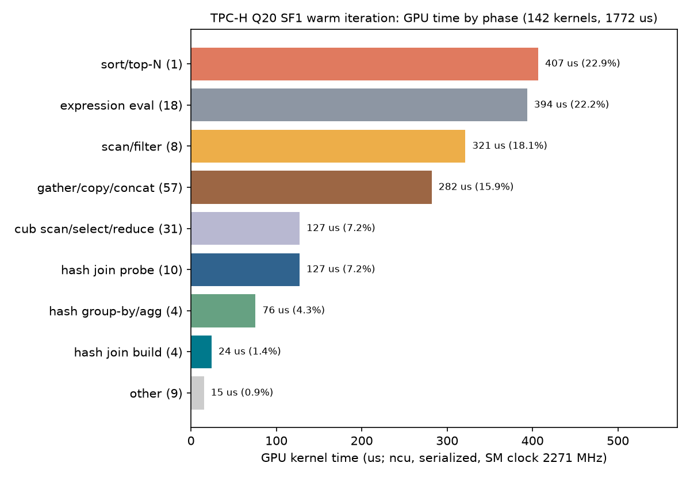
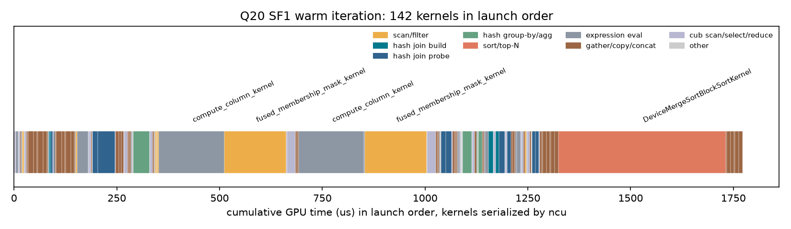
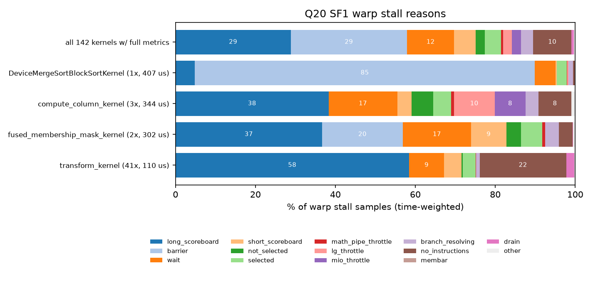
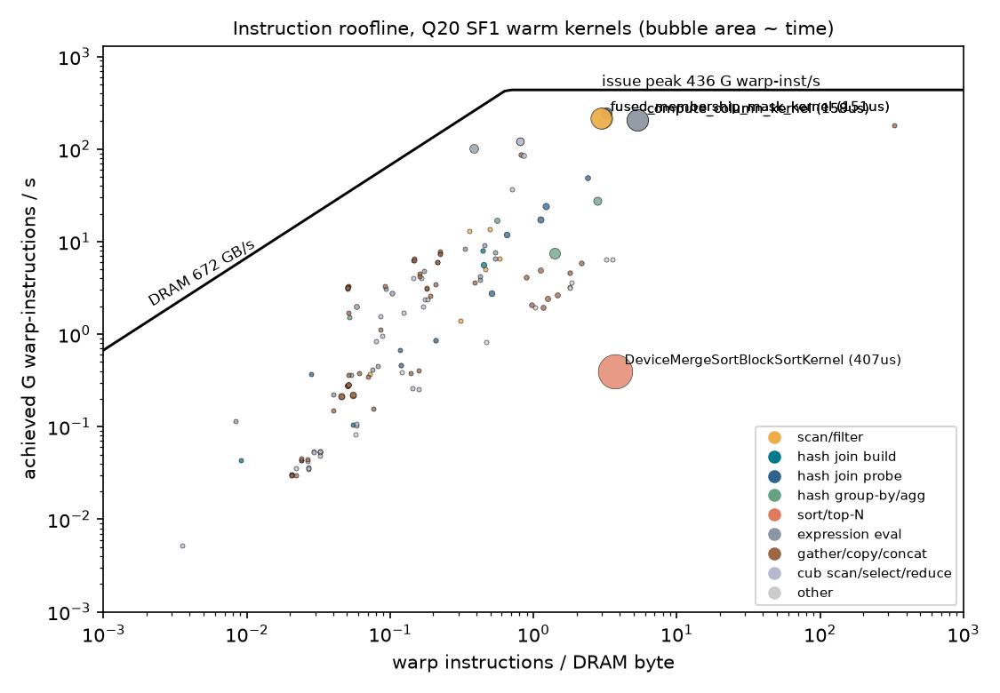

# TPC-H Q20 (SF1) on Sirius, all referenced columns pinned on GPU — Workload Analysis

**Date**: 2026-11-13
**GPU**: NVIDIA GeForce RTX 5070, 12 GB GDDR7 (192-bit, 672 GB/s), Blackwell sm_120, 48 SMs
**Workload**: TPC-H Query 20 (potential part promotion: suppliers of nation 'KENYA' whose `ps_suppkey` is in partsupp rows of parts with `p_name LIKE 'antique%'` and `ps_availqty > 0.5 * sum(l_quantity)` over lineitem of 1993; two nested `IN (subquery)` and one correlated scalar subquery; constants read from `q20.sql`), scale factor 1. The 15 referenced columns of 5 tables are pinned in GPU memory with `pin_table(tier='gpu')` (87.11 MB); measured iterations read no table data from host (§3).
**Framework**: Sirius (`sirius-duckdb` release build), DuckDB v2.0, stock libcudf from the pixi env, CUDA runtime 13.5 (versions copied from the Q12 report; see §4)
**Pipeline**: `scripts/tpch_sf1/profile_query.sh 20` (274 s of pipeline stages: 15 s for sql/timing/pcie/selftest + 259 s for list/detail/extract/validate; `pipeline_run.log`); every number below comes from a file in this directory.
**Labels**: *measured* = read from a profiler/log file; *inferred* = derived by arithmetic or reasoning from measured data.

---

## 1. Executive Summary

A warm Q20 takes **9.0 ms end-to-end** (median of 12 timed runs after 3 warmups, range 8–9 ms, `.timer` 1 ms resolution; *measured*, `timing_summary.txt`). DuckDB on the CPU takes 29.0 ms (min 27, max 35), so the GPU is 3.2x faster (*inferred* ratio). The 181-row result equals DuckDB-CPU exactly (mode `exact`, max relative difference 0.0, tolerance 1e-9, identical across all 15 GPU iterations; `timing.json`). The first (cold) iteration takes 55.0 ms. The nested subqueries run fully on the GPU with `enable_duckdb_fallback=false` (no `ERROR.txt`).

| Where the 9.0 ms go (median warm iteration, 1 ms stamps) | ms | Source |
|---|---:|---|
| Planning (DuckDB optimizer + Sirius plan build, 40 pipelines) | 3 | Sirius log, *measured* |
| Engine window (timing run) | 5 | Sirius log, *measured* |
| Gap from `QueryEnd` to the next statement | 0 | Sirius log, *measured* (medians 3+5+0 = 8 ms vs 9.0 ms median wall: 1 ms stamps, medians of parts) |
| GPU busy (kernels + copies, real clocks, nsys run) | **1.307** | `nsys_iteration_breakdown.txt`, *measured* |
| Engine window with the GPU idle (host orchestration) | ~3.7 | engine 5 ms (timing run) − GPU busy 1.307 ms (nsys run), *inferred*, ±1 ms |

GPU busy is 14.5% of the 9.0 ms wall (*inferred*, cross-run). Inside the 1230.9 µs of kernel time (nsys, 142 kernels per iteration, deterministic) the top three families are:

1. **`DeviceMergeSortBlockSortKernel`: 316.8 µs, 25.7%, 1 launch.** The final `ORDER BY s_name` runs as a **single CTA** (grid 1, 256 threads) string sort. ncu: 406.6 µs, SM active 2.1% of the elapsed cycles, 14.0 of 32 lanes active, 85.1% of its stall samples are `barrier` (§8). It is the single most expensive kernel for a 181-row result.
2. **`compute_column_kernel` (libcudf AST evaluator): 269.2 µs, 21.9%, 3 launches.** Two launches of ~3.0 M rows each (ncu 159.2 and 158.0 µs, 40.7 waves) are bound by the LSU pipe (91.6% busy), reach 5.8% of DRAM peak, and are 17.5x slower than the DRAM time of their own 12.18 MB (*inferred*, same-basis ncu bytes and times).
3. **`fused_membership_mask_kernel` (dynamic-filter probe): 235.6 µs, 19.1%, 2 launches** (ncu 150.8/150.9 µs, 17.1 waves, 10.9% of DRAM peak, 14.0 of 32 lanes active).

Against the physical floor of 129.6 µs (87.11 MB at 672 GB/s, `physical_floor.md`): kernel time is **9.50x** the floor, GPU busy **10.08x**, the engine window **38.6x**, the wall **69.4x** (*inferred*). 93 of 142 kernels last < 5 µs (ncu full pass), 131 launch < 1 wave, 45 are single-CTA. Q20 is limited by one serialized string sort, by AST/probe kernels that run far below the DRAM ceiling, and by orchestration; not by DRAM bandwidth.

## 2. Workload Description

Query text (`q20.sql`): `supplier s, nation n` filtered `n_name='KENYA'`; `s_suppkey IN (SELECT ps_suppkey FROM partsupp WHERE ps_partkey IN (SELECT p_partkey FROM part WHERE p_name LIKE 'antique%') AND ps_availqty > (SELECT 0.5*sum(l_quantity) FROM lineitem WHERE l_partkey=ps_partkey AND l_suppkey=ps_suppkey AND l_shipdate >= 1993-01-01 AND < 1994-01-01))`; `ORDER BY s_name`.

Cardinalities (DuckDB-CPU on the Parquet, `physical_floor.md`; *measured*): lineitem 6,001,215 rows (908,721 in 1993, 15.14%; 9,919 of those for antique parts), part 200,000 (2,186 antique), partsupp 800,000 (8,744 for antique parts; 5,935 pass the availqty test; 4,515 distinct suppliers), supplier 10,000 (376 in KENYA), nation 25. Result: 181 rows, 8,319 B CSV (`timing.json`).

**Plan** (`query_plan.txt`, operators counted by distinct id, ids 0–55 = 56 operators in 40 pipelines): 5 GPU_SCAN (ids 0, 3, 12, 15, 28), 5 HASH_JOIN (ids 7 INNER, 18 MARK, 32 SEMI, 45 INNER, 50 RIGHT_SEMI), 5 DYNAMIC_FILTER (4, 29, 41, 42, 47), 2 HASH_GROUP_BY (23, 35) + 2 MERGE_GROUP_BY, 1 CTE (21), 1 BUILD_FILTER (9), 2 FILTER (19, 46), 6 PROJECTION, 1 ORDER_BY with SORT_SAMPLE/SORT_PARTITION/MERGE_SORT, 12 PARTITION, 10 CONCAT, 1 RESULT_COLLECTOR. The scan→table mapping is from the log lines "assigned pinned entry 'X' to operator 'N'" (*measured*): nation→0, supplier→3, part→12, partsupp→15, lineitem→28.

**How Sirius decorrelates the scalar subquery** (plan shape *measured*, semantics *inferred*): no correlated subquery is left. (1) Pipeline 16: join 18 (MARK) of partsupp (scan 15) against part (scan 12), then FILTER 19, PROJECTION 20, into **CTE 21**; the Sirius log reports "8744 build rows" for the dynamic filters published from it, equal to the 8,744 antique partsupp rows. (2) The CTE is read twice: through PROJECTION 22 → HASH_GROUP_BY 23 → MERGE_GROUP_BY 25 as the build side of **SEMI join 32** whose probe side is lineitem (scan 28 → DYNAMIC_FILTER 29); and through DYNAMIC_FILTER 41/42 as the probe side of INNER join 45. (3) After join 32: PROJECTION 33/34 → HASH_GROUP_BY 35 → MERGE_GROUP_BY 37 → PROJECTION 38 (inferred: `sum(l_quantity)` per (partkey, suppkey) and the 0.5 factor) is the build side of join 45; FILTER 46 (inferred: `ps_availqty > 0.5*sum`) → DYNAMIC_FILTER 47 → join 50 RIGHT_SEMI against nation ⋈ supplier (join 7 INNER, BUILD_FILTER 9) → ORDER_BY 51. This is the same pattern as a CTE-decorrelated correlated aggregate (a group-by on the correlation keys, joined back). Sirius log (15 iterations): per iteration two publications, "pushed 1 dynamic filter(s) … (1 build rows …)" (inferred: the KENYA filter into supplier scan 3) and "pushed 2 dynamic filter(s) … (8744 build rows, 2 bound keys of 2 admitted)" (inferred: partkey+suppkey into lineitem scan 28); three filters are published although the plan has five DYNAMIC_FILTER operators, ; the log wires 4 hash joins per iteration with 1 + 2 + 1 + 1 = 5 dynamic-filter probe targets (2 scan-bound, 3 join-edge; build est 80,000 / 120,024 / 5 / 2,000 rows), matching the five operators, but which wired targets did not publish is not in the log.

## 3. PCIe Verification (`pcie_verification.txt`: `OVERALL: PASS`)

No table data cross PCIe in the measured iterations; only small control copies do: per iteration (nsys iterations 4–8, identical) **68 H2D copies / 3,862 B, largest single 276 B; 56 D2H copies / 9,581 B, largest single 9,280 B** (result CSV 8,319 B) (*measured*). Quoted from the check lines:
- `pinned_entry_per_gpu_scan` (timing, nsys and all four ncu runs): "every iteration: #`assigned pinned entry` == #GPU_SCAN operators (5), all of ['lineitem', 'nation', 'part', 'partsupp', 'supplier'] present". **Distinct GPU_SCAN ids in `query_plan.txt`: 5 (0, 3, 12, 15, 28); pinned-entry assignments per iteration: 5, one per table** (15 timing iterations, 8 nsys iterations).
- `fs_cache_zero_every_iteration`: "16 cache summaries for 15 iterations … iterations 1..15 all last_cycle[reads=0 hits=0 h2d=0 miss=0 ...]" (nsys run: 9 summaries for 8 iterations, all zero).
- `no_parquet_decode_kernels`: "0 decode/decompress kernels among 1136 kernels of all 8 iterations". `h2d_measured_iterations`: "up to 68 copies, 3862 B total, largest single 276 B (limits: single <= 5000 B, total <= 1048576 B)"; `d2h_measured_iterations`: "up to 56 copies, 9581 B total, largest single 9280 B (result CSV is 8319 B; limit 262144 B)". `no_other_host_copies`: 0 managed/unknown-kind copies. Per-iteration on-device D2D: 17 copies, 14,519,045 B, largest 3,200,000 B.
- `unified_memory`: UM CPU+GPU fault collection on; "faults per measured iteration [0, 0, 0, 0, 0]; managed-memory API calls in the whole trace: none" (fault tables are written only when a fault occurs).
- `pool_counters_stable`: "gpu_pool allocated == pinned footprint 87107584 B at QueryBegin and QueryEnd"; `no_downgrade_or_spill`: 0 lines.
- `no_host_staged_filter_publication`: "30 filter publication(s) logged in query iterations; 15 carry a transport line, all 'peer copies' (device-side), 0 host-staged" (nsys run: 16 / 8). Only half of the publications carry a transport line, so the check says nothing about transport for the other half (which publication carries it is not identified); that half rests on the H2D bound (largest single copy 276 B vs 8,744 build rows) and the sysmem check (*inferred*).
- Pin phase (not measured iterations): H2D 370 copies, 45,930,263 B, largest 1,048,576 B. Tables below the byte limit (< 8192 rows): `nation` only; for it the evidence is the log checks and the sysmem check. The H2D single-copy limit 5,000 B = rows/2 of supplier (10,000 rows), the PCIE_* values equal their defaults.
- `ncu_sysmem_check.txt`: 142 kernels, 0 with SM (tex) sysmem-aperture sectors (total 0); the all-source counter reads 265–292 sectors for every kernel (information only); ncu `pcie__read/write_bytes` 512 / 1,529,344 B (rate x duration, includes driver/ncu traffic). `ncu_log_checks_{list,detail}.txt`: every residency check PASS on all four ncu runs.
- Negative control (`selftest_negative_control.txt`): with `lineitem` left unpinned `pcie_verify.py` exited 1 as expected, failing `pinned_entry_per_gpu_scan` ("4 assigned for 5 GPU_SCANs, missing tables ['lineitem']"), `fs_cache_zero_every_iteration` (reads 18, h2d 51), `no_parquet_decode_kernels` (3 decode kernels), `h2d_measured_iterations` (148 copies, 40,186,751 B, largest 4,320,440 B) and `d2h_measured_iterations` (864,561 B, largest 95,040 B); `SELFTEST: PASS (verification detected the unpinned table)`.
- GPU memory: pinned footprint 87,107,584 B; gpu_pool high-water 255,656,676 B (process-lifetime, includes the pin phase).

## 4. Environment

| Component | Version / setting |
|---|---|
| GPU / driver | RTX 5070 (sm_120, 48 SMs, 12 GB, 48 MB L2) / 580.173.02 (queried this run) |
| Nsight Compute | 2025.2.1.0 (queried), via `sudo -n`; `--set full --import-source yes` on all 142 warm kernels |
| ncu clocks | locked by ncu: SM median 2271 MHz (`ncu_extract_summary.txt`) |
| Nsight Systems | 2025.5.2 (`/home/sai/nsight-systems-2025.5`); `-t cuda -s none --cpuctxsw=none` plus UM page-fault collection |
| CPU / DuckDB / CUDA runtime | i9-13900K, 125 GB RAM / v2.0 / 13.5 (copied from the Q12 report, not re-queried) |
| Sirius config | `scripts/tpch_sf1/sirius.yaml`: 4 pipeline threads, GPU pool 25% of 12 GB, 1 GB pinned host pool (2 pools), `enable_duckdb_fallback=false` |

## 5. Physical Floor vs Measured

Written before any ncu output (`physical_floor.md`). Pinned bytes (gpu_pool deltas): supplier 540,928; partsupp 6,400,000; part 8,150,528; lineitem 72,015,360 (82.7%); nation 768; total 87,107,584 B.

| Scenario (`physical_floor.md`) | Bytes | Floor @ 672 GB/s |
|---|---:|---:|
| A. every pinned column once (narrowed) | 87.11 MB | **129.6 µs** |
| A'. native widths (inferred) | 138.36 MB | 205.9 µs |
| A-min. predicate-forced bytes only (inferred) | ≈ 38.4 MB | 57.2 µs |
| B1. A + intermediates if filters reach lineitem early (inferred) | ≈ 87.75 MB | ≈ 130.6 µs |
| B2. A + 908,721 date-qualified lineitem rows written+read (inferred) | ≈ 108.9 MB | ≈ 162.1 µs |

Compute estimate < 10 µs (*inferred*); launch-count bound 142 kernels × ~2 µs ≈ 0.28 ms (the 2 µs is an assumption, not measured here).

| Measured quantity | Value | × floor A (129.6 µs) | Source |
|---|---:|---:|---|
| nsys kernel time (sum, mean of iterations) | 1230.9 µs | 9.50x | `nsys_iteration_breakdown.txt` |
| nsys GPU busy (union kernels + copies, median) | 1307 µs | 10.08x | same |
| Engine window (timing run) | 5000 µs | 38.6x | `timing_summary.txt` |
| Wall (median) | 9000 µs | 69.4x | `timing.json` |
| ncu serialized kernel sum (clock-locked, L2-flushed; not comparable to the rows above) | 1772.4 µs | — | `ncu_extract_summary.txt` |

ncu cold-L2 DRAM traffic over the 142 kernels: 59.99 MB (`phase_breakdown.txt`), below the 87.11 MB pinned footprint: the query does not touch every pinned byte (§6, §10).

## 6. Kernel, Phase and Operator Breakdown

Warm iteration (5th): **142 kernels** (`warm_kernel_summary.txt`; ncu list passes 964 / 1106 / 1248 launches, +142 per added iteration; nsys 142 per iteration; `STABLE: True`). Policy branch: 142 ≤ `NCU_FULL_MAX` (1000) → **`full_all`** (light + families branch not used). ncu phase table (serialized, `phase_breakdown.txt`):

| Phase | Kernels | µs | % | DRAM MB |
|---|---:|---:|---:|---:|
| sort/top-N | 1 | 406.6 | 22.9 | 0.04 |
| expression eval | 18 | 393.6 | 22.2 | 20.27 |
| scan/filter (dynamic-filter probes) | 8 | 321.2 | 18.1 | 22.10 |
| gather/copy/concat | 57 | 281.9 | 15.9 | 4.10 |
| cub scan/select/reduce | 31 | 127.2 | 7.2 | 7.95 |
| hash join probe | 10 | 127.1 | 7.2 | 4.37 |
| hash group-by/agg | 4 | 75.6 | 4.3 | 0.82 |
| hash join build | 4 | 24.2 | 1.4 | 0.30 |
| other | 9 | 15.1 | 0.9 | 0.03 |

`other` is 0.9% (< 5%), so `kclass.py` was not edited. Operators (`operator_breakdown.txt`): sort 22.9%, expression AST 19.4% (3 kernels), dynamic filter membership probe 17.6% (5), gather strings 9.8% (24 kernels), cub select/compact 6.1% (24), fixed-width gather/scatter 5.8% (32), join output/compaction 5.6% (7), group-by 4.3% (4). Size mix (*measured*): 93 kernels < 5 µs, 122 < 10 µs (458.9 µs, 25.9% of ncu time); **131 kernels launch < 1 wave (1022.0 µs, 57.7%)**; 122 have grid < 48 CTAs; 45 single-CTA launches take 578.3 µs (32.6%), of which the sort alone is 406.6 µs. Only 11 kernels reach ≥ 1 wave (750.5 µs, 42.3%).




## 7. Top Kernels (ncu `--set full`, serialized, clock-locked, L2 flushed per kernel)

| pos | Kernel | µs | % | grid×blk | waves | SM% | DRAM (MB, %peak) | lanes/32 | main stalls |
|---:|---|---:|---:|---|---:|---:|---|---:|---|
| 135 | DeviceMergeSortBlockSortKernel (string comparator) | 406.6 | 22.9 | 1×256 | 0.00 | 0.1 | 0.04, 0.0% | 14.0 | barrier 85.1 |
| 63 | compute_column_kernel<128,0,0> | 159.2 | 9.0 | 23435×128 | 40.7 | 90.7 | 6.09, 5.8% | 32.0 | long_sb 37.5, wait 17.4 |
| 70 | compute_column_kernel<128,0,0> | 158.0 | 8.9 | 23450×128 | 40.7 | 90.5 | 6.09, 5.8% | 32.0 | long_sb 37.2 |
| 72 | fused_membership_mask_kernel | 150.9 | 8.5 | 4096×256 | 17.1 | 49.2 | 10.91, 10.9% | 14.0 | long_sb 37.0, barrier 20.4 |
| 64 | fused_membership_mask_kernel | 150.8 | 8.5 | 4096×256 | 17.1 | 49.4 | 10.85, 10.9% | 14.0 | long_sb 36.3, barrier 20.1 |
| 41 | contains_if_n (join filter) | 42.1 | 2.4 | 6250×128 | 10.9 | 58.5 | 3.27, 11.8% | 17.1 | barrier 28.4, long_sb 21.6 |
| 54 | static_kernel (groupby compute) | 40.2 | 2.3 | 18×256 | 0.09 | 1.8 | 0.21, 0.8% | 9.7 | long_sb 45.5 |
| 35 | compute_column_kernel<128,0,1> | 26.8 | 1.5 | 1563×128 | 3.6 | 37.5 | 7.07, **40.0%** | 28.6 | long_sb 50.0 |

(`top_kernel_details.txt`, `ncu_extract_summary.txt`.) **Families reaching ≥ 1 wave** (`ncu_warm_metrics.json`): `compute_column_kernel` (3 of 3 launches, max 40.7 waves), `fused_membership_mask_kernel` (2 of 2, 17.1), `DeviceSelectSweepKernel` (4 of 14, max 5.44), `contains_if_n` (1 of 3, 10.85), `copy_range_kernel` (1 of 1, 10.85, 5.1 µs). **Best DRAM% over all 142 kernels: 40.0% (263.9 GB/s), pos 35, a 26.8 µs kernel**; the long kernels sit at 5.8–11.8%. Time-weighted stall mix: barrier 29.1% (almost all the sort), long_scoreboard 28.8%, wait 11.8%, no_instructions 9.6%.

Which operator each launch serves is *inferred* from grid×block: 23,435×128 = 2,999,680 and 23,450×128 = 3,001,600 sum to 6,001,280 ≥ 6,001,215, i.e. two halves of lineitem; 1563×128 = 200,064 ≈ part's 200,000 rows and pos 35's 7.07 MB ≈ p_name characters + offsets (7.35 MB native, `physical_floor.md`). The launch order [compute_column, fused_membership_mask, DeviceSelectSweep] repeats for pos 63–66 and 70–74 (inferred: per lineitem half, predicate, dynamic-filter probe, compaction).




## 8. Instruction-Level Evidence for the #1 kernel (`sass/DeviceMergeSortBlockSortKernel_hotspots.txt`, pos 135, 1 launch)

Kernel: `merge_sort::DeviceMergeSortBlockSortKernel<…, cudf::simple_comparator<cudf::string_view>, …>`; grid 1, 256 threads (8 warps), 48 regs, 17,424 B shared; 160,038 warp instructions, IPC 0.17, 941,043 elapsed cycles with SM active cycles 19,408 (2.1% = 1 of 48 SMs), 912 stall samples, L1 hit 99.0%, 14.0 of 32 lanes active on average (*measured*). Instruction mix: integer arithmetic 50.4%, control flow 15.1% (87.5% of stall samples), global load 9.9%, local (spill) 1.7%.

**Hot instruction (776 of 912 samples, 85.1%, reason `barrier`)**:
```
+0x06630 exe=64 BAR.SYNC.DEFER_BLOCKING 0x0
   ... (7 instructions, 0 samples)
+0x066b0 exe=64 samp=776 [barrier] BSSY.RECONVERGENT B1, 0x7fd9921a0c60
+0x066c0 exe=64 STS [R45+0x4], R23
```
BAR.SYNC executed 64 warp-times = 8 warps × 8 rounds (*measured* count; "8 rounds" = 64 executions ÷ 8 warps, assuming each warp executes it equally, *inferred*). The samples land on the BSSY after the barrier, not on the BAR.SYNC itself; tying them to the BAR.SYNC at +0x06630 is an inference from the window.

**What the other lanes do between barriers**: the serial string-compare loops, e.g.
```
+0x06110 exe=2389 thr=10.0 LDG.E.U8 R16, desc[UR8][R8.64]
+0x06120 exe=2389 thr=10.0 LDG.E.U8 R17, desc[UR8][R10.64]
+0x06130 exe=2389 thr=10.0 samp=10 [long_sb=10] ISETP.NE.U32.AND P3, PT, R16, R17, PT
+0x06140 exe=2389 thr=10.0 @P3 BRA 0x7fd99219fb10
+0x06150 exe=2253 thr= 9.0 IADD R14, R14, 0x1
```
Register by register (*measured* from the window): `ISETP` at +0x06130 reads R16 and R17, written by the two `LDG.E.U8` at +0x06110/+0x06120 directly before it; `@P3 BRA` reads P3 from the `ISETP`; `IADD R14` is the loop index. The loop back-edge is outside the quoted window, so the loop structure is *inferred*. The same load-load-compare-branch pattern appears at +0x06300..+0x06330 (exe 2389) and +0x04d90..+0x04dc0 (exe 281). Interpretation (*inferred*): one byte per iteration is fetched and compared, i.e. a per-lane byte-at-a-time `string_view` comparison (supplier names `Supplier#000000076` share a 12-character prefix, so each compare walks many bytes). Only 10–11 lanes are active in these loops (`thr=10.0/11.0`, *measured*; 5–6 lanes in the compare loops at +0x06f70 and +0x07ae0): the tile is 256 threads × 17 items = 4,352 slots (the immediate 0x1100 = 4,352 at +0x03d20 `VIMNMX`, *measured*), and a 181-row input fills only ~11 threads (181/17 = 10.65, *inferred*); the other 7 warps wait at the barrier while warp 0 does the serial compares (*inferred*). Long-scoreboard samples on these compares are only 1.1% each: the sort is limited by barrier waits on serialized per-lane work, not by memory latency.

## 9. Root Cause Analysis (top 3 time sinks)

**#1 Sort, 316.8 µs (nsys) / 406.6 µs (ncu), 25.7% of kernel time**
- Symptom: one launch, grid 1; SM active 2.1% of 941,043 cycles; 85.1% barrier samples (*measured*).
- WHY: 7 of 8 warps idle at `BSSY`/barrier while the warp holding the data runs serial compares (*inferred* from 10–11 active lanes, 8 barrier rounds, 64 BAR executions, *measured*).
- WHY: the block sort assigns 17 items per thread over a 4,352-item tile, so a ~181-row input occupies ~11 threads (*inferred*); each compare is a byte-at-a-time `LDG.E.U8` loop (2,389 warp-level executions of the loop body over 136 loop entries, ≈ 17.6 bytes per compare, *measured*).
- ROOT: the library's string `ORDER BY` path is a single-CTA comparison sort with per-lane serial byte compares: ≈ 941 K cycles for a result of 181 rows (8,319 B CSV, *measured*) versus a 129.6 µs whole-query floor (*measured/inferred*).

**#2 AST evaluator, 269.2 µs (nsys) / 343.9 µs (ncu), 21.9% of kernel time**
- Symptom: two ~3.0 M-row launches, 40.7 waves, 91.6% LSU pipe busy, IPC 1.96, only 5.8% of DRAM peak (6.09 MB in 159.2 µs = 38.2 GB/s) (*measured*); 17.5x slower than the DRAM time of the two launches' 12.18 MB (*inferred*).
- WHY: each thread runs ≈ 347 instructions (3.2528e7 warp instructions / 93,740 warps), 45.0 global load requests per warp (4.2183e6/93,740), for what is a range predicate (*inferred* that it is the shipdate range; the kernel evaluates an expression tree).
- WHY: the evaluator interprets the tree: dependent loads walk node data (`LDG.E R15,[R14+0xc]` → `IMAD.WIDE R8,R15,0x20,R8` → `LDG.E.64 R8,[R8+0x10]` → `LD.E.U16 R12,[R8.64]` at +0x18130…+0x18170: R15, R8, R8:R9 chain confirmed register by register), and 5.2% of executed instructions are local-memory spill traffic (`STL`/`LDL`, *measured*). The stalled `ISETP R6` at +0x18180 (444 samples, long_sb 439) reads R6, whose producer is outside the window, so its exact producer is unknown.
- ROOT: a general expression interpreter pays node-walking loads per row instead of a streaming compare: LSU-bound at 91.6% while DRAM is idle (*measured*); what the node loads fetch is *inferred*.

**#3 Dynamic-filter probe, 235.6 µs (nsys) / 301.7 µs (ncu), 19.1% of kernel time**
- Symptom: 2 launches, 17.1 waves, 10.9 MB each at 72 GB/s (10.9% of peak), 14.0 of 32 lanes active, stalls long_sb 37%, barrier 20% (*measured*); each is 9.3x the DRAM time of its own bytes (150.8 µs vs 16.15 µs, *inferred*).
- WHY: 2 bound keys (partkey, suppkey) are looked up per row in a hash set built from 8,744 rows (Sirius log, *measured*); 14.0 of 32 lanes are active on average (44%); where lanes drop out is not measured here (no SASS exported for this family). The SASS of this family was not exported (top 2 families only), so no instruction-level chain is claimed.
- ROOT: the probe runs over every lineitem row of a half (DRAM ≈ a full 4-byte key column per launch, *inferred*) although at most 9,919 of 6.0 M rows survive the semi-joins (*measured*, `physical_floor.md`): probing is done per row at hash-lookup cost with 14.0 of 32 lanes active.

Not a root cause (*measured*): DRAM bandwidth (best kernel 40.0%, long kernels 5.8–11.8%), PCIe (§3), parquet decode (0 kernels).

## 10. Gap Analysis

| Layer | Time | × floor A | Source |
|---|---:|---:|---|
| Floor A (87.11 MB / 672 GB/s) | 129.6 µs | 1.0x | `physical_floor.md` |
| nsys kernel time | 1230.9 µs | 9.50x | `nsys_iteration_breakdown.txt` |
| nsys GPU busy | 1307 µs | 10.08x | same |
| Engine window (timing run) | 5000 µs | 38.6x | Sirius log |
| Wall | 9000 µs | 69.4x | `timing.json` |

(*inferred* ratios.) The 9.5x kernel gap decomposes by nsys shares: sort 316.8 µs (25.7%), AST 269.2 µs (21.9%), probe 235.6 µs (19.1%), the other 409.3 µs (33.3%) spread over 136 kernels. The 142 launches alone (~2 µs each, an assumption) bound the GPU time at ≈ 0.28 ms, so even perfect kernels would leave a launch/latency-bound ≈ 2x floor. The sort alone is 24.2% of GPU busy (316.8/1307, both nsys). The ncu DRAM traffic (59.99 MB) is below the pinned 87.11 MB: so not even lineitem's 72.02 MB of pinned columns is read in full at DRAM level (cold L2); which pinned bytes are not read was not analysed. The remaining wall (≈ 3.7 ms engine with GPU idle + 3 ms planning) is orchestration: per iteration 267 `cudaStreamSynchronize` (1.682 ms CPU summed over threads), 98 `cuStreamSynchronize`, 142 `cudaLaunchKernel` (0.626 ms), 121 `cudaMemcpyBatchAsync` (0.418 ms), 219 pool alloc + 219 free calls (*measured*, `nsys_iteration_breakdown.txt`); that each sync waits for a µs-scale kernel is *inferred*.

## 11. Optimization Directions (general-purpose; no query-specific fusion)

1. **Small-input string sort** (target: 316.8 µs, 25.7% of kernel time): size the block-sort tile to the input (fewer items per thread so a few hundred rows spread across all 256 threads), compare strings with wide (4/8-byte) loads or a fixed-width prefix key instead of `LDG.E.U8` per byte, and avoid the single-CTA path for tiny tables. General to any ORDER BY on strings (*inferred* benefit; not measured).
2. **AST evaluator** (target: 269.2 µs): for simple column-vs-constant conjunctions use direct binary-op kernels or compile the expression, avoiding the dependent node-walking loads and local spills (§9 #2); a streaming compare would approach the 9 µs DRAM time of the 12.18 MB (*inferred*).
3. **Dynamic-filter probe**: probe only rows that survive earlier predicates (compact first, then probe) or use a Bloom/bitmap pre-test; keep lanes converged across the two rounds (*inferred*). Fusing is context only and not recommended here.
4. **Orchestration**: 142 launches and 267 stream syncs per 1.3 ms of GPU work; batching tiny kernels (131 launch < 1 wave) through graphs or fewer sync points would target the ≈ 3.7 ms engine-idle time (*inferred*).

## 12. Determinism and Profiling Method

- **Launch counts are deterministic** (*measured*, `warm_kernel_summary.txt`, `ncu_plan.json`, `pcie.json`): 142 launches in every iteration of the three ncu list runs (964/1106/1248) and in all 8 nsys iterations; added-iteration multisets equal.
- **Launch order is not**: iteration 4 vs 5 differ at 8 positions, x4 vs x5 prefix at 35 (`warm_kernel_summary.txt`); the slice needs only counts and multisets (`ncu_slice_check.txt`: 142 vs 142, multiset match True; 1 name reconciled on function/grid/block).
- ncu policy `full_all`; `--set full --import-source yes` on all 142 warm kernels; ncu is serialized, clock-locked (SM median 2271 MHz) and flushes L2 before each kernel; nsys (CUDA trace, boost clocks) gives real-clock times. The two are never summed or subtracted.
- nsys: 5 measured iterations (4–8), kernels [142]×5, GPU busy 1.301–1.309 ms; nsys doubles the engine window (10.0 vs 5 ms in the timing log), so wall splits come from the timing log.
- Timing: 3 warmups + 12 timed iterations; DuckDB-CPU same protocol (first 35.0 ms). Result: GPU vs CPU mode `exact` (max rel diff 0.0).
- Validation: `validate_pipeline.txt` "SUMMARY q20: 72 PASS, 0 FAIL, 1 PENDING" (the PENDING is this report).

## 13. Limitations

- ncu serialized kernel sum 1772.4 µs vs nsys kernel time 1230.9 µs (1.44x ratio); tiny kernels are overstated by ncu. All real-clock claims use nsys.
- ncu DRAM bytes (59.99 MB) are cold-L2 traffic; warm-iteration traffic inside a real query can be lower (not measured).
- Wall splits are 1 ms stamps; the ~3.7 ms "GPU idle" mixes the timing run and the nsys run (±1 ms) and the three log medians sum to 8 ms vs a 9.0 ms wall.
- Which operator each launch serves, the 181-row sort input, the 8 barrier rounds, the ~11 active threads, and what the §8/§9 loads fetch are inferences from grid×block, lane counts and byte volumes. The compute_column stalled `ISETP` reads R6 whose producer is outside the window; the sort's loop back-edge is outside the window.
- SASS covers the top 2 families only (sort, compute_column); the probe (`fused_membership_mask_kernel`) and the select/scan/transform/gather kernels rest on ncu metrics. Stall-sample counts are small on short kernels (the sort has 912 samples total).
- Two hit rates were clamped to 100 in `ncu_warm_metrics.json` (raw kept): pos 82 L2 100.4%, pos 135 L2 112.4%. Narrowing per column is not in the log: pinned lineitem is 12.00 B/row vs an assumed 20 B/row native, so the native-width floors are inferred. The ~2 µs smallest-kernel figure is an assumption, not measured. Only 3 of the 5 DYNAMIC_FILTER operators have publication lines in the log.
- Only the pinned configuration was profiled; no unpinned timing comparison (the negative control checks residency detection only). The 1e-9 result tolerance was not exercised (max rel diff 0.0). Measurements are of one machine, one session.

## 14. Raw Data

| File | Contents |
|---|---|
| `timing_summary.txt`, `timing.json`, `result.csv`, `traces/timing_run.txt`, `traces/duckdb_cpu_run.txt` | timing, result, CPU baseline, compare mode |
| `query_plan.txt`, `sql/` | Sirius plan, generated SQL |
| `pcie_verification.txt`, `pcie.json`, `traces/q20_nsys.{nsys-rep,sqlite}`, `traces/sirius_log_*` | PCIe evidence |
| `ncu_sysmem_check.txt`, `ncu_log_checks_{list,detail}.txt`, `selftest_negative_control.txt`, `selftest/` | host-memory-in-place, residency checks, negative control |
| `nsys_iteration_breakdown.{txt,json}` | GPU busy, API counts, real-clock kernel times |
| `warm_kernel_list.json`, `warm_kernel_summary.txt`, `ncu_plan.json`, `traces/ncu_list_x{3,4,5}.csv` | list passes, determinism, plan |
| `profiles/q20_warm_full.ncu-rep`, `ncu_slice_check.txt` | full ncu report (142 kernels) |
| `ncu_warm_metrics.json`, `ncu_extract_summary.txt`, `phase_breakdown.{txt,json}`, `operator_breakdown.txt`, `top_kernel_details.txt` | extracted metrics |
| `sass/` | hotspots for `DeviceMergeSortBlockSortKernel` and `compute_column_kernel` |
| `plots/q20_*.png` | phase breakdown, kernel sequence, roofline, stall mix |
| `physical_floor.md`, `pipeline_run.log`, `validate_pipeline.txt` | floor, logs, validation |
