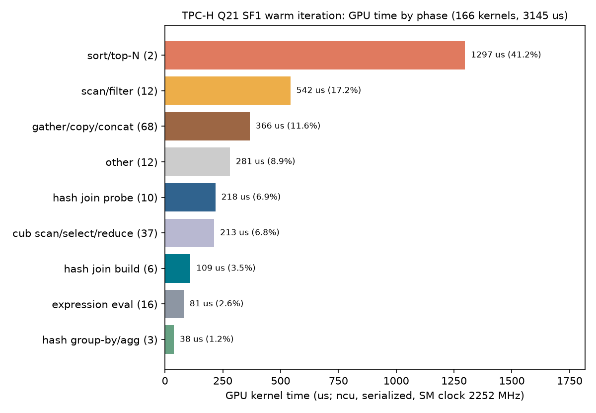
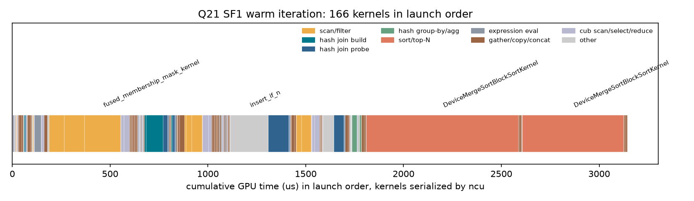
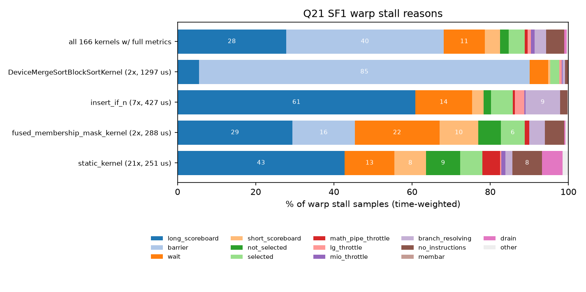
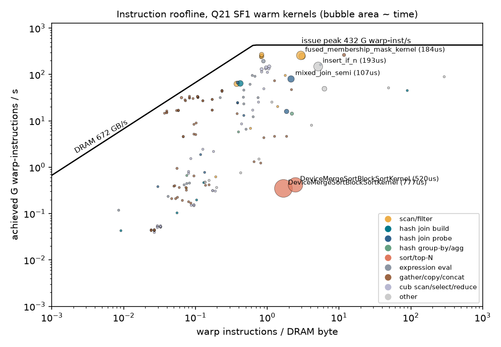

# TPC-H Q21 (SF1) on Sirius, all referenced columns pinned on GPU — Workload Analysis

**Date**: 2026-11-13
**GPU**: NVIDIA GeForce RTX 5070, 12 GB GDDR7 (192-bit, 672 GB/s), Blackwell sm_120, 48 SMs
**Workload**: TPC-H Query 21 (suppliers who kept orders waiting: `supplier ⋈ lineitem l1 ⋈ orders ⋈ nation` with `o_orderstatus = 'F'`, `n_name = 'BRAZIL'`, `l1.l_receiptdate > l1.l_commitdate`, an `EXISTS` on lineitem l2 (same order, `l_suppkey <>`), a `NOT EXISTS` on lineitem l3 (same order, `l_suppkey <>`, late), GROUP BY `s_name`, ORDER BY `numwait DESC, s_name`, LIMIT 100; constants read from `q21.sql`), scale factor 1. The 11 referenced columns of 4 tables are pinned in GPU memory with `pin_table(tier='gpu')` (73,765,632 B).
**Framework**: Sirius (`sirius-duckdb` release build), DuckDB v2.0, stock libcudf from the pixi env, CUDA runtime 13.5
**Pipeline**: `scripts/tpch_sf1/profile_query.sh 21` (286 s for the stages after the first run's 15 s: sql 0, timing 2, pcie 7, selftest 6, list 26, detail 243, extract 17, validate 0 s; `pipeline_run.log`). Every number below comes from a file in this directory.
**Labels**: *measured* = read from a profiler/log file; *inferred* = derived by arithmetic or reasoning from measured data.

---

## 1. Executive Summary

A warm Q21 takes **11.0 ms end-to-end** (median of 12 timed runs after 3 warmups, range 10–12 ms, `.timer` 1 ms resolution; *measured*, `timing_summary.txt`). DuckDB on the CPU takes 58.0 ms (min 54, max 63), so the GPU is 5.3x faster (*inferred* ratio 58.0/11.0). The 100-row result equals DuckDB-CPU exactly (compare mode `exact`, max relative difference 0.0, tolerance 1e-9, identical across all 15 GPU iterations; `timing.json`). Data residency: the PCIe verification is `OVERALL: PASS` (§3); no table data cross PCIe in the measured iterations.

| Where the 11.0 ms go (median warm iteration, 1 ms stamps) | ms | Source |
|---|---:|---|
| Planning (DuckDB optimizer + Sirius plan build, 36 pipelines) | 4 | Sirius log, *measured* (`timing_summary.txt`) |
| Engine window (timing run) | 6 | Sirius log, *measured* |
| Gap from `QueryEnd` to next statement | 0 | Sirius log, *measured* (4 + 6 + 0 = 10 vs 11.0 ms median wall: 1 ms stamps, medians of parts) |
| GPU busy (kernels + copies, real clocks, nsys run) | **2.285** | `nsys_iteration_breakdown.txt`, *measured* |
| nsys-run engine window / first→last GPU op | 10.0 / 9.69 | `nsys_iteration_breakdown.txt`, *measured* (nsys inflates the window; GPU busy = 23% of it) |

Inside the 2265.3 µs of kernel time per iteration (nsys, 166 kernels per iteration, deterministic; `nsys_iteration_breakdown.txt`):

1. **`DeviceMergeSortBlockSortKernel` (cub block sort of row indices with a libcudf row comparator): 1018.1 µs, 44.9%, 2 launches, both single-CTA (grid 1, block 256).** ncu: 776.8 + 520.2 = 1297.0 µs (41.2% of ncu time). One SM of 48 is busy (`SM busy max/avg 48.00`, active fraction 0.02), DRAM 0.16 / 0.09 MB, 84.9% / 84.2% of stall samples are `barrier` (§8, §9).
2. **`insert_if_n` (cuco hash-table inserts): 272.4 µs, 12.0%, 7 launches; `fused_membership_mask_kernel` (Sirius dynamic-filter probe): 230.1 µs, 10.2%, 2 launches.** Together with the filter-key-set builds, the dynamic-filter operators are 542.1 µs = 17.2% of ncu time (`phase_breakdown.txt`, scan/filter).
3. **Orchestration**: 166 launches, 104 of them < 5 µs in ncu (planning takes 4 ms of the 11.0 ms wall, and each iteration makes 253 `cudaStreamSynchronize` + 94 `cuStreamSynchronize` calls); most of the small kernels are gathers, scans, selects and fills.

Against the physical floor (`physical_floor.md`): 109.8 µs (73.77 MB read once) to 377.7 µs (three lineitem scans at native widths): kernel time is 20.6x / 6.0x, GPU busy 20.8x / 6.05x, wall **100.2x / 29.1x** (*inferred* ratios). 142 of 166 kernels run less than one wave (fewer CTAs than fill the 48 SMs); Q21 is limited by one latency-bound single-CTA sort and by many small dependent kernels, not by DRAM bandwidth.



---

## 2. Workload Description

- Plan (`query_plan.txt`, counted by distinct ids 0–47): **48 operators in 36 pipelines**: 6 GPU_SCANs (ids 0, 3, 11, 14, 26, 36), 4 DYNAMIC_FILTERs (4, 15, 27, 37), 2 FILTERs (16, 28), 3 PROJECTIONs (8, 29, 38), 5 HASH_JOINs (7, 19, 22, 32, 41), 2 BUILD_FILTERs (23, 33), HASH_GROUP_BY (42) + MERGE_GROUP_BY (44), TOP_N (45) + MERGE_TOP_N (46), RESULT_COLLECTOR (47), 11 PARTITIONs, 10 CONCATs.
- Scan-to-table assignment (`assigned pinned entry` lines, `traces/sirius_log_timing/*.log`): id 0 nation, 3 supplier, 11 orders, **14, 26, 36 lineitem**. lineitem is scanned three times (l1, l3, l2; which id is which follows from the DAG shapes: 14 has FILTER 16 = l1's lateness predicate, 26 has FILTER 28 = l3's, 36 has none = l2; *inferred*).
- Join types printed in the plan: id 7 INNER (nation⋈supplier), id 19 INNER (orders⋈l1), id 22 INNER (those two results), **id 32 RIGHT_ANTI** (probe = l3 scan 26), **id 41 RIGHT_SEMI** (probe = l2 scan 36), with the hash group-by (42) fused into the last pipeline. The plan text does **not** show the `l_suppkey <>` condition (no join-condition text in `query_plan.txt`, *measured*). The warm iteration launches exactly two `cudf::mixed_join_semi` kernels (pos 111 grid 568, pos 134 grid 52); that these are the anti and semi joins carrying the inequality (equality hash + AST predicate) is *inferred*.
- Row counts (DuckDB-CPU on the Parquet, `physical_floor.md`): lineitem 6,001,215 (late 3,793,296 = 63.2%); orders 'F' 729,413 (48.6%); suppliers in BRAZIL 397; l1 rows 1,828,911; after EXISTS 1,762,253; after NOT EXISTS 98,833; **3,913 rows reach the group-by**; 397 candidate groups; 100 result rows (2,215 B).
- Dynamic filters (Sirius log): 3 `pushed 1 dynamic filter(s)` lines per iteration, with 1, 397 and 729,413 build rows, plus 2 `accumulated Bloom … published through peer copies` lines per iteration (145,408 B and 13,312 B arrays); 5 hash joins are wired with probe targets (equal to the nation, supplier-in-BRAZIL and F-order counts; which scan receives each is not logged, *inferred* from the counts).
- Pinned footprint (`pcie_verification.txt`, `physical_floor.md`): supplier 250,880 B, lineitem 60,013,568 B (10.00 B/row), orders 13,500,416 B (9.00 B/row), nation 768 B; total 73,765,632 B.

---

## 3. PCIe Verification (`pcie_verification.txt`: `OVERALL: PASS`)

- Residency (timing run: 15 iterations; nsys run: 8; each ncu list/detail run also checked in `ncu_log_checks_{list,detail}.txt`): "`pinned_entry_per_gpu_scan`: every iteration: #`assigned pinned entry` == #GPU_SCAN operators (6), all of ['lineitem', 'nation', 'orders', 'supplier'] present" — **6 GPU scans, 6 pinned-entry assignments**, three of them lineitem (ids 14, 26, 36), every iteration of every run. `fs_cache_zero_every_iteration`: iterations 1..15 (and 1..8 in the nsys run, 1..3/1..4/1..5 in the ncu list runs, 1..5 in the ncu detail run) all `last_cycle[reads=0 hits=0 h2d=0 miss=0 ...]`; `no_downgrade_or_spill`: 0 lines; `pool_counters_stable`: gpu_pool allocated == pinned footprint 73,765,632 B at every QueryBegin/QueryEnd.
- `no_parquet_decode_kernels`: 0 decode/decompress kernels among 1328 kernels of 8 iterations.
- Copies per measured iteration (nsys, memory-kind classified): **H2D 61 copies, 4,081 B total, largest 256 B**; **D2H 51 copies, 19,690 B, largest 16,384 B** (result CSV 2,215 B); D2D on device 15 copies, 2,713,892 B (largest 646,508 B); 0 copies with a non-device source and destination. Pin phase (not measured iterations): H2D 318 copies, 32,645,534 B. These small control copies cross PCIe every iteration; no table data do (limits 5,000 B per copy / 1,048,576 B per iteration; 262,144 B D2H).
- `unified_memory`: UM CPU+GPU page-fault collection on; "nsys writes the fault tables only when a fault occurs (present: none)"; faults per measured iteration [0,0,0,0,0]; managed-memory API calls: none.
- `no_host_staged_filter_publication`: "45 filter publication(s) logged in query iterations; 30 carry a transport line, all 'peer copies' (device-side), 0 host-staged". In the log, none of the 45 "pushed" lines has its own transport line; the 30 "accumulated Bloom … published through peer copies" lines are separate lines (2 per iteration), and which pushed filter, if any, each belongs to is not logged. So for the pushed filters the evidence is the H2D byte bound and the sysmem check, not the transport wording.
- `ncu_sysmem_check.txt`: 166 kernels, 0 with SM (tex) sysmem-aperture sectors (total 0); the all-source counter reads 265–328 sectors per kernel (info only); ncu `pcie__read/write_bytes` (rate × duration, includes driver/ncu traffic) 1,536 / 1,797,632 B.
- Negative control (`selftest_negative_control.txt`): with lineitem left unpinned, `pcie_verify.py` exits 1 as required ("SELFTEST: PASS (verification detected the unpinned table)"): `pinned_entry_per_gpu_scan` FAIL ("3 assigned for 5 GPU_SCANs, missing tables ['lineitem']"), `fs_cache_zero_every_iteration` FAIL, `no_parquet_decode_kernels` FAIL, `h2d_measured_iterations` FAIL (194 copies, 64,130,116 B per iteration, largest 3,030,116 B). Note the unpinned plan has 5 GPU_SCANs vs 6 in the pinned runs: lineitem is scanned twice (ids 14, 29; `selftest/traces/sirius_log_nsys`) instead of three times, so the control exercises a different plan; why was not investigated.
- GPU pool: pinned footprint 73,765,632 B after the last pin; gpu_pool high-water 232,403,688 B (process-lifetime, includes the pin phase) inside the 3 GB pool.

---

## 4. Environment

| Component | Version / setting |
|---|---|
| GPU / driver | RTX 5070 (sm_120, 48 SMs, 12 GB, 48 MB L2) / 580.173.02 (driver re-queried with nvidia-smi; SM count and L2 copied from the Q12 report) |
| Nsight Compute | via `sudo -n`; 2025.2.1 (path seen in the process list); `--set full --import-source yes` on all 166 warm kernels |
| ncu clocks | locked by ncu: SM median 2252 MHz (`ncu_extract_summary.txt`) |
| Nsight Systems | 2025.5.2 (`/home/sai/nsight-systems-2025.5`); `-t cuda -s none --cpuctxsw=none` plus UM page-fault collection |
| CPU | Intel i9-13900K, 125 GB RAM (copied from the Q12 report; not re-queried) |
| Sirius config | `scripts/tpch_sf1/sirius.yaml`: 4 pipeline threads, GPU pool 25% of 12 GB, 1 GB pinned host pool (2 pools), `enable_duckdb_fallback=false` |

---

## 5. Physical Floor vs Measured

| Quantity | Value | Source |
|---|---:|---|
| Floor A: 73.77 MB pinned (narrowed) once | 109.8 µs | `physical_floor.md` |
| Floor A': native widths, once (≈109.82 MB) | 163.4 µs | `physical_floor.md`, *inferred* |
| Floor C: three lineitem scans + orders + supplier, native (≈253.85 MB) | 377.7 µs | `physical_floor.md`, *inferred* |
| Launch-count bound: 166 kernels × ~2 µs (2 µs imported from Q2, not re-measured) | ~0.33 ms | *inferred* |
| nsys kernel time / GPU busy (real clocks) | 2265.3 µs / 2285 µs | `nsys_iteration_breakdown.txt` |
| ncu kernel sum (serialized, base-clock, cold-L2) | 3144.8 µs | `ncu_extract_summary.txt`, not comparable with nsys |
| Wall (median) | 11.0 ms | `timing_summary.txt` |

Ratios (*inferred*, recomputed): kernel time / A = 20.6x, / C = 6.0x; GPU busy / A = 20.8x, / C = 6.05x; wall / A = 100.2x, / C = 29.1x. The nsys sort alone (1018.1 µs) is 2.7x floor C. ncu DRAM traffic summed over the 166 kernels is 203.25 MB (reads+writes, cold L2) at an average 64.6 GB/s (9.6% of 672 GB/s), below floor C's 253.85 MB — the dynamic filters shrink what the l1/l3/l2 scans' consumers move (*inferred*); it is above the 73.77 MB pinned footprint because intermediates are materialised.

---

## 6. Kernel, Phase and Operator Breakdown

Phase breakdown (ncu, `phase_breakdown.txt`; 166 kernels, 3144.8 µs):

| Phase | Kernels | µs | % |
|---|---:|---:|---:|
| sort / top-N | 2 | 1297.0 | 41.2 |
| scan / filter (dynamic-filter ops) | 12 | 542.1 | 17.2 |
| gather / copy / concat | 68 | 366.3 | 11.6 |
| other (incl. 2 `insert_if_n` set builds for the mixed joins, pos 110 + 133 = 249.6 µs, that `kclass.py` labels fill/init) | 12 | 280.8 | 8.9 |
| hash join probe | 10 | 217.8 | 6.9 |
| cub scan/select/reduce | 37 | 212.6 | 6.8 |
| hash join build | 6 | 109.2 | 3.5 |
| expression eval | 16 | 80.7 | 2.6 |
| hash group-by / agg | 3 | 38.1 | 1.2 |

Operators (`operator_breakdown.txt`): sort/top-N 1297.0 µs (41.2%); dynamic-filter membership probe 9 kernels 459.1 µs (14.6%); fill/sequence/init 261.1 (249.6 µs of it is `insert_if_n` pos 110/133, misclassified); cub select/compact 33 kernels 203.9; fixed-width gather 44 kernels 184.5; string gather 24 kernels 181.9; hash-join output/compaction 7 kernels 178.9; hash-join build (insert) 3 kernels 97.0; dynamic-filter key-set build 2 kernels 80.9; join probe 3 kernels 38.9; group-by 3 kernels 38.1. `other:` rows total 3.4 µs (0.1%), so `kclass.py` was not edited; note that it files `insert_if_n` pos 110/133 (249.6 µs, 7.9%) under fill/sequence/init.

Counts: 104 kernels < 5 µs (62.7%), 134 < 10 µs (together 486.0 µs = 15.5% of ncu time); **142 kernels < 1 wave** (1999.5 µs), 92 with grid < 48 CTAs; top-10 kernels = 68.6% of ncu time. Real-clock families (nsys, 2265.3 µs): sort 1018.1 (44.9%), insert_if_n 272.4 (12.0%), fused_membership_mask 230.1 (10.2%), static_kernel 204.4 (9.0%), DeviceSelectSweep 143.0 (6.3%), transform_kernel 116.6 (5.1%), mixed_join_semi 104.3 (4.6%).

Order of the end of the iteration (`ncu_warm_metrics.json`, pos 143–165): group-by (mapping_indices pos 143 grid 31, single_pass_shmem_aggs pos 149), string gather of `s_name` (150–152), **sort pos 155**, gather (156–159), **sort pos 161**, gather (162–165). Attributing the two sorts to TOP_N / MERGE_TOP_N is *inferred* from position.




---

## 7. Top Kernels (ncu `--set full`, serialized, clock-locked, L2 flushed per kernel)

| pos | kernel | µs | grid × block | waves | DRAM MB (GB/s) | IPC | active lanes /32 | top stall |
|---:|---|---:|---|---:|---|---:|---:|---|
| 155 | DeviceMergeSortBlockSort | 776.8 | 1 × 256 | 0.01 | 0.16 (0.2) | 0.15 | 14.4 | barrier 84.9% |
| 161 | DeviceMergeSortBlockSort | 520.2 | 1 × 256 | 0.01 | 0.09 (0.2) | 0.18 | 10.4 | barrier 84.2% |
| 110 | insert_if_n (double-row-equality set) | 193.2 | 1908 × 128 | 4.97 | 5.68 (29.4) | 1.56 | 7.4 | long_scoreboard 46.9% |
| 39 | fused_membership_mask | 184.3 | 4096 × 256 | 17.07 | 16.46 (89.3) | 2.41 | 19.9 | long_scoreboard 30.0% |
| 111 | mixed_join_semi | 106.5 | 568 × 128 | 1.18 | 4.08 (38.3) | 1.12 | 6.1 | long_scoreboard 41.2% |
| 38 | fused_membership_mask | 104.0 | 4096 × 256 | 17.07 | 8.48 (81.6) | 2.33 | 20.5 | long_scoreboard 28.3% |
| 65 | insert_if_n (join build) | 86.8 | 5699 × 128 | 9.89 | 13.35 (153.8) | 0.63 | 18.1 | long_scoreboard 82.9% |
| 37 | insert_if_n (filter key set) | 76.7 | 5699 × 128 | 9.89 | 13.06 (170.2) | 0.59 | 22.9 | long_scoreboard 85.2% |

(`top_kernel_details.txt`; active lanes = `smsp__thread_inst_executed_per_inst_executed`, a lane count out of 32; the lane count of the two sorts means 14.4 and 10.4 lanes active per warp instruction.)

Kernels that reach ≥ 1 wave (24 of 166; `ncu_warm_metrics.json`): `static_kernel` 9 of 21 launches, `DeviceSelectSweepKernel` 7 of 19, `insert_if_n` 3 of 7, `fused_membership_mask_kernel` 2 of 2, `gather_chars_fn_char_parallel` 1 of 8, `mixed_join_semi` 1 of 2, `add_if_shmem` (hyperloglog) 1 of 1. **Best DRAM% over all 166 kernels: 77.43%** (`transform_kernel`, pos 35, 17.4 µs, 510.9 GB/s, 8.89 MB) — a fixed-width gather; the largest `static_kernel` launches reach 45–50% (pos 84: 301.8 GB/s, pos 121: 327.3 GB/s). No kernel with more than ~20 µs comes near the bandwidth ceiling except these; `fused_membership_mask_kernel` (17 waves) reads 12–13.5% of peak at SM% 57–60 and IPC 2.3–2.4, so it is issue/latency-limited rather than DRAM-limited (*inferred* from the numbers).

Time-weighted stall mix over all kernels: barrier 40.3% (dominated by the two sorts), long_scoreboard 27.8%, wait 10.5%, no_instructions 4.6%, selected 4.2% (`ncu_extract_summary.txt`).




---

## 8. Instruction-Level Evidence for the #1 kernel (`sass/DeviceMergeSortBlockSortKernel_hotspots.txt`, pos 155)

Longest launch of the family: 776.8 µs, grid 1, block 256 (8 warps), 64 regs, 17,424 B shared, 2.73e5 warp instructions executed, **1,754 stall samples** (small count), IPC 0.15, 14.4 of 32 lanes active (45%). Template arguments (from the demangled name, *measured*): `int *` keys (row indices), `cub::NullType *` values, comparator `lexicographic::less_comparator<device_row_comparator<0, ...>>`. 17.0% of the 13,648 static instructions ever execute. Class mix (executed): integer arithmetic 36.2%, move/special 32.2%, control flow 13.0%, local-memory spill 5.2% (14,120 warp instructions), global load 0.1% (144).

**Hot instructions: barrier waits.** The six hottest PCs are all `LDC.64` constant-bank loads that sit just after a `BAR.SYNC.DEFER_BLOCKING 0x0` (directly after for five; +0x08bf0 is the third instruction after +0x08bc0, past LOP3/IMAD), each executed once per warp (exe = 8):

```
+0x08bc0  BAR.SYNC.DEFER_BLOCKING 0x0
+0x08bf0  LDC.64 R30, c[0x0][0x3f0]     samp=777 (44.3%) [barrier=777]
+0x0cd30  BAR.SYNC.DEFER_BLOCKING 0x0
+0x0cd40  LDC.64 R34, c[0x0][0x400]     samp=148 [barrier=148]     (same at +0x0b310 145, +0x0c020 141, +0x098f0 139, +0x0a600 138)
```

These samples total 1,488 of 1,754 (84.8%). The `LDC` reads a kernel parameter, not anything written before the barrier; the stall is the warp waiting at the barrier for the other warps (the first LDC after each `BAR.SYNC` carries the wait). The producer of the delay is outside these windows. Six barrier sites correspond to six unrolled passes (*inferred* from the repeated pattern).

**What the late warps run (inferred as a byte-wise key compare):** `+0x2d110 LD.E.U8 R12,[R8.64]`, `+0x2d120 LD.E.U8 R13,[R6.64]`, `+0x2d130 ISETP.NE.U32.AND P3,PT,R12,R13,PT` (46 samples, long_sb 44), `+0x2d140 @P3 BRA`, `+0x2d150 IADD R5,R5,0x1`: the compare reads exactly R12 and R13 written by the two loads two and one instructions earlier (same window, *measured*). Executed 4,061 warp-times at 9.0 active lanes; a second copy at +0x2d340–+0x2d370 (R6/R7, 3,736 executions, 6.0 lanes, 18+9 samples). That this is a per-character string comparison (the `s_name` key, 18 chars on every row, DuckDB-CPU) and that the loop explains why a few lanes run while the rest of the CTA waits is an inference from shape and the lane counts; these compare instructions hold only ~4% of stall samples themselves, the barrier absorbs the other warps' waiting. The index arithmetic `LOP3 R55,R40,0x3fe` / `IMAD R55,R55,0x11` / `VIMNMX.S32 R55,R55,R57` (min with R57, whose producer is outside the window) is the per-thread offset of a 17-item tile (*inferred*). Code with `exe=0` (e.g. `+0x2d1e0`) is excluded.

---

## 9. Root Cause Analysis

**Sink 1 — the two single-CTA block sorts (41.2% ncu, 44.9% nsys)**
- Symptom: 776.8 + 520.2 µs ncu (1018.1 µs nsys) for sorting the aggregated groups; DRAM traffic 0.16 + 0.09 MB (*measured*; their DRAM time at 672 GB/s is ~0.24 + 0.13 µs).
- WHY 1: grid 1 → one of 48 SMs busy (`active_frac 0.02`, 0.01 waves) (*measured*), so GPU width is irrelevant to the duration.
- WHY 2: 84.9% / 84.2% of stall samples are `barrier` (*measured*): 7–8 warps wait at six `BAR.SYNC` sites for the slowest warp (the attribution to the slowest warp is *inferred*).
- WHY 3: the work between barriers is the generic row-comparator merge sort with a string-bearing key and spills (5.2% of instructions local), executing at 6–9 active lanes in the compare loops (*measured* lanes; string-compare reading *inferred*), IPC 0.15 (*measured*).
- ROOT: the library sorts a few hundred rows (≤ 397 groups is *inferred* from the plan; the sort's input row count is not logged) with the general block-sort kernel on one CTA; its duration is the serial latency of ~3e5 warp instructions on one SM, not data volume (~3,000x the DRAM time of its bytes, *inferred*). The two sorts have the same shape (grid 1 × 256), so the cost repeats (pos 155 then 161).

**Sink 2 — dynamic-filter probes and hash-set inserts (17.2% ncu for filter ops; insert_if_n 12.0% nsys)**
- Symptom: `fused_membership_mask_kernel` 288.3 µs (2 launches, 17.07 waves each), `insert_if_n` 427.4 µs over 7 launches (ncu).
- WHY 1: the fused probes reach only 12.3–13.5% DRAM and IPC 2.3–2.4 (*measured*), stalled 28–30% long_scoreboard, 21–22% wait, 15–18% barrier.
- WHY 2: the inserts at pos 37 and 65 (5699 CTAs, 9.89 waves) show long_scoreboard 85.2% / 82.9% and 7.36e4 / 8.95e4 global atomics (*measured*); pos 110 (the set for the mixed join) stalls at `+0x01f50 ISETP.EQ R6,R9` (1,866 of 18,242 samples, 10.2%, long_sb 1,836) which reads R6 and R9 loaded by the `LD.E` pair at +0x01f30/+0x01f40 in the same window (*measured*); it runs 5.0 active lanes per warp instruction.
- WHY 3: each probe step is a dependent global load (probed slot → compare → next slot / CAS result); with 5–7 lanes active per instruction the loads of one warp are few and their latency is not hidden (*inferred* from lanes and the load→compare chain).
- ROOT: open-addressing probing/insertion is latency-bound dependent random accesses into a table that is 13 MB-class of DRAM traffic per build (13.06 MB at pos 37, whose grid 5699 × 128 = 729,472 threads matches the 729,413-row build, *inferred*; the 729,413-row filter would hold 2.9 MB of 4-byte keys, *inferred* mapping). Whole-iteration ncu DRAM is 9.6% of peak.

**Sink 3 — orchestration (not a kernel)**
- Symptom: wall 11.0 ms vs 2.285 ms GPU busy (different runs, ratios only: 4.8x).
- WHY 1: planning 4 ms and engine 6 ms (*measured*, Sirius log, 1 ms stamps) with 166 launches and per iteration 253 `cudaStreamSynchronize` + 94 `cuStreamSynchronize` (CPU time summed over threads 2.447 + 0.458 ms) and 240 pool alloc/free pairs (*measured*, `nsys_iteration_breakdown.txt`).
- WHY 2: 100 of 166 kernels are < 5 µs in the list pass (104 in the full pass): each is a dependent step of a 36-pipeline plan (*inferred*) (*measured* counts).
- ROOT: at SF1 the work per operator is smaller than the launch + synchronisation cost; "each sync waits for a µs-scale kernel" is *inferred* (nsys measures call counts and CPU time only).

---

## 10. Gap Analysis

| Step | Time | Note |
|---|---:|---|
| Floor C (3 scans, native) | 0.378 ms | `physical_floor.md`, *inferred* |
| nsys kernel time | 2.265 ms | 6.0x floor C |
| of which both block sorts | 1.018 ms | 2.7x floor C alone |
| of which dynamic-filter probe + all insert_if_n | 0.503 ms | 230.1 + 272.4 µs, nsys |
| nsys GPU busy | 2.285 ms | 6.05x floor C |
| Engine window (timing run) | 6 ms | 1 ms stamps |
| Planning | 4 ms | 1 ms stamps |
| Wall | 11.0 ms | 29.1x floor C |

Removing both sorts' time would leave ~1.25 ms of kernel time (nsys, *inferred* arithmetic 2265.3 − 1018.1 = 1247.2 µs), still 3.3x floor C and 11x floor A; the wall is dominated by CPU-side planning and synchronisation (10 of 11 ms are planning + engine window).

---

## 11. Optimization Directions (general-purpose; no query-specific fusion)

1. **Top-N / small-table sort as a library operator**: replace "full block sort of row indices with a generic string row comparator on 1 CTA" by a rank-then-sort path (compute integer ranks for string keys once, then sort integers) or a selection-based top-k for LIMIT 100 over a few hundred rows; the 1018.1 µs (nsys) is the largest single target (*inferred* upside ≤ that figure).
2. **Small-set dynamic filters**: for build sizes of 1 or 397 keys (log, *measured*) use an IN-list/min-max style filter instead of a cuco hash set; for the 729,413-row filter reduce dependent-load latency with more probes in flight per warp (the inserts show long_scoreboard 83–85%).
3. **Cut synchronisation and allocation churn**: 347 syncs, 240 alloc/free pairs and 166 launches for a 100-row result; batch per-partition steps and reuse pool allocations (*inferred* benefit; planning alone is 4 ms of 11.0 ms).
4. **Plan caching across repeated executions** of the same statement (prepared-statement style) to remove the 4 ms planning from warm runs (*inferred*).
5. **`mixed_join_semi`** (158.1 µs ncu, 5.0%, one launch ≥ 1 wave) is lower priority.
Kernel fusion is mentioned only as context: it would lower launch counts but is out of scope here.

---

## 12. Determinism and Profiling Method

- **Launch counts are deterministic** (*measured*, `warm_kernel_summary.txt`, `ncu_plan.json`, `pcie.json`): 922 / 1088 / 1254 launches in the ncu list runs (pin + 3/4/5 iterations), 166 per iteration in all 8 nsys iterations; `STABLE: True`.
- **Launch order is not**: iteration 4 vs 5 differ at 24 positions, x4 vs x5 prefix at 176; the slice needs only counts and multisets (`ncu_slice_check.txt`: 166/166 match).
- **ncu policy branch**: 166 ≤ `NCU_FULL_MAX` (1000) → `full_all`; the light + families branch was not used; the detail stage took 243 s.
- nsys: 5 measured iterations (4–8), GPU busy 2.278–2.305 ms, kernels [166]×5; nsys roughly doubles the engine window (10 vs 6 ms), so wall splits come from the timing log.
- Timing: 3 warmups (60, 13, 12 ms) + 12 timed iterations; DuckDB-CPU same protocol (first 71.0 ms).
- ncu durations are serialized, clock-locked (SM 2252 MHz) and L2-flushed per kernel; they are never summed with nsys times (ncu list-pass sum 3172.9 µs vs full-pass 3144.8 µs).

---

## 13. Limitations

- ncu kernel sum 3144.8 µs vs nsys 2265.3 µs; tiny kernels are overstated by ncu. All real-clock claims use nsys; ncu DRAM bytes (203.25 MB) are cold-L2 traffic.
- Wall splits are 1 ms stamps; 4 + 6 + 0 = 10 vs the 11.0 ms median wall.
- Which kernel launch belongs to which scan, join or filter is *inferred* from names, grids and position (the pipeline does not tag launches); the sort input row count and the build sizes of the pos 37/65/110 inserts are not logged. The `<>` condition is not in `query_plan.txt`; its execution via `mixed_join_semi` is inferred.
- What the SASS loads fetch (key bytes, slot keys) and why lanes are inactive are inferences; the barrier-wait attribution cannot name which warp is late; stall-sample counts on the sort are small (1,754).
- SASS covers the top 2 families only (sort, insert_if_n); the dynamic-filter probe, static_kernel and transform kernels are analysed from ncu metrics only.
- One hit-rate (pos 161 L2, raw 102.6%) is clamped to 100 (`ncu_warm_metrics.json` keeps the raw value). The ~2 µs smallest-kernel figure is carried over from Q2, not re-measured.
- Only the pinned configuration was profiled; no unpinned timing comparison (the negative control checks residency detection only; its plan has 5 GPU_SCANs). Native widths (16 B/row lineitem, 9 B/row orders, 30 B/row supplier) are inferred; the 1e-9 tolerance was not exercised (max rel diff 0.0).

---

## 14. Raw Data

| File | Contents |
|---|---|
| `timing_summary.txt`, `timing.json`, `result.csv`, `traces/timing_run.txt`, `traces/duckdb_cpu_run.txt` | timing, result, CPU baseline, compare mode |
| `query_plan.txt`, `sql/` | Sirius plan, generated SQL |
| `pcie_verification.txt`, `pcie.json`, `traces/q21_nsys.{nsys-rep,sqlite}`, `traces/sirius_log_*` | PCIe evidence |
| `ncu_sysmem_check.txt`, `ncu_log_checks_{list,detail}.txt`, `selftest_negative_control.txt`, `selftest/` | host-memory-in-place, residency checks, negative control |
| `nsys_iteration_breakdown.{txt,json}` | GPU busy, API counts, real-clock kernel times |
| `warm_kernel_list.json`, `warm_kernel_summary.txt`, `ncu_plan.json`, `traces/ncu_list_x{3,4,5}.csv` | list passes, determinism, plan |
| `profiles/q21_warm_full.ncu-rep`, `ncu_slice_check.txt` | full ncu report (166 kernels) |
| `ncu_warm_metrics.json`, `ncu_extract_summary.txt`, `phase_breakdown.txt`, `operator_breakdown.txt`, `top_kernel_details.txt` | extracted metrics |
| `sass/` | hotspots for `DeviceMergeSortBlockSortKernel` and `insert_if_n` |
| `plots/q21_*.png` | phase breakdown, kernel sequence, roofline, stall mix |
| `physical_floor.md`, `pipeline_run.log`, `validate_pipeline.txt` | floor, logs, validation |
