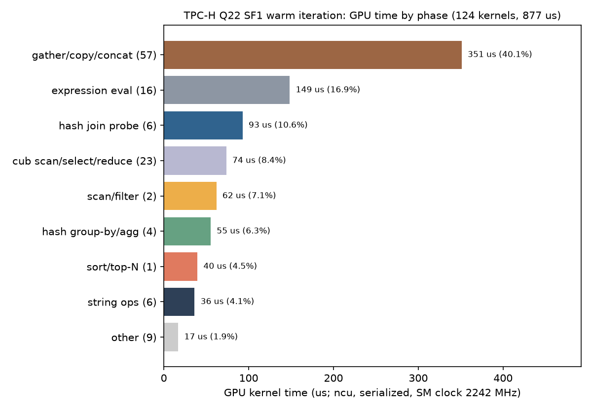
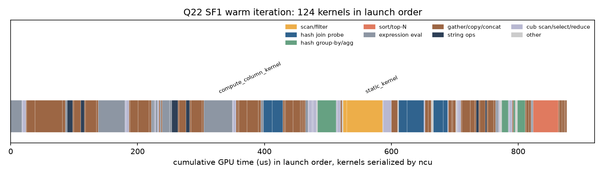
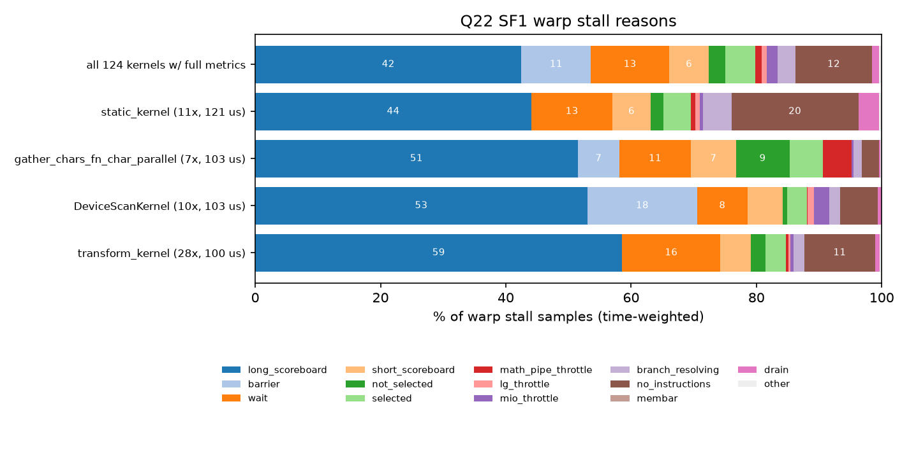
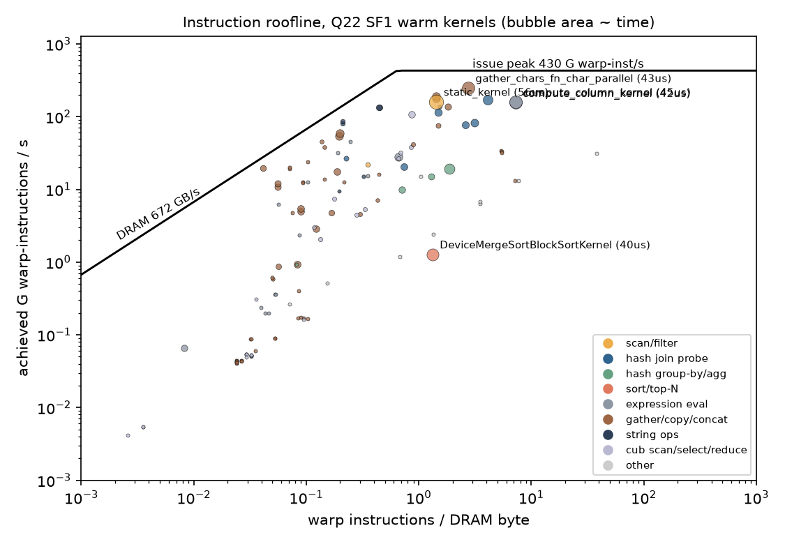

# TPC-H Q22 (SF1) on Sirius, all referenced columns pinned on GPU — Workload Analysis

**Date**: 2026-11-13
**GPU**: NVIDIA GeForce RTX 5070, 12 GB GDDR7 (192-bit, 672 GB/s), Blackwell sm_120, 48 SMs
**Workload**: TPC-H Query 22 (global sales opportunity: `substring(c_phone from 1 for 2)` IN ('24','31','11','16','21','20','34') as filter and group key, scalar subquery `avg(c_acctbal)` over `c_acctbal > 0` customers with the same code list, `NOT EXISTS` against `orders`, 7 groups, ORDER BY; constants read from `q22.sql`), scale factor 1. The 4 referenced columns of 2 tables are pinned in GPU memory with `pin_table(tier='gpu')` (10.05 MB); measured iterations read no table data from host (§3).
**Framework**: Sirius (`sirius-duckdb` release build), DuckDB v2.0, stock libcudf from the pixi env, CUDA runtime 13.5 (versions copied from the Q12 report, not re-queried)
**Pipeline**: `scripts/tpch_sf1/profile_query.sh 22` (239 s of pipeline stages: 15 s for sql/timing/pcie/selftest + 224 s for list/detail/extract/validate; `pipeline_run.log`); every number below comes from a file in this directory.
**Labels**: *measured* = read from a profiler/log file; *inferred* = derived by arithmetic or reasoning from measured data.

---

## 1. Executive Summary

A warm Q22 takes **7.0 ms end-to-end** (median of 12 timed runs after 3 warmups, range 6–7 ms, `.timer` 1 ms resolution; *measured*, `timing_summary.txt`). DuckDB on the CPU takes 30.0 ms (min 27, max 35), so the GPU is 4.3x faster (*inferred* ratio). The 7-row result equals DuckDB-CPU exactly (compare mode `exact`, max relative difference 0.0, tolerance 1e-9, identical across all 15 GPU iterations; `timing.json`) although it contains an average-derived comparison and DECIMAL sums. The first (cold) iteration takes 71.0 ms. `substring` and the string IN-list ran on the GPU (no `ERROR.txt`).

| Where the 7.0 ms go (median warm iteration, 1 ms stamps) | ms | Source |
|---|---:|---|
| Planning (DuckDB optimizer + Sirius plan build, 28 pipelines) | 2 | Sirius log, *measured* |
| Engine window (timing run) | 4 | Sirius log, *measured* |
| Gap from `QueryEnd` to the next statement | 1 | Sirius log, *measured* (2 + 4 + 1 = 7 ms, equal to the median wall; 1 ms stamps, medians of parts) |
| GPU busy (kernels + copies, real clocks, nsys run) | **0.562** | `nsys_iteration_breakdown.txt`, *measured* |
| Engine window with the GPU idle (host orchestration) | ~3.4 | engine 4 ms (timing run) − GPU busy 0.562 ms (nsys run), *inferred*, ±1 ms |

GPU busy is 8.0% of the 7.0 ms wall (*inferred*). Inside the 492.2 µs of kernel time (nsys real clocks, 124 kernels per iteration, deterministic):

1. **`static_kernel` 80.1 µs (16.3%), 11 launches.** The largest launch (ncu 56.4 µs, 10.2 waves) is the dynamic-filter membership probe of the orders scan against a 19,125-row key set; it is stalled 65.4% on long-scoreboard waits at `ISETP` compares that consume hash-bucket loads (§8).
2. **`gather_chars_fn_char_parallel` 62.6 µs (12.7%), 7 launches**; the whole "gather: strings" operator (7 gathers + 10 offset scans + 10 scan-init kernels = 27 kernels) is 221.9 µs ncu (25.3%). The largest launch copies one byte per lane (`LDG.E.U8` → `STG.E.U8`) at 91.0 GB/s (13.5% of peak).
3. **`compute_column_kernel` (libcudf AST evaluator) 61.9 µs (12.6%), 3 launches**; two launches of ~1,100 CTAs (ncu 44.7 and 42.3 µs) are bound by the load/store pipe (LSU 70.1% / 65.6%), not DRAM (3.3% of peak).

Against the physical floor of 15.0 µs (10.05 MB at 672 GB/s, `physical_floor.md`): GPU busy is **37.6x** the floor and the wall is **468x** (*inferred*). 82 of 124 kernels last < 5 µs (ncu full pass), 42 are single-CTA, 107 launch < 1 wave. Q22 is limited by the number of tiny kernels, string re-materialisation and orchestration, not by DRAM bandwidth.



---

## 2. Workload Description

- Plan (`query_plan.txt`, counted by distinct ids 0–41): **42 operators in 28 pipelines**: 3 GPU_SCANs (ids 0, 8, 22), 4 FILTER (1, 9, 16, 32), 5 PROJECTION (2, 5, 10, 14, 33), UNGROUPED_AGGREGATE (3) + MERGE_AGGREGATE (4), NESTED_LOOP_JOIN type INNER (13), CTE (15), 2 HASH_GROUP_BY (17, 34) + 2 MERGE_GROUP_BY (19, 36), 1 DYNAMIC_FILTER (23), 2 HASH_JOIN (26 type SEMI, 31 type MARK), ORDER_BY (37) with SORT_SAMPLE/SORT_PARTITION/MERGE_SORT (38–40), 8 PARTITION, 6 CONCAT, RESULT_COLLECTOR (41). So 3 joins and 1 dynamic filter.
- `customer` is scanned **twice** (ids 0 and 8) and `orders` once (id 22): the Sirius log lists "assigned pinned entry 'customer' to operator '0'", "'customer' ... '8'", "'orders' ... '22'" (3 GPU_SCANs, 3 assignments; table-to-id mapping from that log).
- Structure (*inferred* from the plan): id 0 = the `avg(c_acctbal)` subquery scan; ids 8 → 13 (NLJ with the 1-row average) → 15/16/17 yield the customer rows above average; id 26 SEMI joins their distinct custkeys with the orders scan (dynamic filter id 23 built from them), id 31 MARK-joins the customer rows against that result, id 32 filters on the mark (the NOT EXISTS), id 34 groups by country code.
- Dynamic filter: "pushed 1 dynamic filter(s) ... (19125 build rows ...)" once per iteration (`traces/sirius_log_timing/*.log`), equal to the DuckDB-CPU count of customers in the code list with balance above the average (19,125).
- Row counts and selectivities (DuckDB-CPU on the Parquet, `physical_floor.md`): customer 150,000; code in list 42,030 (28.0%); also `c_acctbal > 0` 38,176 (avg 5011.385); above the average 19,125; additionally no order **6,424** (sum of `numcust` in `result.csv`). orders 1,500,000 rows, 99,996 distinct custkeys; 50,004 customers (33.3%) have no order. Result: 7 groups, 155 B.
- Pinned bytes (`gpu_pool ... QueryEnd allocated=`): customer 4,050,432 B (c_custkey, c_phone, c_acctbal), orders 6,000,128 B (o_custkey); total **10,050,560 B**.
- 124 kernel launches per warm iteration (list passes: 558/682/806 launches for pin+3/4/5 iterations, +124 each); ncu policy **`full_all`** (124 ≤ 1000), `--set full` on all 124.

## 3. PCIe Verification (`pcie_verification.txt`: `OVERALL: PASS`)

No table data cross PCIe in the measured iterations; only small control copies do: per iteration up to 102 H2D copies / 4,868 B and 79 D2H copies / 570 B (*measured*; quoted from the check lines):
- `timing_log:pinned_entry_per_gpu_scan` / `nsys_log:...`: "every iteration: #`assigned pinned entry` == #GPU_SCAN operators (3), all of ['customer', 'orders'] present" — 3 GPU_SCAN operators (customer twice, orders once) vs 3 assignments.
- `fs_cache_zero_every_iteration`: "16 cache summaries for 15 iterations ... iterations 1..15 all last_cycle[reads=0 hits=0 h2d=0 miss=0 ...]" (nsys run: 9 summaries for 8 iterations, all zero).
- `no_parquet_decode_kernels`: "0 decode/decompress kernels among 992 kernels of all 8 iterations".
- `h2d_measured_iterations`: "up to 102 copies, 4868 B total, largest single 756 B (limits: single <= 65536 B, total <= 1048576 B)". `d2h_measured_iterations`: "up to 79 copies, 570 B total, largest single 214 B (result CSV is 155 B; limit 262144 B)". `no_other_host_copies`: 0 managed/unknown-kind copies. Per-iteration on-device D2D: 15 copies, 4,662,042 B, largest 2,250,000 B (= 150,000 x 15 B, *inferred* to be the c_phone character buffer).
- `unified_memory`: UM CPU+GPU fault collection on; "faults per measured iteration [0, 0, 0, 0, 0]; managed-memory API calls in the whole trace: none" (the fault tables are written only when a fault occurs).
- `pool_counters_stable`: "gpu_pool allocated == pinned footprint 10050560 B at QueryBegin and QueryEnd"; `no_downgrade_or_spill`: 0 lines. `no_host_staged_filter_publication`: "15 filter publication(s) logged in query iterations; 0 carry a transport line, all 'peer copies' (device-side), 0 host-staged; no transport line was logged, so this check does not show how those filters move" — it shows nothing about transport; the no-PCIe claim for the 19,125-row filter rests on the H2D byte bound (largest copy 756 B) and the sysmem check (*inferred*).
- Pin phase (not measured iterations): H2D 89 copies, 6,177,106 B, largest 1,048,576 B.
- `ncu_sysmem_check.txt`: 124 kernels, 0 with SM (tex) sysmem-aperture sectors (total 0); the all-source counter reads 265–279 sectors per kernel (information only); ncu `pcie__read/write_bytes` 0 / 1,337,344 B (rate x duration, includes driver/ncu traffic). `ncu_log_checks_{list,detail}.txt`: every residency check PASS on all four ncu runs, including "#`assigned pinned entry` == #GPU_SCAN operators (3)".
- Negative control (`selftest_negative_control.txt`): with `orders` left unpinned `pcie_verify.py` exited 1 as expected, failing `pinned_entry_per_gpu_scan` ("2 assigned for 3 GPU_SCANs, missing tables ['orders']"), `fs_cache_zero_every_iteration` (reads 2, h2d 5), `no_parquet_decode_kernels` (3 flagged kernels: count/decode_page_headers + a for_each static_kernel), `h2d_measured_iterations` (4,007,306 B per iteration, largest 1,979,877 B); `SELFTEST: PASS (verification detected the unpinned table)`. Tables below the byte limit: none (both have ≥ 8192 rows).
- GPU memory: pinned footprint 10,050,560 B; gpu_pool high-water 40,256,128 B (process-lifetime, includes the pin phase).

## 4. Environment

| Component | Version / setting |
|---|---|
| GPU / driver | RTX 5070 (sm_120, 48 SMs, 12 GB, 48 MB L2) / 580.173.02 (copied from the Q8/Q12 reports; not re-queried) |
| Nsight Compute | via `sudo -n`; `--set full --import-source yes` on all 124 warm kernels (version copied from Q12's source, not re-queried) |
| ncu clocks | locked by ncu: SM median 2241 MHz (`ncu_warm_metrics.json`) |
| Nsight Systems | 2025.5.2 (`/home/sai/nsight-systems-2025.5`); `-t cuda -s none --cpuctxsw=none` plus UM page-fault collection |
| CPU | Intel i9-13900K, 125 GB RAM (copied from the Q12 report) |
| Sirius config | `scripts/tpch_sf1/sirius.yaml`: 4 pipeline threads, GPU pool 25% of 12 GB, 1 GB pinned host pool (2 pools), `enable_duckdb_fallback=false` |

## 5. Physical Floor vs Measured

Floors from `physical_floor.md`, written before any ncu output (*inferred* from table statistics):

| Scenario | Bytes | Floor @ 672 GB/s |
|---|---:|---:|
| A. every pinned column once (narrowed) | 10.05 MB | **15.0 µs** |
| A'. native widths (inferred) | 10.65 MB | 15.8 µs |
| A-min. predicate/join columns only (= A', every column is used) | 10.65 MB | 15.8 µs |
| B. A + ~0.5 MB intermediates | ≈ 11.1 MB | ≈ 16.5 µs |
| Compute estimate (~0.01 G simple ops) | | < 5 µs |
| Launch-count bound (124 kernels x ~2 µs, figure imported from earlier queries, not re-measured) | | ~248 µs |

| Measured (real clocks unless noted) | Value | × floor A (15.0 µs) |
|---|---:|---:|
| Wall, warm median (`timing.json`) | 7.0 ms | 468x |
| nsys GPU busy (`nsys_iteration_breakdown.txt`) | 0.562 ms | 37.6x |
| nsys kernel sum | 0.492 ms | 32.9x |
| ncu serialized kernel sum (clock-locked, cold-L2; not comparable with the rows above) | 0.877 ms | 58.6x |

ncu DRAM traffic for the warm iteration: 70.24 MB (cold-L2, `ncu_extract_summary.txt`), 6.99x the pinned footprint (*inferred*), average 80.1 GB/s (11.9% of peak) over the serialized kernel time: the extra traffic is intermediate columns (string copies, partitions, concatenations) rewritten and re-read (*inferred*). The best single-kernel DRAM% over all 124 kernels is 72.4% (`transform_kernel`, pos 72, 9.9 µs).

## 6. Kernel, Phase and Operator Breakdown

Phase table (ncu full pass, serialized, `phase_breakdown.txt`; 124 kernels, 876.9 µs):

| Phase | Kernels | µs | % | DRAM MB | GB/s |
|---|---:|---:|---:|---:|---:|
| gather/copy/concat | 57 | 351.3 | 40.1 | 40.08 | 114.1 |
| expression eval | 16 | 148.5 | 16.9 | 5.18 | 34.9 |
| hash join probe | 6 | 93.0 | 10.6 | 4.30 | 46.3 |
| cub scan/select/reduce | 23 | 73.8 | 8.4 | 2.79 | 37.7 |
| scan/filter (dynamic-filter probe) | 2 | 62.0 | 7.1 | 6.70 | 108.1 |
| hash group-by/agg | 4 | 55.3 | 6.3 | 0.63 | 11.4 |
| sort/top-N | 1 | 39.7 | 4.5 | 0.04 | 1.0 |
| string ops | 6 | 36.3 | 4.1 | 10.46 | 288.2 |
| other | 9 | 17.0 | 1.9 | 0.06 | 3.4 |

Operators (`operator_breakdown.txt`): gather: strings 27 kernels 221.9 µs (25.3%); expression AST 3 kernels 98.6 µs (11.2%); hash-join output/compaction 6 kernels 93.0 µs (10.6%); gather/scatter fixed-width 18 kernels 66.3 µs (7.6%); copy/concatenate 12 kernels 63.1 µs (7.2%); cub select/compact 18 kernels 61.4 µs (7.0%); dynamic-filter membership probe 1 kernel 56.4 µs (6.4%); group-by 4 kernels 55.3 µs (6.3%); sort 1 kernel 39.7 µs (4.5%); string ops 6 kernels 36.3 µs (4.1%). `other:` rows (`transform_kernel` 5.5 µs, `static_kernel` 1.6 µs) total 7.1 µs (0.8%), below the 5% bar, so `kclass.py` was not edited. The 6 "string ops" kernels are 3 `transform_kernel` (strings functor, 8.9/9.6/3.9 µs) + 3 `valid_if_kernel` (`make_strings_column`, 5.7/5.9/2.3 µs); that they are the three `substring` evaluations is *inferred* from the names.

Kernel-size facts (*measured*, ncu full pass): 82 kernels < 5 µs, 96 < 10 µs (302.8 µs, 34.5% of time); 107 kernels launch < 1 wave (548.7 µs) and 73 have grid < 48 CTAs; 42 are single-CTA (128.4 µs, 14.6%). The list pass gives median kernel 3.46 µs. Only 17 launches reach ≥ 1 wave (328.2 µs, 37.4% of ncu time; from `ncu_warm_metrics.json`): `static_kernel` 3 of 11 (max 10.17 waves), `gather_chars_fn_char_parallel` 4 of 7 (max 7.40), `compute_column_kernel` 2 of 3 (2.71), `MultiBlockBatchMemcpyKernel` 3 of 3 (5.0), `valid_if_kernel` 2 of 3 (2.03), `DeviceSelectSweepKernel` 1 of 10 (2.72), `insert_if_n` 1 of 3 (2.57), `contains_if_n` 1 of 2 (2.57). The top-10 kernels hold 38.3% of time. Real-clock nsys kernel time by family (mean per measured iteration, 492.2 µs): static_kernel 80.1 (16.3%), gather_chars 62.6 (12.7%), compute_column 61.9 (12.6%), DeviceScanKernel 46.1 (9.4%), transform 43.9 (8.9%), DeviceSelectSweep 34.2 (7.0%), merge sort 30.4 (6.2%), insert_if_n 23.3 (4.7%), contains_if_n 22.0 (4.5%), BatchMemcpy 21.5 (4.4%).

Per-iteration CPU-side API (nsys, mean of 5): 329 `cudaStreamSynchronize` (0.668 ms CPU, summed over threads) + 67 `cuStreamSynchronize` (0.272 ms), 124 `cudaLaunchKernel` (0.407 ms), 179 `cudaMemcpyBatchAsync` (0.382 ms), 222 `cudaMallocFromPoolAsync`/`cudaFreeAsync` pairs (0.175/0.110 ms).




## 7. Top Kernels (ncu `--set full`, serialized, clock-locked, L2 flushed per kernel)

| pos | Kernel (operator, *inferred* from name/grid) | µs | grid × blk | waves | SM% | DRAM% | GB/s | main stall |
|---:|---|---:|---|---:|---:|---:|---:|---|
| 69 | static_kernel (dynamic-filter membership probe, orders) | 56.4 | 2930 × 256 | 10.17 | 40.0 | 17.0 | 112.6 | long_sb 65.4% |
| 39 | compute_column<128,0,1> (AST) | 44.7 | 1172 × 128 | 2.71 | 66.0 | 3.3 | 22.1 | long_sb 45.0% |
| 5 | gather_chars_fn_char_parallel | 43.4 | 4260 × 128 | 7.40 | 64.4 | 13.8 | 91.0 | long_sb 47.8% |
| 15 | compute_column<128,0,1> (AST) | 42.3 | 1065 × 128 | 2.47 | 62.9 | 3.2 | 21.4 | long_sb 45.6% |
| 118 | MergeSortBlockSort (string key, result rows) | 39.7 | 1 × 256 | 0.00 | 0.4 | 0.1 | 1.0 | barrier 61.6% |
| 63 | static_kernel (group-by compute_groupby) | 29.8 | 38 × 256 | 0.20 | 4.7 | 1.5 | 10.2 | long_sb 47.8% |
| 75 | contains_if_n (filtered-join probe) | 26.5 | 1483 × 128 | 2.57 | 41.6 | 6.2 | 41.3 | long_sb 39.4% |
| 45 | gather_chars_fn_char_parallel | 17.7 | 1314 × 128 | 2.28 | 49.4 | 20.0 | 132.1 | long_sb 53.1% |

(`top_kernel_details.txt`.) Time-weighted stall mix over all 124 kernels: long_scoreboard 42.5%, wait 12.5%, no_instructions 12.2%, barrier 11.1%, short_scoreboard 6.3%. Roofline reading: the 17 kernels that fill the GPU run at 0.1–20% of DRAM peak, except the two ≥ 1-wave `valid_if_kernel` launches (pos 11, 35: 58.4% / 62.3%); `BatchMemcpyKernel` reaches 278.7–300.7 GB/s (42–46%, < 1 wave) and the best kernel overall 72.4%; the AST kernel sits against the load/store-issue pipe (LSU 70.1%), not the bandwidth ceiling. The 124-launch list is dominated in count by tiny kernels (§6).




## 8. Instruction-Level Evidence for the #1 kernel (`sass/static_kernel_hotspots.txt`, pos 69)

Kernel: `for_each::static_kernel<..., sirius::membership_probe_functor<integral_probe_adapter<int,int>, set_lookup<cuco::static_set_ref<int,1,...,double_hashing<1, XXHash_32...>>>>>`; 37 registers; 2,896 static instructions of which **773 ever execute (26.7%)**; 9.132e6 executed warp instructions, 5,441 stall samples (*measured*). Instruction mix (executed): int arithmetic 54.6% (85.2% of stalls), control flow 16.0%, global load 3.0%. Stall reasons: long_sb 65.4%, wait 14.2%. The multiply constant `-0x3d4d51c3` (= 0xC2B2AE3D) at `+0x003e0`/`+0x019e0` matches an XXH32 prime, so those IMADs are the hash computation (*inferred* from the constant).

Launch shape: the first instructions run 23,432 warp executions at 32.0 lanes (two keys per thread: `+0x003c0 LDG.E R34, [R24.64]` and `+0x019c0 LDG.E R24, [R24.64+0x400]`, both exe = 23,432 at 32.0 lanes in `static_kernel_pos69_source.csv`; ≈ 1,499,648 lookups for 750,080 threads, i.e. all 1,500,000 orders rows), i.e. **389.7 warp instructions per warp-pass** (9.132e6 / 23,432); one warp instruction serves up to 32 lookups. Two keys per thread cover all 1,500,000 orders rows; ~390 warp instructions per warp-pass are ~195 per 32 keys (*inferred*).

Chain A (bucket slot 0; all executed, exe = 23,432, 32.0 lanes; window around `+0x00d60`):
```
+0x00d20  LEA R4, P0, R18, UR4, 0x2            ; address from R18 (producer outside window)
+0x00d50  LDG.E R3, desc[UR40][R4.64]           ; loads slot 0 of the bucket -> R3     samp 5
+0x00d60  ISETP.NE.U32.AND P1, PT, R34, R3, PT  ; reads R3 (the LDG above) and R34   samp 609, long_sb 606
```
Chain B (slot 1; reached by 30,923 warp executions at 14.0 of 32 lanes (44%); window around `+0x00e50`):
```
+0x00e40  LDG.E R3, desc[UR40][R4.64+0x4]       ; loads slot 1 -> R3                   samp 15
+0x00e50  ISETP.NE.U32.AND P2, PT, R34, R3, PT  ; reads R3 (the LDG above) and R34   samp 535, long_sb 531
```
Chain C (`+0x02490 LDG.E R9, [R4.64+0x4]` → `+0x024a0 ISETP.NE.U32.AND P2, PT, R24, R9, PT`, samp 467, 14.0 lanes) has the same shape for the second key per thread (R24). All three are register-exact: the stalled compare reads the register written by the adjacent load (*measured* from the dump). Together they hold 1,611 of 5,441 samples (29.6%). The compared operands R34/R24 (the probe key, *inferred*) and the bucket address register R18 are produced outside the quoted windows. The other hot PCs lie outside the exported windows but are in `static_kernel_pos69_source.csv`: `+0x003e0 IMAD R0, R34, …` (424) waits on `+0x003c0 LDG.E R34` (first key), `+0x019e0 IMAD R29, R24, …` (314) on `+0x019c0 LDG.E R24, [R24.64+0x400]` (second key), and `+0x023a0 ISETP R24, R7` (459) on `+0x02390 LDG.E R7` (slot 0 for the second key). That the slot-0/slot-1 loads are "bucket slots" and that the 14-lane block is a second probe step for lanes whose slot 0 did not match are inferences from the offsets +0/+4 and the lane counts.

Reading: each probe is a dependent hash → address → load → compare sequence with ~390 warp instructions per warp (two keys per lane); the loads miss the L1 (L1 hit 39.7%) and hit L2 88.6% (cold-flush), so each compare waits on an L2-latency load (*inferred*). DRAM is not the limit: 6.35 MB at 112.6 GB/s = 17.0% of peak.

## 9. Root Cause Analysis

**RC1: string materialisation (`gather_chars_fn_char_parallel` + string-offset scans, 221.9 µs ncu for 27 kernels = 25.3%; gather_chars alone 62.6 µs nsys)**
- Symptom (*measured*): 7 gather launches, 103.2 µs ncu (11.8%); the largest (pos 5) takes 43.4 µs at 91.0 GB/s; 10 `DeviceScanKernel` launches of 3.9–13.2 µs each at grids of 1–56 CTAs (sub-wave) cost 102.9 µs (11.7%).
- WHY? `sass/gather_chars_fn_char_parallel_hotspots.txt`: `+0x018b0 STG.E.U8 [R10.64], R9` has 989 samples (23.7%, long_sb 984) and reads R9 written four instructions earlier by `+0x01870 LDG.E.U8 R9, [R8.64]` (register-exact, same window; its address R10 comes from the `IADD.64` at `+0x01880`): a byte-at-a-time load-then-store. 63,895 executions at 31.0 lanes ≈ 1.98 M byte-stores in the launch (*measured* product; one byte per lane is *inferred*), 3.75 loop iterations per warp (63,895 / 17,040 warps), 5.5 warp instructions per stored byte (1.086e7 / 1.98 M).
- WHY? `+0x01810 @!P0 SHF.R.S32.HI R11, RZ, 0x1f, R10` (534 samples) reads R10 from `+0x01800 @!P0 LD.E R10, [R14.64]` (register-exact): an offset/size load feeds the address of the copy. For `+0x01770 IADD3 R19, R0, UR8, R19` (322 samples) the only load of R0 in the window (`+0x016f0`) has exe = 0 and R19 comes from a constant load, so the producer of its long_sb wait is outside the executed window.
- WHY so many launches? Every launch of a string column through a filter / PARTITION / CONCAT / join gather needs new offsets (scan-init + scan) before the chars can be gathered; the plan has 8 PARTITION + 6 CONCAT + 4 FILTER = 18 such operators against 10 offset scans and 7 char gathers, so there is no one-to-one count match; which boundaries re-materialise strings is *inferred*.
- ROOT (*inferred*): the 15-character `c_phone` column and the 2-character `cntrycode` column are re-materialised as variable-length strings at every operator boundary (27 kernels, 25.3% of ncu time) with a per-byte copy that reaches 13.5% of peak, instead of passing fixed-width codes or offset views.

**RC2: dynamic-filter membership probe (`static_kernel` pos 69, 56.4 µs ncu, 6.4%)**
- Symptom (*measured*): 10.17 waves, 93.0% achieved occupancy, IPC 1.70, DRAM 17.0%, L1 hit 39.7%, L2 hit 88.6%.
- WHY slow? 65.4% of stall samples are long_sb and 85.2% of stall samples fall on int-arithmetic instructions, which are the compares that consume loads (§8 chains A–C, register-exact).
- WHY are lanes thin? 23.9 of 32 lanes active per warp instruction on average (75%); the slot-1 blocks run at 14.0 lanes (44%) and 30,923 warp executions vs 23,432 first-slot executions (*measured*); the cause (probe divergence on bucket slot 0 vs 1) is *inferred*.
- ROOT (*inferred*): a hash probe of ~1.5 M keys into a 19,125-key set is latency-bound on dependent L2-latency loads, with ~390 warp instructions per warp-pass; the filter removes most orders rows, but its cost is paid on all probed keys. This one launch is 6.4% of ncu time, the largest single kernel.

**RC3: launch and orchestration overhead (the other ~6.4 ms of wall)**
- Symptom (*measured*): wall 7.0 ms vs GPU busy 0.562 ms; planning 2 ms; engine window GPU idle ~3.4 ms (*inferred*, ±1 ms).
- WHY? 124 launches, 329 + 67 stream syncs, 179 batch copies and 222 pool alloc/free pairs per iteration (*measured*); 42 kernels are single-CTA and 82 take < 5 µs (ncu), 107 launch < 1 wave, so no kernel is large enough to hide host latency (*inferred*).
- ROOT (*inferred*): the plan has 28 pipelines with FULL/PARTIAL barriers and a 7-row result path of 79 tiny D2H copies (570 B); "each sync waits for a µs-scale kernel" is not measured (nsys gives call counts and summed CPU time only).

**Also notable: a 7-row sort costs 30.4 µs nsys (6.2%).** `DeviceMergeSortBlockSortKernel` runs 1 CTA × 256 threads for 39.7 µs ncu, 5.09e4 warp instructions, active_frac 0.02 (SM busy max/avg 48.0), barrier stalls 61.6% (*measured*); that it sorts the 7 result groups by the string key `cntrycode` is *inferred* from the name (`simple_comparator<cudf::stri...`) and the 7-row result.

## 10. Gap Analysis

| Layer | Time | × floor A | Source |
|---|---:|---:|---|
| Floor A (10.05 MB / 672 GB/s) | 15.0 µs | 1.0x | `physical_floor.md` |
| nsys kernel sum | 492 µs | 32.9x | `nsys_iteration_breakdown.txt` |
| nsys GPU busy | 562 µs | 37.6x | `nsys_iteration_breakdown.txt` |
| Engine window (timing run) | 4000 µs | 267x | Sirius log |
| Wall | 7000 µs | 468x | `timing.json` |

The 37.6x GPU gap is a count problem rather than a bandwidth one: 124 kernels at a mean of 3.97 µs (492.2 / 124, nsys) versus a 15.0 µs floor for the whole query; the ncu pass reads 6.99x more DRAM bytes than the pinned footprint but at 11.9% of peak. The three largest sinks are 41.6% of nsys kernel time (204.6 / 492.2 µs: static_kernel, gather_chars, compute_column). Even a zero-cost kernel would leave the ~6.4 ms of non-GPU wall (planning, synchronisation, result handling; wall − GPU busy, *inferred*, mixing the timing and nsys runs).

## 11. Optimization Directions (general-purpose; no query-specific fusion)

1. **String columns without per-boundary re-materialisation (libcudf/Sirius operator, general).** Skip the offsets scan when all strings in a column have equal length, gather fixed-width char arrays with vectorised (4/8/16 B per lane) loads and stores instead of `LDG.U8`/`STG.U8`, or carry dictionary codes / (offset,length) views through PARTITION and CONCAT. Target: the 27 string-gather kernels (221.9 µs ncu, 25.3%); the realistic gain is bounded by the 10 scan launches that would disappear plus the faster copy (*inferred*).
2. **Cheaper membership probe.** Load a bucket with one vector load instead of two dependent scalar loads (`+0` and `+4`), and probe on the filtered key stream rather than the full column; target the 56.4 µs / 389.7 warp instructions per warp-pass (*inferred*).
3. **Small-input sort path.** A single-CTA block sort for 7 rows pays 30.4 µs nsys; a warp-level or CPU-side path for tiny inputs would remove it (*inferred*).
4. **AST evaluator**: reduce the per-row descriptor loads (LSU pipe 70.1%, 1.15e6 load requests in the largest launch) — SASS for this family was not exported, so the mechanism is *inferred* from metrics.
5. **Cut synchronisation and allocation churn.** 396 syncs, 222 alloc/free pairs and 124 launches for a 7-row result; batch per-partition pipelines and reuse pool allocations (*inferred* benefit; GPU idle ~3.4 ms of the engine window).
Kernel fusion is mentioned only as context: it would lower launch counts but is out of scope here.

## 12. Determinism and Profiling Method

- **Launch counts are deterministic** (*measured*, `warm_kernel_summary.txt`, `ncu_plan.json`, `pcie.json`): every iteration = 124 launches in the three ncu list runs (558/682/806) and in all 8 nsys iterations; `STABLE: True`, added-iteration multisets equal.
- **Launch order**: iteration 4 vs 5 differ at 0 positions here; the slice needs only counts and multisets (`ncu_slice_check.txt`: multiset match True; one name reconciled on function/grid/block; identical launch order False vs the list pass).
- **ncu policy branch**: 124 ≤ `NCU_FULL_MAX` (1000) → `full_all`; the light + families branch was not used.
- nsys: 5 measured iterations (4–8), kernels [124]x5, GPU busy 0.554–0.564 ms; nsys inflates the engine window (8.0 ms vs 4 ms in the timing log), so wall splits come from the timing log.
- Timing: 3 warmups + 12 timed iterations; DuckDB-CPU same protocol (first 35.0 ms).
- ncu durations are serialized, clock-locked and L2-flushed per kernel; they are never summed or subtracted with nsys times.
- Validation: `validate_pipeline.txt` SUMMARY q22: 72 PASS, 0 FAIL, 1 PENDING (the report).

## 13. Limitations

- ncu serialized kernel sum 876.9 µs (list pass 900.5 µs) vs nsys 492.2 µs; tiny kernels are overstated by ncu. All real-clock claims use nsys.
- ncu DRAM bytes (70.24 MB) are cold-L2 traffic; the working set (10.05 MB) fits in the 48 MB L2, so real in-query DRAM traffic is likely lower (*inferred*).
- Wall splits are 1 ms stamps; the ~3.4 ms "GPU idle" mixes the timing run and the nsys run (±1 ms).
- The membership probe (pos 69) probes two keys per thread (≈ 1.5 M lookups, all orders rows; from the source CSV), and which scan/partition each other launch handles is *inferred* from grid × block only. What the loads in §8 fetch (bucket slots, probe key in R34/R24) is inferred from offsets and compare shapes; the producer of the gather kernel's R0 is outside the exported window.
- SASS covers the top 2 families only (static_kernel pos 69, gather_chars pos 5); compute_column, scans, merge sort and join probes are analysed from ncu metrics only. The XXH32 identification rests on a single immediate. Stall-sample counts on small kernels are small.
- Two hit rates (pos 29 L2 102.6%, pos 60 L2 113.2%) are clamped to 100 in `ncu_warm_metrics.json` (raw kept). The ~2 µs smallest-kernel figure is carried over from earlier queries, not re-measured.
- `substring`/IN-list kernels are identified from kernel names (`transform_kernel` + `valid_if_kernel`/`make_strings_column`, `compute_column_kernel`), not from a Sirius source read.
- Only the pinned configuration was profiled; no unpinned timing comparison. Native widths (31 B/row customer) are inferred; the 1e-9 result tolerance was not exercised (max rel diff 0.0).

## 14. Raw Data

| File | Contents |
|---|---|
| `timing_summary.txt`, `timing.json`, `result.csv`, `traces/timing_run.txt`, `traces/duckdb_cpu_run.txt` | timing, result, CPU baseline, compare mode |
| `query_plan.txt`, `sql/` | Sirius plan, generated SQL |
| `pcie_verification.txt`, `pcie.json`, `traces/q22_nsys.{nsys-rep,sqlite}`, `traces/sirius_log_*` | PCIe evidence |
| `ncu_sysmem_check.txt`, `ncu_log_checks_{list,detail}.txt`, `selftest_negative_control.txt`, `selftest/` | host-memory-in-place, residency checks, negative control |
| `nsys_iteration_breakdown.{txt,json}` | GPU busy, API counts, real-clock kernel times |
| `warm_kernel_list.json`, `warm_kernel_summary.txt`, `ncu_plan.json`, `traces/ncu_list_x{3,4,5}.csv` | list passes, determinism, plan |
| `profiles/q22_warm_full.ncu-rep`, `ncu_slice_check.txt` | full ncu report (124 kernels) |
| `ncu_warm_metrics.json`, `ncu_extract_summary.txt`, `phase_breakdown.txt`, `operator_breakdown.txt`, `top_kernel_details.txt` | extracted metrics |
| `sass/` | hotspots for `static_kernel` and `gather_chars_fn_char_parallel` |
| `plots/q22_*.png` | phase breakdown, kernel sequence, roofline, stall mix |
| `physical_floor.md`, `pipeline_run.log`, `validate_pipeline.txt` | floor, logs, validation |
