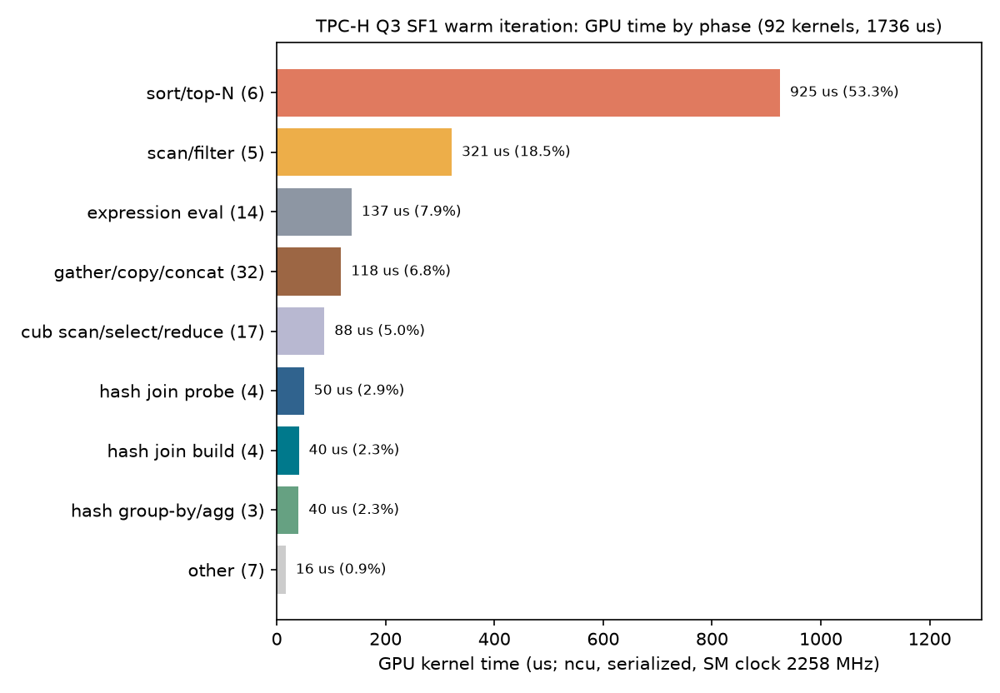
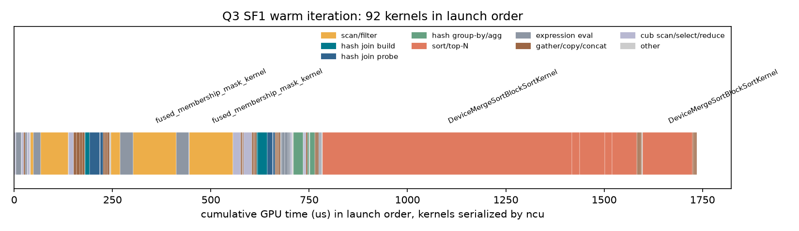
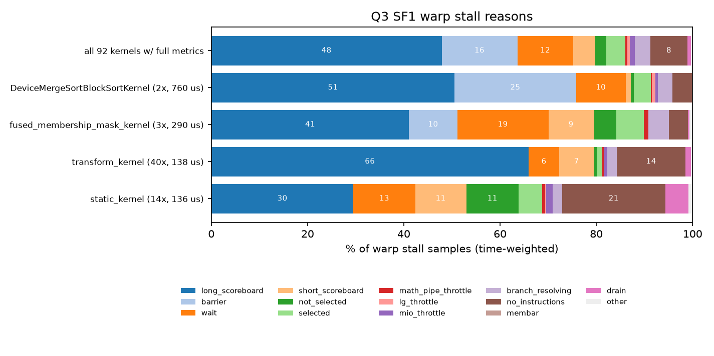
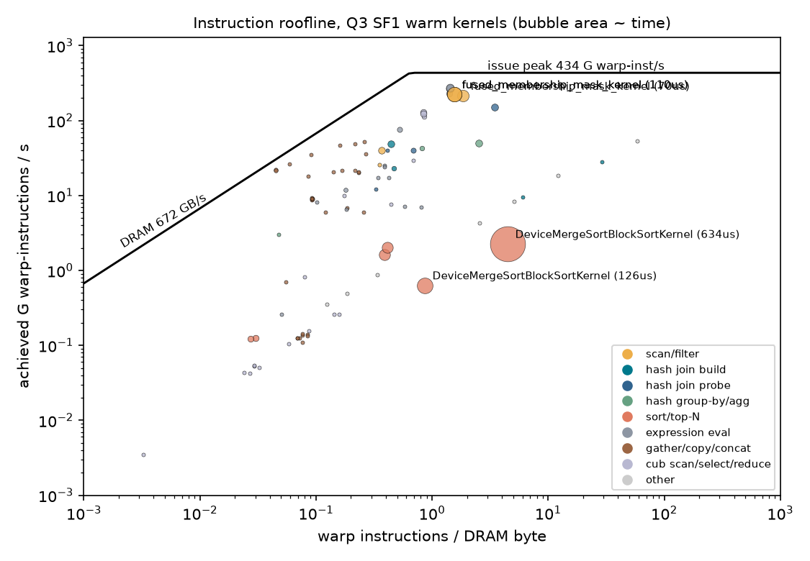

# TPC-H Q3 at SF1 on Sirius with GPU-resident data: profiling report

- **Date:** 2026-11-13. **GPU:** RTX 5070 (12 GB, 672 GB/s peak, sm_120, 48 SMs).
- **Workload:** TPC-H Q3 (customer ⋈ orders ⋈ lineitem; group by `l_orderkey, o_orderdate, o_shippriority`; top 10 by revenue). Pinned with `pin_table(tier='gpu')`: customer (`c_mktsegment, c_custkey`), orders (`o_custkey, o_orderkey, o_orderdate, o_shippriority`), lineitem (`l_orderkey, l_extendedprice, l_discount, l_shipdate`). Pinned footprint 103,068,160 B (103.07 MB).
- **Framework:** Sirius `sirius-duckdb` release build, DuckDB v2.0, stock libcudf from the pixi env, CUDA runtime 13.5.
- **Pipeline:** `scripts/tpch_sf1/profile_query.sh 3`. The first three stages took 7 s (sql 0 s, timing 2 s, pcie 5 s); list took 18 s (`pipeline_run.log`). See §12 for the rest.
- **Labels:** *measured* means read from a profiler or log file in `results/q3`. *Inferred* means derived from measured data.

## 1 Executive Summary

- **Timing (measured, `timing_summary.txt`):** warm median 5.0 ms (min 5, max 6, stdev 0.47). DuckDB-CPU warm median 26.5 ms, so the GPU is 5.3× faster than CPU.
- **Floor (`physical_floor.md`):** 153.4 µs to read all 103.07 MB once, so the warm wall time is **32.6× the floor** (inferred).
- **Verdict:** Q3 at SF1 is **neither bandwidth- nor compute-bound. It is latency/launch-bound.** It has 92 kernels per iteration, 57 of them under 5 µs and 77 with under one wave. The one big time sink is a top-N sort that runs on 3 CTAs.

| Where the 5.0 ms goes | ms | Source / label |
|---|---:|---|
| Planning (DuckDB + Sirius plan build) | 2 | `timing_summary.txt` log split, measured (1 ms resolution) |
| Engine window | 3 | same, measured |
| of which GPU busy (kernels + copies, real clocks) | 1.258 | `nsys_iteration_breakdown.txt` median, measured (about 42% of the 3 ms, inferred) |
| of which engine with GPU idle (host launch, sync, allocation) | about 1.7 | inferred (3 − 1.258) |
| Result handling | about 0 | log split gap 0 ms; D2H is 422 B per iteration |

**Top kernel families (ncu serialized, `ncu_extract_summary.txt`; nsys real-clock in brackets):**
1. `DeviceMergeSortBlockSortKernel` is 2 launches, 760 µs, **43.8%** (nsys 598.6 µs, 48.5%). It sorts about 11,295 group rows (inferred) on 3 CTAs, so one SM's pointer-chasing comparator code runs alone.
2. `fused_membership_mask_kernel` is 3 launches, 290 µs, **16.7%** (nsys 216.4 µs). It is the dynamic-filter probe and the largest streaming kernel: 4096 CTAs, 17 waves, 143 GB/s (21.7% of peak).
3. `transform_kernel` (40 launches, 7.9%) and `static_kernel` (14 launches, 7.9%) are tiny gather and expression kernels, about 3.4 µs and 9.7 µs on average.

The top-10 kernels make up 73.0% of GPU time (`phase_breakdown.txt`).

## 2 Workload Description

- **Query (`sql/q3_timing.sql`):** `c_mktsegment='HOUSEHOLD'`, `o_orderdate < 1995-03-25`, `l_shipdate > 1995-03-25`, `ORDER BY revenue DESC, o_orderdate LIMIT 10`. The result is 10 rows (376 B), exactly equal to DuckDB-CPU (`timing_summary.txt`).
- **Rows (DuckDB-CPU, `physical_floor.md`):** lineitem 6,001,215; orders 1,500,000; customer 150,000.
- **Selectivities (`physical_floor.md`):**
  - HOUSEHOLD customers: 30,189 (20.1%).
  - Orders before the cutoff: 733,457 (48.9%).
  - Lineitem after the cutoff: 3,216,500 (53.6%).
  - orders ⋈ customer: 146,352.
  - ⋈ lineitem: 30,004.
  - Groups: 11,295.
- **Sirius plan (`query_plan.txt`):** 16 pipelines.
  - Three GPU_SCANs (customer with FILTER, orders and lineitem each with DYNAMIC_FILTER), each followed by PARTITION and CONCAT.
  - Two HASH_JOINs. The second is fused with PROJECTION and HASH_GROUP_BY.
  - Then PARTITION, MERGE_GROUP_BY, PROJECTION ×2, TOP_N, MERGE_TOP_N, RESULT_COLLECTOR.
- **Pinned footprint (`traces/sirius_log_timing`, gpu_pool deltas):**

| Table | Pinned bytes | Per row |
|---|---:|---:|
| customer | 2,549,760 | 17.0 B |
| orders | 16,500,480 | 11.0 B |
| lineitem | 84,017,920 | 14.0 B |

## 3 PCIe Verification

Verdict: **`OVERALL: PASS`** (`pcie_verification.txt`). Nothing in the measured iterations moves table data over PCIe.

| Evidence | Result (file) |
|---|---|
| Pin SQL / `pin_table` calls | all 3 tables pinned once with `tier='gpu'` (`pcie_verification.txt`) |
| Pinned entry per GPU_SCAN | every iteration: `assigned pinned entry` count equals the 3 GPU_SCANs, all of customer/lineitem/orders present, in 15 timing and 8 nsys iterations (`pcie_verification.txt`) |
| fs_cache | `last_cycle[reads=0 hits=0 h2d=0 miss=0]` in all 15 timing and all 8 nsys iterations (`pcie_verification.txt`) |
| Parquet decode kernels | 0 among 736 kernels of the 8 nsys iterations (`pcie_verification.txt`) |
| Downgrade / spill / OOM | 0 lines; 0 cache-assignment errors; 0 host-staged dynamic-filter publications (`pcie_verification.txt`) |
| Pool counters | gpu_pool allocated equals the 103,068,160 B pinned footprint at every QueryBegin and QueryEnd; host_pool unchanged for iterations 2 onward (`pcie_verification.txt`) |
| Unified memory | 0 page faults in the 5 measured iterations; no managed-memory API calls in the whole trace (`pcie_verification.txt`) |
| ncu sysmem aperture | 0 of 92 kernels with SM sysmem sectors; `pcie__read/write_bytes` 0 / 1,001,472 B, which includes driver and ncu traffic (`ncu_sysmem_check.txt`) |
| ncu run logs | residency checks PASS for the 3 list runs and the detail run (`ncu_log_checks_list.txt`, `ncu_log_checks_detail.txt`) |
| Negative control | with lineitem left unpinned, `pcie_verify.py` exits 1 and flags pinned-entry, fs_cache, decode-kernel, H2D 33,019,650 B and D2H failures (`selftest_negative_control.txt`) |

**Per measured iteration (nsys, `pcie_verification.txt`):**

| Direction | Copies | Bytes | Largest single copy |
|---|---:|---:|---:|
| H2D | 36 | 1,093 | 192 B (limit 65,536 B) |
| D2H | 33 | 422 | 280 B (result CSV is 376 B) |
| D2D (on device) | 14 | 481,101 | 120,756 B |

All copies are `cudaMemcpyBatchAsync`. Copies with a non-device source and destination: 0.

**What the small copies are (inferred):** kernel parameter blocks and hash-join size/count scalars. The 33 D2H copies are `Device->Pinned` (26) and `Device->Pageable` (7). The D2D copies are on-device column concat and gather, 0.48 MB in total.

**Pin phase (excluded from measured iterations):** 39.5 MB H2D in 253 copies, largest 1,048,576 B.

**Caveat:** the checks cover memcpy and sysmem sectors. A kernel reading mapped host memory in place would show up only in `ncu_sysmem_check.txt`, which found none.

## 4 Environment

- **GPU / host:** RTX 5070, driver 580.173.02. i9-13900K, 125 GB RAM.
- **ncu:** Nsight Compute 2025.2.1 via `sudo -n`. It locks the SM clock: median `sm__cycles_elapsed.avg.per_second` is **2258 MHz** (`ncu_extract_summary.txt`), below real boost clocks.
- **nsys:** Nsight Systems 2025.5.2 with `-t cuda -s none --cpuctxsw=none`.
- **Sirius config (`scripts/tpch_sf1/sirius.yaml`):** 4 pipeline threads, GPU pool 25% of 12 GB, 1 GB pinned host pool, `enable_duckdb_fallback=false`.

## 5 Physical Floor vs Measured

| Scenario (`physical_floor.md`) | Bytes | Floor |
|---|---:|---:|
| A. read all pinned columns once | 103.07 MB | 153.4 µs |
| A-min (inferred widths) | about 69 MB | about 103 µs |
| B. A + one filtered-lineitem materialization (inferred) | about 180 MB | about 268 µs |
| Compute estimate | n/a | under 15 µs |

| Measured quantity | Value | × floor A | Source |
|---|---:|---:|---|
| Wall, warm median | 5.0 ms | 32.6× | `timing_summary.txt` |
| Engine window (log) | 3 ms | 19.6× | `timing_summary.txt` |
| GPU busy, real clocks | 1.258 ms | 8.2× | `nsys_iteration_breakdown.txt` |
| Kernel sum, nsys | 1.235 ms | 8.0× | `nsys_iteration_breakdown.txt` |
| Kernel sum, ncu (serialized, clock-locked, L2 flushed) | 1.736 ms | 11.3× | `ncu_extract_summary.txt` |
| DRAM bytes moved (ncu, cold L2) | 99.48 MB | 0.97× of pinned bytes | `ncu_extract_summary.txt` |

DRAM traffic is about one pass over the pinned data, so bytes are not the problem. The gap to the floor is time spent not moving bytes (§10).

## 6 Kernel, Phase and Operator Breakdown

Source: `phase_breakdown.txt` (ncu, 1735.7 µs, 92 kernels).

| Phase | Kernels | µs | % | DRAM MB |
|---|---:|---:|---:|---:|
| sort/top-N | 6 | 924.9 | 53.3 | 1.15 |
| scan/filter | 5 | 321.3 | 18.5 | 42.85 |
| expression eval | 14 | 137.4 | 7.9 | 19.12 |
| gather/copy/concat | 32 | 118.1 | 6.8 | 20.75 |
| cub scan/select/reduce | 17 | 87.5 | 5.0 | 8.33 |
| hash join probe | 4 | 49.7 | 2.9 | 2.68 |
| hash join build | 4 | 40.5 | 2.3 | 3.25 |
| hash group-by/agg | 3 | 40.1 | 2.3 | 1.33 |
| other | 7 | 16.3 | 0.9 | 0.03 |

**Families (`operator_breakdown.txt` for ncu, `nsys_iteration_breakdown.txt` for nsys):**

| Family | Launches | ncu µs | ncu % | nsys µs | nsys % |
|---|---:|---:|---:|---:|---:|
| DeviceMergeSortBlockSortKernel | 2 | 760.2 | 43.8 | 598.6 | 48.5 |
| fused_membership_mask_kernel | 3 | 290.0 | 16.7 | 216.4 | 17.5 |
| transform_kernel | 40 | 137.7 | 7.9 | 59.9 | 4.9 |
| static_kernel | 14 | 136.4 | 7.9 | 111.0 | 9.0 |
| DeviceMergeSortMergeKernel | 2 | 126.0 | 7.3 | 86.7 | 7.0 |
| DeviceSelectSweepKernel | 8 | 77.9 | 4.5 | 54.4 | 4.4 |
| insert_if_n | 4 | 67.1 | 3.9 | 32.4 | 2.6 |
| find_if_n | 2 | 39.3 | 2.3 | 25.1 | 2.0 |

Other families are each under 1.5% (full list in `operator_breakdown.txt`).

**Small-kernel statistics (`phase_breakdown.txt`, `warm_kernel_summary.txt`):**
- Median kernel 3.20 µs; 57 kernels are under 5 µs and 69 are under 10 µs, together only 236.1 µs (13.6%) of ncu time.
- 77 kernels run under one wave (1216.4 µs) and 41 launch fewer than 48 CTAs.
- Average ncu DRAM bandwidth is 57.3 GB/s (8.5% of peak).
- Plots: `plots/q3_phase_breakdown.png`, `plots/q3_kernel_sequence.png`, `plots/q3_roofline.png`, `plots/q3_stalls.png`.




## 7 Top Kernels (ncu `--set full`, `top_kernel_details.txt`)

ncu serializes kernels, locks the clock and flushes L2 before each kernel, so hit rates and DRAM bytes are cold-L2 values.

| Pos / kernel | µs | Grid × block | Regs | Occ ach/theo % | IPC | DRAM GB/s (% peak) | L1 / L2 hit % | Top stalls (%) |
|---|---:|---|---:|---|---:|---|---|---|
| 77 BlockSort | 633.8 | 3 × 256 | 64 | 16.6 / 66.7 | 0.34 | 0.5 (0.1) | 12.7 / 96.1 | long_sb 59.1, barrier 16.0, wait 10.9 |
| 87 BlockSort | 126.4 | 1 × 256 | 64 | 16.6 / 66.7 | 0.28 | 0.7 (0.1) | 42.4 / 82.3 | barrier 71.8, long_sb 7.4 |
| 31 membership | 110.2 | 4096 × 256 | 48 | 80.3 / 83.3 | 2.15 | 143.6 (21.7) | 40.3 / 48.2 | long_sb 43.0, wait 18.6, short_sb 9.2 |
| 34 membership | 110.2 | 4096 × 256 | 48 | 80.4 / 83.3 | 2.15 | 143.6 (21.7) | 40.4 / 48.6 | long_sb 42.1, wait 19.2 |
| 12 membership | 69.6 | 4096 × 256 | 48 | 78.0 / 83.3 | 2.07 | 115.4 (17.4) | 43.4 / 75.2 | long_sb 36.4, wait 19.0, barrier 13.5 |
| 79 MergeKernel | 63.6 | 3 × 256 | 64 | 16.6 / 66.7 | 0.35 | 4.2 (0.6) | 9.5 / 75.8 | long_sb 67.2 |
| 81 MergeKernel | 62.4 | 3 × 256 | 64 | 16.6 / 66.7 | 0.31 | 4.9 (0.7) | 10.6 / 77.3 | long_sb 58.3, barrier 13.3 |
| 30 static (binary Greater) | 32.8 | 5859 × 256 | 40 | 87.7 / 100 | 2.85 | 185.4 (28.0) | 43.7 / 24.6 | long_sb 34.3, wait 17.2 |

- **Whole warm iteration (`ncu_extract_summary.txt`):** time-weighted stall mix is long_scoreboard 47.9%, barrier 15.7%, wait 11.6%, no_instructions 7.7%.
- **Sort kernels:** `active_frac` is 0.06 for pos 77 (3 of 48 SMs busy) and 0.02 for pos 87.
- **Peak DRAM%:** the highest single-kernel DRAM share is `transform_kernel` pos 16 at 71.6% (472 GB/s), but it takes only 8.4 µs.




## 8 Instruction-Level Evidence for the #1 Kernel

Source: `sass/DeviceMergeSortBlockSortKernel_hotspots.txt`, pos 77, 4,111 stall samples (small, §13).

**Instruction mix (share of warp-level executions):**
- Move/Special 32.4%.
- Int Arithmetic 28.0% (53.5% of stalls).
- Control Flow 19.7%.
- **Local (spill) 7.0%** (1,042 static instructions).
- Global Load 0.03%.

Only 4,145 of the 13,648 static instructions (30.4%) are ever executed. The generic row comparator is compiled for many type combinations (`lexicographic::less_comparator<device_row_comparator<...>>`), and most of that code is never taken.

**Hottest instructions (all warp-executed about 7,000 times, 29 to 30 active threads):**

| Instruction | Samples | Stall |
|---|---:|---|
| `+0x2d8a0 MOV.64 R34, R22` | 421 (10.2%) | long_sb |
| `+0x104c0 @P0 IADD.64 R10, R12, R10` | 302 (7.3%) | long_sb |
| `+0x10300 IMAD.WIDE.U32 R6, R0, 0x4, R6` | 299 (7.3%) | long_sb |
| `+0x102a0 ISETP.NE.U32.AND P0, PT, R5, RZ, PT` | 291 (7.1%) | long_sb |
| `+0x101f0 ISETP.GE.AND P0, PT, R0, 0x1, PT` | 282 (6.9%) | long_sb |
| `+0x103d0 ISETP.NE.U32.AND P0, PT, R6, RZ, PT` | 268 (6.5%) | long_sb |
| `+0x08bf0 LDC.64 R30, c[0x0][0x3f0]` (executed 8 times) | 295 (7.2%) | barrier |

**Dependency chain (quoted from the context window around `+0x10300`):**
```
+0x10280  LDL.U8 R5, [R2+0x58]            ; comparator flag loaded from local memory
+0x102a0  ISETP.NE.U32.AND P0,PT,R5,RZ,PT ; long_sb 291 samples: waits for the LDL
+0x102c0  @!P0 BRA 0x7f336e9cde20          ; branch on the loaded flag
+0x102d0  LDL.64 R6, [R2+0x48]            ; column pointer loaded from local memory
+0x10300  IMAD.WIDE.U32 R6, R0, 0x4, R6   ; long_sb 299: address needs the LDL.64 result
+0x10310  LD.E R5, desc[UR8][R6.64]       ; generic (not LDG) load of the key
+0x103d0  ISETP.NE.U32.AND P0,PT,R6,RZ,PT ; long_sb 268: tests R6, not the R5 loaded at +0x10310; this PC is outside the +0x10300 context window
```
At `+0x2d850`/`+0x2d8a0`, `LD.E.128 R20` feeds `MOV.64 R34, R22` four instructions later. `+0x104c0 @P0 IADD.64 R10, R12, R10` does not read the `LD.E R32` at `+0x104b0`; it waits on registers loaded before the window.

**Interpretation (inferred):**
- The comparator keeps its state (flags, column pointers) in local memory (`LDL`).
- Each key compare is therefore a dependent chain: local load, then branch or address math, then a generic global load, then compare.
- With only 8 warps per SM and IPC 0.34, nothing hides these latencies.

## 9 Root Cause Analysis

**Sink 1: top-N sort, 43.8% of ncu time (48.5% in nsys)**
- *Symptom:* 760 µs in 2 BlockSort launches (`operator_breakdown.txt`). The longest is 633.8 µs at 0.5 GB/s DRAM, 0.34 IPC and 0.1% DRAM (measured).
- *WHY 1:* the launch has grid 3 × 256 threads, so `active_frac` is 0.06 and only about 3 SMs work. The other 45 are idle (measured, `top_kernel_details.txt`).
- *WHY 2:* each active warp is almost always stalled: long_scoreboard 59.1%, barrier 16.0%. The six long_sb instructions in §8 hold 45.3% of samples (1,863 of 4,111); only the +0x102a0/+0x10300 pair sits on an LDL chain (measured, §8).
- *WHY 3:* the generic lexicographic row comparator spills its state to local memory, with 7.0% of executed instructions being `LDL`/`STL` (measured), and loads keys through generic pointers one dependent hop at a time (inferred from SASS).
- *ROOT:* the sort takes about 11,295 group rows (inferred: the groups feed the ORDER BY), a size that cannot fill the GPU. cuDF's general row comparator is built for arbitrary column types, so its per-compare latency chain is paid serially on a few SMs. The 1,435 K warp-instructions run for 1.43 M cycles per SM at 2.258 GHz, close to the 633.8 µs measured (inferred arithmetic).

**Sink 2: dynamic-filter membership probe, 16.7% (17.5% in nsys)**
- *Symptom:* 3 launches, 290.0 µs, 143.6 GB/s at best (21.7% of peak) (measured).
- *WHY 1:* IPC is 2.15 with 80% occupancy, so the SMs are busy with instructions (SM% 53), not limited by DRAM bandwidth (measured). Of 24.7 M warp instructions only 2.0% are global loads, and 46.3% are integer arithmetic (measured, SASS).
- *WHY 2:* the top three stalled instructions are all long_sb: `+0x350 ISETP` waiting on `LDG.E.U8 R4` (15.3%), `+0x2fa0 IMAD R0, R30, -0x3d4d51c3, R3` waiting on `LDG.E R30` (15.1%) and `+0x3550 ISETP` (10.5%) (measured). The loaded key feeds a multiplicative hash, then a compare.
- *WHY 3:* active threads per warp at the hot hash instructions are only 17 (`thr=17.0` at +0x2fa0), versus 31 at the byte load (measured). About half of each warp is idle there; attributing this to null/valid-bit checks is inferred.
- *ROOT:* each probe is a data-dependent chain of key load, hash, table compare, with divergence from the validity checks. Latency, not DRAM bandwidth, caps this kernel at 21.7% of peak, even though it is the best-behaved large kernel in the query (inferred).

**Sink 3: many tiny kernels, 57 under 5 µs, 69 under 10 µs**
- *Symptom:* only 1.258 ms GPU busy inside a 3 ms engine window and 5 ms wall; first-to-last GPU op is 6.21 ms in the nsys run (measured).
- *WHY 1:* 92 kernels and 180 GPU ops per iteration, plus 132 `cudaMallocFromPoolAsync`, 132 `cudaFreeAsync` and 127 `cudaStreamSynchronize` calls, which sum to 1.21 ms CPU in the sync calls alone (measured, `nsys_iteration_breakdown.txt`).
- *WHY 2:* 16 pipelines with PARTITION, CONCAT and barrier edges (`query_plan.txt`) produce about 3 operator boundaries per join. The operator kernels are generic (40 `transform_kernel` and 14 `static_kernel` launches, `operator_breakdown.txt`).
- *ROOT:* per-operator dispatch overhead, not per-byte cost, dominates once data is pinned. The 1.7 ms of engine time with an idle GPU is more than the whole kernel time (inferred).

## 10 Gap Analysis

| Component | ms | % of 5.0 ms wall | Evidence |
|---|---:|---:|---|
| Planning | 2 | 40 | `timing_summary.txt` (measured, 1 ms resolution) |
| Engine, GPU idle (host launch / sync / alloc) | about 1.7 | about 34 | 3 − 1.258 (inferred) |
| GPU busy, other kernels and copies | about 0.34 | about 7 | 1.258 − 0.920 sort+probe (0.704 + 0.216), from nsys (inferred) |
| GPU busy, sort kernels | about 0.7 | about 14 | nsys 598.6 + 86.7 + 19.0 µs (measured) |
| GPU busy, membership probe | 0.216 | about 4 | nsys (measured) |
| Result handling | about 0 | about 0 | gap 0 ms, 422 B D2H |

The planning share is the largest single piece. Sirius log stamps have 1 ms resolution, so the 2/3 split can be off by about 1 ms.

## 11 Optimization Directions (generic only)

- **Top-N and sort:** use a top-k (selection) path instead of a full sort for `ORDER BY ... LIMIT`, and a comparator that reads keys directly from registers or shared memory. This would turn 3-CTA latency chains into a few vectorized passes. These are changes to a general library operator, not to this query.
- **Row comparator code generation:** specialize the comparator on column types at compile time so state does not spill to local memory (7.0% of executed instructions in pos 77).
- **Dispatch overhead:** reduce per-kernel host cost (allocation, sync and launch) with CUDA graphs or stream-ordered pools. A graph of the 92-kernel sequence replaces 92 launches with one.
- **Planning cost:** cache the Sirius pipeline plan for repeated identical statements (2 ms of 5 ms wall).
- **Probe kernel:** improve divergence and prefetching in general-purpose hash-probe kernels (17 of 32 lanes active at the hot hash instruction).
- Kernel fusion could reduce launches but is out of scope; cuDF kernels stay general-purpose library operators.

## 12 Determinism and Profiling Method

- **Launch counts (`ncu_plan.json`):** list passes gave 611 / 703 / 795 launches for pin + 3 / 4 / 5 iterations, with 92 added per iteration. nsys also shows 92 kernels in every iteration (8 of 8). `STABLE: True`; `launch_counts_stable` passes.
- **Launch order:** with 4 pipeline threads it differs by 9 positions between consecutive iterations. Only counts and multisets are used for the `-s/-c` slice.
- **ncu policy:** `full_all`. 92 warm kernels are below the 1000 threshold, so all 92 got `--set full` (100% of warm GPU time). Slice: skip 703, count 92.
- **ncu name rendering:** ncu printed one `for_each::static_kernel<..., long, ...functor<int *, int>>` kernel with a different name live and in the saved report (`uninitialized_fill::functor` vs `cuda_cub::functor`). The first two pipeline runs failed on this. It was reconciled on function base name, grid and block in `ncu_slice_check.txt`: 92/92 match, "exact names: missing 1, unexpected 1; reconciled: 1".
- **Detail stage duration:** not in `pipeline_run.log` (§ status). The two failed attempts started at 14:13:39 and 14:16:04; the log has no end stamps (the first lasted at most 2m25s).
- **Timing stability:** timed iterations are 5 to 6 ms (stdev 0.47). nsys breakdown GPU busy is 1.245 to 1.259 ms over 5 iterations.
- **Validation:** `validate_pipeline.txt` reports 72 PASS, 0 FAIL, 1 PENDING (this report).

## 13 Limitations

- ncu serializes kernels, locks the SM clock (median 2258 MHz) and flushes L2 before each kernel, so its 1735.7 µs total is 1.41× the nsys kernel sum (1235.1 µs). Tiny kernels are inflated most. Use nsys for real-clock times.
- DRAM bytes and cache hit rates are cold-L2 values and overstate what kernels see inside a real query.
- `.timer` and the Sirius log have 1 ms resolution: planning 2 ms / engine 3 ms can each be off by up to 1 ms.
- nsys roughly doubles the engine window (7 vs 3 ms); only its GPU busy and counts are used here.
- SASS stall sampling has small counts: 4,111 samples for the sort kernel and 11,179 for the probe kernel. Per-instruction shares of under about 1% are not reliable.
- Inferred rather than measured: the sort input size, the comparator-state-in-local-memory explanation, the divergence cause in the probe kernel, the host-idle estimate (3 − 1.258 ms), the floors B and A-min, and which copies the 1,093 B of H2D are.
- Hit rates clamped to 100%: none were clamped (`ncu_extract_summary.txt`).

## 14 Raw Data (`results/q3/`)

| File | Contents |
|---|---|
| `timing_summary.txt`, `timing.json` | warm timings, Sirius split, DuckDB-CPU comparison |
| `result.csv`, `query_plan.txt` | query result, Sirius plan |
| `pcie_verification.txt`, `pcie.json` | PCIe checks and per-iteration copies |
| `ncu_sysmem_check.txt`, `ncu_log_checks_list.txt`, `ncu_log_checks_detail.txt` | ncu residency evidence |
| `selftest_negative_control.txt`, `selftest/`, `reverify_hardened.log` | negative control, re-verification log |
| `nsys_iteration_breakdown.txt/.json` | nsys GPU busy, API calls, kernel time by name |
| `warm_kernel_list.json`, `warm_kernel_summary.txt`, `ncu_plan.json` | warm kernel list, summary, plan |
| `ncu_slice_check.txt/.json` | slice check with reconciliation |
| `ncu_warm_metrics.json`, `ncu_extract_summary.txt` | per-kernel ncu metrics |
| `phase_breakdown.txt/.json`, `operator_breakdown.txt` | phase / family / operator tables |
| `top_kernel_details.txt` | top-8 kernel details |
| `sass/*_hotspots.txt`, `sass/*_inst_inventory.csv`, `sass/*_source.csv` | SASS hotspots for the two top families |
| `plots/*.png`, `profiles/q3_warm_full.ncu-rep`, `traces/` | plots, ncu report, nsys and Sirius logs |
| `physical_floor.md`, `validate_pipeline.txt`, `pipeline_run.log`, `sql/` | floors, validation, run log, SQL |
