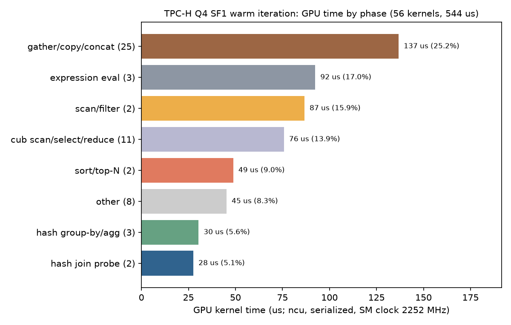
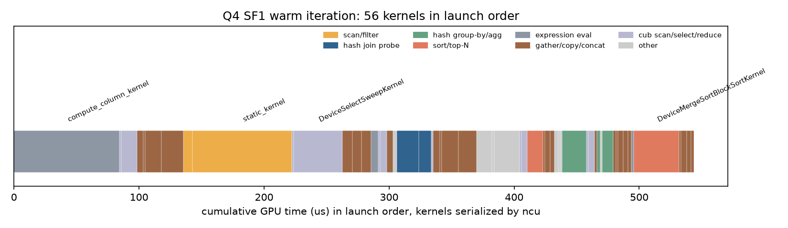
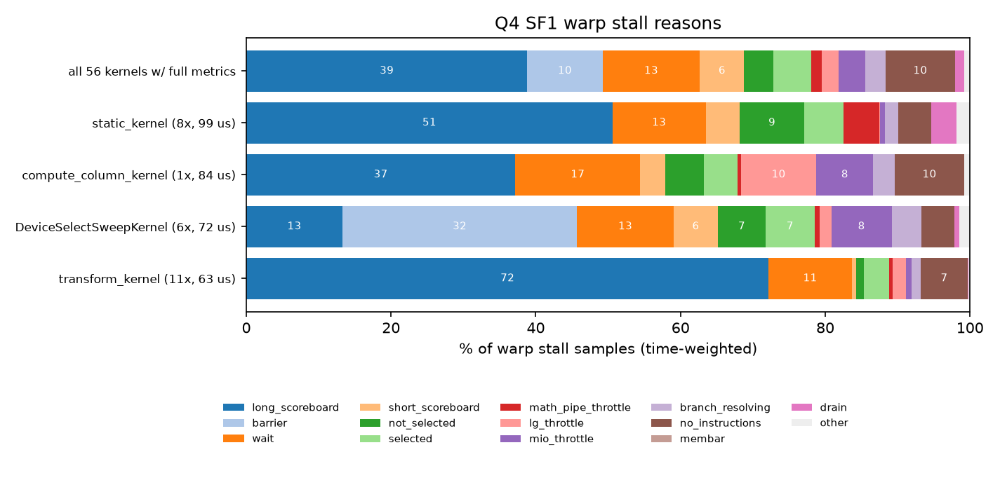
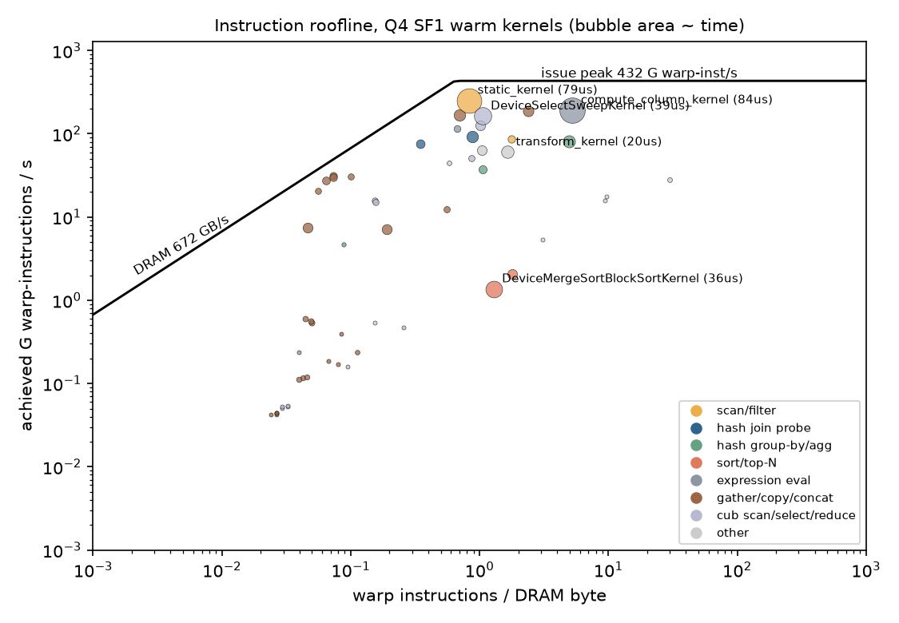

# TPC-H Q4 (SF1) on Sirius, all referenced columns pinned on GPU — Workload Analysis

**Date**: 2026-11-13
**GPU**: NVIDIA GeForce RTX 5070, 12 GB GDDR7 (192-bit, 672 GB/s), Blackwell sm_120, 48 SMs
**Workload**: TPC-H Query 4 (order-priority check: `orders` date range + `EXISTS` semi-join on `lineitem` + group-by), scale factor 1. The 6 referenced columns of `orders` and `lineitem` are pinned in GPU memory with `pin_table(tier='gpu')` (75.61 MB); measured iterations read no file and copy no table data host→device (§3).
**Framework**: Sirius (`sirius-duckdb` release build), DuckDB v2.0, stock libcudf from the pixi env, CUDA runtime 13.5
**Pipeline**: `scripts/tpch_sf1/profile_query.sh 4`; every number below comes from a file in this directory.
**Labels**: *measured* = read from a profiler/log file; *inferred* = derived by arithmetic or reasoning from measured data.

---

## 1. Executive Summary
- **Result (measured, `timing_summary.txt`, `timing.json`)**: warm median **4.0 ms** (min 4.0, max 5.0, stdev 0.28; 12 timed, 3 warmup, first iteration 54.0 ms). DuckDB-CPU warm median 18.0 ms (15.0 to 19.0), so the GPU is 4.5x faster. The 5-row result is bit-identical across all 15 iterations and equals DuckDB-CPU (exact, max rel diff 0.0).
- **Wall split (log, 1 ms resolution)**: planning 2 ms, engine 2 ms, gap to next statement 0 ms. **Planning is about half of the wall time.**
- **GPU work (measured, `nsys_iteration_breakdown.txt`)**: 56 kernels and 117 GPU ops per iteration, **GPU busy 0.415 ms** (about 10% of the 4.0 ms wall). Kernel time at real clocks is 395.9 us.
- **PCIe (§3)**: PASS with the hardened checks. Per measured iteration: H2D 29 copies / 2,231 B (largest 276 B), D2H 25 copies / 16,616 B (largest 16,384 B), 0 sysmem-aperture sectors in ncu, 0 unified-memory faults. The dynamic Bloom filter is published device-side ("through peer copies") in all 15 publications.
- **Floor (`physical_floor.md`)**: 112.5 us (pinned bytes once) to 157.6 us (with materialisation). Wall is 36x floor A. GPU busy is 3.7x. The longest single kernel (`compute_column_kernel`) is 65.9 us (nsys) / 84.4 us (ncu), roughly 7 to 9x its own byte floor.
- **Where the kernel time goes (ncu, serialized, `phase_breakdown.txt`)**: the three scan-like families that read the big columns are the Bloom-filter probe (`static_kernel`, 18.1%), the AST date predicate (`compute_column_kernel`, 15.2%) and the select/compact kernels (`DeviceSelectSweepKernel`, 13.4%). String gathers (15 kernels) are 16.4% and a 5-row sort is 9.0%.
- **Unlike Q2, the top two kernels fill the GPU** (20 and 41 waves). They are latency-bound (long-scoreboard stalls 37 and 56%), not bandwidth-bound (DRAM 5.5% and 46%).
- **Small kernels**: 31 of 56 kernels are under 5 us (`warm_kernel_summary.txt`), 45 have less than one wave, 31 have a grid under 48 CTAs.

## 2. Workload Description
```sql
select o_orderpriority, count(*) as order_count from orders
where o_orderdate >= date '1996-10-01' and o_orderdate < date '1997-01-01'
  and exists (select * from lineitem where l_orderkey = o_orderkey and l_commitdate < l_receiptdate)
group by o_orderpriority order by o_orderpriority;
```
- **Data (measured, DuckDB-CPU, `physical_floor.md`)**:
  - orders 1,500,000 rows; 57,515 (3.83%) fall in the date range.
  - lineitem 6,001,215 rows; 3,793,296 (63.2%) have commit < receipt.
  - lineitem rows whose order is in the date range: 230,667 (3.84%).
  - Orders that qualify: 52,802.
  - Result 5 groups, 105 B (`result.csv`).
- **Pinned columns (`sql/`, `pcie_verification.txt`)**: orders(o_orderkey, o_orderdate, o_orderpriority) 27,600,384 B; lineitem(l_orderkey, l_commitdate, l_receiptdate) 48,009,984 B (8.0 B/row, narrowed from 12 B native). Total **75,610,368 B**; gpu_pool high-water 220,697,832 B (process lifetime, includes the pin phase).
- **Plan (`query_plan.txt`, 13 pipelines)**:
  - #0 GPU_SCAN(orders) -> BUILD_FILTER -> PARTITION -> CONCAT -> HASH_JOIN build.
  - #4 GPU_SCAN(lineitem) -> DYNAMIC_FILTER -> FILTER -> PARTITION -> CONCAT -> HASH_JOIN probe -> HASH_GROUP_BY.
  - Then PARTITION -> MERGE_GROUP_BY -> ORDER_BY (sort sample/partition/merge) -> RESULT_COLLECTOR.
  - The dynamic filter is a Bloom filter (115,200 B array, `[dynamic_filter_publisher]` log lines) built from the order keys and used to pre-filter lineitem before the join.
- **Kernel counts (`warm_kernel_summary.txt`)**: pin phase 156 launches; each iteration 56 (identical multisets in the x3/x4/x5 passes and all 8 nsys iterations).

## 3. PCIe Verification (no table data crosses PCIe in measured iterations)
Verdict: **`OVERALL: PASS`** (`pcie_verification.txt`). Evidence, all measured:

| Check (file) | Result |
|---|---|
| `pin_tier_gpu` (sql, timing log, nsys log) | 2 `CALL pin_table`, all `tier='gpu'`, tables lineitem+orders match the referenced tables |
| `pinned_entry_per_gpu_scan` | each iteration: 2 `assigned pinned entry` = 2 GPU_SCANs, both tables present (15 timing + 8 nsys iterations) |
| `no_cache_assign_error`, `no_downgrade_or_spill` | 0 cache-assignment errors; 0 downgrade/spill/OOM lines (the earlier false hit on "Bloom" is fixed) |
| `fs_cache_zero_every_iteration` | iterations 1..15 (timing) and 1..8 (nsys): `last_cycle[reads=0 hits=0 h2d=0 miss=0]` |
| `pool_counters_stable` | gpu_pool allocated == 75,610,368 B at every QueryBegin/QueryEnd; host pool unchanged in iterations 2+ |
| `no_host_staged_filter_publication` | 15 + 8 dynamic-filter publications, all "published through peer copies (device-side)"; 0 host-staged |
| `no_parquet_decode_kernels` | 0 decode kernels among 448 kernels of all 8 nsys iterations |
| `h2d_measured_iterations` | per iteration: up to 29 copies, 2,231 B, largest 276 B (limits 64 KiB single / 1 MiB total) |
| `d2h_measured_iterations` | per iteration: up to 25 copies, 16,616 B, largest 16,384 B (result CSV 105 B; limit 262,144 B) |
| `no_other_host_copies` | 0 copies with non-device source and destination |
| D2D | 3 copies, 86 B, largest 42 B per iteration |
| `unified_memory` | UM fault collection on; faults per iteration [0,0,0,0,0]; no managed-memory API calls in the trace |
| `ncu_sysmem_check.txt` | 56 kernels, 0 with sysmem-aperture sectors; `pcie__read/write_bytes` 512 / 608,256 B (includes ncu/driver traffic) |
| `ncu_log_checks_{list,detail}.txt` | the same log checks PASS for the x3/x4/x5 list runs and the detail run |
| `selftest_negative_control.txt` | with lineitem left unpinned the verification FAILs (exit 1; H2D 20.6 MB/iteration, Parquet decode kernels found), so the checks can detect a missing pin |

- **Pin phase (not measured iterations)**: H2D 124 copies / 23.6 MB (largest 1 MiB).
- **Bloom publication**: the filter (115,200 B) never goes through the host, so the small H2D/D2H counts are not filter traffic. **The 2,231 B H2D is tiny control data (inferred).**
- **The 16,384 B D2H**: exactly one per iteration, Device->Pageable, issued right after an `add_if_shmem` kernel (nsys sqlite; all 8 nsys iterations follow `add_if_shmem`, the group-by aggregation). **Content not identified.** It is 0.1% of the table bytes and well under the 256 KiB limit.
- **Not done**: no measurement of the unpinned case on the real query, and `ncu` replay itself is excluded from the byte counts.

## 4. Environment
| Component | Setting |
|---|---|
| GPU / driver | RTX 5070 (sm_120, 48 SMs, 12 GB, 48 MB L2) / 580.173.02 (copied from the Q2 report; not re-read) |
| Nsight Compute | `sudo -n` ncu; `--set full --import-source yes` on all 56 warm kernels (policy `full_all`, `ncu_plan.json`); SM clock locked, median 2,252 MHz (`ncu_extract_summary.txt`) |
| Nsight Systems | 2025.5.2 (`-t cuda -s none --cpuctxsw=none`; UM fault collection on) |
| Sirius config | `scripts/tpch_sf1/sirius.yaml`: 4 pipeline threads, GPU pool 25% of 12 GB, 1 GB host pool, `enable_duckdb_fallback=false` |
| CPU / RAM | i9-13900K, 125 GB (copied from Q2) |

## 5. Physical Floor vs Measured
Floors (`physical_floor.md`, computed before reading ncu data), at 672 GB/s:
| Scenario | Bytes | Floor |
|---|---:|---:|
| A. pinned bytes once | 75.61 MB | **112.5 us** |
| A'. native widths | 102.6 MB | 152.7 us |
| A-min. predicate/join columns only | about 85 MB | 126 us |
| B. A + materialising 3.79 M filtered lineitem keys (write+read) | 105.9 MB | 157.6 us |
Compute estimate about 15 us (0.2 G simple ops at about 14 T lane-ops/s; inferred).

| Measured quantity (source) | Value | Ratio to floor A (112.5 us) |
|---|---:|---:|
| Wall, warm median (`timing_summary.txt`) | 4.0 ms | 36x |
| Engine window (log) | 2 ms | 18x |
| GPU busy, real clocks (`nsys_iteration_breakdown.txt`) | 0.415 ms | 3.7x |
| Kernel time, real clocks (nsys) | 395.9 us | 3.5x |
| ncu serialized warm total (`warm_kernel_summary.txt`) | 551.7 us | 4.9x |
| ncu DRAM traffic, L2 flushed per kernel (`phase_breakdown.txt`) | 65.30 MB (86% of the 75.61 MB pinned) | 0.86x bytes |
| Longest kernel `compute_column_kernel` (nsys 65.9 / ncu 84.4 us) | | 0.6 / 0.75x of A, 7.4 / 9.5x of its own 8.9 us floor (6.0 MB of dates) |
| Bloom probe launch pos 8 (ncu 79.4 us) | 24.14 MB at 304 GB/s | 2.2x its own 35.9 us floor (24.14 MB / 672 GB/s) |
- **Reading (inferred)**: the data traffic is near the floor (65.3 MB read in ncu vs 75.6 MB pinned, because only 4 of the 6 lineitem/orders columns' bytes are touched in full). The GPU-side gap of 3.5x is dominated by latency-bound kernels and about 31 sub-5-us kernels (see §6), not by wasted bytes. The remaining 36x wall gap is mostly outside the GPU (§9 RC3, §10).

## 6. Kernel, Phase and Operator Breakdown
`phase_breakdown.txt` (ncu, serialized, clock-locked; total 543.6 us, 56 kernels, DRAM 65.30 MB, average 120.1 GB/s):
| Phase | Kernels | us | % | GB/s |
|---|---:|---:|---:|---:|
| gather/copy/concat | 25 | 136.7 | 25.2 | 154.9 |
| expression eval | 3 | 92.4 | 17.0 | 44.7 |
| scan/filter (Bloom probe) | 2 | 86.7 | 15.9 | 282.6 |
| cub scan/select/reduce | 11 | 75.8 | 13.9 | 117.4 |
| sort/top-N | 2 | 48.8 | 9.0 | 1.1 |
| other | 8 | 45.2 | 8.3 | 38.3 |
| hash group-by/agg | 3 | 30.3 | 5.6 | 24.6 |
| hash join probe | 2 | 27.6 | 5.1 | 146.8 |

- **Operators (`operator_breakdown.txt`)**: gather strings 15 kernels 16.4%; dynamic-filter membership probe 2 kernels 15.9%; expression AST 1 kernel 15.5%; cub/thrust select/compact 11 kernels 13.9%; sort/top-N 9.0%; fixed-width gather/scatter 10 kernels 8.7%. "other" rows total 1.1%, so `kclass.py` was not edited.
- **Families at real clocks (nsys, mean per iteration, total 395.9 us)**: `static_kernel` 86.2 us (21.8%), `compute_column_kernel` 65.9 us (16.6%), `DeviceSelectSweepKernel` 56.8 us (14.3%), `transform_kernel` 38.6 us (9.8%), `DeviceMergeSortBlockSortKernel` 27.7 us (7.0%), `gather_chars_fn_char_parallel` 25.9 us (6.5%), `DeviceScanKernel` 24.6 us (6.2%).
- **ncu family share (`warm_kernel_summary.txt`)**: static_kernel 8 launches 100.0 us (18.1%), compute_column_kernel 84.0 us (15.2%), DeviceSelectSweepKernel 6 launches 74.0 us (13.4%).
- **Small kernels**: median kernel 4.29 us; under 5 us: 31 (32 in `phase_breakdown.txt`); under 10 us: 42, totalling 157.9 us (28%); less than one wave: 45 kernels (237.9 us); grid under 48 CTAs: 31. Top-10 kernels are 62.9% of GPU time.
- **Stall mix (time-weighted, `ncu_extract_summary.txt`)**: long_scoreboard 38.8%, wait 13.5%, barrier 10.4%, no_instructions 9.7%, short_scoreboard 6.1%.
- **Plots**: `plots/q4_{phase_breakdown,kernel_sequence,roofline,stalls}.png`.




## 7. Top Kernels (ncu `--set full`, `top_kernel_details.txt`)
ncu conditions: serialized, clocks locked, L2 flushed before each kernel (cold-cache DRAM numbers).
| # | Kernel (pos) | us (%) | grid x block | occ (ach/theo) | waves | IPC | DRAM MB (GB/s, % peak) | top stalls |
|---|---|---:|---|---|---:|---:|---|---|
| 1 | `compute_column_kernel` (0) | 84.4 (15.5) | 11,719 x 128 | 91.2/100 | 20.35 | 1.88 | 3.09 (36.5, 5.5%) | long_sb 37.2, wait 17.3, lg_throttle 10.4 |
| 2 | Bloom `static_kernel` (8) | 79.4 (14.6) | 11,722 x 256 | 88.9/100 | 40.70 | 2.56 | 24.14 (304.0, 46.0%) | long_sb 56.2, wait 13.1, not_selected 10.2 |
| 3 | `DeviceSelectSweepKernel` (10) | 39.1 (7.2) | 1,042 x 384 | 45.5/50 | 10.85 | 1.62 | 6.06 (155.0, 23.4%) | barrier 31.2, wait 14.8, long_sb 10.9 |
| 4 | `DeviceMergeSortBlockSortKernel` (51) | 36.4 (6.7) | 1 x 256 | 16.6/83.3 | 0.00 | 0.62 | 0.04 (1.1) | barrier 58.8 |
| 5 | `transform_kernel` dict-encode (28) | 20.3 (3.7) | 104 x 256 | 37.2/66.7 | 0.54 | 0.66 | 0.74 (36.6) | long_sb 56.7 |
| 6 | `mapping_indices_kernel` (38) | 19.3 (3.5) | 240 x 128 | 34.7/41.7 | 1.00 | 0.82 | 0.31 (16.2) | no_inst 34.6, long_sb 23.2 |
| 7 | `insert_if_n` (19) | 17.6 (3.2) | 1,174 x 128 | 82.9/100 | 2.04 | 1.07 | 1.89 (107.1) | long_sb 68.9 |
| 8 | `gather_chars_fn_char_parallel` (6) | 17.4 (3.2) | 1,798 x 128 | 80.0/100 | 3.12 | 1.86 | 4.18 (240.2) | long_sb 58.0 |
- Only kernels 1, 2, 3, 7 and 8 have more than 2 waves. Kernels 4 to 6 are small or tail-bound. The three `transform_kernel` launches at pos 11 to 13 reach 405 to 431 GB/s (60 to 65% of peak) in ncu but last only 7 to 8 us each.
- Each static_kernel launch is a separate kernel: grid 11,722 is the lineitem probe; the other 7 launches (pos 14, 18, 27, 35, 36, 37, 42) are 1.6 to 6.0 us (comparison, hash-table initialisers, binary search).




## 8. Instruction-Level Evidence
The #1 single kernel is `compute_column_kernel`; the #1 family is the Bloom-probe `static_kernel`. Both are covered (`sass/*_hotspots.txt`).

**`compute_column_kernel<128,0,0>` (the AST evaluator, pos 0, 84.4 us)**
- **Inference**: grid x block = 1.5 M threads equals the orders row count, so it evaluates the date range predicate on orders.
- **Size**: 16,400 static instructions (only 239 ever executed), 1.63e7 warp-instructions executed = about 347 per warp of 32 rows. The expression is interpreted at run time from a device-side tree.
- **Class mix**: integer arithmetic 48.4% of executed (51.2% of stalls), control flow 15.3%, global load 13.3% (17.6% of stalls), const load 8.9%, **local-memory spill 5.2% of executed (12.0% of stalls)**. LSU pipe 87.7%, SM 86.3%, L1 hit 95.2%.
- **Hottest instruction `+0x18180` (5.2% of samples, long_scoreboard)**: `ISETP.GT.AND P0,PT,R6,0x14,PT` waits on R6, which is loaded before this window; the preceding instructions are a separate dependent chain that ends in R12, which this ISETP does not read:
  `+0x18130 LDG.E R15,[R14+0xc]` -> `+0x18150 IMAD.WIDE R8,R15,0x20,base` -> `+0x18160 LDG.E.64 R8,[R8+0x10]` -> `+0x18170 LD.E.U16 R12,[R8]` -> `ISETP.GT 0x14` (then `ISETP.GT 0x9`, i.e. an operator-type dispatch).
  This is a three-load dependent chain; reading it as node index -> node record -> operator id is inferred. Samples: `+0x18170` 205, `+0x18150` 149 (long_sb), `+0x18180` 441.
- **Spill pair `+0x00170 STL.64 [R1+0x58]` (2.7%, lg_throttle 120 / mio 63) and `+0x002c0 LDL.LU.64 [R1+0x48]` (2.1%)**: 32 static spill instructions are executed 843,750 times. Then `+0x002f0 SHF.L.U64.HI R5,R10,0x2,R11` waits on that reload (3.2%, long_sb 265).
- **Dependency chain overall**: node-pointer loads -> dispatch compare -> operand loads (`LDG.E R8,[R8.64]` at `+0x320`, `LDG.E R25` at `+0x17d50`) -> compare -> store. The bytes are not the limit: DRAM 3.09 MB (5.5% of peak).

**Bloom probe `for_each::static_kernel<... membership_probe_functor<... bloom_lookup<cuco::bloom_filter_ref ...>>>` (pos 8, 79.4 us)**
- 984 static instructions, 2.01e7 warp-instructions executed; integer arithmetic is 70.1% of executed and 86.8% of stall samples.
- **Stall samples: 40.1% on two instructions**:
  - `+0x003a0 IMAD.WIDE.U32 R4,R7,-0x7a143579,RZ` (20.8%, long_sb 1,586 of 1,600).
  - `+0x00aa0 IMAD.WIDE.U32 R2,R19,-0x7a143579,RZ` (19.3%, long_sb 1,477 of 1,484).
  - Both start the hash of a key just loaded by `LDG.E R7,[R18.64]` (`+0x370`) and `LDG.E R19,[R18.64+0x400]` (`+0xa70`). The constant is the low word of the XXHash-64 prime, matching `cuco::XXHash_64<int>` in the kernel name.
- **A further 17.1%** is on `+0x00e40` and `+0x00740 LOP3.LUT P2,RZ,R3,R12,RZ,0xc0` (long_sb 651 and 613), which test the Bloom-filter bit mask against a filter word (inferred; the word load is not in the quoted context).
- **Chain per row** (the `+0x320`/`+0xa30` validity-test blocks have exe=0 in this launch): key `LDG.E` -> hash IMAD chain -> filter-word `LDG` -> `LOP3` bit test. The two blocks (rows `+0x370` and `+0xa70`) show each thread handles 2 rows (93,768 executions each = 3.0 M threads / 32). The +0x320/+0xa30 blocks (inferred validity-bit test from their shape) are never executed (exe=0), so no row pays that load.
- **Measured effect**: IPC 2.56 (of 4 per SM), occupancy 88.9%, DRAM 46.0% of peak, L1 hit 37.4%, L2 hit 53.8%.

## 9. Root Cause Analysis

### RC1 — Predicate + Bloom-probe scans: 165 us of ncu time (30%), 152 us at real clocks (38%)
- Symptom: `compute_column_kernel` 65.9 us and the probe `static_kernel` 86.2 us (all 8 launches) at real clocks (nsys), together 38% of the 395.9 us kernel time (`nsys_iteration_breakdown.txt`); ncu 84.4 + 79.4 us.
- WHY 1: they sit at IPC 1.88 / 2.56 with 20 / 41 waves, so SMs are busy (SM 86.3% / 62.6%) yet DRAM is only 5.5% / 46%.
- WHY 2 (`sass/*_hotspots.txt`): 37.2% and 56.2% of stall samples are long_scoreboard on a load-to-use chain. In the AST kernel it is a three-load pointer chase per node; in the probe, `LDG` key -> hash -> `LDG` Bloom word -> `LOP3`, with only 2 rows in flight per thread.
- WHY 3: a general-purpose expression interpreter fetches the operator tree from memory per row (plus 5.2% spill instructions) and a general Bloom lookup does dependent loads per key; neither software-pipelines.
- ROOT (inferred): library kernels written for generality; the work per row is about 350 instructions for a date compare on orders. Byte floors are 8.9 us and 35.9 us; measured are 84.4 and 79.4 us (9.5x and 2.2x).

### RC2 — Strings and small selects: gathers 89.3 us (16.4%) + select/compact 75.8 us (13.9%) + groupby/sort 79 us
- Symptom: 15 string-gather kernels cost 89.3 us (`operator_breakdown.txt`; nsys `gather_chars_fn_char_parallel` 25.9 us, 6.5%) to move o_orderpriority for only 57,515 qualifying rows; 11 select/compact kernels cost 75.8 us.
- WHY 1: gather kernels reach only 78 to 240 GB/s (e.g. pos 6: 240.2 GB/s, 36.5% of peak) with long_sb 58% and 3.1 waves.
- WHY 2: the plan has 4 PARTITION / CONCAT stages (13 pipelines in `query_plan.txt`), each materialising and re-gathering the string column (offsets then chars).
- WHY 3: the strings are variable length, so each stage costs an offsets scan, a select and a chars gather. 31 kernels are under 5 us (median 4.29 us), where launch+drain, not bytes, dominates (1.75 us for `DeviceScanInitKernel`).
- ROOT (measured + inferred): the generic exchange between pipelines multiplies small kernels; bytes are small (8.07 MB gathered) but the kernel count is 56 per query.

### RC3 — GPU idle inside the 4 ms wall: only about 10% busy
- Symptom: wall 4.0 ms vs GPU busy 0.415 ms (nsys); planning alone is 2 ms (log).
- WHY 1: 2 ms of planning (DuckDB plan + Sirius plan translation) precedes any GPU work (`timing_summary.txt`: planning 2 ms, engine 2 ms).
- WHY 2: within the engine window the host issues 56 launches, 52 `cudaMemcpyBatchAsync` and 90 pool alloc/free pairs, and synchronises 107 + 32 times per iteration (`nsys_iteration_breakdown.txt`: 0.387 + 0.292 ms CPU time in sync calls alone).
- WHY 3: the 13-pipeline DAG has FULL barriers (`query_plan.txt`), so dependent kernels cannot overlap and each hop pays a synchronisation.
- ROOT (inferred): host-side orchestration, not GPU work, sets the wall time. GPU-idle estimate is about 1.6 ms (2.0 ms engine minus 0.415 ms busy); this uses two runs and carries plus or minus 1 ms.

### Also material
- **Sort of 5 rows**: `DeviceMergeSortBlockSortKernel` runs 1 CTA, 36.4 us (ncu) / 27.7 us (nsys), 58.8% barrier stalls, SM 0.4%; with the radix single-tile kernel (12.8 us), sort/top-N is 8.9% of ncu time for 5 rows (inferred cardinality from the result).

## 10. Gap Analysis
| Step | Value | Source |
|---|---:|---|
| Byte floor A | 112.5 us | `physical_floor.md` |
| Kernel time at real clocks | 395.9 us (+283 us, 3.5x) | nsys |
| GPU busy (adds memcpy/memset) | 415 us | nsys |
| Engine window | about 2 ms (+1.6 ms idle, inferred) | log |
| Planning | 2 ms | log |
| Wall | 4.0 ms | `timing_summary.txt` |
- Of the 283 us above the floor at real clocks: roughly 150 us are the latency-bound predicate/probe kernels (RC1), 105 us the string/select exchange (RC2), and 37 us the 5-row sort (nsys 27.7 + 9.4 us). The sum is approximate since categories overlap.
- ncu 551.7 us exceeds nsys 395.9 us because ncu locks clocks (2,252 MHz vs boost), serialises, and flushes L2 before each kernel.

## 11. Optimization Directions (generic; no query-specific fusion)
- **Planning (2 ms, 50% of wall)**: cache the DuckDB-to-Sirius plan translation for repeated statements (inferred upside up to 2 ms of 4 ms).
- **Library probe kernels**: more rows in flight per thread (loop unrolling/prefetch of the key and filter-word loads) in the Bloom lookup; the byte floor is 35.9 us vs 79.4 us measured (inferred headroom up to 43 us ncu).
- **AST evaluator**: lower the per-row cost of the interpreter (keep operator nodes in registers/shared memory; avoid the spill pair) or route simple column-vs-literal compares to native binary-op kernels; floor 8.9 us vs 84.4 us measured. This is a general library change, not query fusion.
- **Exchange**: fewer PARTITION/CONCAT materialisations of string columns; sort and group-by on a tiny cardinality could use a single-warp path (36 us for 5 rows).
- **Orchestration**: fewer stream synchronisations per iteration (139 now) so pipelines overlap.
- Kernel fusion is context only; cuDF kernels stay general-purpose library operators.

## 12. Determinism and Profiling Method
- **Launch counts are deterministic (measured, `warm_kernel_summary.txt`, `pcie.json`)**: pin 156; each iteration 56 launches in the x3/x4/x5 ncu list passes (324 / 380 / 436 total) and in all 8 nsys iterations; kernel-name multisets of iterations are equal, launch order identical at 0 positions of difference.
- **ncu policy**: 56 <= `NCU_FULL_MAX` (1000), so `full_all` (`--set full --import-source yes`) on all 56 warm kernels (`ncu_plan.json`); the slice matches the expected multiset (`ncu_slice_check.txt`, one name reconciled on function/grid/block).
- **Log checks on the ncu runs** (`ncu_log_checks_{list,detail}.txt`): the same pinned-entry, fs_cache, pool and peer-copy checks PASS on the ncu list and detail runs, so profiled iterations also ran from the pin.
- **Real-clock numbers** come from nsys; wall from `.timer` and the Sirius log (1 ms resolution).
- `validate_pipeline.txt`: `SUMMARY q4: 72 PASS, 0 FAIL, 1 PENDING` (the pending item is this report).

## 13. Limitations
- ncu durations are serialized, clock-locked (2,252 MHz median), and taken after an L2 flush; kernels under 10 us are inflated against real clocks, and DRAM bytes are cold-L2 values.
- The serialized warm total is 551.7 us in `warm_kernel_summary.txt` and 543.6 us in `phase_breakdown.txt`/`ncu_extract_summary.txt`, and kernels under 5 us are 31 vs 32, because the two files sum different ncu metrics; this does not change any conclusion.
- Wall splits come from 1 ms stamps, so the 2 ms planning and 2 ms engine values are plus or minus 1 ms. The nsys run shows engine 5 to 6 ms, inflated by tracing.
- GPU idle (about 1.6 ms) mixes an unprofiled run with an nsys run.
- The 16,384 B D2H per iteration is not identified (only its position after `add_if_shmem`).
- The validity-bit reading of the never-executed (exe=0) probe blocks, the per-kernel row counts (from grid size and DuckDB cardinalities), and "2 rows per thread" are inferred, not read from Sirius.
- Stall-sample counts: the probe has 7,696 samples, the AST kernel 8,535; percentages below 1% are noisy.
- The PCIe checks cannot see host memory read in place without memcpy except through the ncu sysmem check, which found 0 such sectors; this covers the profiled iteration only.
- Only the pinned configuration was profiled; there is no unpinned comparison on the real query.
- Environment rows marked "copied from Q2" were not re-read.

## 14. Raw Data
| File (all under `analysis/results/q4/`) | Contents |
|---|---|
| `timing_summary.txt`, `timing.json`, `result.csv` | timing, result, DuckDB-CPU baseline |
| `query_plan.txt`, `sql/` | Sirius plan, pinned SQL scripts |
| `pcie_verification.txt`, `pcie.json`, `ncu_sysmem_check.txt`, `ncu_log_checks_{list,detail}.txt`, `selftest_negative_control.txt`, `reverify_hardened.log` | PCIe evidence |
| `nsys_iteration_breakdown.{txt,json}`, `traces/q4_nsys.{nsys-rep,sqlite}` | real-clock GPU busy, API counts, kernel times |
| `warm_kernel_list.json`, `warm_kernel_summary.txt`, `ncu_plan.json`, `ncu_slice_check.txt` | determinism and profiling plan |
| `ncu_warm_metrics.json`, `ncu_extract_summary.txt`, `phase_breakdown.{txt,json}`, `operator_breakdown.txt`, `top_kernel_details.txt` | ncu metrics and breakdowns |
| `sass/*_hotspots.txt`, `sass/*_inst_inventory.csv` | instruction-level evidence |
| `plots/q4_*.png` | phase breakdown, kernel sequence, roofline, stalls |
| `physical_floor.md`, `validate_pipeline.txt` | floor, validation |
