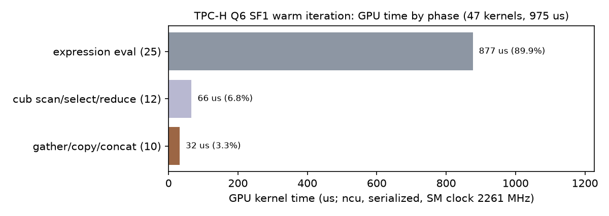
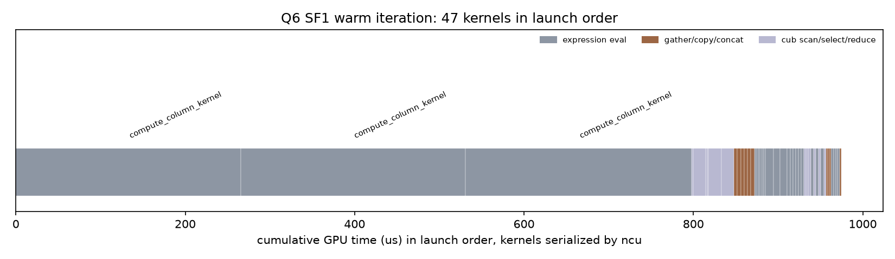
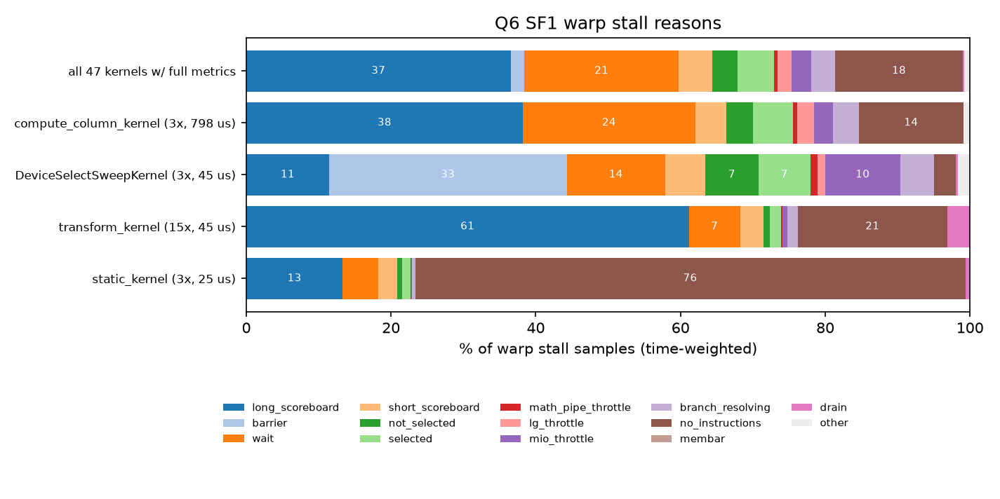
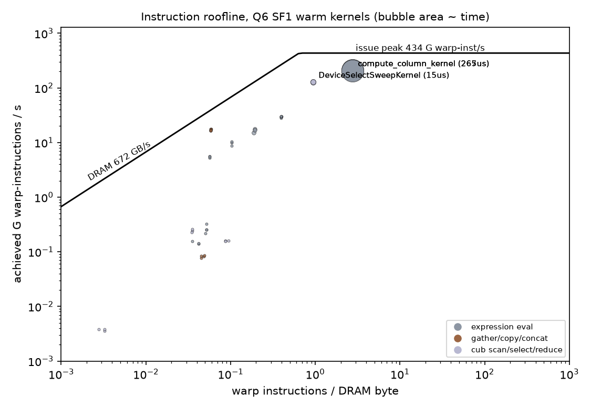

# TPC-H Q6 (SF1) on Sirius, all referenced columns pinned on GPU — Workload Analysis

**Date**: 2026-11-13
**GPU**: NVIDIA GeForce RTX 5070, 12 GB GDDR7 (192-bit, 672 GB/s), Blackwell sm_120, 48 SMs
**Workload**: TPC-H Query 6 (forecasting revenue change: single-table filter on 4 columns + `sum(l_extendedprice*l_discount)`), scale factor 1. All 4 referenced columns of `lineitem` (6,001,215 rows) are pinned in GPU memory with `pin_table(tier='gpu')` (84.02 MB); measured iterations read no file and copy no table data host→device (§3).
**Framework**: Sirius (`sirius-duckdb` release build), DuckDB v2.0, stock libcudf from the pixi env, CUDA runtime 13.5
**Pipeline**: `scripts/tpch_sf1/profile_query.sh 6` (about 105 s end-to-end: 14 s + 91 s, `pipeline_run.log`); every number below comes from a file in this directory.
**Labels**: *measured* = read from a profiler/log file; *inferred* = derived by arithmetic or reasoning from measured data.

---

## 1. Executive Summary

- **Residency proven** (*measured*, `pcie_verification.txt`, OVERALL PASS): per measured iteration 2,909 B H2D (largest copy 612 B) and 263 B D2H; 0 UM faults; 0 Parquet decode kernels; negative control (table left unpinned) fails as it should.
- **Result**: revenue = 61567694.9502 (`result.csv`), identical on all 15 GPU iterations and equal to DuckDB-CPU (`timing.json`, max rel diff 0.0).
- **Speed**: warm median **3.0 ms** on GPU vs **12.0 ms** DuckDB-CPU = 4.0x (`timing_summary.txt`, 1 ms timer resolution).
- **Floor**: reading the 84.02 MB pinned footprint once is **125 us** at 672 GB/s (`physical_floor.md`); compute < 5 us (*inferred*). GPU busy at real clocks is 748 us (6.0x the floor); wall is 3.0 ms (24x).
- **One kernel family dominates the GPU**: `cudf::compute_column_kernel` (the AST expression interpreter), 3 launches, **86.9% of kernel time at real clocks** (627.7 of 722.0 us, `nsys_iteration_breakdown.txt`) and 82.2% under ncu (`warm_kernel_summary.txt`). It runs at 75 GB/s (11% of peak DRAM) with the LSU pipe 86% busy: it is limited by interpreter instruction count and dependent loads, not by DRAM (§7-§9).
- **At SF1 the GPU is idle most of the iteration**: GPU busy is 25% of the engine window (nsys run) and the CPU issues 207 stream syncs and 117 pool alloc/free pairs per iteration (§6, §9).

Where the wall time goes (median of 12 timed iterations unless stated):

| Component | Time | Source / label |
|---|---:|---|
| Wall per query | 3.0 ms | `timing_summary.txt`, *measured* |
| Planning (DuckDB + Sirius) | 1 ms | `timing_summary.txt` (log split, 1 ms resolution); the nsys run shows 2.0 ms |
| Engine window | 2 ms | `timing_summary.txt` (nsys run shows 3.0 ms; nsys inflates it) |
| GPU busy (kernels+memcpy+memset union, real clocks) | 0.748 ms | `nsys_iteration_breakdown.txt`, *measured* |
| of which `compute_column_kernel` | 0.628 ms | same, *measured* |
| other 44 kernels | 0.094 ms | 722.0 - 627.7 us, *inferred* from same |
| CPU-side orchestration (not GPU) | remainder of engine window | *inferred*; 207 `cudaStreamSynchronize` calls, 1.75 ms summed CPU time over all threads |

---

## 2. Workload Description

```sql
select sum(l_extendedprice * l_discount) as revenue from lineitem
where l_shipdate >= date '1997-01-01' and l_shipdate < date '1998-01-01'
  and l_discount between 0.03 - 0.01 and 0.03 + 0.01 and l_quantity < 24;
```
- Plan (`query_plan.txt`, *measured*): Pipeline 0 = GPU_SCAN → PROJECTION → UNGROUPED_AGGREGATE; Pipeline 1 = MERGE_AGGREGATE; Pipeline 2 = RESULT_COLLECTOR.
- Selectivities (DuckDB-CPU on the Parquet, `physical_floor.md`, *measured*): shipdate in 1997 = 911,395 (15.2%); discount in [0.02,0.04] = 1,637,011 (27.3%); quantity < 24 = 2,758,822 (46.0%); date AND discount = 248,415 (4.1%); all four = **114,271 (1.90%)**; result 1 row (22 B).
- Types: 3 x DECIMAL(15,2) + DATE. Pinned footprint 84,018,176 B = 14.0 B/row (Sirius narrows carriers; native widths would be 28 B/row = 168.03 MB). The per-column split is not in any file (*inferred* from the total only).
- Data is fully resident: gpu_pool allocated = 84,018,176 B at every QueryBegin/QueryEnd; gpu_pool high-water 348,071,636 B (process-lifetime, includes pin phase) (`pcie_verification.txt`).

---

## 3. PCIe Verification (no table data crosses PCIe in measured iterations)

All lines below are from `pcie_verification.txt` unless noted (*measured*).
- `[PASS] sql:pin_tier_gpu`: every pinned SQL script pins each referenced table once with tier='gpu'. Same for `timing_log` and `nsys_log` (1 `CALL pin_table`, tables ['lineitem']).
- `[PASS] timing_log:pinned_entry_per_gpu_scan` / `nsys_log:...`: every iteration: #`assigned pinned entry` == #GPU_SCAN operators (1).
- `[PASS] timing_log:fs_cache_zero_every_iteration`: 16 cache summaries for 15 iterations; iterations 1..15 all `last_cycle[reads=0 hits=0 h2d=0 miss=0 ...]`. nsys log: 9 summaries / 8 iterations, same.
- `[PASS] no_downgrade_or_spill`, `no_cache_assign_error`, `no_host_staged_filter_publication`, `pool_counters_stable` (allocated == pinned footprint 84,018,176 B at QueryBegin and QueryEnd; host_pool unchanged in iterations >= 2).
- `[PASS] no_parquet_decode_kernels`: 0 decode/decompress kernels among 376 kernels of all 8 nsys iterations.
- `[PASS] h2d_measured_iterations`: per measured iteration up to 83 copies, **2,909 B** total, largest single **612 B** (limits 65,536 B single / 1,048,576 B total). `[PASS] d2h_measured_iterations`: up to 50 copies, **263 B**, largest 24 B (result CSV 22 B, limit 262,144 B). Limits are the defaults (no PCIE_* override).
- `[PASS] no_other_host_copies`: 0 copies with non-device source and destination. `[PASS] unified_memory`: UM CPU+GPU fault collection on; faults per measured iteration [0,0,0,0,0]; no managed-memory API calls.
- Pin phase (excluded from the check, for contrast): H2D 150 copies, 35,628,020 B, largest 1,048,576 B.
- `ncu_sysmem_check.txt`: 47 kernels, **0** with SM (tex) sysmem-aperture sectors (no kernel reads mapped host memory in place); all-source sysmem sectors 265-292 per kernel (info only); `pcie__read/write_bytes` 0 / 505,856 B (includes driver/ncu traffic) → PASS.
- `ncu_log_checks_list.txt` (x3, x4, x5) and `ncu_log_checks_detail.txt`: every ncu run shows the same residency checks PASS (OVERALL PASS).
- Negative control (`selftest_negative_control.txt`): `lineitem` left unpinned; `pcie_verify.py` exit code 1 (1 expected): pinned-entry, fs_cache (`reads 18, h2d 45`), decode-kernel checks FAIL, H2D = 35,641,044 B per iteration with largest copy 3,560,399 B. `SELFTEST: PASS (verification detected the unpinned table)`.
- Table < 8192 rows: none, so byte-count evidence applies to the one referenced table.

---

## 4. Environment

| Component | Version / setting |
|---|---|
| GPU / driver | RTX 5070 (sm_120, 48 SMs, 12 GB, 48 MB L2) / 580.173.02 |
| Nsight Compute | 2025.2.1 via `sudo -n` (counters admin-only); `--set full --import-source yes` on all 47 warm kernels; SM clock locked ≈ 2.26 GHz (median, `ncu_extract_summary.txt`) |
| Nsight Systems | 2025.5.2 (`/home/sai/nsight-systems-2025.5`; the 2025.1.3 in `/usr/local/cuda` cannot decode CUDA 13 traces); `-t cuda -s none --cpuctxsw=none` plus UM page-fault collection |
| CPU | Intel i9-13900K, 125 GB RAM |
| Sirius config | `scripts/tpch_sf1/sirius.yaml`: 4 pipeline threads, GPU pool 25% of 12 GB, 1 GB pinned host pool (2 pools), `enable_duckdb_fallback=false` |

Environment rows other than the SM clock are carried over from the Q2 report (same machine, same pipeline, RUNBOOK §6); they were not re-queried for Q6.

---

## 5. Physical Floor vs Measured

Floors (`physical_floor.md`, computed before reading ncu output, *inferred* from bytes ÷ 672 GB/s):

| Scenario | Bytes | Floor |
|---|---:|---:|
| A. Every pinned column once (narrowed) | 84.02 MB | **125.0 us** |
| A'. Native widths | 168.03 MB | 250.0 us |
| B. A + 1 B/row selection mask written and re-read | 96.0 MB | 142.9 us |
| Compute (~10 ops/row x 6.0 M rows at ~14 T lane-ops/s) | | < 5 us |

| Measured | Time | x floor A | Source |
|---|---:|---:|---|
| Wall, warm median | 3.0 ms | 24.0x | `timing_summary.txt` |
| Engine window (log) | 2 ms | 16x | `timing_summary.txt` |
| GPU busy, real clocks | 748 us | 6.0x | `nsys_iteration_breakdown.txt` |
| Kernel time, real clocks | 722.0 us | 5.8x | same |
| Kernel time, ncu serialized | 974.9 us | 7.8x | `phase_breakdown.txt` |
| `compute_column_kernel` alone (nsys, 3 launches) | 627.7 us | 5.0x | `nsys_iteration_breakdown.txt` |

All 47 warm kernels together move 78.78 MB of cold-L2 DRAM traffic (`phase_breakdown.txt`) = 117 us at 672 GB/s, i.e. close to floor A in bytes (93.8% of 84.02 MB). The bytes are therefore not the problem; the time is. Average DRAM throughput over the ncu kernel time is 80.8 GB/s (12% of peak).

---

## 6. Kernel, Phase and Operator Breakdown

Warm iteration: **47 kernels**, 195 GPU ops (kernels+memcpy+memset) per iteration (`nsys_iteration_breakdown.txt`). Pin phase = 162 launches (303 - 3 x 47, *inferred* from `ncu_plan.json`). Counts are identical in all 8 nsys iterations.

Phase (ncu, `phase_breakdown.txt`):

| Phase | Kernels | us | % | DRAM MB | GB/s |
|---|---:|---:|---:|---:|---:|
| expression eval | 25 | 876.9 | 89.9 | 65.53 | 74.7 |
| cub scan/select/reduce | 12 | 66.3 | 6.8 | 6.26 | 94.4 |
| gather/copy/concat | 10 | 31.8 | 3.3 | 6.99 | 219.8 |

Operator (`operator_breakdown.txt`; no `other:` rows): expression AST 3 kernels 798.0 us (81.8%); cub select/compact 6, 50.1 us (5.1%); expression binary op 9, 45.2 us (4.6%); expression cast/unary 13, 33.7 us (3.5%); gather/scatter 6, 24.0 us (2.5%); cub reduce/find 6, 16.2 us (1.7%); copy/concatenate 4, 7.8 us (0.8%).

Small-kernel counts (*measured*, `phase_breakdown.txt`, `warm_kernel_summary.txt`): 38 of 47 kernels < 5 us, 41 < 10 us (together 131.5 us = 13.5% of time); 41 launch < 1 wave (48 SMs); 26 have grid < 48 CTAs; median kernel 2.43 us. For these the DRAM% is ~0-15% and a bandwidth story is not meaningful; they are launch/latency-bound. Top-10 kernels = 89.5% of time. Plots: `plots/q6_phase_breakdown.png`, `plots/q6_kernel_sequence.png`, `plots/q6_roofline.png`, `plots/q6_stalls.png`.




---

## 7. Top Kernels (ncu `--set full`)

ncu conditions: kernels serialized, SM clocks locked (~2.26 GHz vs boost), L2 flushed before each kernel; DRAM bytes and hit rates are cold-L2 values. Use the nsys column for real-clock time. Source: `top_kernel_details.txt`, `ncu_extract_summary.txt`.

| Kernel (launches) | ncu us each | nsys us (all launches) | Grid x blk | Waves | SM% | DRAM GB/s (%peak) | Dominant stalls |
|---|---:|---:|---|---:|---:|---:|---|
| `compute_column_kernel<128,0,1>` (3) | 265-267 | 627.7 | 15,627-15,630 x 128 | 36.2 | 85.5 | 75.2 (11.2%) | long_sb 38.5, wait 23.8, no_inst 14.2 |
| `DeviceSelectSweepKernel` (3) | 15.0-15.3 | 36.2 | 348 x 384 | 3.62 | 34.6 | 135 (20%) | barrier 32.9, wait 14.1, mio 11.8 |
| `transform_kernel` (15) | 3.0 avg | 24.6 | 148-151 x 256 (3 launches 1 x 256) | ≤0.52 | 4-7 | 178 family avg (26%); 282-300 for 6 gather launches | (sub-wave, 2-4 us) |
| `for_each::static_kernel<Mul>` (3) | 8.0-9.2 | 10.7 | 74-76 x 256 | 0.31 | 3.5 | 80-91 | no_inst 75 |
| `DeviceReduceKernel` (6) + `SingleTile` (7) | 2.3-3.8 | 7.8 + 7.3 | 19-38 x 256 / 1 x 256 | 0.01-0.13 | < 6 | < 100 | latency |

`compute_column_kernel` detail (pos 2, 267.2 us): 56 regs, occupancy 71.7% achieved / 75% theoretical, IPC 1.92 (of 4 issue slots), **5.53e7 warp-instructions**, L1 hit 93.0%, L2 hit 11.2% (cold), DRAM 20.11 MB per launch (3 launches = 60.3 MB), 8.63e6 global load requests, shared bank conflicts 2.54e6 on 5.0e5+5.0e5 shared ld/st. Pipe utilisation: **LSU 86.0%**, ALU 18.8%, ADU 22.6%, FMA 5.4%. Stall mix over all kernels, time-weighted: long_scoreboard 36.5%, wait 21.3%, no_instructions 17.6%, selected 5.0%.

Ceilings for this kernel (*inferred* from the above): DRAM floor for its 20.11 MB = 29.9 us (it takes 266 us, 8.9x); issue-bound floor at IPC 4 = 5.53e7 / (48 x 4) / 2.26 GHz = 127 us (it takes 2.1x that at IPC 1.92). The binding resource is the LSU/L1 pipe (86% busy), i.e. the kernel is instruction/LSU-bound, not DRAM-bound.

Which predicate each of the 3 launches evaluates is not recorded in any file; the three launches are within 1% of each other in time, grid and bytes.




---

## 8. Instruction-Level Evidence — `compute_column_kernel` (launch pos 2, 267 us)

Source: `sass/compute_column_kernel_hotspots.txt` (14,069 stall samples; selection verified by duration).
- The binary holds 28,752 static instructions but only **335 (1.2%)** are ever executed: a template-instantiated expression interpreter.
- Executed mix (warp-level): Int Arithmetic 50.1%, Control Flow 18.2%, Global Load 16.7%, Const Load 7.9%, FP 0.2%. **295 thread-instructions per row** (5.53e7 x 32 / 6.0e6, *inferred*) against ~10 for the predicate and multiply written by hand.
- Per-row work is dominated by operand resolution: for each AST node the kernel walks a data-reference table before it can compute anything. Most-executed hot window (`+0x22710..+0x227a0`, 562,554 executions = 3 per warp-row-group):

```
+0x22710  LDG.E R21, desc[UR12][R16.64]        ; operand 0: table/column index
+0x22720  LDG.E R33, desc[UR12][R16.64+0x4]    ; operand 1
+0x22730  LDG.E R5,  desc[UR12][R16.64+0x8]    ; operand 2
+0x22740  IMAD.WIDE R20, R21, 0x18, R6         ; index * 24 B descriptor stride    [long_sb 257 samples]
+0x22750  LDG.E R18, desc[UR12][R20.64+0x4]    ; descriptor field (type id)
+0x22790  ISETP.GT.AND P0, PT, R18, 0xe, PT    ; type-id dispatch compare          [342 samples, long_sb 327]
+0x227a0  @P0 BRA ...
```
- Second hot window (`+0x520b0..+0x520f0`, 187,518 executions), the column read path:
```
+0x52090  LDG.E R33, [R32.64+0xc]              ; column index
+0x520b0  IMAD.WIDE R20, R33, 0x20, R20        ; index * 32 B column_device_view   [149 samples]
+0x520c0  LDG.E.64 R22, [R20.64+0x10]          ; column data pointer
+0x520d0  LDG.E R18, [R20.64+0x4]              ; type id
+0x520e0  LD.E R17, [R22.64]                   ; the actual row value (generic load) [181 samples]
+0x520f0  ISETP.GT.AND P0, PT, R24, 0x14, PT  ; type switch on R24, not loaded in this window (the type id loaded here is R18) [901 samples = 6.4% of all stalls, long_sb 896]
```
- **Dependency chain per operand** (*measured* SASS, latencies *inferred*): load index → `IMAD.WIDE` address → load descriptor → load data pointer → load value → `ISETP`/`BRA` on the type id → arithmetic. That is 3-4 dependent global loads (93% average L1 hit rate) before the first compare, repeated per row and per node. The top 25 instructions are almost all `ISETP.GT/NE` and `IMAD.WIDE` waiting on `long_sb` (38.5% of samples), plus `wait` 23.8% (fixed-latency dependency stalls between `IMAD.WIDE` → `LDG`), which is exactly this chain.
- The data loads themselves are cheap: DRAM is 11% busy, L1 hits 93%. The cost is the 46 load requests per 32-row group (8.63e6 / 187.5k, *inferred*) that fetch descriptors, not data.
- `DeviceSelectSweepKernel` (`sass/DeviceSelectSweepKernel_hotspots.txt`): 30.6% of its stall samples sit on one `UMOV UR4, 0x400` after the block barrier (`barrier=413`), the CUB block-scan synchronisation; it is 4.7% of GPU time, so secondary.

---

## 9. Root Cause Analysis

**Sink 1: `compute_column_kernel` (627.7 us real, 86.9% of kernel time)**
- Symptom: 3 launches at 266 us each when their 20.11 MB DRAM traffic needs 29.9 us (*measured* ncu, *inferred* floor).
- WHY 1: DRAM is only 11.4% busy while SM% / Mem% is 85.5% and the LSU pipe 86% (*measured*). The kernel is limited by load/store-unit issue, not memory bandwidth.
- WHY 2: it executes 5.53e7 warp-instructions = ~295 per row, 18.2% of them branches, 16.7% global loads (*measured*; per-row figure *inferred*). A hand-written filter needs ~10.
- WHY 3: the interpreter re-resolves, for every node and every row, the operand through table/column descriptors: 3-4 dependent `LDG`s (§8 SASS) and a type-id switch (`ISETP.GT R18,0xe`), so 38.5% of stalls are `long_scoreboard` on exactly those compares (*measured*).
- ROOT: the AST evaluator is a generic, type-erased, per-row interpreter whose operand metadata is not hoisted out of the per-row loop; the structure costs 8.9x the DRAM floor at 1.9 IPC (*measured/inferred*).

**Sink 2: host-side orchestration, ~2.25 of the 3.0 ms engine window in the nsys run is not GPU work (*inferred*)**
- Symptom: GPU busy is 0.748 ms of a 3.0 ms nsys engine window (25%; 2.64 ms between first and last GPU op) (*measured*, `nsys_iteration_breakdown.txt`).
- WHY 1: each iteration issues 207 `cudaStreamSynchronize`, 128 `cudaMemcpyBatchAsync`, 117 `cudaMallocFromPoolAsync` + 117 `cudaFreeAsync`, 47 launches (*measured*; 1.754 + 0.554 + 0.317 + 0.195 + 0.359 ms of summed CPU time).
- WHY 2: 38 of 47 kernels are < 5 us (median 2.43 us), so launch/sync latency, not execution, sets the pace; 195 GPU ops carry only 263 B D2H / 2,909 B H2D of metadata (*measured*).
- ROOT: a 47-kernel plan for a 1-row aggregate, built from many small general operators (cast, binary op, select, gather, reduce), each with its own sync and temporary allocation; at 6.0 M rows there is too little work per launch to hide this.

**Sink 3: small cub select/reduce/transform tail (~94 us real)**
- Symptom: 12 cub kernels 66.3 us + 15 `transform_kernel` 45.7 us (ncu), 3 `DeviceSelectSweepKernel` with 33% barrier stalls (*measured*).
- WHY: each selection materialises indices from a boolean column (`counting_iterator<int,long>` select, grid 348 x 384) before the gathers and the two-level reduce (`DeviceReduceKernel` then `DeviceReduceSingleTileKernel`, 1 CTA) (*measured* names, intent *inferred*).
- ROOT: the 114,271 survivors (1.9%) are materialised in several steps rather than reduced directly; each step is a separate tiny kernel (< 16 us) and does not approach any ceiling.

---

## 10. Gap Analysis

| Gap | Size | Explained by |
|---|---|---|
| Floor A (125 us) → kernels at real clocks (722 us) | +597 us | `compute_column_kernel` 627.7 us vs its 29.9 us DRAM floor (3 launches, +~540 us over a pure-streaming ideal; *inferred*), 44 small kernels 94 us |
| Kernels (722 us) → GPU busy (748 us) | +26 us | memcpy/memset ops (195 ops vs 47 kernels) |
| GPU busy (0.748 ms) → engine window (2 ms log / 3 ms nsys) | +1.3 to 2.3 ms | CPU orchestration: syncs, pool alloc/free, batch memcpys (§9 sink 2) |
| Engine → wall (3.0 ms) | +1 ms | planning (1 ms log) |
| ncu 974.9 us vs nsys 722.0 us | +253 us | ncu clock lock (2.26 GHz vs ~3.09 GHz boost, from RUNBOOK), serialization, L2 flush |

If `compute_column_kernel` ran at the DRAM floor, GPU busy would fall from 748 us to roughly 210 us but wall time would improve by well under 0.5 ms of 3.0 ms (*inferred*): at SF1 the wall is dominated by the host. This changes with scale: kernel time scales with rows and orchestration does not (*inferred*; not measured, no SF10 run).

---

## 11. Optimization Directions (generic; no query-specific fusion)

1. **Make the AST evaluator cheaper per row** (library-level, benefits every `compute_column` user): hoist operand/column descriptor resolution out of the per-row path (resolve once per thread or per block into registers/shared memory), avoid re-reading the type id per row, process more rows per thread to amortise the metadata loads. Target: from ~295 to a few tens of instructions per row, i.e. toward the 127 us issue-bound and 30 us DRAM floors per launch. Evidence: §8.
2. **A JIT/typed path for AST expressions** inside libcudf (compile the expression for the concrete column types) removes the type-id switch and the descriptor walk (*inferred*; general operator, not tied to Q6).
3. **Narrower evaluation**: evaluate the first (most selective) predicate and carry a selection forward instead of running the full interpreter over all 6.0 M rows three times (3 launches x 20.11 MB). Evidence: 1.9% final selectivity (§2).
4. **Reduce per-iteration host overhead in Sirius**: fewer stream syncs (207), pooled/reused temporaries instead of 117 alloc/free pairs, fewer batch memcpys for metadata (§9 sink 2). Evidence: GPU busy 25% of the engine window.
5. **Reduce kernel count**: 38 of 47 kernels are < 5 us; direct reduce of a masked column in one library call instead of select + gather + two-stage reduce (§9 sink 3). Kernel fusion of these library operators would also help but is context only here, per project rule.
6. Larger scale factors make (1)-(3) dominate: kernel time scales with rows (*inferred*).

---

## 12. Determinism and Profiling Method

- **Launch counts are deterministic** (*measured*, `warm_kernel_summary.txt`, `ncu_plan.json`): every iteration = 47 launches in the three ncu list runs (pin + 3/4/5 iterations: 303 / 350 / 397) and in all 8 nsys iterations; multisets of the added iterations are identical (`STABLE: True`).
- **Order is not deterministic**: 4 pipeline threads interleave; iteration 4 vs 5 differ at 38 positions, x4 vs x5 prefix at 93 positions. The `-s 350 -c 47` slice relies on counts and multisets only; the report's 47 names match exactly (`ncu_slice_check.txt`: missing 0, unexpected 0, reconciled 0).
- **ncu policy**: `full_all` (47 <= `NCU_FULL_MAX` 1000), `--set full --import-source yes` on all 47 warm kernels (72 s). `full-set families` cover 94.3% of time in 24 kernels (informational).
- Timing: 3 warmup + 12 timed iterations for both Sirius and DuckDB-CPU; nsys: pin + 3 warmup + 5 measured. First iteration 31.0 ms (includes first-use costs).

---

## 13. Limitations

- ncu durations are serialized, clock-locked (~2.26 GHz) and taken with L2 flushed before each kernel; DRAM bytes and hit rates are cold-L2 values. Use nsys for real-clock times; the real/ncu ratio for `compute_column_kernel` is 627.7 / 798.0 = 0.79 (ncu launches vs nsys sum).
- The `.timer` has 1 ms resolution: 3.0 vs 4.0 ms medians are within one tick; the planning/engine split (1/2 ms) is likewise coarse. nsys inflates the engine window (3.0 ms vs 2 ms).
- The orchestration share (§9 sink 2) is *inferred* from the difference between GPU busy and the engine window plus CPU API counts, not from a CPU profile; summed API CPU times cross threads.
- Per-column pinned bytes and the predicate assigned to each of the 3 `compute_column_kernel` launches are not in the outputs (*inferred* only). Narrowed vs native widths: 84.02 vs 168.03 MB.
- SASS instruction counts per row (295) divide warp-level executions by row count and assume each launch covers all rows (grid 15,627 x 128 x 3 rows/thread ≈ 6.0 M, *inferred*).
- Sampling: 14,069 stall samples for the top kernel, 1,351 for `DeviceSelectSweepKernel`; small kernels have too few samples for per-instruction conclusions.
- Hit rates > 100%: none clamped (`ncu_extract_summary.txt`). SF1 only; no SF10 measurement.
- Not run on a second GPU; single run of the pipeline (determinism of timings across runs not re-tested).

---

## 14. Raw Data

| File | Contents |
|---|---|
| `timing_summary.txt`, `timing.json`, `result.csv`, `traces/timing_run.txt`, `traces/duckdb_cpu_run.txt` | timing (3 warmup + 12 timed), result, DuckDB-CPU baseline |
| `query_plan.txt`, `sql/q6_*.sql` | Sirius pipeline plan, generated SQL |
| `pcie_verification.txt`, `pcie.json`, `traces/q6_nsys.{nsys-rep,sqlite}`, `traces/sirius_log_*` | PCIe evidence |
| `ncu_sysmem_check.txt`, `ncu_log_checks_{list,detail}.txt`, `selftest_negative_control.txt`, `selftest/` | host-memory-in-place check, residency checks on ncu runs, negative control |
| `nsys_iteration_breakdown.{txt,json}` | per-iteration GPU busy, API counts, real-clock kernel times |
| `warm_kernel_list.json`, `warm_kernel_summary.txt`, `ncu_plan.json`, `traces/ncu_list_x{3,4,5}.csv` | list passes, determinism, profiling plan |
| `profiles/q6_warm_full.ncu-rep`, `ncu_slice_check.txt` | full ncu report of the warm iteration (47 kernels) |
| `ncu_warm_metrics.json`, `ncu_extract_summary.txt`, `phase_breakdown.*`, `operator_breakdown.txt`, `top_kernel_details.txt` | extracted metrics |
| `sass/` | SASS hotspots for `compute_column_kernel` and `DeviceSelectSweepKernel` |
| `plots/q6_*.png` | phase breakdown, kernel sequence, roofline, stall mix |
| `physical_floor.md` | floor (written before ncu output was read) |
| `pipeline_run.log`, `validate_pipeline.txt` | pipeline log and validation (72 PASS, 0 FAIL, 1 PENDING = this report) |
