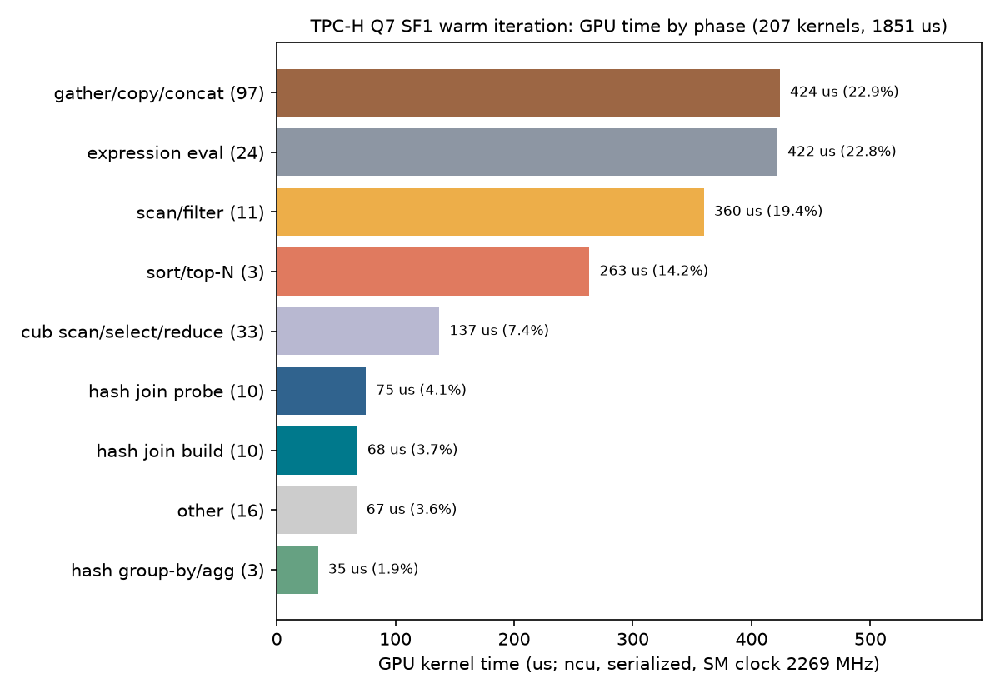
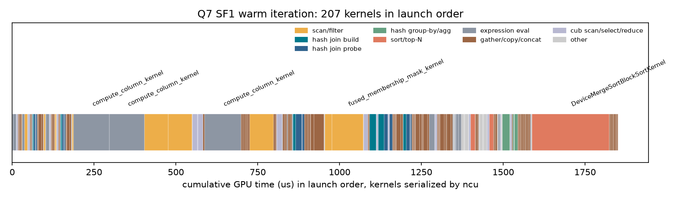
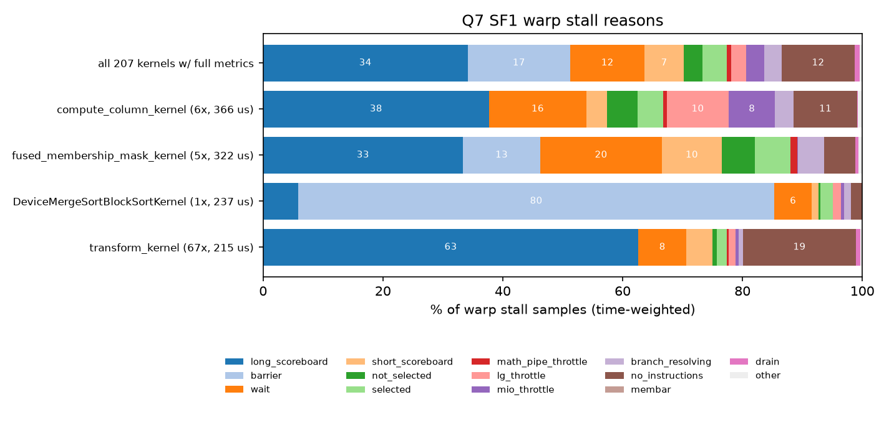
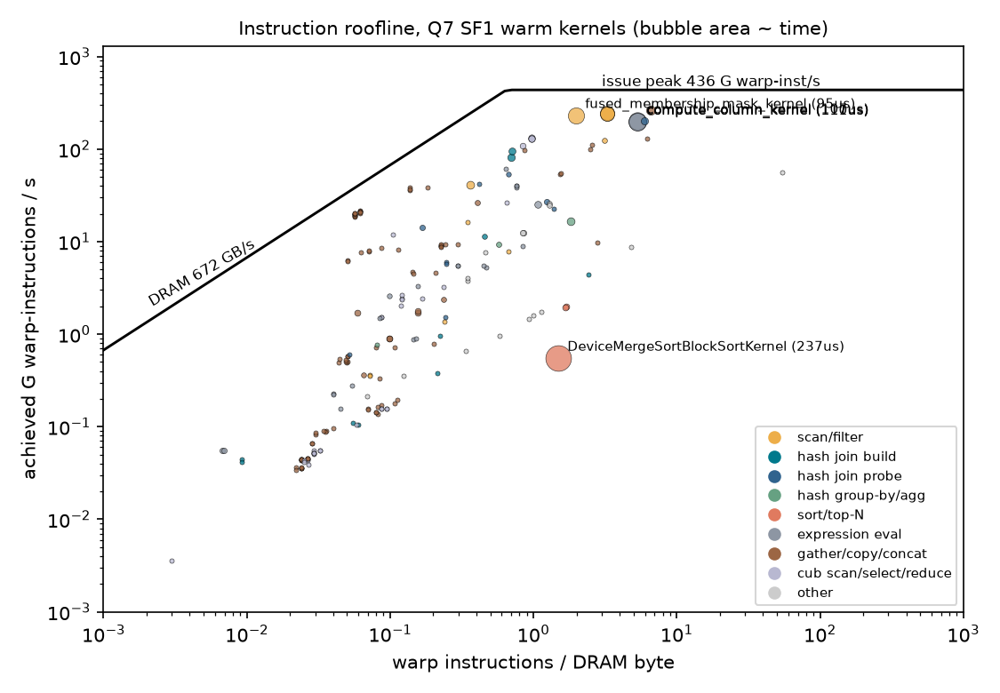

# TPC-H Q7 (SF1) on Sirius, all referenced columns pinned on GPU — Workload Analysis

**Date**: 2026-11-13
**GPU**: NVIDIA GeForce RTX 5070, 12 GB GDDR7 (192-bit, 672 GB/s), Blackwell sm_120, 48 SMs
**Workload**: TPC-H Query 7 (volume shipping: 6-way join of supplier, lineitem, orders, customer and `nation` twice, nation-pair predicate, 2-year ship-date window, GROUP BY 3 columns, ORDER BY), scale factor 1. All 13 referenced columns of `lineitem`, `orders`, `customer`, `supplier`, `nation` are pinned in GPU memory with `pin_table(tier='gpu')` (108.80 MB); measured iterations read no file and copy no table data host→device (§3).
**Framework**: Sirius (`sirius-duckdb` release build), DuckDB v2.0, stock libcudf from the pixi env, CUDA runtime 13.5
**Pipeline**: `scripts/tpch_sf1/profile_query.sh 7` (6.3 min end-to-end: 15 s + 360 s); every number below comes from a file in this directory.
**Labels**: *measured* = read from a profiler/log file; *inferred* = derived by arithmetic or reasoning from measured data.

---

## 1. Executive Summary

A warm Q7 takes **10.0 ms end-to-end** (median of 12 timed runs after 3 warmups, range 9–10 ms, `.timer` 1 ms resolution; *measured*, `timing_summary.txt`). DuckDB on the CPU takes 28.5 ms (results exact-equal, 4 rows), so the GPU is 2.85x faster. The physical floor is **162 µs** (read the 108.80 MB of pinned columns once at 672 GB/s, `physical_floor.md`), so Sirius is **~62x above the floor** end to end. The GPU is idle for most of that time:

| Where the 10.0 ms go (median warm iteration, 1 ms stamps) | ms | Source |
|---|---:|---|
| Planning (DuckDB optimizer + Sirius plan build, 36 pipelines) | 3 | Sirius log, *measured* |
| Gap from `QueryEnd` to the next statement (result fetch, printing) | 1 | Sirius log, *measured* |
| Engine window with the GPU **idle** (host orchestration) | ~4.7 | engine 6 ms (log) − GPU busy 1.287 ms (nsys), *inferred* |
| GPU busy (kernels + copies, real clocks) | **1.29** | nsys, *measured* |

Inside the 1.287 ms of GPU time (nsys, 207 kernels per iteration, deterministic; kernel sum 1,237 µs):

1. **Lineitem filter passes: `compute_column_kernel` 273 µs (22.1%) + `fused_membership_mask_kernel` 256 µs (20.7%) = 43% of kernel time.** Three ~2.0 M-row AST evaluations over lineitem partitions and four dynamic-filter probes (pos 56/57/70 over ~2.0 M rows; pos 98 over ~1.5 M rows, 46,875 warps, *inferred* orders). These 7 are the largest of the 21 GPU-filling kernels (27 and 17 waves), yet they reach just 37 GB/s and 75–117 GB/s of DRAM bandwidth (5.5% and 11–17.7% of 672 GB/s).
2. **ORDER BY block sort: 189 µs (15.3%), one launch**, a single 256-thread CTA, `DeviceMergeSortBlockSortKernel`; 79.5% of its stall samples are barrier waits (§9 RC3).
3. The remaining 207 − 12 launches are small gathers, scans, selects and hash-join kernels: ~0.52 ms. 151 kernels run < 5 µs and 76 are single-CTA.

The kernels move **99.56 MB of DRAM traffic** (ncu, cold L2) against a floor of 108.80 MB, yet take 7.6x the floor time (nsys kernel sum). Q7 at SF1 is **host-orchestration-bound** (GPU busy = 13% of wall), then **latency/instruction-bound inside the GPU**, not bandwidth-bound.

---

## 2. Workload Description

**Query** (`sql/q7_timing.sql`, TPC-H Q7): suppliers in EGYPT/UNITED STATES joined to lineitem shipped 1995-01-01 … 1996-12-31, to orders, to customers of the other nation; `sum(l_extendedprice*(1-l_discount))` by `(supp_nation, cust_nation, l_year)`, ordered by all three.

**Row counts and selectivities** (DuckDB-CPU on the same Parquet; *measured*, `physical_floor.md`):

| Step | Rows |
|---|---:|
| lineitem / orders / customer / supplier / nation | 6,001,215 / 1,500,000 / 150,000 / 10,000 / 25 |
| lineitem after ship-date window | 1,828,450 (30.5%) |
| suppliers / customers / orders in EGYPT or UNITED STATES | 808 / 11,978 / 119,032 |
| lineitem(date) ⋈ those suppliers (= ⋈ orders) | 148,529 (2.5% of lineitem) |
| after customer join and nation-pair predicate | 5,970 |
| result | 4 rows (195 B as CSV) |

**Sirius plan** (`query_plan.txt`; *measured*): 36 pipelines, 6 `GPU_SCAN` operators (`nation` scanned twice, once per alias), 5 `HASH_JOIN`, each preceded by `PARTITION`/`CONCAT` repartitioning; 4 `DYNAMIC_FILTER`s (on the customer, supplier, lineitem and orders scans, operators 4/15/23/30) fed from join build sides; then `FILTER` → `PROJECTION` → `HASH_GROUP_BY` → `MERGE_GROUP_BY` → `ORDER_BY` (`SORT_SAMPLE`/`SORT_PARTITION`/`MERGE_SORT`) → `RESULT_COLLECTOR`.

**Pinned footprint** (`traces/sirius_log_timing/*.log`, `gpu_pool … allocated=` after each `pin_table`; *measured*): lineitem 96,020,992 B, orders 12,000,256 B, customer 750,080 B, supplier 30,464 B, nation 768 B; **total 108,802,560 B**. Sirius narrows carriers (lineitem is 16 B/row pinned; 28 B/row at native widths, *inferred*, 168.0 MB). GPU pool high-water mark for the process: 325.3 MB (`pcie_verification.txt`; reached while pinning/querying, no spill). The one-off pin is excluded from all numbers.

---

## 3. PCIe Verification (no table data crosses PCIe in measured iterations)

Sources: `pcie_verification.txt`, `pcie.json`, `ncu_sysmem_check.txt`, `ncu_log_checks_list.txt`, `ncu_log_checks_detail.txt`, `selftest_negative_control.txt`. Every check exits non-zero on failure. **OVERALL: PASS.** All numbers *measured*.

| Evidence | Result |
|---|---|
| Pin tier | `sql:pin_tier_gpu`: every pinned SQL script pins each referenced table once with `tier='gpu'`; timing and nsys Sirius logs each show 5 `CALL pin_table` statements, all `tier='gpu'`, tables customer, lineitem, nation, orders, supplier |
| Scans served from the pin | `pinned_entry_per_gpu_scan`: in every iteration `#assigned pinned entry` == `#GPU_SCAN` operators (6). `nation` is scanned twice and is assigned its pinned entry twice (operators 0 and 11, Sirius log), so each scan has its own entry assignment; 0 cache-assignment errors |
| File cache | 16 `cache summary` lines for 15 iterations (summary k describes iteration k-1): `last_cycle[reads=0 hits=0 h2d=0 miss=0 …]` for iterations 1–15; nsys run 9 summaries for 8 iterations, same |
| Downgrade / spill / OOM lines during queries | 0 |
| Pool counters | `gpu_pool allocated` equals the pinned footprint (108,802,560 B) at `QueryBegin` and `QueryEnd` of every iteration; `host_pool` allocated and peak unchanged from iteration 2 |
| Dynamic-filter publication through host staging | 0 (all through peer copies, device-side) |
| Parquet decode / decompression kernels (nsys, 1,656 kernels in 8 iterations) | 0 |
| Unified memory | UM CPU+GPU page-fault collection on; 0 faults in the 5 measured iterations; no managed-memory API call in the trace |
| Kernels reading host memory in place (ncu SM/tex sysmem aperture) | `ncu_sysmem_check.txt`: 207 kernels, 0 with SM (tex) sysmem-aperture sectors (total 0), PASS |
| The ncu runs themselves | all three list runs and the `--set full` run pass the same log checks (`OVERALL ncu list logs: PASS`, `OVERALL ncu detail logs: PASS`) |

nsys CUDA trace (`traces/q7_nsys.sqlite`, Nsight Systems 2025.5.2), copies by memory kind, per measured iteration (identical in all 5):

| Direction | Copies | Bytes | Largest single copy | Interpretation |
|---|---:|---:|---:|---|
| H2D (pinned/pageable → device) | 113 | 8,254 | 576 B (limit 5,000 B) | scalars, parameter arrays (*inferred* from sizes) |
| D2H (device → pinned/pageable) | 89 | 33,424 | 16,384 B | size/count readbacks and the 195 B result (*inferred*) |
| D2D | 30 | 2,674,227 | 198,456 B | on-device |

The single-copy H2D limit is data-relative (5,000 B = half the rows of `supplier`, the smallest table with ≥ 8,192 rows). `nation` (25 rows) is below the limit's resolution; for it the evidence is the log checks plus the sysmem-aperture check (`pcie_verification.txt`). The pin phase copied 48.71 MB H2D (largest 1 MiB) and is outside the measured iterations.

**Negative control** (`selftest_negative_control.txt`): the same run with `lineitem` left unpinned makes `pcie_verify.py` exit 1 (expected) with 10 FAIL lines: pinned tables ≠ referenced tables (sql, timing log, nsys log), "5 assigned for 6 GPU_SCANs, missing tables ['lineitem']", non-zero file-cache reads (`reads=24 … h2d=65 miss=2`), Parquet `decode_page_headers_kernel` launches, H2D 44,507,401 B per iteration (largest copy 3,560,399 B, limit 5,000 B) and D2H 1,100,127 B. `SELFTEST: PASS`.

Not covered: GPU-side UM fault tables are written by nsys only when a fault happens (none present); the aggregate SM aperture counter reads 0 everywhere, so its sensitivity could not be tested here.

---

## 4. Environment

| Component | Version / setting |
|---|---|
| GPU / driver | RTX 5070 (sm_120, 48 SMs, 12 GB, 48 MB L2) / 580.173.02 |
| Nsight Compute | 2025.2.1 via `sudo -n`; `--set full --import-source yes` on all 207 warm kernels |
| ncu clocks | locked by ncu: SM ≈ 2.27 GHz (median, `ncu_extract_summary.txt`: 2269 MHz) |
| Nsight Systems | 2025.5.2 (`/home/sai/nsight-systems-2025.5`); `-t cuda -s none --cpuctxsw=none` plus UM page-fault collection |
| CPU | Intel i9-13900K, 125 GB RAM |
| Sirius config | `scripts/tpch_sf1/sirius.yaml`: 4 pipeline threads, GPU pool 25% of 12 GB, 1 GB pinned host pool (2 pools), `enable_duckdb_fallback=false` (copied from the Q2 report; unchanged) |

---

## 5. Physical Floor vs Measured

Details: `physical_floor.md` (written before reading any profile).

| Scenario | Bytes | Floor @ 672 GB/s |
|---|---:|---:|
| A. Read every pinned column once (narrowed) | 108.80 MB | **161.9 µs** |
| A'. Native widths (*inferred* widths) | 181.3 MB | 269.8 µs |
| A-min. Only predicate-forced columns | ≈ 35.8 MB | 53.3 µs |
| B. A + materialising the date-filtered lineitem + join output | ≈ 203.7 MB | 303.1 µs |

Compute floor: ~0.1 G simple ops → < 10 µs (*inferred*).

| Measured | Value | x floor (161.9 µs) |
|---|---:|---:|
| End-to-end warm median (`.timer`) | 10.0 ms | 62x |
| Engine window (Sirius log, unprofiled run) | 6 ms | 37x |
| GPU busy per iteration (nsys, real clocks, `nsys_iteration_breakdown.txt`) | 1.287 ms | 7.9x |
| Sum of kernel durations (nsys) | 1.237 ms | 7.6x |
| Sum of kernel durations (ncu, serialized, 2.27 GHz, L2 flushed before each kernel) | 1.851 ms | 11.4x |
| First→last GPU op (nsys, includes idle gaps) | 8.71 ms (median) | 54x |
| DRAM bytes moved by all 207 kernels (ncu, cold L2) | 99.56 MB | 0.91x of A's bytes |

The kernels move about the floor's byte count; the excess is time per byte, plus a host-side gap that is ~3.7x larger than all GPU work.

---

## 6. Kernel, Phase and Operator Breakdown

Sources: `warm_kernel_summary.txt`, `phase_breakdown.txt`, `operator_breakdown.txt`, `nsys_iteration_breakdown.txt`. ncu times are serialized, clock-locked and taken with the L2 cache flushed before each kernel (DRAM bytes and hit rates are cold-cache values); nsys times are at real clocks with concurrency.

| Phase (`kclass.py`) | Kernels | ncu µs | % | DRAM MB |
|---|---:|---:|---:|---:|
| gather / copy / concat | 97 | 423.9 | 22.9 | 35.42 |
| expression eval (AST `compute_column_kernel`, cast, binary) | 24 | 421.8 | 22.8 | 14.50 |
| scan / filter (dynamic-filter membership) | 11 | 359.9 | 19.4 | 30.61 |
| sort / top-N | 3 | 263.5 | 14.2 | 0.12 |
| cub scan / select / reduce | 33 | 137.1 | 7.4 | 9.26 |
| hash join probe | 10 | 75.2 | 4.1 | 3.40 |
| hash join build | 10 | 67.9 | 3.7 | 5.04 |
| other | 16 | 67.1 | 3.6 | 0.82 |
| hash group-by / agg | 3 | 34.9 | 1.9 | 0.39 |
| **Total** | **207** | **1,851.2** | 100 | 99.56 |

| Kernel family | Launches | ncu µs (%) | nsys µs/iter (%) |
|---|---:|---:|---:|
| `compute_column_kernel` (AST) | 6 | 366.0 (19.8) | 273.1 (22.1) |
| `fused_membership_mask_kernel` (dynamic filter probe) | 5 | 322.2 (17.4) | 256.0 (20.7) |
| `DeviceMergeSortBlockSortKernel` | 1 | 236.8 (12.8) | 188.7 (15.3) |
| `transform_kernel` (fixed-width gathers, casts) | 67 | 215.4 (11.6) | 120.4 (9.7) |
| `DeviceScanKernel` (string offsets) | 18 | 140.0 (7.6) | 69.5 (5.6) |
| `DeviceSelectSweepKernel` | 16 | 111.9 (6.0) | 74.8 (6.0) |
| `gather_chars_fn_char_parallel` | 16 | 103.2 (5.6) | 55.4 (4.5) |

Operator view (`operator_breakdown.txt`): AST expression 19.8%, dynamic-filter probe 17.5%, sort 14.2%, string gathers 14.1% (48 kernels), fixed-width gathers 8.8% (49 kernels, 30.2 MB DRAM), select/compact 6.6%, hash-join build+probe+compaction 7.4%. `other:` rows total 12.1 µs (0.7%).

Small-kernel profile (*measured*, `phase_breakdown.txt`): median kernel 3.5 µs (ncu); 151 kernels < 5 µs, 175 < 10 µs (32.9% of ncu time); 186 of 207 below one wave; 76 kernels with grid = 1 hold 477 µs (25.8%). Only **21 kernels fill the GPU (≥ 1 wave) and they hold 846 µs (45.7%)**; the 7 biggest (3 AST + 4 membership launches) hold 641 µs (34.6%). ncu/nsys is 1.34 for the AST kernels but 2.3 for the ~1.7 µs scan-init kernels: ncu overstates tiny kernels.





---

## 7. Top Kernels (ncu `--set full`)

Sources: `top_kernel_details.txt`, `ncu_warm_metrics.json`, `plots/q7_roofline.png`, `plots/q7_stalls.png`.

| Kernel (launch pos) | µs | Grid x Blk | Regs | Occ. ach/theo | IPC | DRAM GB/s (%) | L1 / L2 hit | Top stalls (%) |
|---|---:|---|---:|---|---:|---|---|---|
| `DeviceMergeSortBlockSort` (198) | 236.8 | 1x256 | 64 | 16.6 / 66.7 | 0.24 | 0.4 (0.1) | 50.7 / 86.3 | barrier 79.5, wait 6.2, long_sb 5.8 |
| `compute_column_kernel<128,0,0>` (63) | 110.9 | 15630x128 | 40 | 91.2 / 100 | 1.92 | 36.8 (5.6) | 96.7 / 95.0 | long_sb 36.5, wait 16.8, lg_throttle 11.7 |
| `compute_column_kernel` (54, 55) | 109.8 / 107.1 | 15629x128 / 15627x128 | 40 | 91.2 / 100 | 1.92 | 37.2 / 38.2 | 96.6 / 95.0 | same |
| `fused_membership_mask_kernel` (98) | 94.8 | 4096x256 | 48 | 78.8 / 83.3 | 2.21 | 116.9 (17.7) | 52.1 / 79.5 | long_sb 35.5, wait 20.6, barrier 13.5 |
| `fused_membership_mask_kernel` (70, 56, 57) | 73.0 / 72.9 / 72.1 | 4096x256 | 48 | 78.5 / 83.3 | 2.3 | ~75 (11.3) | 86.3 / 37.6 | long_sb 32–34, wait 20, barrier 13 |
| `gather_chars_fn_char_parallel` (95) | 30.6 | 4642x128 | n/a | 85.9 | n/a | 39.5 (6.0) | n/a | n/a |
| `DeviceScanKernel` (18 launches, string offsets) | 7.8 avg (12.7–13.3 max) | 3–5x224 | n/a | ~14.5 | 0.1–0.2 | 9–29 (≤ 4.3) | n/a | barrier / long_sb |

- Sort launch: `sm_active_max/avg = 48.0`, i.e. one SM of 48 busy; SM throughput 0.2%, DRAM 0.1%, 1.3e5 warp instructions with 12.2 of 32 lanes active per instruction.
- AST launches: SM throughput 88% with the LSU pipe at 89.6% busy, 2.81e6 global-load requests and 1.25e5 shared loads for ~2.0 M rows; DRAM 4.09 MB each (5.6% of peak). Per-warp work = 2.169e7 / 62,518 warps = 347 warp-instructions for a date-range predicate (*inferred* from the SASS entry count).
- Time-weighted stall mix over all 207 kernels: long scoreboard 34.1%, barrier 17.1%, wait 12.4%, no_instructions 12.2%, short scoreboard 6.5% (`ncu_extract_summary.txt`).
- Roofline: no kernel in the top-25 exceeds 20.4% of DRAM peak (highest: `DeviceSelectSweepKernel` 134.7 GB/s, `hash_csr_build_fill` 133.9 GB/s). Issue throughput: the AST kernel runs 2.17e7 warp-inst / 110.9 µs = 196 G warp-inst/s against a 440 G/s ceiling (48 SMs x 4 x 2.29 GHz, *inferred*), i.e. ~44%. The two big families are limited by instruction count and LSU/dependent-load latency, not by DRAM.
- The sort and the 76 single-CTA kernels sit ~3 orders of magnitude below both ceilings.





---

## 8. Instruction-Level Evidence — `cudf::compute_column_kernel<128,0,0>` (#1 family, 19.8%; longest launch pos 63, 110.9 µs)

Source: `sass/compute_column_kernel_hotspots.txt`, `…_inst_inventory.csv`, `…_pos63_source.csv` (11,116 stall samples). The single longest launch overall is the sort (§9 RC3); the SASS export covers the two largest families, so the sort is analysed from ncu metrics only.

| Property | Value | Label |
|---|---|---|
| Kernel | cuDF AST interpreter: `compute_column_kernel<128,0,0>(table_device_view, expression_device_view, mutable_column_device_view)`: evaluates an expression tree per row | measured (name) |
| Launch | 15,630 CTAs x 128 = 2.0 M threads, 27.1 waves, 40 regs; 3 identical launches (pos 54, 55, 63), 4.09 MB DRAM each, i.e. ~2 B per row for ~2.0 M rows | measured; "one launch per lineitem partition" is *inferred* |
| Static vs executed | 16,400 SASS instructions, 239 (1.5%) ever execute | measured |
| Executed | 2.169e7 warp instructions, 31 active threads per instruction | measured |
| Mix (% of executed) | integer 48.4, control flow 15.3, global load 13.3, const load 8.9, **local spill (`LDL`/`STL`) 5.2**, move 3.2 | measured |
| Stall share by class | integer 49.6, global load 18.1, **local spill 12.9**, control 8.2 | measured |

Where the stall samples fall:

| Instruction | Executions (warps) | Samples | Reason |
|---|---:|---:|---|
| `ISETP.GT.AND P0, PT, R6, 0x14, PT` @ +0x18180, after `LD.E.U16 R12, desc[UR8][R8.64]` | 125,036 | **631 (5.7%)** | long scoreboard (623) |
| `STL.64 [R1+0x58], R6` @ +0x00170 | 62,518 | 346 (3.1%) | lg_throttle 184, mio 106 |
| `SHF.L.U64.HI R5, R10, 0x2, R11` @ +0x002f0 after `LDL.LU.64 R10, [R1+0x48]` | 187,554 | 289 (2.6%) | long scoreboard |
| `IMAD.WIDE R8, R11, 0x4, R4` @ +0x17d30 | 187,554 | 283 (2.5%) | long scoreboard |
| `LD.E.U16 R12` @ +0x18170 | 125,036 | 282 (2.5%) | long scoreboard |

Dependency chain at the hottest PC (the AST interpreter fetching one column operand; every step waits on the previous load):

```
+0x18130  LDG.E R15, desc[UR8][R14.64+0xc]     // node operand: column index from the expression array
+0x18140  LDC.64 R8, c[0x0][0x3a0]             // base of table_device_view columns
+0x18150  IMAD.WIDE R8, R15, 0x20, R8          // &column[index]  (32-byte column_device_view)   samp=215
+0x18160  LDG.E.64 R8, desc[UR8][R8.64+0x10]   // load the column's data pointer                  samp=93
+0x18170  LD.E.U16 R12, desc[UR8][R8.64]       // generic load of the row value (2-byte carrier)  samp=282
+0x18180  ISETP.GT.AND P0, PT, R6, 0x14, PT    // type-code compare on R6 (does not read the just-loaded R12); long_sb waits on R6's producer, not shown  samp=631  <- hot
+0x18190  @P0 BRA ...                          // dispatch on the operator/type code (0x14, then 0x9 ...)
```

Each operand is three dependent loads (node index → column data pointer → value; the descriptor address is IMAD arithmetic) followed by a type-code compare/branch; the second hot area (+0x00170 … +0x00380) saves and reloads loop state through local memory (`STL.64 [R1+0x58]`, `LDL.LU.64 R10, [R1+0x48]` executed 187,554 times) because the interpreter's per-node state does not fit in 40 registers. Both patterns re-execute for every row and for every node of the tree.

Arithmetic (*inferred*): 110.9 µs x 2.27 GHz = 252 K cycles per SM-time for 347 warp instructions per warp at 62,518 warps over 48 SMs x 4 schedulers = 1,303 warps per SM (326 per scheduler), i.e. ~190 cycles per warp, ~0.55 cycles per instruction issue slot (IPC 1.92 of 4). The ideal DRAM time for the 4.09 MB it reads is 6.1 µs, so the kernel runs **18x its bandwidth floor** with the LSU pipe 89.6% busy: it is bound by load-instruction count (45 global-load instructions per warp for a 2-sided date predicate), not by bytes.

Dynamic-filter probe (`fused_membership_mask_kernel`, family #2; `sass/fused_membership_mask_kernel_hotspots.txt`): 10.6% of samples sit on `@P1 BRA` @ +0x3ef80 right after `BAR.SYNC.DEFER_BLOCKING 0x0` (barrier, 32,768 warps); 8.9% + 7.3% on `IMAD R0, R30, -0x3d4d51c3, R3` @ +0x02fa0 / +0x12660 (the xxhash multiply, consuming `LDG.E R30, desc[UR36][R30.64]`, long scoreboard 853 / 704) and 6.9% + 6.1% on `ISETP.NE.U32 P1, PT, R30, R3, PT` @ +0x12c30 / +0x03550 (key compare against the slot loaded with `LDG.E R3`). The block +0x12600…+0x12c30 runs with 2.0 active lanes (43,551 executions); it reloads a key from another kernel parameter and re-hashes it with the seed, so it reads as a second fused probe round taken by few rows (*inferred*), not a collision retry; the probe-continuation PCs +0x03650/+0x036e0/+0x03770 run at 14/7/2 lanes.

---

## 9. Root Cause Analysis

### RC1 — GPU idle ~4.7 ms inside the 6 ms engine window (largest wall-time component)

```
Symptom: engine 6 ms (log, unprofiled), GPU busy 1.287 ms (nsys): GPU idle ~79% of the engine window; first→last GPU op 8.7 ms   [measured/inferred]
 → WHY? per iteration the host issues 392 cudaStreamSynchronize + 98 cuStreamSynchronize, 343 pool allocations + 343 frees,
   222 batched/plain memcpys (113 H2D averaging 73 B, 89 D2H averaging 376 B) and 207 launches                   [measured, nsys]
 → WHY do they serialise? 2.68 ms of CPU time per iteration (summed over threads, under nsys) is spent inside stream syncs; each sync
   waits for a µs-scale kernel and hands control back to the host before the next operator step is issued        [CPU time measured; per-sync attribution inferred]
 ROOT: operator-at-a-time execution of a 36-pipeline plan with host round trips for sizes/counts between small kernels; at SF1 the per-step
       host latency exceeds the GPU work of the step. Planning (3 ms) is a separate CPU cost.
```

### RC2 — Lineitem filter passes: `compute_column_kernel` + `fused_membership_mask_kernel`, 0.529 ms (43% of kernel time)

```
Symptom: 3 AST launches (273 µs) + 4 big membership probes (256 µs); each reads 4–11 MB, DRAM 5.6% and 11–17.7% of peak   [measured]
 → WHY slow for so few bytes? AST kernel: LSU pipe 89.6%, 2.81e6 global loads, 347 warp-instructions/warp, IPC 1.92 (SM 88%): it is
   instruction-throughput-bound, not bandwidth-bound                                                             [measured]
 → WHY so many instructions per row? the AST interpreter resolves each operand through a dependent load chain (node → column descriptor →
   data pointer → value) and a type-code branch; 5.2% of executed instructions are local-memory spills (12.9% of stalls)   [measured SASS]
 → WHY does the membership probe stall? open-addressing probe: hash (IMAD by -0x3d4d51c3) of a loaded key, then `LDG` of the slot and a compare
   chain; 35.5% long scoreboard, 13.5% barrier after a block REDUX count; active lanes drop to 14/7/2 at the probe-continuation PCs and 2 in the second-round block   [lane counts measured; mechanism inferred]
 ROOT: lineitem (6.0 M rows) and orders (1.5 M, probe pos 98) are the tables large enough to fill the GPU, and the general-purpose interpreter/probe code spends ~18x (AST)
       its DRAM-floor time on instruction and load-latency chains; no bytes problem exists (§5: 0.91x of floor bytes).
```

### RC3 — ORDER BY block sort: 0.189 ms (15.3%), one launch

```
Symptom: 1 launch of DeviceMergeSortBlockSortKernel = 236.8 µs ncu / 188.7 µs nsys, DRAM 0.09 MB (0.1%), SM throughput 0.2%  [measured]
 → WHY so little throughput? grid = 1 CTA x 256 threads: one SM of 48 busy (sm_active max/avg = 48.0), occupancy 16.6%, IPC 0.24, thread
   efficiency 12.2                                                                                              [measured]
 → WHY one CTA? cub merge sort launches ceil(n / tile) CTAs; the ORDER BY sees the 4 merged groups (result = 4 rows), far under one tile
                                                                                   [inferred from the 4-row result; row count not read from Sirius]
 → WHY 190–240 µs for ~4 rows? 79.5% of stall samples are barrier waits (the other warps wait for the one holding rows); 1.3e5 warp
   instructions are a single dependent comparator chain (same kernel took 505 µs for 485 rows in Q2's SASS: cost set by the serial chain
   of cuDF's generic row comparator, not by n)                                                                  [measured counts; mechanism inferred, SASS not exported for Q7]
 ROOT: a general-purpose full sort with a generic row comparator serves a 4-row ORDER BY; its cost is the latency of one warp, which more
       GPU width cannot help.
```

---

## 10. Gap Analysis

| Component of the 10.0 ms warm wall time | ms | Evidence | Label |
|---|---:|---|---|
| Planning | 3 | Sirius log | measured |
| Gap to next statement (result fetch/print) | 1 | Sirius log | measured |
| GPU idle inside engine (RC1) | ~4.7 | log 6 − nsys 1.287 | inferred |
| Lineitem AST filters (RC2) | 0.273 | nsys | measured |
| Dynamic-filter membership probes (RC2) | 0.256 | nsys | measured |
| ORDER BY block sort (RC3) | 0.189 | nsys | measured |
| Other kernels (~195 launches) | 0.52 | nsys kernel sum 1.237 − 0.718 | inferred |
| Copies / memsets (nsys busy − kernel sum) | ~0.05 | 1.287 − 1.237 | inferred |
| Physical floor | 0.162 | `physical_floor.md` | computed |

Components are medians of 1 ms stamps and do not sum exactly to 10.0. nsys lengthens the engine window to ~10 ms (median) by intercepting ~2,480 API calls per iteration, so nsys host-side times are used for counts and ratios only.

---

## 11. Optimization Directions (generic; no query-specific fusion)

| # | Direction | Expected effect | Evidence |
|---|---|---|---|
| 1 | Fewer host round trips in the Sirius executor: avoid per-step stream syncs for size readbacks, reuse pool allocations across iterations, batch small copies | targets the ~4.7 ms idle | RC1: 490 syncs, 343 allocs per iteration |
| 2 | Plan caching for repeated statements | targets the 3 ms planning | log |
| 3 | AST evaluation: specialise `compute_column` on the expression type so operands are not resolved through column-descriptor pointer chasing, and keep interpreter state in registers (avoid local spills); or pre-resolve column data pointers once per kernel launch | up to ~0.2 ms of the 0.273 ms | RC2: 347 inst/warp, 5.2% spills, LSU 89.6% |
| 4 | Dynamic-filter probe: reduce lane divergence in open-addressing collision loops (probe with cooperative groups, lower load factor) and avoid the per-block barrier-count epilogue | up to ~0.1 ms | RC2: 14/7/2 active lanes at +0x03650/+0x036e0/+0x03770, barrier 13.5% |
| 5 | Small-n path in the library sort: pick the block-sort policy by n (all 256 threads hold rows), or compare the leading fixed-width key first and run the full row comparator only on ties | up to −0.18 ms | RC3: 1 CTA, barrier 79.5% |
| 6 | Late materialisation: carry row indices through the join chain and gather payload columns once (planner choice; kernels stay generic) | fewer of the 97 gather/copy kernels (0.42 ms ncu) | §6 |

Fusing Q7's specific operator chain would also remove launches, but it is out of scope by project policy: cuDF kernels stay general-purpose library operators.

---

## 12. Determinism and Profiling Method

- **Launch counts are deterministic** (*measured*, `warm_kernel_summary.txt`, `ncu_plan.json`, `pcie.json`): every iteration = 207 launches in the three ncu list runs (pin+3/4/5 iterations: 1,174 / 1,381 / 1,588) and in all 8 nsys iterations; kernel-name multisets of the added iterations are identical (`STABLE: True`).
- **Launch order is not**: the 4 pipeline threads interleave; iterations 4 and 5 of one run differ at 19 positions and the x4 vs x5 prefix at 77. The `-s 1381 -c 207` slice needs only counts and multisets; the report's 207 kernel names match the expected multiset (`ncu_slice_check.txt`: multiset match True; 1 name reconciled on function/grid/block).
- **ncu policy branch**: 207 ≤ `NCU_FULL_MAX` (1000) → `full_all`, `--set full --import-source yes` on all 207 launches. The light + families branch was not used for Q7.
- nsys windows: 5 measured iterations (4–8), kernel counts [207]x5, GPU busy 1.283–1.302 ms.

## 13. Limitations

- ncu durations are serialized, clock-locked (2.27 GHz) and taken after cache flushes; tiny kernels are overstated up to ~2.3x. Real-clock kernel times come from nsys.
- ncu flushes L2 before each profiled kernel, so the 99.56 MB of "DRAM traffic" is cold-cache traffic; the 108.8 MB pinned working set exceeds the 48 MB L2 either way.
- Wall splits come from 1 ms Sirius log stamps and the 1 ms `.timer`; the ~4.7 ms "GPU idle" is a difference of two runs (log: unprofiled, GPU busy: nsys) and carries about ±1 ms.
- Native column widths (28 B/row for lineitem) and the "one AST/probe launch per ~2.0 M-row lineitem partition" reading are inferred, not read from Sirius.
- The sort's input row count (~4) is inferred from the 4-row result; SASS is not exported for the sort kernel, so RC3's mechanism leans on ncu metrics and the Q2 SASS.
- Stall-sample counts on small kernels are small; the SASS chains are reliable in kind, not in exact percentages.
- 2 kernels reported `lts__t_sector_hit_rate` of 102–104% (ncu artifact on tiny kernels); clamped to 100% in `ncu_warm_metrics.json` (raw values kept).
- Only the pinned configuration was profiled; there is no unpinned timing comparison (the negative control only checks residency detection).
- `nation` (25 rows) is below the byte-limit resolution of the PCIe check; its evidence is the log and sysmem checks.

## 14. Raw Data

| File | Contents |
|---|---|
| `timing_summary.txt`, `timing.json`, `result.csv`, `traces/timing_run.txt`, `traces/duckdb_cpu_run.txt` | timing (3 warmup + 12 timed), result, DuckDB-CPU baseline |
| `query_plan.txt`, `sql/` | Sirius pipeline plan, generated SQL |
| `pcie_verification.txt`, `pcie.json`, `traces/q7_nsys.{nsys-rep,sqlite}`, `traces/sirius_log_*` | PCIe evidence |
| `ncu_sysmem_check.txt`, `ncu_log_checks_{list,detail}.txt`, `selftest_negative_control.txt`, `selftest/` | host-memory-in-place check, residency checks on the ncu runs, negative control |
| `nsys_iteration_breakdown.{txt,json}` | per-iteration GPU busy, API counts, real-clock kernel times |
| `warm_kernel_list.json`, `warm_kernel_summary.txt`, `ncu_plan.json`, `traces/ncu_list_x{3,4,5}.csv` | list passes, determinism, profiling plan |
| `profiles/q7_warm_full.ncu-rep`, `ncu_slice_check.txt` | full ncu report of the warm iteration (207 kernels) |
| `ncu_warm_metrics.json`, `ncu_extract_summary.txt`, `phase_breakdown.*`, `operator_breakdown.txt`, `top_kernel_details.txt` | extracted metrics |
| `sass/` | SASS hotspots for `compute_column_kernel` and `fused_membership_mask_kernel` |
| `plots/q7_*.png` | phase breakdown, kernel sequence, roofline, stall mix |
| `physical_floor.md` | floor |
| `pipeline_run.log`, `validate_pipeline.txt` | pipeline logs and validation |
