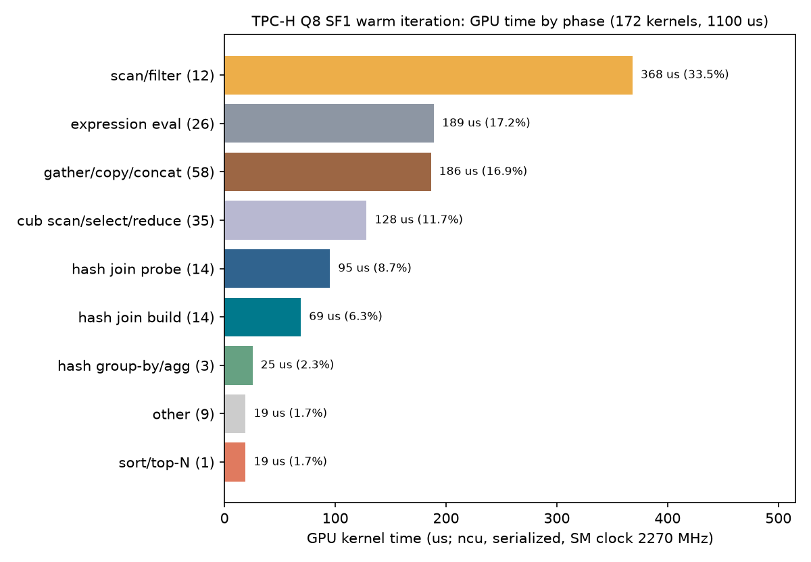
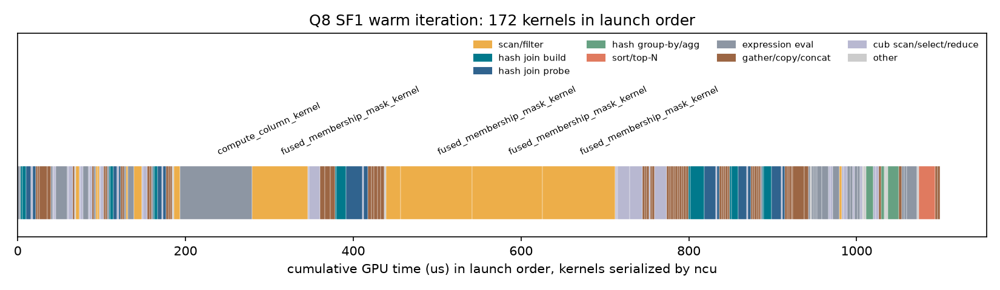
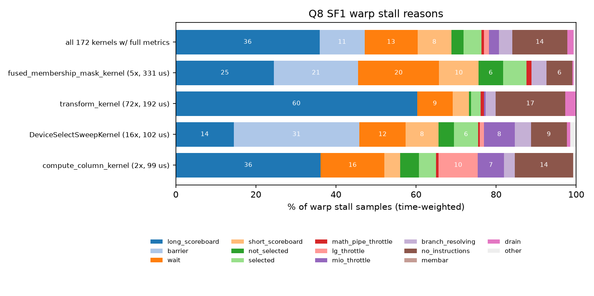
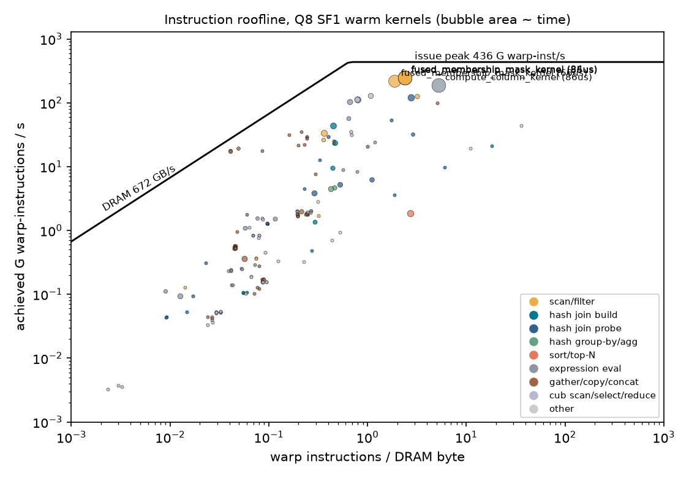

# TPC-H Q8 (SF1) on Sirius, all referenced columns pinned on GPU — Workload Analysis

**Date**: 2026-11-13
**GPU**: NVIDIA GeForce RTX 5070, 12 GB GDDR7 (192-bit, 672 GB/s), Blackwell sm_120, 48 SMs
**Workload**: TPC-H Query 8 (national market share: 8-way join of lineitem, part, supplier, orders, customer, `nation` twice and region; part-type, 2-year order-date and region predicates; CASE ratio `mkt_share` (DOUBLE) grouped by year; ORDER BY), scale factor 1. All 19 referenced columns of the 7 tables are pinned in GPU memory with `pin_table(tier='gpu')` (129.53 MB); measured iterations read no file and copy no table data host→device (§3).
**Framework**: Sirius (`sirius-duckdb` release build), DuckDB v2.0, stock libcudf from the pixi env, CUDA runtime 13.5
**Pipeline**: `scripts/tpch_sf1/profile_query.sh 8` (5.3 min end-to-end: 15 s for sql/timing/pcie/selftest + 304 s for the rest); every number below comes from a file in this directory.
**Labels**: *measured* = read from a profiler/log file; *inferred* = derived by arithmetic or reasoning from measured data.

---

## 1. Executive Summary

A warm Q8 takes **9.0 ms end-to-end** (median of 12 timed runs after 3 warmups, range 8–10 ms, `.timer` 1 ms resolution; *measured*, `timing_summary.txt`). DuckDB on the CPU takes 29.0 ms (min 26, max 31), so the GPU is 3.2x faster. The result (2 rows) equals DuckDB-CPU exactly: compare mode `exact`, max relative difference 0.0 at tolerance 1e-9, consistent across all 15 GPU iterations (`timing_summary.txt`, `timing.json`). The physical floor is **192.7 µs** (read the 129.53 MB of pinned columns once at 672 GB/s, `physical_floor.md`), so Sirius is **~47x above the floor** end to end. The GPU is idle for most of that time:

| Where the 9.0 ms go (median warm iteration, 1 ms stamps) | ms | Source |
|---|---:|---|
| Planning (DuckDB optimizer + Sirius plan build, 48 pipelines) | 4 | Sirius log, *measured* |
| Gap from `QueryEnd` to the next statement (result fetch, printing) | 1 | Sirius log, *measured* |
| Engine window with the GPU **idle** (host orchestration) | ~3.3 | engine 4 ms (log) − GPU busy 0.741 ms (nsys), *inferred* |
| GPU busy (kernels + copies, real clocks) | **0.74** | `nsys_iteration_breakdown.txt`, *measured* |

Inside the 0.741 ms of GPU time (nsys, 172 kernels per iteration, deterministic; kernel sum 704.5 µs):

1. **Dynamic-filter membership probes: `fused_membership_mask_kernel` 267.4 µs (38.0%), 5 launches.** Three launches over ~2.0 M-row lineitem partitions and one over ~1.5 M rows hold 4 of the 5 (ncu 86.5/85.2/83.9/66.0 µs). They fill the GPU (17 waves) yet reach only 102–117 GB/s DRAM (15.5–17.7% of peak); the SASS shows a hash → load → compare chain and 21.8% of stall samples on a single post-barrier branch (§8).
2. **`transform_kernel` (gathers/casts) 85.0 µs (12.1%), 72 launches, avg 2.7 µs (ncu)**, and **`compute_column_kernel` (AST) 74.3 µs (10.5%), 2 launches**, one of which (grid 11,719 x 128) runs at 85% SM throughput with the LSU pipe 87.7% busy.
3. The other 172 − 79 launches are small selects, hash-join build/probe and scans: 134 kernels run < 5 µs (ncu), 155 are below one wave, 60 are single-CTA.

The kernels move **70.43 MB of DRAM traffic** (ncu, cold L2) against a floor of 129.53 MB (0.54x) yet take 3.7x the floor time (nsys kernel sum). Q8 at SF1 is **host-orchestration-bound** (GPU busy = 8% of wall), then latency/instruction-bound inside the GPU, not bandwidth-bound.

---

## 2. Workload Description

**Query** (`sql/q8_timing.sql`, TPC-H Q8): market share of EGYPT within MIDDLE EAST customers' 1995–1996 orders for `p_type = 'PROMO BRUSHED COPPER'`; `sum(case when nation='EGYPT' then volume else 0 end)/sum(volume)` by `o_year`, ordered by year. Result: 1995 → 0.04333, 1996 → 0.03833 (`result.csv`, 68 B).

**Row counts and selectivities** (DuckDB-CPU on the same Parquet; *measured*, `physical_floor.md`):

| Step | Rows |
|---|---:|
| lineitem / orders / part / customer / supplier / nation / region | 6,001,215 / 1,500,000 / 200,000 / 150,000 / 10,000 / 25 / 5 |
| parts with `p_type='PROMO BRUSHED COPPER'` | 1,259 (0.63%) |
| lineitem rows with such a part | 37,666 (0.63%) |
| orders in the 1995–1996 window | 457,263 (30.5%) |
| MIDDLE EAST customers | 29,904 (19.9%) |
| orders in the window AND from those customers | 90,488 (6.0%) |
| lineitem rows surviving all joins | 2,241 |
| result | 2 rows (68 B as CSV) |

**Sirius plan** (`query_plan.txt`; *measured*): 48 pipelines: 8 `GPU_SCAN` (`nation` scanned twice), 7 `HASH_JOIN`, 15 `PARTITION` + 14 `CONCAT` repartitioning steps, 4 `DYNAMIC_FILTER`s (each directly after a `GPU_SCAN`, fed from join build sides), then `MERGE_GROUP_BY`, `SORT_SAMPLE`/`MERGE_SORT`, `RESULT_COLLECTOR`.

**Pinned footprint** (`traces/sirius_log_timing/*.log`, `gpu_pool … allocated=` after each `pin_table`; *measured*): lineitem 108,023,296 B, part 5,720,320 B, supplier 30,464 B, orders 15,000,320 B, customer 750,080 B, nation 1,024 B, region 768 B; **total 129,526,272 B**. Sirius narrows carriers (lineitem is 18.0 B/row pinned; 28 B/row at native widths, *inferred* from the Parquet column types, 168.0 MB). GPU pool high-water mark for the process: 457.3 MB (`pcie_verification.txt`; a process-lifetime mark that includes the pin phase; no spill). The one-off pin is excluded from all numbers.

---

## 3. PCIe Verification (no table data crosses PCIe in measured iterations)

Sources: `pcie_verification.txt`, `pcie.json`, `ncu_sysmem_check.txt`, `ncu_log_checks_list.txt`, `ncu_log_checks_detail.txt`, `selftest_negative_control.txt`. Every check exits non-zero on failure. **OVERALL: PASS.** All numbers *measured*.

| Evidence | Result |
|---|---|
| Pin tier | `sql:pin_tier_gpu`: every pinned SQL script pins each referenced table once with `tier='gpu'`; timing and nsys Sirius logs each show 7 `CALL pin_table` statements, all `tier='gpu'`, tables customer, lineitem, nation, orders, part, region, supplier |
| Scans served from the pin | `pinned_entry_per_gpu_scan`: in every iteration `#assigned pinned entry` == `#GPU_SCAN` operators (8); 0 cache-assignment errors |
| File cache | 16 `cache summary` lines for 15 iterations (summary k describes iteration k-1): `last_cycle[reads=0 hits=0 h2d=0 miss=0 …]` for iterations 1–15; nsys run 9 summaries for 8 iterations, same |
| Downgrade / spill / OOM lines during queries | 0 |
| Pool counters | `gpu_pool allocated` equals the pinned footprint (129,526,272 B) at `QueryBegin` and `QueryEnd` of every iteration; `host_pool` allocated and peak unchanged from iteration 2 |
| Dynamic-filter publication through host staging | 0 (0 host-staged publications; all through peer copies, device-side) |
| Parquet decode / decompression kernels (nsys, 1,376 kernels in 8 iterations) | 0 |
| Unified memory | UM CPU+GPU page-fault collection on; 0 faults in the 5 measured iterations; no managed-memory API call in the trace |
| Kernels reading host memory in place (ncu SM/tex sysmem aperture) | `ncu_sysmem_check.txt`: 172 kernels, 0 with SM (tex) sysmem-aperture sectors (total 0), PASS; all-source sysmem sectors 265–284 per kernel (info only) |
| The ncu runs themselves | all three list runs and the `--set full` run pass the same log checks (`OVERALL ncu list logs: PASS`, `OVERALL ncu detail logs: PASS`) |

nsys CUDA trace (`traces/q8_nsys.sqlite`, Nsight Systems 2025.5.2), copies by memory kind, per measured iteration (identical in all 5):

| Direction | Copies | Bytes | Largest single copy | Interpretation |
|---|---:|---:|---:|---|
| H2D (pinned/pageable → device) | 61 | 2,872 | 276 B (limit 5,000 B) | scalars, parameter arrays (*inferred* from sizes) |
| D2H (device → pinned/pageable) | 51 | 326 | 48 B | size/count readbacks and the result rows (*inferred*; 68 B is the CSV text size, the largest D2H copy is 48 B) |
| D2D | 26 | 70,678 | 20,000 B | on-device |

The single-copy H2D limit is data-relative (5,000 B = half the rows of `supplier`, the smallest table with ≥ 8,192 rows). `nation` (25 rows) and `region` (5 rows) are below the limit's resolution; for them the evidence is the log checks plus the sysmem-aperture check (`pcie_verification.txt`). The pin phase copied 56.75 MB H2D (largest 1 MiB) and is outside the measured iterations.

**Negative control** (`selftest_negative_control.txt`): the same run with `lineitem` left unpinned makes `pcie_verify.py` exit 1 (expected) with 10 FAIL lines: pinned tables ≠ referenced tables (sql, timing log, nsys log), "7 assigned for 8 GPU_SCANs, missing tables ['lineitem']", non-zero file-cache reads (`reads=12 … h2d=58 miss=1`), Parquet `count_page_headers_kernel`/`decode_page_headers_kernel` launches, H2D 49,999,792 B per iteration (largest copy 4,637,942 B, limit 5,000 B) and D2H 1,062,737 B (largest 78,720 B). `SELFTEST: PASS`.

Not covered: GPU-side UM fault tables are written by nsys only when a fault happens (none present); the aggregate SM aperture counter reads 0 everywhere, so its sensitivity could not be tested here.

---

## 4. Environment

| Component | Version / setting |
|---|---|
| GPU / driver | RTX 5070 (sm_120, 48 SMs, 12 GB, 48 MB L2) / 580.173.02 (copied from the Q7 report; not re-queried) |
| Nsight Compute | 2025.2.1 via `sudo -n`; `--set full --import-source yes` on all 172 warm kernels |
| ncu clocks | locked by ncu: SM ≈ 2.27 GHz (median, `ncu_extract_summary.txt`: 2270 MHz) |
| Nsight Systems | 2025.5.2 (`/home/sai/nsight-systems-2025.5`); `-t cuda -s none --cpuctxsw=none` plus UM page-fault collection |
| CPU | Intel i9-13900K, 125 GB RAM (copied from the Q7 report) |
| Sirius config | `scripts/tpch_sf1/sirius.yaml`: 4 pipeline threads, GPU pool 25% of 12 GB, 1 GB pinned host pool (2 pools), `enable_duckdb_fallback=false` (unchanged) |

---

## 5. Physical Floor vs Measured

Details: `physical_floor.md` (written before reading any profile).

| Scenario | Bytes | Floor @ 672 GB/s |
|---|---:|---:|
| A. Read every pinned column once (narrowed) | 129.53 MB | **192.7 µs** |
| A'. Native widths (*inferred* widths) | 193.0 MB | 287.2 µs |
| A-min. Only predicate-forced columns | ≈ 41.6 MB | 61.9 µs |
| B. A + materialising date-filtered orders + lineitem∩part intermediate | ≈ 142.0 MB | 211.3 µs |

Compute floor: ~0.15 G simple ops → < 15 µs (*inferred*). Launch-count bound: 172 kernels x ~2 µs ≈ 0.34 ms (*inferred*; the 2 µs is carried over from Q2, not measured here).

| Measured | Value | x floor (192.7 µs) |
|---|---:|---:|
| End-to-end warm median (`.timer`) | 9.0 ms | 47x |
| Engine window (Sirius log, unprofiled run) | 4 ms | 21x |
| GPU busy per iteration (nsys, real clocks, `nsys_iteration_breakdown.txt`) | 0.741 ms (0.741–0.757) | 3.8x |
| Sum of kernel durations (nsys) | 0.7045 ms | 3.7x |
| Sum of kernel durations (ncu, serialized, 2.27 GHz, L2 flushed before each kernel) | 1.100 ms | 5.7x |
| First→last GPU op (nsys, includes idle gaps) | 9.50 ms (median) | 49x |
| DRAM bytes moved by all 172 kernels (ncu, cold L2) | 70.43 MB | 0.54x of A's bytes |

The kernels move about half the floor's bytes (many predicate columns are never fully read after the dynamic filters); the excess is time per byte, plus a host-side gap ~4.5x larger than all GPU work.

---

## 6. Kernel, Phase and Operator Breakdown

Sources: `warm_kernel_summary.txt`, `phase_breakdown.txt`, `operator_breakdown.txt`, `nsys_iteration_breakdown.txt`. ncu times are serialized, clock-locked and taken with the L2 cache flushed before each kernel (DRAM bytes and hit rates are cold-cache values); nsys times are at real clocks with concurrency.

| Phase (`kclass.py`) | Kernels | ncu µs | % | DRAM MB |
|---|---:|---:|---:|---:|
| scan / filter (dynamic-filter probe + key-set build) | 12 | 368.4 | 33.5 | 36.89 |
| expression eval (AST, binary, cast) | 26 | 189.1 | 17.2 | 6.73 |
| gather / copy / concat | 58 | 186.3 | 16.9 | 13.14 |
| cub scan / select / reduce | 35 | 128.3 | 11.7 | 8.57 |
| hash join probe | 14 | 95.2 | 8.7 | 2.25 |
| hash join build | 14 | 69.0 | 6.3 | 2.54 |
| hash group-by / agg | 3 | 25.3 | 2.3 | 0.24 |
| other | 9 | 19.1 | 1.7 | 0.05 |
| sort / top-N | 1 | 19.0 | 1.7 | 0.01 |
| **Total** | **172** | **1,099.7** | 100 | 70.43 |

| Kernel family | Launches | ncu µs (%) | nsys µs/iter (%) |
|---|---:|---:|---:|
| `fused_membership_mask_kernel` (dynamic-filter probe) | 5 | 330.9 (30.1) | 267.4 (38.0) |
| `transform_kernel` (gathers, casts) | 72 | 192.1 (17.5) | 85.0 (12.1) |
| `compute_column_kernel` (AST) | 2 | 98.8 (9.0) | 74.3 (10.5) |
| `DeviceSelectSweepKernel` | 16 | 102.4 (9.3) | 67.5 (9.6) |
| `insert_if_n` (hash build / filter key set) | 10 | 85.2 (7.7) | 47.6 (6.8) |
| `static_kernel` (cub for_each) | 20 | 76.9 (7.0) | 45.9 (6.5) |
| `find_if_n` (hash probe) | 7 | 70.0 (6.4) | 41.8 (5.9) |

Operator view (`operator_breakdown.txt`): dynamic-filter membership probe 30.3% (6 kernels), fixed-width gathers 13.7% (52), select/compact 9.4% (25), AST expression 9.0% (2), hash-join probe 6.4%, binary-op expression 5.6%, hash-join build 5.2%, string gathers 3.3%, filter key-set build 2.6%. `other:` rows total 9.0 µs (0.8%), so no `kclass.py` rule was added.

Small-kernel profile (*measured*, `phase_breakdown.txt`, `ncu_warm_metrics.json`): median kernel 2.72 µs (ncu); 134 kernels < 5 µs, 152 < 10 µs (43.1% of ncu time); 155 of 172 below one wave; 131 with grid < 48 CTAs; **60 kernels with grid = 1 hold 184.7 µs (16.8%)**. Only **17 kernels fill the GPU (≥ 1 wave) and they hold 553 µs (50.3%)**. ncu/nsys is 1.56 overall but larger for tiny kernels: ncu overstates them.





---

## 7. Top Kernels (ncu `--set full`)

Sources: `top_kernel_details.txt`, `ncu_warm_metrics.json`, `plots/q8_roofline.png`, `plots/q8_stalls.png`.

| Kernel (launch pos) | µs | Grid x Blk | Regs | Occ. ach/theo | IPC | DRAM GB/s (%) | L1 / L2 hit | Top stalls (%) |
|---|---:|---|---:|---|---:|---|---|---|
| `fused_membership_mask` (81) | 86.5 | 4096x256 | 48 | 80.3 / 83.3 | 2.35 | 102.3 (15.5) | 92.4 / 24.6 | barrier 23.9, long_sb 21.5, wait 20.3 |
| `compute_column_kernel<128,0,0>` (60) | 86.3 | 11719x128 | 40 | 91.2 / 100 | 1.88 | 35.8 (5.4) | 95.2 / 94.6 | long_sb 37.9, wait 16.5, lg_throttle 11.2 |
| `fused_membership_mask` (79, 80) | 85.2 / 83.9 | 4096x256 | 48 | 79.7 / 83.3 | 2.34 | 103.7 / 105.6 (15.7 / 16.0) | 92.4 / 24.6–25.1 | barrier 23.4, long_sb 21.5, wait 21 |
| `fused_membership_mask` (61) | 66.0 | 4096x256 | 48 | 77.9 / 83.3 | 2.11 | 117.1 (17.7) | 42.0 / 66.9 | long_sb 36.4, wait 18.9, barrier 13.2 |
| `find_if_n` (69) | 19.7 | 707x128 | 38 | 75.3 / 100 | 1.44 | 44.3 (6.7) | 30.7 / 88.1 | long_sb 40.7, barrier 21.4 |
| `DeviceRadixSortSingleTile` (169) | 19.0 | 1x256 | 123 | 16.4 / 33.3 | 0.91 | 0.7 (0.1) | 33.3 / 100 | mio_throttle 44.7, selected 21.1, wait 15.8 |
| `insert_if_n` (78, 104) | 17.2 / 16.8 | 707x128 | 32 | 87.6 / 65.3 ach (theo 100) | 0.37 | 94.4 / 99.3 (14.3 / 15.1) | 55.3 / 77.3 | long_sb 80.5 |
| `DeviceSelectSweepKernel` (85, 84, 92) | 14.7 / 14.5 / 14.4 | 348x384 | n/a | 44.1 | n/a | 140–143 (21.3–21.6) | n/a | n/a |
| `static_kernel` (14) | 13.2 | 391x256 | n/a | 73.4 | n/a | 155.2 (23.5) | n/a | n/a |
| `compute_column_kernel` (167) | 12.4 | 1x128 | n/a | 2.4 | n/a | 7.5 (1.1) | n/a | n/a |

- Probe launches 81/79/80 each run 62,518 active warps for ~2.0 M rows (*inferred*: 3 x 2.0 M ≈ the 6.0 M-row lineitem) and read 8.84–8.86 MB, ≈ 4 B/row (= the `l_partkey` carrier); pos 61 has `st_req` 4.69e4 warps ≈ 1.5 M rows (*inferred*: orders, probed by the date/customer filter). On average 24.8 of 32 lanes are active per instruction (18.3 for pos 61).
- Probe at 86.5 µs vs its DRAM floor 8.85 MB / 672 GB/s = 13.2 µs: **6.6x its bandwidth floor** (cold L2); issue rate 2.11e7 warp-inst / 86.5 µs = 244 G warp-inst/s against a 440 G/s ceiling (48 SMs x 4 x 2.29 GHz, *inferred*), 55%.
- AST pos 60: SM throughput 85.4%, LSU pipe 87.7%, 2.11e6 global-load requests and 1.63e7 warp instructions for ~1.5 M rows (46,875 warps → 348 warp-inst and 45 load requests per warp, *inferred* from grid size); DRAM 3.09 MB = 4.6 µs ideal vs 86.3 µs measured (18.8x).
- Sort: `sm_active_max/avg = 48.0` (one SM of 48 busy), 3.55e4 warp instructions, DRAM 0.01 MB.
- Time-weighted stall mix over all 172 kernels: long scoreboard 35.9%, no_instructions 13.8%, wait 13.2%, barrier 11.2%, short scoreboard 8.4% (`ncu_extract_summary.txt`).
- Roofline: the highest DRAM rate in the top-25 table is `static_kernel` 155.2 GB/s (23.5% of peak); no kernel there exceeds 24% of peak. The two GPU-filling families are limited by instruction count and dependent-load latency, not by DRAM. The 60 single-CTA kernels sit orders of magnitude below both ceilings.





---

## 8. Instruction-Level Evidence — `sirius::fused_membership_mask_kernel` (#1 family, 30.1% ncu / 38.0% nsys; longest launch pos 81, 86.5 µs)

Source: `sass/fused_membership_mask_kernel_hotspots.txt`, `…_inst_inventory.csv`, `…_pos81_source.csv` (8,797 stall samples).

| Property | Value | Label |
|---|---|---|
| Kernel | Sirius dynamic-filter probe: for each row load the key, hash it (xxhash32 constants `-0x3d4d51c3`, `0x165667b5`), probe an open-addressing set, write a membership bit, count set bits per block | measured (name, SASS constants); role *inferred* from the plan |
| Launch | 4,096 CTAs x 256 = 1.05 M threads, 17.07 waves, 48 regs; 62,518 per-row warp executions vs 32,768 launched warps = ~1.9 row-batches per warp | measured |
| Static vs executed | 16,320 SASS instructions, 605 (3.7%) ever execute | measured |
| Executed | 2.11e7 warp instructions, 24.8 of 32 lanes active per instruction on average | measured |
| Mix (% of executed / of stalls) | integer 48.1 / 46.5, control flow 16.6 / 32.0, const load 10.6, global load 1.9 / 0.9 | measured |

Where the stall samples fall:

| Instruction | Executions (warps) | Samples | Reason |
|---|---:|---:|---|
| `@P1 BRA` @ +0x3ef80, right after `BAR.SYNC.DEFER_BLOCKING 0x0` | 32,768 | **1,916 (21.8%)** | barrier 1,911 |
| `IMAD R0, R30, -0x3d4d51c3, R3` @ +0x02fa0, after `LDG.E R30` | 62,518 | **1,108 (12.6%)** | long scoreboard 1,101 |
| `ISETP.NE.U32.AND P1, PT, R30, R3, PT` @ +0x12c30 (1 active lane) | 11,407 | 177 (2.0%) | long scoreboard |
| `IMAD R0, R30, -0x3d4d51c3, R3` @ +0x12660 (1 active lane) | 11,407 | 175 (2.0%) | long scoreboard |
| `ISETP.NE.U32.AND P1, PT, R30, R3, PT` @ +0x03550 | 62,518 | 169 (1.9%) | long scoreboard |

Dependency chain at the #2 hot PC (key fetch → hash → slot fetch → compare; one dependent load pair per probe step):

```
+0x02f40  IADD.64 R30, R36, UR4                // &key[row]
+0x02f60  LDG.E R30, desc[UR36][R30.64]        // load the row's key (4 B, coalesced)          samp=8
+0x02fa0  IMAD R0, R30, -0x3d4d51c3, R3        // hash multiply, first consumer of R30         samp=1108 <- long_sb
+0x02fb0  IADD R0, R0, 0x165667b5 ; SHF.L.W.U32.HI R0, R0, 0x11, R0 ...   // rest of xxhash
+0x03530  LDG.E R3, desc[UR36][R8.64]          // load the slot's stored key (after a 2nd seeded hash + modulo, +0x03260…+0x03460)
+0x03550  ISETP.NE.U32.AND P1, PT, R30, R3, PT // compare key vs slot, stalls on that load     samp=169
```

The barrier hotspot (context, +0x3ef00…): `REDUX.SUM.S32 UR4, R17` → `STS [R3+0x8], R14` → `BAR.SYNC` → `@P1 BRA`. All 8 warps of a CTA must reach the barrier; the stalled warps (1,911 barrier samples) wait for the slowest warp, whose lanes diverge in the probe-continuation steps (+0x03650/+0x036e0/+0x03770 with 15, 7 and 2 lanes: `exe` and `thr` columns); the 1-lane block +0x12600…+0x12c30 (11,407 executions) reloads a key from another kernel parameter and re-hashes it with the seed, i.e. a second fused probe round taken only by surviving rows (*inferred*: 11,407 ≈ 37,666/3 part-matching rows per partition), not a collision retry. Mechanism (*inferred* from those columns, not from a lane-level trace): a warp's block-count reduction waits for its slowest lane's probe chain; the CTA waits for its slowest warp.

Arithmetic (*inferred*): 86.5 µs x 2.27 GHz = 196 K cycles per SM; IPC 2.35 of 4; ideal DRAM time for the 8.85 MB is 13.2 µs, so the kernel runs **6.6x its bandwidth floor** with the LSU pipe only 16.2% busy and SM throughput 57%: it is bound by serial dependent-load latency plus per-CTA barrier imbalance, not by bytes. The 3 identical lineitem launches (pos 79/80/81) repeat this cost.

Family #2 (`transform_kernel`, 72 launches, `sass/transform_kernel_hotspots.txt`, longest launch pos 65, 6.4 µs, grid 177x256): 92.0% of its stall samples are long scoreboard, 54.7% on `STG.E desc[UR4][R12.64], R11` @ +0x00760 (waiting for the value) and 37.3% on `IMAD.WIDE R10, R13, 0x4, R8` @ +0x00710 (waiting for the gather index loaded just before): `LDG` index → `IMAD.WIDE` address → `LDG.E R11` value → `STG`: a 2-deep dependent load chain per element (110.5 K warp instructions total, 2,816 executions of the hot loop).

---

## 9. Root Cause Analysis

### RC1 — GPU idle ~3.3 ms inside the 4 ms engine window (largest wall-time component with planning)

```
Symptom: engine 4 ms (log, unprofiled), GPU busy 0.741 ms (nsys): GPU idle ~81% of the engine window; first→last GPU op 9.50 ms (nsys)   [measured/inferred]
 → WHY? per iteration the host issues 260 cudaStreamSynchronize + 120 cuStreamSynchronize, 249 pool allocations + 249 frees, 107 batched +
   21 plain memcpys and 172 launches (`nsys_iteration_breakdown.txt`)                                              [measured, nsys]
 → WHY do they serialise? 1.095 + 0.383 = 1.48 ms of CPU time per iteration (summed over threads, under nsys) sits inside stream syncs;
   each sync waits for a µs-scale kernel (median 2.72 µs ncu) and returns control before the next step is issued    [CPU time measured; per-sync attribution inferred]
 ROOT: operator-at-a-time execution of a 48-pipeline plan with host round trips for sizes/counts between small kernels; at SF1 per-step
       host latency exceeds the GPU work of the step. Planning (4 ms, the largest single log component) is a separate CPU cost.
```

### RC2 — Dynamic-filter membership probes: 267.4 µs nsys (38.0% of kernel time), 5 launches

```
Symptom: 4 large probes (86.5/85.2/83.9/66.0 µs ncu) read 7.7–8.9 MB each at 102–117 GB/s (15.5–17.7% of peak); 6.6x their DRAM floor   [measured]
 → WHY slow for so few bytes? IPC 2.35, SM 57%, LSU 16.2%, no pipe above 28%; stall mix barrier 23.9 / long_sb 21.5 / wait 20.3  [measured]
 → WHY barrier and long scoreboard? 21.8% of samples on the branch after BAR.SYNC and 12.6% on the hash IMAD waiting for LDG.E of the key;
   probe-continuation PCs execute with 2–15 active lanes (+0x03650 15, +0x036e0 7, +0x03770 2; the 1-lane +0x12660 block is a second probe round, inferred) and the key/slot loads are dependent   [lane counts measured SASS; reading inferred]
 → WHY divergence? open-addressing lookup into the key set: lanes that collide iterate extra slot-load/compare steps while others idle
   at the REDUX/BAR epilogue                                                          [inferred from active-lane counts]
 ROOT: a general-purpose per-row probe whose cost is set by the slowest lane of each warp and the slowest warp of each CTA, repeated over
       ~6.0 M lineitem rows (3 launches) + ~1.5 M orders rows; only 3.7% of the kernel's 16,320 SASS instructions ever run. No bytes problem (§5: 0.54x floor bytes).
```

### RC3 — 134 kernels < 5 µs: gathers, selects, hash-join pieces (72 `transform_kernel` + 16 `SelectSweep` + 20 `static_kernel` …)

```
Symptom: 72 transform launches avg 2.67 µs (ncu) = 192.1 µs ncu / 85 µs nsys; 60 single-CTA kernels = 184.7 µs; 155 of 172 kernels < 1 wave   [measured]
 → WHY slow per element? longest gather: 92% long scoreboard, STG waits on a value loaded through a freshly loaded index (index → IMAD.WIDE → LDG → STG)  [measured SASS]
 → WHY so many of them? every join output is re-gathered column by column after PARTITION/CONCAT (58 gather/copy/concat kernels, 186 µs ncu, 13.1 MB DRAM) [measured counts]
 → WHY does that cost wall time? each is 1.8–6 µs of GPU work behind a launch + stream sync + pool alloc (RC1)    [inferred]
 ROOT: at SF1 (2,241 surviving rows, < 38 K rows after the part semi-filter) per-kernel fixed latency (launch + drain ≈ 2 µs, inferred from the smallest
       kernel 1.54 µs ncu) dominates payload; gather count, not gather bytes, sets the time.
```

---

## 10. Gap Analysis

| Component of the 9.0 ms warm wall time | ms | Evidence | Label |
|---|---:|---|---|
| Planning | 4 | Sirius log | measured |
| Gap to next statement (result fetch/print) | 1 | Sirius log | measured |
| GPU idle inside engine (RC1) | ~3.3 | log 4 − nsys 0.741 | inferred |
| Dynamic-filter membership probes (RC2) | 0.267 | nsys | measured |
| AST filters (`compute_column`, 2 launches) | 0.074 | nsys | measured |
| Gathers/casts (`transform_kernel`, RC3) | 0.085 | nsys | measured |
| Other kernels (~93 launches) | 0.279 | nsys kernel sum 0.7045 − 0.426 | inferred |
| Copies / memsets (nsys busy − kernel sum) | ~0.037 | 0.741 − 0.7045 | inferred |
| Physical floor | 0.193 | `physical_floor.md` | computed |

Components are medians of 1 ms stamps and do not sum exactly to 9.0. nsys lengthens the engine window to 11 ms (median) by intercepting ~1,850 API calls per iteration, so nsys host-side times are used for counts and ratios only. Wall/floor = 47x; GPU busy/floor = 3.8x; the floor itself (193 µs) is 1.4x below the GPU time of the probe family alone (267 µs).

---

## 11. Optimization Directions (generic; no query-specific fusion)

| # | Direction | Expected effect | Evidence |
|---|---|---|---|
| 1 | Fewer host round trips in the Sirius executor: avoid per-step stream syncs for size readbacks, reuse pool allocations across iterations, batch small copies | targets the ~3.3 ms idle | RC1: 380 syncs, 249 allocs per iteration |
| 2 | Plan caching for repeated statements | targets the 4 ms planning | log |
| 3 | Dynamic-filter probe: stage the key set in shared memory / use cooperative-group probing so a warp's lanes finish together; move the block count to a warp-level atomic or two-level scheme to remove the CTA barrier wait | up to ~0.15 ms of 0.267 ms | RC2: barrier 21.8% of samples, 1–15 active lanes |
| 4 | Probe a small key set with a bitmap/Bloom pre-test so most rows skip the hash → slot-load chain (planner/library choice, still a general operator) | fewer dependent loads | RC2: 1,259-key build side vs 6.0 M probe rows (inferred) |
| 5 | AST: pre-resolve column data pointers once per launch to cut the per-row load-request count (45 per warp for a 2-sided date predicate) | up to ~0.05 ms | §7: LSU 87.7%, 18.8x DRAM floor |
| 6 | Late materialisation: carry row indices through the join chain and gather payload columns once (planner choice; kernels stay generic) | fewer of the 58 gather/copy/concat kernels (186 µs ncu) | RC3 |

Fusing Q8's specific operator chain would also remove launches, but it is out of scope by project policy: cuDF kernels stay general-purpose library operators.

---

## 12. Determinism and Profiling Method

- **Launch counts are deterministic** (*measured*, `warm_kernel_summary.txt`, `ncu_plan.json`, `pcie.json`): every iteration = 172 launches in the three ncu list runs (pin+3/4/5 iterations: 1,277 / 1,449 / 1,621) and in all 8 nsys iterations; kernel-name multisets of the added iterations are identical (`STABLE: True`).
- **Launch order is not**: the 4 pipeline threads interleave; iterations 4 and 5 of one run differ at 14 positions and the x4 vs x5 prefix at 50. The `-s 1449 -c 172` slice needs only counts and multisets; the report's 172 kernel names match the expected multiset (`ncu_slice_check.txt`: multiset match True; 1 name reconciled on function/grid/block).
- **ncu policy branch**: 172 ≤ `NCU_FULL_MAX` (1000) → `full_all`, `--set full --import-source yes` on all 172 launches. The light + families branch was not used.
- nsys windows: 5 measured iterations (4–8), kernel counts [172]x5, GPU busy 0.741–0.757 ms.
- Timing: 3 warmups + 12 timed iterations; first (cold) iteration 68.0 ms; DuckDB-CPU first 39.0 ms.

## 13. Limitations

- ncu durations are serialized, clock-locked (2.27 GHz) and taken after cache flushes; tiny kernels are overstated (ncu/nsys 1.56 overall). Real-clock kernel times come from nsys.
- ncu flushes L2 before each profiled kernel, so the 70.43 MB of "DRAM traffic" is cold-cache traffic; the 129.5 MB pinned working set exceeds the 48 MB L2 either way.
- Wall splits come from 1 ms Sirius log stamps and the 1 ms `.timer`; the ~3.3 ms "GPU idle" is a difference of two runs (log: unprofiled, GPU busy: nsys) and carries about ±1 ms.
- Native column widths (28 B/row for lineitem) and which table each probe/AST launch scans (3 lineitem partitions, 1 orders) are inferred from grid size and warp counts, not read from Sirius. `part`'s native width is not available (VARCHAR); its pinned size is used.
- The collision-loop divergence mechanism in RC2 is inferred from per-instruction active-lane counts; no lane-level trace was taken. The sort and `compute_column` pos 167 are analysed from ncu metrics only (SASS covers the top-2 families).
- Stall-sample counts on small kernels are small; the SASS chains are reliable in kind, not in exact percentages. The ~2 µs launch floor is carried over from Q2 and the smallest Q8 kernel (1.54 µs ncu).
- One kernel reported `lts__t_sector_hit_rate` of 100.1% (pos 169 L2); clamped to 100% in `ncu_warm_metrics.json` (raw kept).
- Only the pinned configuration was profiled; there is no unpinned timing comparison (the negative control only checks residency detection).
- `nation` (25 rows) and `region` (5 rows) are below the byte-limit resolution of the PCIe check; their evidence is the log and sysmem checks. `mkt_share` equality is exact (max rel diff 0.0), so the 1e-9 tolerance was not exercised.

## 14. Raw Data

| File | Contents |
|---|---|
| `timing_summary.txt`, `timing.json`, `result.csv`, `traces/timing_run.txt`, `traces/duckdb_cpu_run.txt` | timing (3 warmup + 12 timed), result, DuckDB-CPU baseline, compare mode |
| `query_plan.txt`, `sql/` | Sirius pipeline plan, generated SQL |
| `pcie_verification.txt`, `pcie.json`, `traces/q8_nsys.{nsys-rep,sqlite}`, `traces/sirius_log_*` | PCIe evidence |
| `ncu_sysmem_check.txt`, `ncu_log_checks_{list,detail}.txt`, `selftest_negative_control.txt`, `selftest/` | host-memory-in-place check, residency checks on the ncu runs, negative control |
| `nsys_iteration_breakdown.{txt,json}` | per-iteration GPU busy, API counts, real-clock kernel times |
| `warm_kernel_list.json`, `warm_kernel_summary.txt`, `ncu_plan.json`, `traces/ncu_list_x{3,4,5}.csv` | list passes, determinism, profiling plan |
| `profiles/q8_warm_full.ncu-rep`, `ncu_slice_check.txt` | full ncu report of the warm iteration (172 kernels) |
| `ncu_warm_metrics.json`, `ncu_extract_summary.txt`, `phase_breakdown.*`, `operator_breakdown.txt`, `top_kernel_details.txt` | extracted metrics |
| `sass/` | SASS hotspots for `fused_membership_mask_kernel` and `transform_kernel` |
| `plots/q8_*.png` | phase breakdown, kernel sequence, roofline, stall mix |
| `physical_floor.md` | floor |
| `pipeline_run.log`, `validate_pipeline.txt` | pipeline logs and validation |
