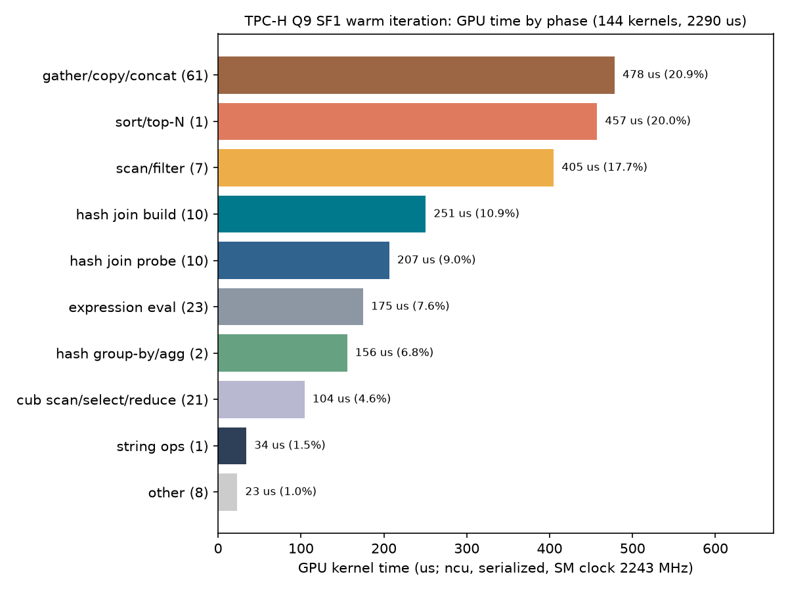
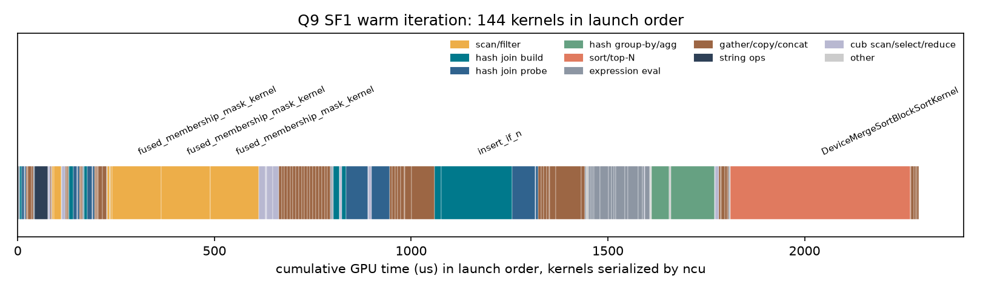
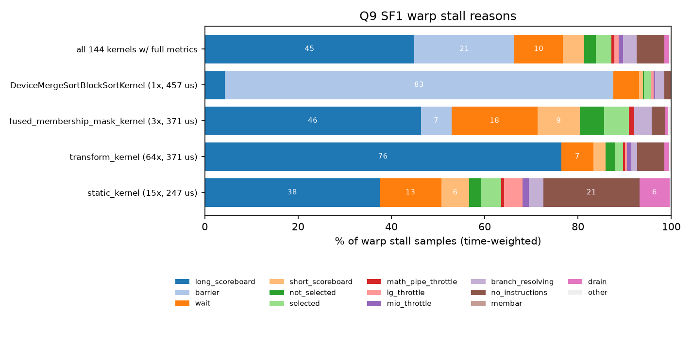
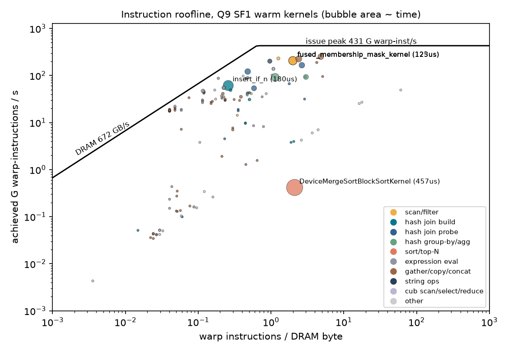

# TPC-H Q9 (SF1) on Sirius, all referenced columns pinned on GPU — Workload Analysis

**Date**: 2026-11-13
**GPU**: NVIDIA GeForce RTX 5070, 12 GB GDDR7 (192-bit, 672 GB/s), Blackwell sm_120, 48 SMs
**Workload**: TPC-H Query 9 (product-type profit: 6-way join of part, supplier, lineitem, partsupp, orders, nation; `p_name LIKE '%yellow%'` as generated in `sql/q9_timing.sql`; `sum(amount)` grouped by nation and year; ORDER BY nation, o_year DESC), scale factor 1. All 17 referenced columns of the 6 tables are pinned in GPU memory with `pin_table(tier='gpu')` (157.21 MB); measured iterations read no file and copy no table data host→device (§3).
**Framework**: Sirius (`sirius-duckdb` release build), DuckDB v2.0, stock libcudf from the pixi env, CUDA runtime 13.5
**Pipeline**: `scripts/tpch_sf1/profile_query.sh 9` (4.9 min end-to-end: 15 s for sql/timing/pcie/selftest + 277 s for list/detail/extract/validate; `pipeline_run.log`); every number below comes from a file in this directory.
**Labels**: *measured* = read from a profiler/log file; *inferred* = derived by arithmetic or reasoning from measured data.

---

## 1. Executive Summary

A warm Q9 takes **9.0 ms end-to-end** (median of 12 timed runs after 3 warmups, range 8–10 ms, `.timer` 1 ms resolution; *measured*, `timing_summary.txt`). DuckDB on the CPU takes 52.5 ms (min 46, max 59), so the GPU is 5.8x faster. The result (175 rows, 4,764 B) equals DuckDB-CPU exactly: compare mode `exact`, max relative difference 0.0 at tolerance 1e-9, identical across all 15 GPU iterations (`timing.json`). The physical floor is **233.9 µs** (read the 157.21 MB of pinned columns once at 672 GB/s, `physical_floor.md`), so Sirius is **~38x above the floor** end to end. The GPU is idle most of that time:

| Where the 9.0 ms go (median warm iteration, 1 ms stamps) | ms | Source |
|---|---:|---|
| Planning (DuckDB optimizer + Sirius plan build, 36 pipelines) | 3 | Sirius log (`timing.json`), *measured* |
| Gap from `QueryEnd` to the next statement (result fetch, printing) | 1 | Sirius log, *measured* |
| Engine window with the GPU **idle** (host orchestration) | ~3.4 | engine 5 ms (log) − GPU busy 1.637 ms (nsys), *inferred* |
| GPU busy (kernels + copies, real clocks) | **1.64** | `nsys_iteration_breakdown.txt`, *measured* |

Inside the 1.598 ms of kernel time (nsys, 144 kernels per iteration, deterministic):

1. **The final ORDER BY: one `DeviceMergeSortBlockSortKernel` launch, 1 CTA x 256 threads, 360.6 µs (22.6%) at real clocks, 457.2 µs (20.0%) under ncu.** It sorts the 175-row result (*inferred* from the plan) on one SM of 48 (SM active 2%), 11.9 of 32 lanes active per instruction, 83.2% of stall samples at `BAR.SYNC` waiting for the slowest warp, whose lanes run serial byte-wise string comparisons (§8). This single kernel is 1.2x the 3 membership-probe launches together (360.6 vs 299.9 µs nsys).
2. **Dynamic-filter membership probes: `fused_membership_mask_kernel` 299.9 µs (18.8%), 3 launches**, each 17 waves, ~105 GB/s (15.8% of peak), dependent-load hash chain (§7, §9).
3. **`transform_kernel` 254.5 µs (15.9%), 64 launches (avg 4.0 µs nsys)**; `static_kernel` 174.6 µs (10.9%, 15 launches, includes the group-by aggregation 111.2 µs ncu); `insert_if_n` 113.9 µs (7.1%, 7 launches; one 180.5 µs ncu launch builds a 1.5 M-row hash table at 244 GB/s).
4. The remaining launches are small: 63 of 144 kernels run < 5 µs (ncu), 112 < 10 µs, 118 are below one wave, 27 are single-CTA.

The kernels move **301.79 MB of DRAM traffic** (ncu, cold L2) against a floor of 157.21 MB (1.92x, intermediates are 5.5% of lineitem = 330,610 rows) and take 6.8x the floor time (nsys kernel sum). Q9 at SF1 is **host-orchestration-bound** (GPU busy = 18% of wall), then latency/instruction-bound inside the GPU, not bandwidth-bound.

---

## 2. Workload Description

**Query** (`sql/q9_timing.sql`): profit by nation and year, `amount = l_extendedprice*(1-l_discount) - ps_supplycost*l_quantity`, for lineitem rows whose part name contains `yellow`; `GROUP BY nation, o_year ORDER BY nation, o_year DESC`. Result: 175 rows = 25 nations x 7 years (`result.csv`). Note: the task text said `%green%`; the pipeline-generated SQL uses `%yellow%`, so every selectivity here is for `yellow`.

**Row counts and selectivities** (DuckDB-CPU on the same Parquet; *measured*, `physical_floor.md`):

| Step | Rows |
|---|---:|
| lineitem / orders / part / partsupp / supplier / nation | 6,001,215 / 1,500,000 / 200,000 / 800,000 / 10,000 / 25 |
| parts with `p_name LIKE '%yellow%'` | 10,992 (5.50%) |
| partsupp rows of those parts | 43,968 (5.50%) |
| lineitem rows with such a part (= after partsupp join) | 330,610 (5.51%) |
| distinct orders touched | 296,782 (19.8%) |
| result | 175 rows (4,764 B as CSV) |

**Sirius plan** (`query_plan.txt`; *measured*): 36 pipelines: 6 `GPU_SCAN`, 5 `HASH_JOIN`, 2 `DYNAMIC_FILTER`s (each directly after a `GPU_SCAN`, ids 17 and 28), `PARTITION`/`CONCAT` repartitioning steps, then `MERGE_GROUP_BY`, `SORT_SAMPLE`/`SORT_PARTITION`, `MERGE_SORT`, `RESULT_COLLECTOR`.

**Pinned footprint** (`traces/sirius_log_timing/*.log`, `gpu_pool … allocated=` after each `pin_table`; *measured*): lineitem 132,028,416 B, part 8,150,528 B, orders 9,000,192 B, partsupp 8,000,000 B, supplier 30,464 B, nation 768 B; **total 157,210,368 B**. Sirius narrows carriers (lineitem 22.0 B/row pinned; 36 B/row at native widths, *inferred* from Parquet types, 216.0 MB). GPU pool high-water mark: 456.9 MB (456,865,744 B, `pcie_verification.txt`; process-lifetime mark that includes the pin phase; no spill, configured pool 3 GB). The one-off pin is excluded from all numbers.

---

## 3. PCIe Verification (no table data crosses PCIe in measured iterations)

Sources: `pcie_verification.txt`, `pcie.json`, `ncu_sysmem_check.txt`, `ncu_log_checks_list.txt`, `ncu_log_checks_detail.txt`, `selftest_negative_control.txt`. Every check exits non-zero on failure. **OVERALL: PASS.** All numbers *measured*.

| Evidence | Result |
|---|---|
| Pin tier | `sql:pin_tier_gpu`: every pinned SQL script pins each referenced table once with `tier='gpu'`; timing and nsys Sirius logs each show 6 `CALL pin_table`, all `tier='gpu'`, tables lineitem, nation, orders, part, partsupp, supplier |
| Scans served from the pin | `pinned_entry_per_gpu_scan`: in every iteration `#assigned pinned entry` == `#GPU_SCAN` operators (6); 0 cache-assignment errors |
| File cache | 16 `cache summary` lines for 15 iterations (summary k describes iteration k-1): `last_cycle[reads=0 hits=0 h2d=0 miss=0 …]` for iterations 1–15; nsys run 9 summaries for 8 iterations, same |
| Downgrade / spill / OOM lines during queries | 0 |
| Pool counters | `gpu_pool allocated` equals the pinned footprint (157,210,368 B) at `QueryBegin` and `QueryEnd` of every iteration; `host_pool` allocated and peak unchanged from iteration 2 |
| Dynamic-filter publication through host staging | 0 (all filters published through peer copies, device-side) |
| Parquet decode / decompression kernels (nsys, 1,152 kernels in 8 iterations) | 0 |
| Unified memory | UM CPU+GPU page-fault collection on; 0 faults in the 5 measured iterations; no managed-memory API call in the trace |
| Kernels reading host memory in place (ncu SM/tex sysmem aperture) | `ncu_sysmem_check.txt`: 144 kernels, 0 with SM (tex) sysmem-aperture sectors (total 0), PASS; all-source sysmem sectors 265–285 per kernel (info only) |
| The ncu runs themselves | all three list runs and the `--set full` run pass the same log checks (`OVERALL ncu list logs: PASS`, `OVERALL ncu detail logs: PASS`) |

nsys CUDA trace (`traces/q9_nsys.sqlite`, Nsight Systems 2025.5.2), copies by memory kind, per measured iteration (identical in all 5):

| Direction | Copies | Bytes | Largest single copy | Interpretation |
|---|---:|---:|---:|---|
| H2D (pinned/pageable → device) | 42 | 1,995 | 192 B (limit 5,000 B) | scalars, parameter arrays (*inferred* from sizes) |
| D2H (device → pinned/pageable) | 37 | 6,391 | 6,143 B | size/count readbacks and the 4,764 B result (*inferred*) |
| D2D | 28 | 16,964,979 | 6,000,000 B | on-device (partition/concat/gather) |

The single-copy H2D limit is data-relative (5,000 B = half the rows of `supplier`, the smallest table with ≥ 8,192 rows). `nation` (25 rows) is below the limit's resolution; for it the evidence is the log checks plus the sysmem-aperture check (`pcie_verification.txt`). The pin phase copied 63.24 MB H2D (516 copies, largest 1,048,576 B) and is outside the measured iterations.

**Negative control** (`selftest_negative_control.txt`): the same run with `lineitem` left unpinned makes `pcie_verify.py` exit 1 (expected) with 10 FAIL lines: pinned tables ≠ referenced tables (sql, timing log, nsys log), "5 assigned for 6 GPU_SCANs, missing tables ['lineitem']", non-zero file-cache reads (`reads=12 … h2d=58 miss=6`), Parquet `count_page_headers_kernel`/`decode_page_headers_kernel` launches, H2D 54,691,704 B per iteration (largest copy 4,637,942 B, limit 5,000 B) and D2H 1,284,658 B (largest 94,720 B). `SELFTEST: PASS`.

Not covered: UM fault tables are written by nsys only when a fault happens (none present); the aggregate SM aperture counter reads 0 everywhere, so its sensitivity could not be tested here.

---

## 4. Environment

| Component | Version / setting |
|---|---|
| GPU / driver | RTX 5070 (sm_120, 48 SMs, 12 GB, 48 MB L2) / 580.173.02 (copied from the Q8 report; not re-queried) |
| Nsight Compute | 2025.2.1 via `sudo -n`; `--set full --import-source yes` on all 144 warm kernels (policy `full_all`, 144 ≤ 1000) |
| ncu clocks | locked by ncu: SM ≈ 2.24 GHz (median, `ncu_extract_summary.txt`: 2243 MHz) |
| Nsight Systems | 2025.5.2 (`/home/sai/nsight-systems-2025.5`); `-t cuda -s none --cpuctxsw=none` plus UM page-fault collection |
| CPU | Intel i9-13900K, 125 GB RAM (copied from the Q8 report; not re-queried) |
| Sirius config | `scripts/tpch_sf1/sirius.yaml`: 4 pipeline threads, GPU pool 25% of 12 GB, 1 GB pinned host pool (2 pools), `enable_duckdb_fallback=false` (unchanged) |

---

## 5. Physical Floor vs Measured

Details: `physical_floor.md` (written before reading any profile).

| Scenario | Bytes | Floor @ 672 GB/s |
|---|---:|---:|
| A. Read every pinned column once (narrowed) | 157.21 MB | **233.9 µs** |
| A'. Native widths (*inferred* widths) | 249.1 MB | 370.6 µs |
| A-min. Only predicate/join-forced columns | ≈ 56.8 MB | 84.5 µs |
| B. A + three 330,610-row intermediates written and read once | ≈ 228.6 MB | 340.2 µs |

Compute floor: ~0.25 G simple ops → < 20 µs (*inferred*). Launch-count bound: 144 kernels x ~2 µs ≈ 0.29 ms (*inferred*; the 2 µs is carried over from Q2 via `physical_floor.md`, not measured here).

| Measured | Value | x floor (233.9 µs) |
|---|---:|---:|
| End-to-end warm median (`.timer`) | 9.0 ms | 38x |
| Engine window (Sirius log, unprofiled run) | 5 ms | 21x |
| GPU busy per iteration (nsys, real clocks, `nsys_iteration_breakdown.txt`) | 1.637 ms (1.621–1.644) | 7.0x |
| Sum of kernel durations (nsys) | 1.598 ms | 6.8x |
| Sum of kernel durations (ncu, serialized, 2.24 GHz, L2 flushed before each kernel) | 2.290 ms | 9.8x |
| First→last GPU op (nsys, includes idle gaps) | 9.07 ms (median) | 39x |
| DRAM bytes moved by all 144 kernels (ncu, cold L2) | 301.79 MB | 1.92x of A's bytes, 1.32x of B |

Average kernel DRAM rate under ncu is 131.8 GB/s (19.6% of peak, `phase_breakdown.txt`). The kernels move more bytes than the floor (partition/gather/concat copies and hash tables) and still take 6.8x the floor time: excess is time per byte plus a host-side period 2x larger than all GPU work.

---

## 6. Kernel, Phase and Operator Breakdown

Sources: `warm_kernel_summary.txt`, `phase_breakdown.txt`, `operator_breakdown.txt`, `nsys_iteration_breakdown.txt`. ncu times are serialized, clock-locked and taken with the L2 cache flushed before each kernel (DRAM bytes and hit rates are cold-cache values); nsys times are at real clocks with concurrency.

| Phase (`kclass.py`) | Kernels | ncu µs | % | DRAM MB |
|---|---:|---:|---:|---:|
| gather / copy / concat | 61 | 478.4 | 20.9 | 104.52 |
| sort / top-N | 1 | 457.2 | 20.0 | 0.09 |
| scan / filter (dynamic-filter probe + key-set build) | 7 | 405.0 | 17.7 | 43.67 |
| hash join build | 10 | 250.5 | 10.9 | 49.38 |
| hash join probe | 10 | 206.6 | 9.0 | 25.51 |
| expression eval | 23 | 174.9 | 7.6 | 47.78 |
| hash group-by / agg | 2 | 155.6 | 6.8 | 10.52 |
| cub scan / select / reduce | 21 | 104.2 | 4.6 | 11.59 |
| string ops | 1 | 34.0 | 1.5 | 7.37 |
| other | 8 | 23.2 | 1.0 | 1.36 |
| **Total** | **144** | **2,289.7** | 100 | 301.79 |

| Kernel family | Launches | ncu µs (%) | nsys µs/iter (%) |
|---|---:|---:|---:|
| `DeviceMergeSortBlockSortKernel` (final ORDER BY) | 1 | 457.2 (20.0) | 360.6 (22.6) |
| `fused_membership_mask_kernel` (dynamic-filter probe) | 3 | 371.2 (16.2) | 299.9 (18.8) |
| `transform_kernel` (gathers, casts) | 64 | 371.1 (16.2) | 254.5 (15.9) |
| `static_kernel` (cub for_each: gathers, group-by) | 15 | 246.9 (10.8) | 174.6 (10.9) |
| `insert_if_n` (hash build / filter key set) | 7 | 219.5 (9.6) | 113.9 (7.1) |
| `gather_chars_fn_char_parallel` (string gather) | 6 | 150.1 (6.6) | 98.5 (6.2) |
| `DeviceSelectSweepKernel` | 10 | 88.9 (3.9) | 63.9 (4.0) |
| `find_if_n` (hash probe) | 4 | 86.0 (3.8) | 46.0 (2.9) |

Operator view (`operator_breakdown.txt`): sort 20.0% (1 kernel), dynamic-filter membership probe 17.0% (4), fixed-width gathers 10.9% (43), hash-join build 10.0% (6), string gathers 10.0% (18), hash-join probe 8.2% (6), group-by 6.8% (2). `other:` rows total 11.5 µs (0.5%), so no `kclass.py` rule was added (file not edited).

Small-kernel profile (*measured*, `phase_breakdown.txt`, `ncu_warm_metrics.json`): median kernel 6.27 µs (ncu); 63 kernels < 5 µs, 112 < 10 µs (22.7% of ncu time, 518.8 µs); 118 of 144 below one wave; 45 with grid < 48 CTAs; **27 kernels with grid = 1 hold 528.6 µs (23.1%), 457.2 µs of it the sort**. **26 kernels fill the GPU (≥ 1 wave) and hold 1,160.7 µs (50.7%)**. ncu/nsys is 1.43 overall.





---

## 7. Top Kernels (ncu `--set full`)

Sources: `top_kernel_details.txt`, `ncu_warm_metrics.json`, `plots/q9_roofline.png`, `plots/q9_stalls.png`.

| Kernel (launch pos) | µs | Grid x Blk | Regs | Occ. ach/theo | IPC | DRAM GB/s (%) | L1 / L2 hit | Top stalls (%) |
|---|---:|---|---:|---|---:|---|---|---|
| `DeviceMergeSortBlockSort` (138) | 457.2 | 1x256 | 64 | 16.7 / 66.7 | 0.18 | 0.2 (0.0) | 67.7 / 89.5 | barrier 83.2, wait 5.6, long_sb 4.3 |
| `insert_if_n` (95) | 180.5 | 11719x128 | 22 | 86.7 / 100 | 0.60 | 244.3 (36.9) | 14.9 / 75.7 | long_sb 85.2, wait 5.2, branch 4.1 |
| `fused_membership_mask` (48, 49, 51) | 124.9 / 123.3 / 123.0 | 4096x256 | 48 | 80.0 / 83.3 | 2.03 | 104.5–106.0 (15.8–16.0) | 14.7 / 90.4 | long_sb 46.5, wait 18.5, short_sb 8.6, barrier 6.8 |
| `static_kernel` group-by (128) | 111.2 | 646x256 | 128 | 32.0 / 33.3 | 0.93 | 82.0 (12.4) | 77.2 / 77.8 | long_sb 45.1, wait 18.3, no_inst 8.6, lg_throttle 7.5 |
| `gather_chars_fn_char_parallel` (105, 93) | 65.4 / 58.6 | 10332x128 | 36 | 87.8 / 100 | 2.21 / 2.56 | 96.4 / 53.6 (14.6 / 8.1) | 64.5 / 30.8 (pos 93: 37.0 / 86.0) | long_sb 56.6 / 43.6, wait 12 |
| `find_if_n` (96) | 57.6 | 2583x128 | n/a | 91.4 | n/a | 258.9 (39.1) | n/a | long_sb, barrier (819 samples) |
| `hash_csr_probe_count` (82) | 55.8 | 1292x256 | n/a | 79.1 | n/a | 63.5 (9.6) | n/a | n/a |
| `hash_csr_retrieve` (85) | 46.1 | 96x256 | n/a | 32.1 | n/a | 94.5 (14.3) | n/a | n/a |
| `mapping_indices_kernel` (126) | 44.4 | 240x128 | n/a | 33.9 | n/a | 31.5 (4.8) | n/a | n/a |
| `transform_kernel` string (12) | 34.0 | 261x256 | n/a | 78.3 | n/a | 216.6 (32.7) | n/a | n/a |

- Sort (pos 138): `SM busy max/avg = 48.00`, active fraction 0.02 (one SM of 48 busy), 1.92e5 warp instructions, 11.9 of 32 lanes active per instruction, DRAM 0.09 MB. 457.2 µs x 2.243 GHz ≈ 1.03e6 cycles for 1.92e5 warp instructions = 0.19 warp-inst/cycle (*inferred* arithmetic; matches IPC 0.18).
- Probe (pos 48) at 124.9 µs vs its DRAM floor 13.04 MB / 672 GB/s = 19.4 µs: **6.4x its bandwidth floor** (cold L2); issue rate 2.59e7 warp-inst / 124.9 µs = 207 G warp-inst/s against a 431 G/s ceiling (48 SMs x 4 x 2.243 GHz, *inferred*), 48%. Each launch has 62,516 per-row warp executions ≈ 2.0 M rows (*inferred*; 3 launches x 2.0 M ≈ lineitem 6.0 M).
- `insert_if_n` pos 95: grid 11,719 x 128 = 1.5 M threads (*inferred*: the 1.5 M-row orders build side); DRAM 44.1 MB = 29 B per row vs 4 B/row key payload, consistent with 32 B-sector random access into the table (*inferred*); 1.81e5 global-atomic requests; 180.5 µs vs 65.6 µs DRAM floor at 44.1 MB (2.75x).
- Highest DRAM rates among all 144 kernels: `DeviceReduceKernel` 468.0 GB/s (69.6%, 11.4 µs), `static_kernel` pos 119 409.8 GB/s (62.0%, 26.1 µs); no kernel above 10% of GPU time reaches 40% of peak. The GPU-filling families are limited by instruction count and dependent-load latency, not DRAM; the 27 single-CTA kernels sit orders of magnitude below both ceilings.
- Time-weighted stall mix over all 144 kernels: long scoreboard 44.9%, barrier 21.5%, wait 10.4%, no_instructions 5.9%, short scoreboard 4.5% (`ncu_extract_summary.txt`). About 78% of the time-weighted barrier share comes from the sort kernel; find_if_n pos 96, mapping_indices pos 126, gather_chars and the probes supply the rest.





---

## 8. Instruction-Level Evidence — `DeviceMergeSortBlockSortKernel` (#1 family, 20.0% ncu / 22.6% nsys; 1 launch, pos 138, 457.2 µs)

Source: `sass/DeviceMergeSortBlockSortKernel_hotspots.txt`, `…_inst_inventory.csv`, `…_pos138_source.csv` (1,035 stall samples).

| Property | Value | Label |
|---|---|---|
| Kernel | cub block merge sort of row indices (`int*` keys, `lexicographic::less_comparator<device_row_comparator<…>>`); role = final ORDER BY nation (string), o_year (int) on the group-by output | measured (name); role *inferred* from the plan and kernel order (pos 138 of 144, after group-by pos 128) |
| Launch | grid 1 x 256 threads, 64 regs, 17,424 B smem; 8 warps on 1 SM | measured |
| Static vs executed | 13,648 SASS instructions, 2,301 (16.9%) ever execute | measured |
| Executed | 1.92e5 warp instructions, 11.9 of 32 lanes active per instruction on average | measured |
| Mix (% of executed / of stalls) | integer 35.2 / 9.1, move 30.5 / 2.1, control 13.8 / 1.8, **local spill 7.0 / 2.0 (1,042 static LDL/STL)**, const load 1.8 / **83.8** | measured |
| Items per thread | `IMAD R55, R55, 0x11` (x17) in the prologue = 17 items per thread, tile 4,352 | inferred from the constant |

Where the stall samples fall:

| Instruction | Executions (warps) | Samples | Reason |
|---|---:|---:|---|
| `LDC.64 R30, c[0x0][0x3f0]` @ +0x08bf0, right after `BAR.SYNC.DEFER_BLOCKING 0x0` @ +0x08bc0 | 8 | **495 (47.8%)** | barrier 495 |
| `LDC.64 R36, c[0x0][0x3f8]` @ +0x0c020, after `BAR.SYNC` @ +0x0c010 | 8 | 102 (9.9%) | barrier |
| `LDC.64 R34, c[0x0][0x400]` @ +0x0b310, +0x0a600, +0x098f0 (each after a `BAR.SYNC`) | 8 each | 95 + 85 + 83 (25.4%) | barrier |
| `ISETP.NE.U32.AND P1, PT, R6, R7, PT` @ +0x2d360 (2 active lanes) | 1,622 | 12 (1.2%) | long scoreboard |
| `ISETP.NE.U32.AND P3, PT, R12, R13, PT` @ +0x2d130 (3 active lanes) | 1,678 | 9 (0.9%) | long scoreboard |

Barrier hotspot (context): `LEA … ; IMAD R24, R40, 0x44, R16 ; BAR.SYNC.DEFER_BLOCKING 0x0 ; LOP3.LUT R55, R40, 0x3fe … ; IMAD R55, R55, 0x11 ; LDC.64 R30, c[0x0][0x3f0]`. Only 8 warp executions of each barrier exist (one per warp), yet they carry 83.2% of all samples: the first-arriving warps wait for the last one. The last one is busy in the comparator, a byte-wise string compare loop:

```
+0x2d340  LD.E.U8 R6, desc[UR8][R10.64]        // byte i of string A (generic pointer, 1 B per load)   exe=1622, 2 lanes
+0x2d350  LD.E.U8 R7, desc[UR10][R28.64]       // byte i of string B
+0x2d360  ISETP.NE.U32.AND P1, PT, R6, R7, PT  // compare, stalls on both loads                         samp=12 <- long_sb
+0x2d370  @P1 BRA 0x7f1326ff2040               // leave on first mismatch
+0x2d380  IADD R5, R5, 0x1                     // i++ and loop (dependent chain: load -> compare -> branch -> next load)
```

Mechanism (*inferred* from the `exe` and `thr` columns, not from a lane-level trace): with ~175 rows and 17 items per thread only about 11 of 256 threads hold data (175/17 ≈ 10.3, *inferred*). Each does a serial merge whose comparator walks nation names byte by byte (2–3 active lanes at the loop PCs), spilling to local memory (13.4k executed local ops). Every merge round ends in a `BAR.SYNC`, so each round costs the slowest thread's serial compare chain, while 245 threads and 47 SMs idle.

---

## 9. Root Cause Analysis

**Sink 1 — final ORDER BY, 360.6 µs nsys (22.6% of kernel time), 457.2 µs ncu**
- Symptom: one 1-CTA kernel is the single largest kernel of the query; 0.02 SM-active fraction, DRAM 0.09 MB (*measured*, `top_kernel_details.txt`).
- WHY 1: 83.2% of its stall samples are barrier stalls at 5 `BAR.SYNC` sites executed once per warp (*measured*, SASS).
- WHY 2: the warps reaching the barrier early wait for the slowest warp, whose 2–3 active lanes run `LD.E.U8 → ISETP.NE → BRA` string-compare loops (1,622 and 1,678 warp executions at 2.0 and 3.0 lanes, *measured*; that the barrier waits on this loop is *inferred*); 11.9 of 32 lanes active per instruction (*measured*).
- WHY 3: cub's block sort gives each thread a contiguous run of 17 items (x17 constant, *inferred*) and merges runs serially; for 175 rows (*measured* result size) only ~11 threads have work (*inferred*), so the critical path is serial compares plus 13,391 executed spill instructions (7.0% of executed; 1,042 static), not data volume.
- ROOT: the sort is a generic row-comparator block sort that is single-CTA by construction for small inputs; its time is a serial dependent-load chain on one SM (1.03e6 cycles for 1.92e5 warp instructions, 0.19 inst/cycle, *inferred* arithmetic), independent of the 4,764 B of data. Whether Sirius forces this path or cuDF chooses it for small inputs was not examined.

**Sink 2 — dynamic-filter membership probes, 299.9 µs nsys (18.8%), 371.2 µs ncu, 3 launches**
- Symptom: each launch fills the GPU (17.07 waves, occupancy 80%) but reaches only 104.5–106.0 GB/s (15.8–16.0% of peak) and 48% of the issue ceiling (*measured* rates; ceiling *inferred*).
- WHY 1: 46.5% of stall samples are long-scoreboard; the top 6 PCs are the hash→compare chain: `LDG.E.S16 R30` (+0x00790) → `IMAD R0, R30, -0x3d4d51c3, R3` (+0x007d0, 1,169 samples, 9.4%) and `LDG.E R3` (+0x00d60) → `ISETP.NE.U32.AND P1, PT, R3, R30, PT` (+0x00d80, 1,088 samples, 8.7%) (*measured*).
- WHY 2: each row runs two probe rounds, each a dependent key→slot load pair (`LDG.E.S16 R30` +0x00790 → `LDG.E R3` +0x00d60; `LDG.E R30` +0x12620 → compare +0x12c30; both at 31 lanes, 62,516 executions); on average 28.6 of 32 lanes are active per instruction and the probe-continuation PCs after each compare run with 1–6 active lanes (+0x12d10 6, +0x12da0 1, +0x00e80 3) (lane counts *measured*; continuation-loop reading *inferred*).
- WHY 3: the per-row work is latency-bound at 2.59e7 warp instructions for ~2.0 M rows (~414 warp-inst per row-warp, ≈ 13 per row, *inferred*), and the CTA-wide barrier (6.8% of samples, `@P1 BRA` @ +0x3ef80 4.4%) pays for the slowest collision lane.
- ROOT: the filter is an open-addressing set probed with a dependent load pair per row; random accesses over a hashed set limit the kernel to 6.4x its DRAM floor (124.9 vs 19.4 µs) and 48% of issue rate; the 90% L2 hit rate shows the set is cache-resident, so the cost is load-to-use latency and lane divergence (*inferred*).

**Sink 3 — host orchestration + small kernels (GPU idle ~3.4 ms of the 5 ms engine window; 3 ms planning)**
- Symptom: GPU busy 1.637 ms of 9.0 ms wall (18%); first→last GPU op 9.07 ms in the nsys run (*measured*).
- WHY 1: per iteration the CPU issues 144 `cudaLaunchKernel`, 206 `cudaMallocFromPoolAsync`, 206 `cudaFreeAsync`, 187 `cudaStreamSynchronize` + 91 `cuStreamSynchronize` (CPU time summed over threads 0.605, 0.580, 0.165, 1.659, 0.517 ms) (*measured*, `nsys_iteration_breakdown.txt`).
- WHY 2: 36 pipelines each go partition → concat → operator with synchronizations between steps; 63 kernels run < 5 µs and 27 are single-CTA, so each is dominated by launch and dependency latency, not work (*measured* counts).
- WHY 3: planning (DuckDB optimizer + Sirius pipeline build) costs 3 ms before the first kernel, more than 1.8x the entire GPU busy time (*measured*, 1 ms stamps).
- ROOT: at SF1 the data work (~0.23 ms floor) is smaller than the fixed per-query orchestration cost (planning 3 ms + synchronization-gated pipeline execution ~3.4 ms idle, the latter *inferred* by subtraction); the engine window in the nsys run is 10 ms vs 5 ms unprofiled, so nsys-run CPU timings are inflated (§13).

Also notable (*measured*): `insert_if_n` pos 95 (hash build, 180.5 µs ncu, 85.2% long scoreboard, 244.3 GB/s) and `static_kernel` pos 128 (group-by, 111.2 µs, 128 regs, long_sb 45.1%) are the next two largest single launches but each are below 8% of ncu time.

---

## 10. Gap Analysis

| Layer | Time | Cumulative factor vs floor 233.9 µs |
|---|---:|---:|
| Physical floor A (157.21 MB at 672 GB/s) | 0.234 ms | 1.0x |
| Floor B incl. intermediates | 0.340 ms | 1.5x |
| Launch-count bound (144 x ~2 µs, imported 2 µs) | 0.29 ms | 1.2x |
| Kernel sum, real clocks (nsys) | 1.598 ms | 6.8x |
| GPU busy (kernels + 260−144 = 116 copies/memsets, nsys) | 1.637 ms | 7.0x |
| Engine window (unprofiled Sirius log) | 5 ms | 21x |
| + planning 3 ms + result gap 1 ms = wall | 9.0 ms | 38x |

- Kernel time over floor B: 1.598 / 0.340 = 4.7x (*inferred*). Of the 1.598 ms, the sort is 0.361 ms (22.6%); without it the kernel sum would be 1.238 ms (5.3x floor A, *inferred*, hypothetical).
- 6.8x kernel-over-floor is not bandwidth: average DRAM rate 131.8 GB/s (ncu), 63 of 144 kernels < 5 µs, 27 single-CTA; the large kernels are latency/issue-bound (§9).
- Host side: 7.4 ms of the 9.0 ms wall is outside GPU-busy time (*inferred*: 9.0 − 1.637 = 7.4 ms; planning 3 + gap 1 + engine-idle 3.4).
- Versus CPU: 52.5 ms DuckDB vs 9.0 ms Sirius = 5.8x; at 1.64 ms GPU busy the device itself would be 32x faster (*inferred*, not realizable without host changes).

---

## 11. Optimization Directions

All directions are general-purpose library or engine changes; none is query-specific fusion (kernel fusion is mentioned only as context: the project keeps cuDF kernels general-purpose).

1. **Small-input sort path (largest single win, 22.6% of kernel time).** For sorts of a few hundred rows, avoid the 1-CTA, 17-items-per-thread block sort with a byte-wise string comparator: (a) encode string keys to order-preserving integer ranks once (generic dictionary encoding of the key column; the 25 nation names are tiny), then sort integers; (b) a small-n sort that parallelizes the merge across warps (rank-based/bitonic) instead of per-thread serial runs; (c) reduce the 1,042 spill instructions (64-register cap with a templated comparator). Estimated effect: the 360.6 µs would fall toward the < 20 µs of a small integer sort (*inferred* from the typical size of small kernels in this trace, not measured on a replacement).
2. **Cheaper membership structure for dense integer keys.** The probe's 2.6e7 warp instructions and dependent load pair come from a hashed open-addressing set. A general "direct-address bitmap when the key range is small" mode would replace hash + two dependent loads with one load; part keys are dense (1..200,000, *inferred* from the 200,000 rows). Same direction could apply in the 1.5 M-row hash build (44.1 MB traffic).
3. **Reduce host orchestration.** 206 pool allocs/frees, 187+91 stream syncs and 3 ms planning per iteration dominate wall time. Options: cache optimized plans for repeated queries (planning), batch allocations from a per-query arena, replace per-step `cudaStreamSynchronize` with event dependencies, CUDA graphs for the repeated pipeline sequence (generic engine change).
4. **Context only (not recommended here)**: fusing the 64 `transform_kernel` gathers/casts would cut launch count but is query-specific; the general alternative is batching same-shaped gathers into one library launch (multi-column gather), which keeps kernels general.

---

## 12. Determinism and Profiling Method

- Kernel counts: 144 per iteration in all 8 nsys iterations (`pcie_verification.txt`, `nsys:kernels_per_iteration_stable`); ncu list passes 1,112 / 1,256 / 1,400 launches (pin + 3/4/5 iterations), +144 per added iteration, multisets reproduce (`warm_kernel_summary.txt`, STABLE: True). Launch *order* differs by 12 positions between iterations 4 and 5 of the x5 run (4-thread interleaving), so only counts and multisets are relied on.
- ncu slice: warm (5th) iteration, `-s 1256 -c 144`; `ncu_slice_check.txt`: 144 vs 144 expected, multiset match True (exact names: missing 1, unexpected 1; reconciled on function/grid/block: 1).
- **ncu policy branch: `full_all`** (144 warm launches ≤ `NCU_FULL_MAX` 1000): `--set full --import-source yes` on all 144 kernels, 220 s; the light + families branch was not taken.
- ncu conditions: kernels serialized, SM clocks locked to base (median 2,243 MHz vs ~3.09 GHz boost, per the RUNBOOK), L2 flushed before each kernel (`--cache-control all`): durations are longer than real (ncu/nsys 1.43) and DRAM bytes/hit rates are cold-L2 values. Real-clock times in this report come from nsys; wall time from `.timer` and the Sirius log.
- Timing: 3 warmup + 12 timed iterations; first iteration 60.0 ms (pin-free first run, includes one-time costs); warm timed: 9 10 10 9 9 9 9 9 9 9 8 8 ms (`timing_summary.txt`). Validation: `validate_pipeline.txt` 72 PASS, 0 FAIL, 1 PENDING (this report file).

---

## 13. Limitations

- `.timer` resolution is 1 ms; planning/engine/gap values are 1 ms stamps (medians 3/5/1). The engine-idle ~3.4 ms subtracts an nsys-run GPU busy from an unprofiled-run engine window (different runs; nsys roughly doubles the engine window: 10 ms in `nsys_iteration_breakdown.txt` vs 5 ms in the log).
- ncu durations of tiny kernels are inflated by clock locking and L2 flush; nsys is used for real-clock shares. The one sort kernel is 457.2 µs (ncu) vs 360.6 µs (nsys).
- SASS stall sampling counts are modest for the sort kernel (1,035 samples); the "slowest warp / serial string compare" mechanism and the "~11 active threads of 256" estimate are *inferred* from per-PC execution counts and the x17 constant, not from a lane-level trace. The sort's input size (175 rows) is inferred from the group-by result, not measured at the kernel.
- SASS was exported for the top 2 families only (sort, membership probe); the `insert_if_n`, `transform_kernel` and group-by `static_kernel` mechanisms are inferred from ncu counters (stall mix, atomics, DRAM bytes), not from instruction-level data.
- The query uses `%yellow%`, not `%green%` (§2). Native-width byte counts (249.1 MB) assume 8-byte decimals and are inferred. `nation` (25 rows) is below the byte-limit resolution; evidence for it is the log and sysmem checks. The launch-count bound uses a ~2 µs kernel time imported from Q2, not re-measured.
- No hit rates were clamped (`ncu_extract_summary.txt`: none above 100%). The aggregate sysmem counter reads 265–285 sectors for every kernel (non-SM per-launch traffic, info only); its sensitivity was not tested.

---

## 14. Raw Data

All in this directory (`/home/sai/cs254_project/tpch_q1_analysis/analysis/results/q9/`):
`timing.json`, `timing_summary.txt`, `result.csv`, `query_plan.txt`, `pcie_verification.txt`, `pcie.json`, `selftest_negative_control.txt`, `nsys_iteration_breakdown.{txt,json}`, `warm_kernel_list.json`, `warm_kernel_summary.txt`, `ncu_plan.json`, `ncu_log_checks_{list,detail}.{txt,json}`, `ncu_slice_check.{txt,json}`, `ncu_sysmem_check.{txt,json}`, `ncu_warm_metrics.json`, `ncu_extract_summary.txt`, `phase_breakdown.{txt,json}`, `operator_breakdown.txt`, `top_kernel_details.txt`, `physical_floor.md`, `validate_pipeline.txt`, `pipeline_run.log`, `sql/q9_*.sql`, `profiles/q9_warm_full.ncu-rep`, `sass/{DeviceMergeSortBlockSortKernel,fused_membership_mask_kernel}_{hotspots.txt,inst_inventory.csv,pos*_source.csv}`, `plots/q9_{phase_breakdown,kernel_sequence,stalls,roofline}.png`, `traces/` (nsys `.nsys-rep`/`.sqlite`, ncu CSVs, Sirius logs per run).
